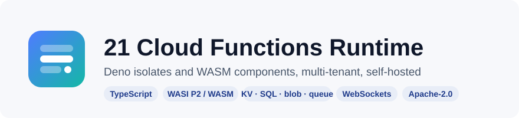
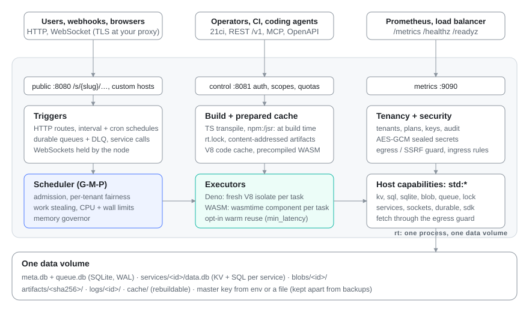

<p align="center">
  
</p>

<p align="center">
  <a href="https://github.com/21-ci/runtime/actions/workflows/ci.yml"></a>
  <a href="https://github.com/21-ci/runtime/actions/workflows/security.yml"></a>
  <a href="https://github.com/21-ci/runtime/releases/latest"></a>
  <a href="https://codecov.io/gh/21-ci/runtime"></a>
  <a href="https://scorecard.dev/viewer/?uri=github.com/21-ci/runtime"></a>
  <a href="https://21-ci.github.io/runtime/"></a>
  <a href="LICENSE"></a>
</p>

<p align="center">
  <b>Run your own Cloudflare-Workers-style platform on one box:</b> tenants deploy TypeScript or WASM, and every
  service gets HTTP routes, schedules, queues, KV/SQL/blob storage and WebSockets, isolated per request.
</p>

<p align="center">
  <a href="https://21-ci.github.io/runtime/">Docs</a> ·
  <a href="#quickstart">Quickstart</a> ·
  <a href="sample/README.md">Examples</a> ·
  <a href="SECURITY.md">Security</a> ·
  <a href="CONTRIBUTING.md">Contributing</a> ·
  <a href="https://github.com/21-ci/runtime/discussions">Discussions</a>
</p>

---

## Why

Running other people's code usually means one container or microVM per service: hundreds of megabytes and a
cold start per tenant, and a fleet to operate. Hosted isolate platforms fix the density but are not yours to run.

`rt` is a single self-hosted binary that runs many tenants' functions in **V8 isolates** (TypeScript/JavaScript, the
Deno runtime) and **WASM components** (wasmtime, WASI 0.2), with a scheduler that keeps one noisy tenant from starving
the rest. You get a control API, a CLI and an MCP server to deploy with, and storage, queues and schedules that every
function can use without wiring up anything else.

## Features

| | |
|---|---|
| **Two executors** | Deno: a fresh V8 isolate per task, frozen clock, Web APIs. WASM: a WASI 0.2 `wasi:http` component per task (Rust, JS via `jco`, any language with a component toolchain). Opt-in warm reuse for the lowest latency |
| **Triggers** | HTTP (`/s/{slug}/…`, `{slug}.{base_domain}`, verified custom hosts), interval and cron schedules, durable queues with retries and a DLQ, service-to-service calls and typed RPC, WebSockets held by the node |
| **State** | KV (TTL, `incr`, `cas`), SQL on a SQLite database per service, synchronous `bun:sqlite`-style SQLite, blobs, durable objects with alarms, named locks, env and AES-GCM sealed secrets |
| **Multi-tenancy** | tenants, plans with quotas and limits, scoped API keys, projects and environments, ingress and egress rules per service, an SSRF guard on every outbound request, audit events |
| **Scheduler** | Go-style G-M-P scheduler: admission control, per-tenant fair queues, work stealing, CPU and wall-clock limits with preemption, a memory governor that follows the cgroup |
| **Operator SDKs** | publish your platform's SDK as a runtime service; tenants import its contract (`std:sdk`) and grants pick the release per call, so an SDK update never redeploys a tenant |
| **Builds** | TypeScript transpiled at deploy, `npm:` and `jsr:` resolved at build time and pinned in `rt.lock`, lazy or eager compilation, content-addressed artifacts, one-command rollback |
| **Operations** | REST control API with OpenAPI 3.1 and a Scalar UI, the `21ci` CLI, an MCP endpoint for coding agents, Prometheus metrics, health probes, SSE log streams, per-service stats, five tuning profiles |

## Architecture

<p align="center">
  
</p>

One process (`rt serve`), four listeners (public invoke, control API, metrics, an internal Unix socket for operator
calls) and one data directory. Details: [architecture and request path](https://21-ci.github.io/runtime/) in the
docs, trust boundaries in [SECURITY.md](SECURITY.md).

## Quickstart

Pick one way to run a node, then deploy with `21ci`.

<details open>
<summary><b>Homebrew</b> (macOS, Linux)</summary>

```bash
brew install 21-ci/tap/rt 21-ci/tap/21ci
brew services start rt             # loopback only; config, token and master key in $(brew --prefix)/etc/rt/
export RT_ROOT_TOKEN=$(cat "$(brew --prefix)/etc/rt/root-token")
```
</details>

<details>
<summary><b>Docker</b></summary>

```bash
export RT_ROOT_TOKEN=$(openssl rand -hex 32) RT_MASTER_KEY=$(openssl rand -hex 32)   # keep the master key safe
docker run -d --name rt --read-only -e RT_ROOT_TOKEN -e RT_MASTER_KEY -v rt-data:/data \
  -p 127.0.0.1:8080:8080 -p 127.0.0.1:8081:8081 -p 127.0.0.1:9090:9090 ghcr.io/21-ci/rt
```

Production compose file behind Caddy, and Kubernetes manifests: [deploy/](deploy/).
</details>

<details>
<summary><b>curl | sh</b> (Linux, macOS; verifies checksums, and signatures when cosign is installed)</summary>

```bash
curl -fsSL https://21-ci.github.io/runtime/install.sh | sh
export RT_ROOT_TOKEN=$(openssl rand -hex 32) RT_MASTER_KEY=$(openssl rand -hex 32)
mkdir -p ~/rt && cd ~/rt
RT__NODE__DATA_DIR=./data RT__LISTENERS__INTERNAL=unix:./data/rt.sock RT__SECURITY__REQUIRE_V8_SANDBOX=false rt serve &
```
</details>

<details>
<summary><b>apt</b> (Debian, Ubuntu; rpm and apk in <a href="packaging/README.md">packaging/</a>)</summary>

```bash
curl -fsSL https://21-ci.github.io/runtime/packages/gpg.key | sudo gpg --dearmor -o /etc/apt/keyrings/21cloud.gpg
echo "deb [signed-by=/etc/apt/keyrings/21cloud.gpg] https://21-ci.github.io/runtime/packages/apt stable main" \
  | sudo tee /etc/apt/sources.list.d/21cloud.list
sudo apt update && sudo apt install rt 21ci
sudoedit /etc/default/rt            # RT_ROOT_TOKEN and RT_MASTER_KEY: openssl rand -hex 32
sudo systemctl enable --now rt
```
</details>

Then deploy a function:

```bash
21ci config set-context local --api http://127.0.0.1:8081 --invoke http://127.0.0.1:8080 --token "$RT_ROOT_TOKEN"
export RT_TENANT=$(21ci tenant create demo --json | jq -r .id)   # act for a tenant with the root token
21ci init hello --template deno                                  # or: deno-kv, wasm-rust, wasm-js
21ci push hello --service hello --create --wait
21ci invoke hello '/?name=Ada'                                   # or: curl 'http://127.0.0.1:8080/s/hello/?name=Ada'
21ci logs hello -f
```

The control API serves its OpenAPI document and a Scalar UI at `http://127.0.0.1:8081/docs`. For real tenants, create
scoped keys (`21ci key create`) instead of using the root token.

## Hello world

**TypeScript** (Deno executor): `main.ts`

```ts
import { kv } from "std:kv";

export default async function (req: Request): Promise<Response> {
  const name = new URL(req.url).searchParams.get("name") ?? "World";
  const visits = await kv.incr(`visits:${name}`);
  return Response.json({ message: `Hello, ${name}!`, visits });
}
```

Form B adds more triggers to one module: `export default { fetch, scheduled, queue, webSocketMessage }`.

**Rust** (WASM executor): a `cdylib` crate (`crate-type = ["cdylib"]`, dependency `wasip2 = "2"`) built for
`wasm32-wasip2`

```rust
use wasip2::exports::http::incoming_handler::Guest;
use wasip2::http::types::{Fields, IncomingRequest, OutgoingBody, OutgoingResponse, ResponseOutparam};

struct Hello;
wasip2::http::proxy::export!(Hello);

impl Guest for Hello {
    fn handle(_req: IncomingRequest, out: ResponseOutparam) {
        let resp = OutgoingResponse::new(Fields::new());
        let body = resp.body().unwrap();
        ResponseOutparam::set(out, Ok(resp));
        body.write().unwrap().blocking_write_and_flush(b"Hello from WASM\n").unwrap();
        OutgoingBody::finish(body, None).unwrap();
    }
}
```

```bash
cargo build --release --target wasm32-wasip2
21ci push target/wasm32-wasip2/release/hello.wasm --service hello-wasm --create --wait
```

WASM guests reach the same storage and calls through the `std:host` WIT package ([wit/rt-host.wit](wit/rt-host.wit)).

## Guest modules

Deno services import `std:*` modules; WASM components get the same capabilities from the `std:host` WIT package.

| Module | What it does |
|---|---|
| `std:kv` | key-value store per service: TTL, `incr`, `cas`, prefix `list` |
| `std:sql` | SQL on the service's own SQLite database: `execute`, `batch`, transactions |
| `std:sqlite` | synchronous SQLite with the `bun:sqlite` API |
| `std:blob` | blob storage with streamed upload and download |
| `std:queue` | enqueue to a service's durable queue: retries, delays, dead-letter queue |
| `std:schedule` | one-off tasks at a time or after a delay (at-least-once) |
| `std:lock` | named mutexes per service |
| `std:services` | calls to other services and typed RPC (`21ci types <service>` generates the `.d.ts`) |
| `std:sockets` | WebSockets the node holds: `accept`, `send`, `broadcast`, tags, attachments, auto-response |
| `std:durable` | durable objects: one instance per name, its own storage and alarm, one event at a time |
| `std:platform`, `std:sdk` | operator bindings and operator SDKs (`std:sdk/server` `defineSdk`) |
| `std:log`, `std:secrets` | structured logs, sealed secret values |
| `fetch`, `WebSocket` | outbound HTTP and WebSockets through the egress guard |

Reference: [docs/handlers.md](docs/handlers.md) and the [docs site](https://21-ci.github.io/runtime/).

## Examples

| | |
|---|---|
| [sample/deno](sample/deno) | `hello`, `kv-counter`, `sql-todo`, `sqlite-sync`, `blob-upload`, `npm-zod`, `scheduled-queue`, `service-call`, `env-secrets`, `platform-sdk` |
| [sample/wasm](sample/wasm) | `rust-hello` (Rust component), `js-componentize` (JavaScript via `jco`) |
| [sample/apps](sample/apps) | complete apps with tests and smoke scripts: a Telegram bot, event registrations, an electronic queue, a chat room on durable objects, an edge gateway in Rust/WASM, a currency-rates service |
| [sample/operator-sdk](sample/operator-sdk) | an operator SDK published as a runtime service |
| [skills/](skills/) | agent skills so Claude and other coding agents can write and deploy services for you |

## How it compares

| | **21 Cloud runtime** | Docker per service | Firecracker microVMs | A VPS per app | Cloudflare Workers |
|---|---|---|---|---|---|
| Isolation unit | V8 isolate or WASM instance per task | container (shared kernel) | microVM (own kernel) | VM | V8 isolate |
| Idle cost of a service | none: code and caches on disk, nothing running | a running process | a running VM | a running VM | none |
| Cold start | about 3 ms CPU for a fresh isolate, under 0.1 ms for WASM ([benchmarks](#benchmarks)) | hundreds of ms to seconds | about 125 ms boot plus your process | n/a (always on) | milliseconds |
| Languages | TypeScript/JavaScript, any WASI 0.2 component | anything | anything | anything | JS/TS, WASM |
| Built-in state and triggers | KV, SQL, blob, queues, cron, WebSockets, durable objects | bring your own | bring your own | bring your own | yes (KV, D1, R2, Queues, DO) |
| Multi-tenant control plane | yes: tenants, plans, quotas, keys, egress rules | no | no | no | yes (hosted) |
| Self-hosted | yes, one binary | yes | yes | yes | no (`workerd` runs workers, without the platform) |
| Runs arbitrary binaries, native deps | no | yes | yes | yes | no |

Choose `rt` when you host many small functions for many tenants and want density and per-request isolation on your own
hardware. Choose containers or microVMs when tenants bring arbitrary binaries or need a full OS.

## Benchmarks

`bench/bench.sh` with [oha](https://github.com/hatoo/oha), release build, `balanced` profile, a MacBook Air M4 (10 cores,
fanless) with the load generator on the same machine, 6 s per pass. Cells are successful responses per second, p50 in
parentheses. **Default** is the shipped config (a fresh isolate or instance per request); **warm** is the per-service
opt-in that `min_latency` turns on (`deno.reuse_isolates`, `wasm.reuse_instances`).

| Service | Concurrency | Default | Warm |
|---|---|---|---|
| Deno `hello` | 1 | 458 (2.05 ms) | 6,563 (0.11 ms) |
| | 16 | 890 (17.6 ms) | 25,274 (0.52 ms) |
| | 256 | 1,193 | 22,672 |
| Deno `sql-todo` GET | 16 | 672 | 10,754 |
| WASM `hello` | 1 | 9,985 (0.08 ms) | 10,847 (0.08 ms) |
| | 16 | 30,929 (0.39 ms) | 47,656 (0.28 ms) |
| | 256 | 35,904 | 61,754 |

Every pass answered 200 (requests over capacity wait in a queue instead of failing). A fresh V8 isolate costs about
2.9 ms of CPU, which caps the default Deno path near 1k rps on this machine; warm reuse removes that cost. These are
laptop numbers for hello-world handlers, not a capacity plan: measure your workload with `bench/bench.sh`. Full
results and notes: [bench/RESULTS.md](bench/RESULTS.md). The design target for density is about 1,000 idle services on
4 vCPU / 2 GiB.

## Status

Pre-1.0: the API and config may still change between minor releases (the [changelog](CHANGELOG.md) says when). One
node, one process: there is no clustering yet. Known gaps (prebuilt V8 without its sandbox, local-disk storage only,
no seccomp profile beyond the basics, no OTLP export) are listed in
[SECURITY.md, "Known limitations"](SECURITY.md#known-limitations).

## Documentation

| | |
|---|---|
| [21-ci.github.io/runtime](https://21-ci.github.io/runtime/) | the docs site: guides, concepts, reference |
| [docs/api.md](docs/api.md), [openapi/openapi.json](openapi/openapi.json) | control API guide and the OpenAPI 3.1 document |
| [docs/cli.md](docs/cli.md) | every `21ci` command, contexts, CI usage, exit codes |
| [docs/handlers.md](docs/handlers.md) | handler forms, `ctx`, triggers, WebSockets, durable objects |
| [docs/config.md](docs/config.md) | `rt.toml`, profiles, every key |
| [docs/deploy.md](docs/deploy.md) | production deployment, TLS, backups, upgrades, key rotation |
| [docs/mcp.md](docs/mcp.md) | the MCP endpoint for coding agents |
| [SECURITY.md](SECURITY.md) | threat model, limits, hardening checklist, reporting, verifying releases |

## Community

- Questions and ideas: [GitHub Discussions](https://github.com/21-ci/runtime/discussions). Bugs and feature requests:
  [issues](https://github.com/21-ci/runtime/issues/new/choose). Help: [SUPPORT.md](SUPPORT.md).
- Contributing: [CONTRIBUTING.md](CONTRIBUTING.md) (dev setup, tests and coverage, DCO). Coding agents start
  at [AGENTS.md](AGENTS.md).
- Releases: [RELEASING.md](RELEASING.md) (publishing a version, every channel, one-time setup).
- Security issues: privately, as described in [SECURITY.md](SECURITY.md#reporting-a-vulnerability)
  (security@21ci.uz). Anything else: contact@21ci.uz.
- Everyone follows the [Code of Conduct](CODE_OF_CONDUCT.md); project roles: [GOVERNANCE.md](GOVERNANCE.md).

## Building from source

```bash
git clone https://github.com/21-ci/runtime && cd runtime
make build        # Rust 1.95 from rust-toolchain.toml; the first build downloads the prebuilt V8
make dev          # local node on 127.0.0.1 (control :8081, token dev-root-token)
make test         # WASM fixtures + every crate's tests
```

`make help` lists every target. Images: `docker compose up -d --build` (development stack, secrets from `.env`).

## License

[Apache License 2.0](LICENSE). Copyright 2026 The 21 Cloud Runtime Authors. Third-party notices: [NOTICE](NOTICE).
