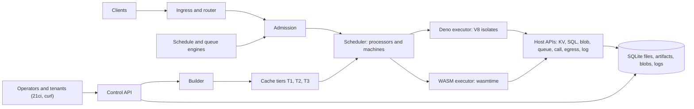
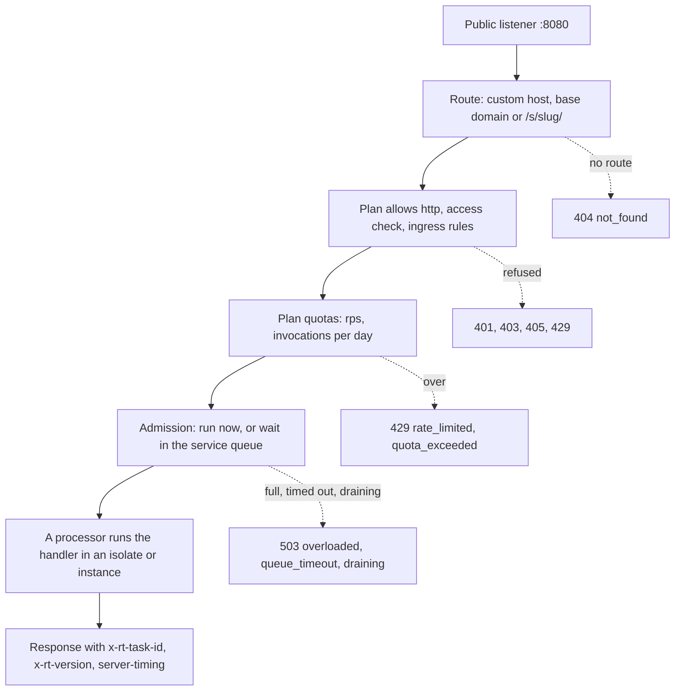

# Architecture

The runtime is one binary, `rt`, that runs as one process with four listeners and one data volume. This page
walks through its parts, follows an HTTP request from the client to the response, and explains what is on disk
and what happens when the node restarts. It is useful background for service developers and required reading
for operators.

## One process, four listeners, one volume

Everything runs inside a single `rt` process (`--role=all`, the only role in this release): the control API, the
router, the scheduler, both executors, the builder, the trigger engines and the stores. There is no separate
build service, database server or message broker.

| Listener | Default bind | Serves | Auth |
|---|---|---|---|
| `public` | `0.0.0.0:8080` | `ANY /s/{slug}/{path}`, custom hosts, `{slug}.{routing.base_domain}` | Per service `access` |
| `control` | `127.0.0.1:8081` | `/v1/*`, `GET /v1/openapi.json`, `/docs` (Scalar UI) | Root token or tenant key |
| `metrics` | `127.0.0.1:9090` | `/metrics` (Prometheus), `/healthz`, `/readyz` | None, bind it locally |
| `internal` | `unix:/data/rt.sock` | The same routes as `public`, trusted | Peer UID check on the socket |

The container image binds `public`, `control` and `metrics` on `0.0.0.0` inside the container and the compose
file publishes them on `127.0.0.1` of the host. The control and metrics listeners have no network ACL of their
own: put a reverse proxy or VPN in front before anything is reachable from outside (see
[Production deployment](../guides/production.md)). Listener addresses are in [`[listeners]`](../config.md#listeners).

All state lives in one directory, `node.data_dir` (`/data` in the image). See [What is on disk](#what-is-on-disk).

## Components

| Component | What it does |
|---|---|
| **Ingress and router** | Accepts HTTP on the public and internal listeners, resolves the route (custom host, base domain or `/s/{slug}`) from an in-memory route table that is swapped atomically on every deploy, runs the access, ingress-rule and quota checks, strips untrusted headers, and streams the response back. |
| **Admission** | Decides whether a task runs now or waits in its service's queue: the service's adaptive concurrency limit, the tenant's plan cap and the node's run slots. Busy capacity waits; a full queue or an expired wait is a `503`. See [Scheduler and autoscaling](scheduler.md). |
| **Scheduler** | A Go-style scheduler: processors (Ps, one per core by default, each of kind `deno` or `wasm`) run tasks on OS threads (Ms) with local run queues, work stealing, time slices and a `sysmon` thread that rebalances and preempts. |
| **Deno executor** | Runs TypeScript and JavaScript in V8 isolates (`deno_core`), one fresh isolate per task by default. See [Execution and isolation](execution.md). |
| **WASM executor** | Runs WASI Preview 2 components in wasmtime, one fresh instance per task by default, with epoch-based preemption and a pooling allocator. |
| **Builder** | Compiles versions inside the node on low-priority build processors: TypeScript to a bundle plus V8 code cache, components to native code. See [Services, versions and builds](services-and-deploys.md). |
| **Cache tiers** | Keeps compiled artifacts in RAM (T1), on disk (T2) and as source (T3), under one memory governor shared by both executors. See [Caching](caching.md). |
| **Stores** | SQLite databases for metadata (`meta.db`), the queue (`queue.db`) and each service's KV and SQL (`services/<id>/data.db`); a content-addressed artifact store; local-disk blobs; log segments. See [Storage](storage.md). |
| **Host APIs** | What guest code calls into: outbound `fetch` through the egress guard, KV, SQL, blobs, queue, service calls, bindings and logs. Blocking work (SQLite, files) runs on a separate blocking pool with per-tenant fair queues. |
| **Triggers** | The schedule engine (one timer wheel for interval and cron), the queue engine (leases batches, acks and retries), and the call dispatcher. They create tasks and submit them like HTTP does. See [Triggers](triggers.md). |
| **Control API** | The REST API under `/v1` on the control listener: tenants, keys, services, versions, env, secrets, hosts, schedules, queue, logs, stats, events and node operations. See the [API reference](../api.md). |



### Design choices and why

| Choice | Why | What it costs |
|---|---|---|
| **One process, one data directory** | A node is installed, backed up and upgraded as one unit; there is no network hop between ingress, scheduler and executors, and a service call is a function call | The process is the blast radius and the trust boundary; there is no scale-out. See [Multi-tenancy](multi-tenancy.md) |
| **Sandboxes inside the process instead of a container per function** | An idle service costs rows and files, not a resident process; a task starts from prepared artifacts without booting anything | Weaker isolation than a VM, and only code that fits V8 or WASI 0.2 runs. See [Isolation compared](isolation-compared.md) |
| **SQLite for every store** | No database server to run; WAL gives readers and a single writer per file; one file per service gives natural data separation, per-service quotas and a simple export | Single node, one writer per service database, no cross-service transactions. See [Storage](storage.md) |
| **A Go-style scheduler (processors, machines, run queues, work stealing) instead of a thread per request** | Thousands of short tasks multiplex over a few threads, tasks can be preempted at slice boundaries, and admission can queue work fairly instead of rejecting it | The runtime owns scheduling policy, including its failure modes. See [Scheduler and autoscaling](scheduler.md) |
| **Queueing instead of `429` for capacity** | Busy capacity is not the client's fault; bursts are absorbed, and `429` stays reserved for limits someone chose | Under sustained overload latency grows until `503 queue_timeout` |
| **Content-addressed artifacts and a three-tier cache** | Identical code shares one compiled entry, rollbacks are a pointer flip, and a restart or upgrade only costs a lazy recompile | A cold version pays a build on first use unless built eagerly. See [Caching](caching.md) |
| **Build at deploy time, resolve dependencies at build time** | No network fetch and no compilation on the request path; rebuilds reproduce the same dependencies through `rt.lock` | Packages must work through the configured CDN's build for a browser-like target |
| **Everything a guest does is a host function** | The runtime can meter, limit and check every effect (storage, egress, calls) against the tenant's plan | The host function surface is part of the trusted code base |

### Threads

The process sizes every thread pool explicitly, so the scheduler's processors do not compete with hidden
library pools:

| Threads | Default | Role |
|---|---|---|
| I/O | `io.threads` = 2 | Accept and parse HTTP, run outbound network I/O |
| Processors (P) and machines (M) | `sched.processors` = cores (cgroup quota aware); Ms = Ps + `sched.spare_machines` | Run tasks |
| Build | `build.threads` = 1 | Compile versions, at low OS priority |
| Blocking pool | `blocking.threads` = max(4, cores) | SQLite and file I/O, with per-tenant fair queues |
| sysmon | 1 | Preemption, rebalancing, memory checks, health heartbeat |
| V8 platform | `deno.v8_platform_threads` = 1 | V8 background work |

`GET /v1/node/status` (or `21ci node status`) shows the processor split, for example
`Kinds: deno=8 wasm=2 build=1`. Idle processors move between kinds when the traffic mix changes.

## The path of an HTTP request

This is the short version; [Request lifecycle](request-lifecycle.md) follows a request phase by phase, with the
data structures involved and what each failure looks like.



Step by step:

1. **Route.** The router matches the `Host` header against verified custom hosts, then against
   `{slug}.{routing.base_domain}` (when set), then the path `/s/{slug}/…`. A service with `access: internal` does
   not resolve on the public listener, so it is a `404` there.
2. **Plan and access checks.** The tenant's plan must allow the `http` trigger (`403 trigger_not_allowed`). For
   `access: key` the request needs a tenant key with the `invoke` scope (or the root token), otherwise `401`.
   Then the service's ingress rules run: allowed methods (`405`), path prefixes and IP allow lists (`403`) and a
   per-service rate limit (`429`).
3. **Quotas.** The tenant's `rps` token bucket and `invocations_per_day` counter (`429` with `Retry-After`).
4. **Header hygiene.** Client-sent `x-rt-*` headers, hop-by-hop headers and runtime credentials (an
   `Authorization: Bearer rtk_…` tenant key) are removed; any other `Authorization` header is passed on. The
   runtime adds `x-rt-trigger: http`, `x-rt-base-path` (for `/s/{slug}` routes), `x-rt-client-ip` and a
   `traceparent` if the client sent none.
5. **Admission.** If the service, the tenant and the node have a free run slot, the task is placed on a
   processor at once. Otherwise it waits in the service's FIFO queue, up to the profile's queue timeout (5 s in
   `balanced`). A client that disconnects while waiting gives up its place.
6. **Execution.** A processor of the right kind picks the task. The executor fetches the prepared artifact from
   the cache; if the version has not been compiled yet, the task waits while one build runs (single-flight, so
   concurrent first requests share it). Then a fresh isolate or instance runs the handler.
7. **Response.** The response streams back as the handler produces it. The runtime adds `x-rt-task-id`,
   `x-rt-version` (the version that ran) and `server-timing` with the phases `queue`, `wait_runtime`, `init` and
   `exec`.

```console
$ curl -si "$RT_INVOKE/s/hello/?name=Ada"
HTTP/1.1 200 OK
content-type: application/json
server-timing: queue;dur=0.000, wait_runtime;dur=0.000, init;dur=5.932, exec;dur=4.720
x-rt-task-id: task_0000000000000002
x-rt-version: 1

{"message":"Hello, Ada!", …}
```

Requests on the internal listener take the same path but skip the access check and the ingress rules, and keep
an `x-rt-invoker` header for the handler (see [Triggers](triggers.md#the-internal-listener)). Schedules, queue
batches and service calls skip the HTTP steps: their engines build the task and submit it to admission directly.

??? info "Under the hood: how a deploy reaches the router"
    `POST /v1/services/{s}/versions` validates the upload (archive safety, syntax, import specifiers, or the
    component's imports and exports), stores the bytes content-addressed in `artifacts/`, inserts the version
    row in `meta.db` and, with `?activate=1`, flips `live`. The node then rebuilds its route table from
    `meta.db` and swaps it atomically, so a request in flight during a flip sees either the old or the new
    version, never a missing route. In-flight tasks finish on the version they started with.

## What is on disk

```text
/data/                          node.data_dir (RT__NODE__DATA_DIR=/data in the image)
  meta.db                       tenants, keys (hashed), services, versions, env, sealed secrets,
                                schedules, hosts, usage, events (SQLite, WAL)
  queue.db                      queue messages and dead letters (SQLite, WAL)
  master.key                    only when no RT_MASTER_KEY was given (generated, mode 0600)
  artifacts/<sha256>/           T3: uploaded sources and components, rt.lock files and vendored
                                dependency modules, content-addressed
  cache/v2/<engine-fp>/<digest>/  T2: compiled bundles, V8 code cache, .cwasm, each with a MAC
  services/<service-id>/data.db KV and SQL of one service
  blobs/<service-id>/           blob objects of one service
  logs/<service-id>/            persisted log segments
  deps/                         created at startup; safe to drop
  rt.sock                       the internal listener
```

`engine-fp` is a fingerprint of the runtime, V8 and wasmtime versions and their flags. A runtime upgrade with a
different fingerprint simply misses T2, and each version is recompiled lazily from `artifacts/` on its next use.
`cache/` can always be deleted; the node rebuilds what it needs. For backups, copy `meta.db`, `queue.db`,
`artifacts/`, `services/`, `blobs/` and the master key (stored apart from the data), with the node stopped or
with `sqlite3 .backup`. See [Production deployment](../guides/production.md).

## Restarts and shutdown

On `SIGTERM` the node switches to drain mode: new requests get `503 x-rt-reason: draining`, `/readyz` turns
`503`, and in-flight tasks get up to 30 seconds to finish before the process exits. `POST /v1/node/drain`
(`21ci node drain`) enters the same mode without exiting, for example before an upgrade. Drain is one-way:
restart the process to serve again.

| State | Where | After a restart |
|---|---|---|
| Tenants, keys, services, versions, live pointers, env, sealed secrets, schedules, hosts, usage | `meta.db` | Intact |
| Queue messages and dead letters | `queue.db` | Intact; a message leased by a task that never finished is redelivered after its visibility timeout |
| Sources and dependency modules | `artifacts/` | Intact |
| Compiled artifacts | `cache/` (T2) | Reused if the engine fingerprint matches, else rebuilt lazily |
| Service KV, SQL and blobs | `services/`, `blobs/` | Intact |
| Daily invocation and egress counters | memory, flushed to `meta.db` | Seeded from today's usage, so a restart does not reset a quota |
| T1 cache, run queues, in-flight tasks, warm isolates and instances | memory | Gone; the first request of each service loads from T2 |

Schedules resume at their next tick; ticks missed while the node was down are skipped, not backfilled. Services
whose effective `cache.preload` is on (the `min_latency` default) are loaded into T1 at startup, most frequently
used first.

`SIGHUP` reloads the plans and the live scheduler and memory knobs from `rt.toml` without a restart; every other
change needs one (see [applying changes](../config.md#live-updatable-vs-restart-required)).

## A single node

This release runs on one node. There is no clustering, replication or failover: scale up the machine, and use
your proxy and backups for availability. A few parts of the design are not in this release:

| Design item | State |
|---|---|
| Multi-node, scale-out, HA | <span class="rt-badge rt-badge--planned">planned</span> Not in v1 |
| Separate supervisor and executor processes (master key and control plane outside the process that runs tenant code) | <span class="rt-badge rt-badge--planned">planned</span> One process today |
| V8 sandbox (custom V8 build) | <span class="rt-badge rt-badge--planned">planned</span> Prebuilt V8; `GET /v1/node/status` reports `v8_sandbox: false` |
| S3 backends for artifacts and blobs | <span class="rt-badge rt-badge--planned">planned</span> Local disk only; `[s3]` is accepted but unused |
| seccomp filter and Landlock | Not planned for now. On Linux only `PR_SET_DUMPABLE=0`, `NO_NEW_PRIVS` and `RLIMIT_CORE=0` are applied |
| OTLP trace export | <span class="rt-badge rt-badge--planned">planned</span> `[otel]` is accepted, nothing is exported; Prometheus metrics work |

The [Security model](security.md) page explains what the single-process design means for isolation.

## See also

- [Request lifecycle](request-lifecycle.md): one request, phase by phase.
- [Failure behavior](failure-behavior.md): what happens on OOM, crash, restart, reload and a full disk.
- [Execution and isolation](execution.md): what happens inside the executor.
- [Scheduler and autoscaling](scheduler.md): processors, admission and queues in depth.
- [Caching](caching.md) and [Storage](storage.md): the tiers and stores named above.
- [Configuration reference](../config.md): every key mentioned on this page.
