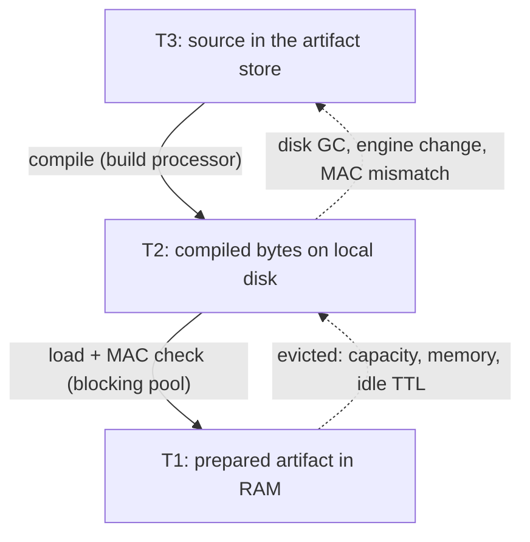

# Caching

Before a service can run, its code has to be compiled: TypeScript into a bundle plus a V8 code cache, a WebAssembly
component into native machine code. The node keeps compiled code in three tiers so that most requests skip that work.
This page explains the tiers, what a request pays on each, how preloading and eviction work, and how the code cache
differs from warm instance pools.

## The three tiers

| Tier | What it holds | Deno <span class="rt-badge rt-badge--deno">Deno</span> | WASM <span class="rt-badge rt-badge--wasm">WASM</span> | Where |
|---|---|---|---|---|
| **T1** | Prepared artifact, ready to instantiate | Module map, V8 code cache, handler form | Compiled `Component` plus a pre-linked `InstancePre` | RAM, a share of the memory budget |
| **T2** | Compiled bytes | `bundle` and `code_cache.bin` | `component.cwasm` | Local disk, `cache/v2/<engine-fp>/<digest>/` in the data directory |
| **T3** | Source | The uploaded source (and its `rt.lock`) | The uploaded `.wasm` | The artifact store, `artifacts/<sha256>/` |

Entries are keyed by **artifact digest, runtime kind and engine fingerprint**. Two consequences:

- Identical code shares one entry, even across versions, services or tenants. Deploying the same bundle twice costs
  one compile.
- The **engine fingerprint** covers the V8 or wasmtime build and its flags. After a node upgrade that changes it, old
  T2 entries no longer match: versions recompile from T3 on their next request (or force it with
  `POST /v1/services/{s}/versions/{v}/rebuild`).

Moving down a tier is a **promotion**:

- **T2 → T1 is a load.** It runs on the blocking pool: read the files, verify their MAC, deserialize.
- **T3 → T2 is a compile.** It runs as a `build` task on the dedicated build processors, never on the processors
  that serve requests (see the [scheduler](scheduler.md#processors-per-executor-kind)).

Both are **single-flight**: when 100 requests arrive for a version that is not in T1, exactly one load or compile runs
and the 100 requests wait for it, then start in arrival order.



## What a request costs on each tier

| The live version is in | What happens before your handler runs | Shows up as |
|---|---|---|
| **T1** | Nothing extra: no disk read, no blocking-pool job. The executor creates (or reuses) an instance | `init` only |
| **T2** | One load job reads and verifies the files, then T1 is populated | `wait_runtime` |
| **T3** | A compile (a Deno build may also fetch dependencies, see [services and deploys](services-and-deploys.md)), then a load | `wait_runtime`, usually the longest |

The time spent is visible per request in the `server-timing` header
(`queue;dur=…, wait_runtime;dur=…, init;dur=…, exec;dur=…`) and in `rt_task_phase_seconds{phase="wait_runtime"}`.
The wait for a load or compile counts against the request's queue timeout, like waiting for a run slot.

### Lazy and eager compile

By default a version compiles **lazily**: the upload stores the source, and the first request that needs the version
compiles it. That first request pays the T3 cost; everybody after it hits T1.

**Eager** compile builds right after the upload, so no request ever pays for it. A version is reported `ready` only
after its artifact has been compiled **and** loaded into T1, so a `ready` version is warm.

| How | Lazy | Eager |
|---|---|---|
| Profile default (`build.compile`) | `max_density`, `balanced` | `min_latency` |
| Per upload | `?compile=lazy` | `?compile=eager` (`202`, `build_state: building`) |
| `21ci` | `21ci push … --compile lazy` | `21ci push … --compile eager`, or `--wait` to also wait for `ready` |

## Preloading at startup

The node remembers how often each prepared artifact is used (a compact frequency sketch per runtime, saved in
`meta.db` every 5 minutes and at graceful shutdown). At startup it restores those frequencies and **preloads** the hot
set into T1 before traffic arrives:

- only services whose `cache.preload` is on (the `min_latency` profile turns it on);
- per runtime, the `cache.preload_top_n` (default 100) most frequently used live versions;
- loads run on the blocking pool, off the startup path.

## How T1 decides what to keep

T1 is bounded by `cache.t1_share` of the [memory budget](#memory-governor) (10 % / 20 % / 35 % for `max_density` /
`balanced` / `min_latency`). When it is full, a cost-aware **W-TinyLFU** policy picks what stays:

- A small window admits new entries; the main area is split into probation and protected segments.
- A new entry replaces a resident one only if its score `frequency × reload cost / size` is higher. **Reload cost** is
  the measured time to bring the entry back from the next tier (load time, or compile time when T2 is missing too).
- So a burst of one-off services cannot push out the steady hot set, and between two equally popular services the
  one that is cheap to reload goes first.

Entries also leave T1 when:

- **Idle TTL**: an entry untouched for `cache.idle_ttl` (60 s / 600 s / 3,600 s by the node's default profile) is
  evicted even without pressure. The sweep runs every 10 seconds.
- **Memory refusal**: when the memory governor refuses a new T1 reservation, the lowest-scoring entries are evicted
  until it fits.

Eviction is safe for running requests: an entry in use stays alive until the last task holding it finishes, and only
then is its memory released.

!!! note "`keep_resident` is not active yet"
    <span class="rt-badge rt-badge--planned">planned</span> A service's `scaling.keep_resident` (bounded by the plan's `max_pinned_mb`) is accepted and shown in `effective`,
    but this release does not pin the service's T1 entry yet. Use the `min_latency` profile (long idle TTL, preload)
    for services that must stay warm.

## Memory governor

All memory that grows with load is reserved through one **memory governor**: V8 heaps and `ArrayBuffer`s, WASM
linear memory, warm instances, the T1 cache, SQLite page caches and logs. A task reserves its memory before it starts;
if the governor refuses, the task waits until memory frees up (within its queue timeout). Values with three parts are
the `max_density` / `balanced` / `min_latency` profile defaults.

| Setting | Default | Meaning |
|---|---|---|
| `memory.budget_mb` | `0` = 85 % of the cgroup v2 `memory.max`, else of physical RAM | The budget everything is charged against. A 2 GiB container gets 1,740 MB |
| `memory.high` | 0.90 / 0.80 / 0.70 | Fraction of the budget where pressure becomes `High` |
| `memory.critical` | 0.97 / 0.92 / 0.88 | Fraction where pressure becomes `Critical` |
| `memory.check_interval` | 250 ms | How often sysmon re-evaluates pressure (it also reads the process RSS) |

What each level does:

| Pressure | Actions |
|---|---|
| `Normal` | Idle-TTL sweeps only |
| `High` | Warm WASM instances and pooled or kept Deno isolates are dropped; the autoscaler cuts concurrency limits by 25 % and halves warm targets |
| `Critical` | All of `High`, plus: the node enters [`shed` mode](scheduler.md#degradation-modes) (only T1 hits are served), concurrency limits are halved, warm targets go to zero. The node returns to `normal` once pressure is back below `High` |

!!! info "Allocator purge"
    <span class="rt-badge rt-badge--planned">planned</span> At `High` and `Critical`, sysmon also requests an allocator purge, at most once per `memory.purge_min_interval`
    (5 s / 30 s / 120 s). The request is recorded, but the executors do not act on it yet.

Watch it with `GET /v1/node/status` (`memory.budget_bytes`, `memory.pressure`) and the `rt_mem_budget_bytes`,
`rt_mem_committed_bytes{category}`, `rt_mem_rss_bytes` and `rt_mem_pressure_level` series.

## T2 on disk

T2 lives under `cache/v2/` in the data directory and is **rebuildable**: you can leave it out of backups.

- **Integrity.** Compiled code is a trusted input (deserializing a tampered `.cwasm` or code cache would run attacker
  code in the node). Every T2 file therefore carries an HMAC-SHA256 keyed from the master key and bound to the entry
  key **and** the file name. It is checked before anything is deserialized. On a mismatch the entry is deleted,
  rebuilt from T3, and a `security.artifact_tamper` event is recorded. Files are mode `0600`, and compiled artifacts
  are never accepted from uploads.
- **Master key rotation** drops T2 at the next start (without tamper events); entries rebuild on demand.
- **Size and free space.** Every 60 seconds a GC pass keeps T2 under `cache.t2_max_mb` (4,096) and, when free disk
  drops below `disk.low_free_mb` (2,048), deletes the lowest-scoring entries until free space is back above
  `disk.high_free_mb` (4,096). Entries a running task uses are kept; entries of deleted or no longer retained versions
  go first. Deno and WASM share one pass.

See [`[cache]`](../config.md#cache) and [`[disk]`](../config.md#service-data-storage-blocking) for the keys.

## Warm instances are not the code cache

The code cache and warm instance pools solve different problems, and it helps to keep them apart:

| | Code cache (T1/T2/T3) | Warm instances |
|---|---|---|
| Saves | Compiling and loading code | Creating an isolate or instance from loaded code |
| Unit | One prepared artifact | Ready instances of one service's version, per processor |
| Shared | Yes: identical code shares one entry, across services and tenants | Never: kept per `(tenant, service, version)` |
| Sized by | `cache.t1_share`, `cache.t2_max_mb`, idle TTL | Autoscaler warm targets, capped by `sched.warm_share` |
| Holds state | No: code only | With reuse on (`deno.reuse_isolates`, `wasm.reuse_instances`), module globals and linear memory persist between requests of the same version |
| Goes away | Eviction (capacity, memory, TTL, disk GC) | Scale to zero after idle TTL; dropped at `High` memory pressure |

A T1 hit removes the compile and load, but each request still gets a fresh instance by default. For Deno that costs
real CPU, which bounds how many requests per second a core can serve however small the handler is. Warm reuse removes
that cost. The [scheduler](scheduler.md#warm-targets-and-scale-to-zero) page explains how warm targets are computed,
the [execution model](execution.md) what reuse means for your code, and [Performance characteristics](performance.md)
what each level of "cold" costs.

## Observing the cache

=== "21ci"

    ```console
    $ 21ci node cache            # operator: tier sizes, hits, misses, top entries
    $ 21ci service get hello     # "Tier:" line for the live version
    ```

=== "curl"

    ```bash
    curl -sS -H "Authorization: Bearer $RT_ROOT_TOKEN" "$RT_API/v1/node/cache"
    curl -sS -H "Authorization: Bearer $RT_KEY" "$RT_API/v1/services/$SVC" | jq .status
    ```

`GET /v1/node/cache` returns one object per runtime (`deno`, `wasm`) with `t1_entries`, `t1_bytes`, `t2_entries`,
`t2_bytes`, `hits`, `misses`, `loads_inflight`, `builds_inflight` and `t1_unreserved_inserts`, plus `top`: the ten most
frequently used artifact digests per runtime.

A service's `status.tier` is `T1` when its live version is resident in RAM and `T3` otherwise; this field does not
distinguish T2 from T3.

Prometheus: `rt_cache_entries{tier}`, `rt_cache_bytes{tier}`, `rt_cache_hits_total{tier}`, `rt_cache_misses_total{tier}`,
`rt_cache_evictions_total{tier,reason}` (`reason` = `pressure`, `ttl`, `disk`, `manual`) and
`rt_cache_unreserved_inserts_total` (T1 inserts the governor refused while nothing was evictable). Builds:
`rt_build_total{kind,result}`, `rt_build_seconds{kind}`. Full list: [metrics reference](../reference/metrics.md).

## See also

- [Services, versions and builds](services-and-deploys.md): what a build does.
- [Scheduler and autoscaling](scheduler.md): waiting for artifacts and memory, warm targets.
- [Performance tuning](../guides/performance.md): choosing a profile and sizing the budget.
