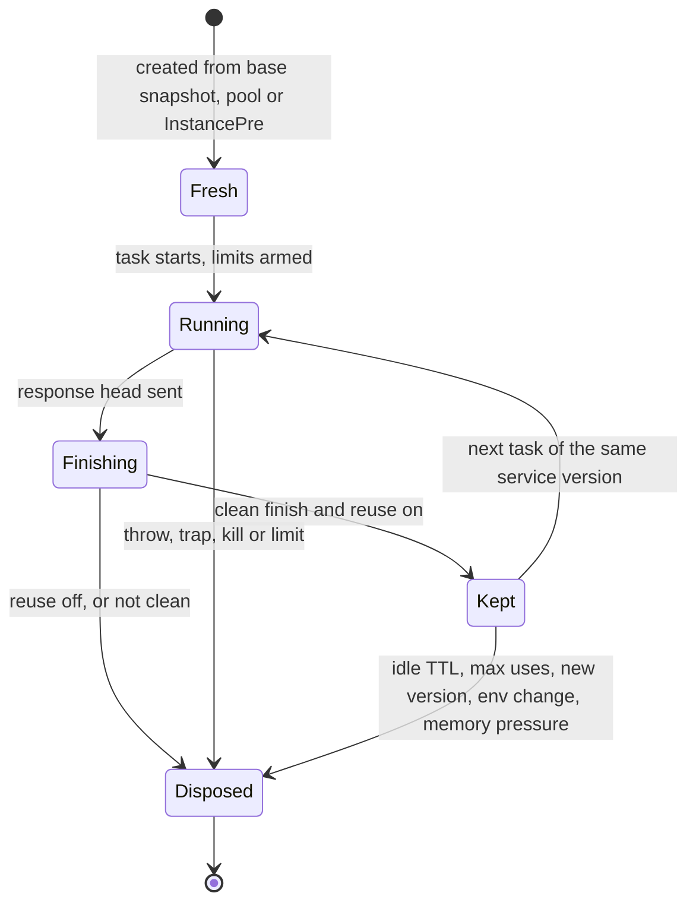

# Execution and isolation

Every task runs in a sandbox of its own: a V8 isolate for TypeScript and JavaScript, a wasmtime instance for a
WebAssembly component. This page explains what happens inside each executor, what the sandbox offers and
removes, how memory and CPU are accounted, what state survives between requests (with and without warm reuse),
the limits a task runs under, and how to choose between the two runtimes. For the comparison with containers and
microVMs see [Isolation compared](isolation-compared.md); for what is shared between tenants despite all this see
[Multi-tenancy](multi-tenancy.md).

## The idea in one paragraph

Guest code never makes a system call. A Deno guest sees a trimmed set of web APIs and a handful of `std:*` modules; a
WASM guest sees the WASI interfaces and `std:host` functions the runtime links, with everything else denied. Whatever
a guest can do to the outside world is a **host function** that the runtime implements, meters and checks against the
tenant's plan. The sandbox itself (V8 or wasmtime) keeps the guest's memory away from the host's and from other
guests'. That is why many tenants can share one process, and also why the process is the unit of trust: a bug in the
engine or in a host function is not contained by a second wall.

## Two executors

| | <span class="rt-badge rt-badge--deno">Deno</span> | <span class="rt-badge rt-badge--wasm">WASM</span> |
|---|---|---|
| Runs | TypeScript and JavaScript modules, bundled at build time | WASI Preview 2 components exporting `wasi:http/incoming-handler` |
| Engine | V8 through `deno_core`, with the web platform crates | wasmtime, one shared engine with a pooling allocator |
| Unit per task | A fresh isolate | A fresh instance with its own linear memory |
| Code | Loaded from the T1 bundle with its V8 code cache | Instantiated from a pre-linked component (`InstancePre`) |
| Host APIs | `std:kv`, `std:sql`, `std:blob`, `std:queue`, `std:services`, `std:sdk` (operator SDKs) | `std:host/{log, kv, sql, blob, queue, call, sdk}` |

Both executors run on the scheduler's processors: a Deno task on a `deno` processor, a WASM task on a `wasm`
processor. The handler runs inside the task's own future until the response head exists, so the scheduler
measures, bills and limits every millisecond of guest CPU, including the part that streams the body afterwards.

## Deno isolates

### A fresh isolate per task

By default every task gets a new isolate created from one **base snapshot** that is built into the binary: the
web platform and the runtime's bootstrap code, no tenant data. The task's modules then load from the prepared
bundle in T1, with their V8 code cache, so nothing is parsed from scratch and nothing is read from the network or
disk at run time. Module top-level code runs, then the handler.

Creating an isolate costs CPU on every task, independent of how small the handler is (see
[Performance characteristics](performance.md)). Two mechanisms move or remove that cost:

- **Isolate pool.** Each processor keeps `deno.isolate_pool_per_p` pre-created isolates (0 / 1 / 4 in
  `max_density` / `balanced` / `min_latency`), refilled between tasks and when the processor is idle, never on
  the request path. Pool isolates hold only base-snapshot state, belong to no tenant and are used once.
- **Warm reuse.** Off by default; see [warm reuse](#warm-reuse).

After the response, the isolate waits for `ctx.waitUntil()` promises (bounded by the wall limit), then goes to a
dispose queue that the processor drains between tasks and when idle, so disposal is not part of the response
time.

Per-service V8 snapshots (evaluating a service's top-level code at build time) are not available; warm reuse
covers the same startup cost for services that receive traffic.

### What the sandbox offers

- **Web APIs:** `fetch`, `Request`, `Response`, `Headers`, `FormData`, `URL`, `URLPattern`, streams,
  `TextEncoder`/`TextDecoder`, `Blob`, `File`, timers, `AbortController`, events, `structuredClone`,
  `CompressionStream`, `MessageChannel`, Web Crypto, `console`, `performance`.
- **Removed:** `Worker`, `SharedWorker`, `SharedArrayBuffer`, `Atomics.wait`/`waitAsync`/`notify`,
  `ShadowRealm`, `caches`. `Deno` is reduced to a read-only `Deno.env` (`get`, `has`,
  `toObject`); there is no file system, raw socket, subprocess or FFI API. `WebSocket` is an outbound client
  through the egress guard; server WebSockets are held by the node and delivered as tasks
  ([WebSockets](../guides/websockets.md)).
- **Outbound `fetch`** goes through the egress guard: public internet only, per-task fetch caps, per-day egress
  quota. See [Security model](security.md).
- **`console.*`** goes to the service logs, at most 1,000 lines per task.

The full list and the `std:*` modules are in the [guest API reference](../reference/guest-api.md).

### The frozen clock

`Date.now()` and `performance.now()` advance only at I/O and timer boundaries (an awaited `fetch`, a storage
call, a timer), never while synchronous code runs. A tight loop measuring itself sees zero elapsed time. This
takes away the high-resolution timer that Spectre-style attacks need. Measure wall time across `await`s, not CPU
work. The operator can switch to `security.clock = "coarse"` (1 ms granularity) instead.

### Memory

`limits.memory_mb` (128 MB by default) covers the V8 heap, every `ArrayBuffer` (also buffers the runtime
creates for you, such as `TextEncoder` output and op results), `Blob` data and WebAssembly memories. The heap
starts small (`deno.isolate_base_mb`, 4 MB) and grows in 8 MB steps from the node's memory governor up to the
limit. Growing a resizable `ArrayBuffer` past the limit throws a `RangeError`; anything else over the limit ends
the task with `502 oom`. Under node memory pressure the governor may refuse to grow a task before it reaches its
own limit, which also ends it with `oom`.

### WebAssembly inside Deno

The `WebAssembly` API is available in Deno services: `Module`, `Instance`, `compile`, `instantiate`, the
`…Streaming` variants and `Memory`. Every wasm memory counts against `memory_mb`, also one the module does not
export. Shared memories are refused (`TypeError` or `CompileError`), because there are no threads. This is the
way to use a WASM library from TypeScript; a whole service written in a WASM language is better deployed as a
component (below).

## WASM components

### A fresh instance per task

Each task gets a new instance of the component, created from a pre-linked `InstancePre` held in T1. The pooling
allocator hands it a memory slot whose pages are reset when released, and the compiled code is memory-mapped
from the T2 `.cwasm` file. With `max_unused_warm_slots` (0 / 100 / 1000 per profile) released slots stay affine
to their component, so the next instance skips remapping its memory image.

The autoscaler also publishes a **warm target** per service. Processors pre-instantiate that many fresh
instances off the request path, with the service's env. Without reuse, each serves exactly one task and is then
replaced. During pre-instantiation the component's start code runs outside any task: every `std:host` import
answers `unavailable`, outbound HTTP is denied and logs are dropped, so do I/O in the handler, not at start.

### Linked interfaces

| Interface | Behavior |
|---|---|
| `wasi:http/incoming-handler` | The export the runtime calls for every task |
| `wasi:http/outgoing-handler` | Outbound HTTP through the egress guard |
| `wasi:io`, `wasi:random` | Streams and polling; real randomness |
| `wasi:clocks` | The frozen clock (below) |
| `wasi:cli` | Env variables and secrets through the environment; stdin is empty; stdout lines become `info` logs and stderr lines `error` logs; `exit` ends the task; terminals report "no terminal" |
| `wasi:filesystem` | Linked with no preopened directories: there is nothing to open |
| `wasi:sockets` | Linked with every address denied |
| `std:host/*` | `log`, `kv`, `sql`, `blob`, `queue`, `call`, `platform` (see the [WIT reference](../reference/wit.md)) |

Any `0.2.x` WASI minor version links. Components that use threads or shared memory are refused at upload.
Blob and call bodies cross the host boundary buffered, not streamed. Pre-initializing components at build time
(Wizer) is <span class="rt-badge rt-badge--planned">planned</span>.

### Preemption, clocks and memory

- **Preemption.** wasmtime's epoch interruption ticks every millisecond; a running component yields to the
  scheduler at the end of each time slice (`sched.time_slice`, 10 ms in `balanced`) and is killed at its CPU
  limit. Optional fuel metering (`wasm.fuel`) is off by default.
- **Clocks.** `wasi:clocks` follows the frozen-clock rule: time advances only when a poll or host call actually
  waited (a pollable that is ready at once does not count), and readings are whole milliseconds. On a reused
  instance the monotonic clock does not count the idle gap; the wall clock is re-anchored to real time when the
  next task starts, never backwards.
- **Memory.** Linear memory may grow up to `limits.memory_mb`; past it the task ends with `502 oom`.
- **Responses** stream as the component writes them (head first, then chunks), up to 100 MB. A trap, kill or the
  size limit after the head ends the body with an error.

## Warm reuse

Warm reuse keeps a sandbox that finished **cleanly** and gives it to the next task of the **same service
version** on the same scheduler thread (Deno) or processor (WASM). Module state (globals, caches built by top-level code, linear memory) then
persists between those tasks, and the next task skips isolate creation and module evaluation.

| | Deno: `deno.reuse_isolates` | WASM: `wasm.reuse_instances` |
|---|---|---|
| Default | On only in `min_latency` | On only in `min_latency` |
| Per service | `{"deno": {"reuse_isolates": true}}` or `21ci service update <svc> --reuse-isolates true` | `{"wasm": {"reuse_instances": true}}` or `21ci service update <svc> --reuse-instances true` |
| Node default | `[deno] reuse_isolates` | `[wasm] reuse_instances` |
| Kept per service | The autoscaler's warm target, else `deno.reuse_max_idle` (4) per scheduler thread; at most `deno.reuse_max_idle_total` (16) per thread across services | `wasm.reuse_max_idle` (8) per processor |
| Expires | Idle for `deno.reuse_idle_ttl` (60 s), or for the service's `scaling.min_run_time_ms` when it is set (`0`: at once, unless tasks of the service wait for a slot, then at most the queue timeout); after `deno.reuse_max_uses` (1,000) tasks | Idle for the service's `cache.idle_ttl`, or for `scaling.min_run_time_ms` when it is set, without a warm target; after 1,000 tasks |

A sandbox is **kept** only if all of this holds:

- the handler, the response body and every `waitUntil` promise succeeded (Deno), or the instance completed
  without a trap (WASM);
- nothing is left running: no pending timer, op or unhandled rejection after one more event-loop turn;
- the task was not killed and never hit a limit;
- the node is below memory pressure `High`, and (Deno) the isolate's memory is within ¾ of `memory_mb` and has
  not grown more than max(16 MiB, 50 %) beyond what it held after its first task.

It is **discarded** when the service gets a new live version, when its env or secrets change (if the code read
them), at memory pressure `High`, and at the limits above. Reuse never crosses a tenant, a service or a version,
even for byte-identical code. Each task still gets its own CPU budget, wall timer, memory limit and a reset
frozen clock.

### State between requests

```ts title="main.ts"
// Module-level state: created again for every task, unless warm reuse is on.
let hitsInThisTask = 0;

export default async function (req: Request): Promise<Response> {
  hitsInThisTask++;
  return Response.json({ hitsInThisTask });
}
```

| | Without reuse (default) | With reuse |
|---|---|---|
| Module top-level code | Runs once per task | Runs once per kept isolate |
| `hitsInThisTask` above | Always `1` | `1, 2, 3, …` on one isolate, but requests may land on another isolate or processor |
| Module-level caches (parsed config, compiled regexes, SDK clients) | Rebuilt every request | Reused while the isolate is kept |
| WASM linear memory | Fresh every request | Persists on the same processor |
| `std:kv`, `std:sql`, `std:blob` | Durable | Durable |

Treat reused state as a cache that can vanish at any request: anything that must survive goes to storage. A
counter in a module variable is never a correct counter; `kv.incr()` from `std:kv` is (atomic across concurrent
tasks). See [Storage](storage.md).

### Lifecycle



## Limits

Every task runs under hard limits. Defaults depend on the trigger:

| Limit | `http` | `interval`, `cron` | `queue` | `call` |
|---|---|---|---|---|
| Wall time | 30 s | 300 s | 300 s | min(own limit, parent's remaining time) |
| CPU time | 1,000 ms | 10,000 ms | 10,000 ms | 1,000 ms, counted separately from the parent |
| Memory (heap or linear memory) | 128 MB | 128 MB | 128 MB | 128 MB |
| Request body | 10 MB | n/a | 1 MB per message | 10 MB |
| Response body (streamed) | 100 MB | n/a | n/a | 100 MB |
| Body buffered across the WASM host boundary (`call` responses, `blob.get`, `platform.fetch`) | 10 MB | 10 MB | 10 MB | 10 MB |
| Outbound fetches per task | 50 | 200 | 200 | 50 |
| Concurrent outbound fetches | 6 | 6 | 6 | 6 |
| Log lines per task | 1,000 | 1,000 | 1,000 | 1,000 |
| Call depth | 15 | 15 | 15 | 15 |

How the numbers are resolved:

- A service sets `limits.wall_ms`, `limits.cpu_ms`, `limits.memory_mb` and `limits.max_body_bytes`. An explicit
  `wall_ms` or `cpu_ms` applies to **every** trigger of the service; without one, each trigger keeps its own
  default from the table.
- The plan's `limits_max` caps everything. A value above it is refused at the API (`422 limit_exceeds_plan`), and
  the trigger defaults are capped silently: on the `free` plan (30 s, 1 s, 128 MB) schedules and queue batches
  also get 30 s wall and 1 s CPU.
- The resolved HTTP values are in the service's `effective` view. See
  [Tenants, plans and keys](tenants-and-plans.md#limits-maxima) and the [limits reference](../reference/limits.md).

A request whose `Content-Length` is over the body limit is refused with `413 too_large` before the handler runs.
A streamed body that grows past it fails the read inside the handler (`request_too_large`).

### Outcome to HTTP

| Outcome | Status | `x-rt-reason` |
|---|---|---|
| The handler returned a response | Its status | None |
| Uncaught throw, rejected promise, trap, or a return value that is not a `Response` | 500 | `guest_error` |
| CPU limit | 502 | `cpu_limit` |
| Memory limit | 502 | `oom` |
| Wall-time limit | 504 | `timeout` |
| The version failed to build | 502 | `build_failed` |
| Waited too long for a slot (also while waiting for memory), queue full, node draining or shedding, routing change being applied | 503 | `queue_timeout`, `overloaded`, `draining`, `shed`, `restarting`, `route_stale` |

Runtime error bodies are generic `text/plain`: the exception message and stack go to the service logs with the
task id, never to the client. For schedules the outcome is only logged; for queue batches it decides ack or
retry; for calls the parent receives it as a response. All reasons: [Error reasons](../reference/errors.md#invoke-reasons-x-rt-reason).

## Deno or WASM?

| | Deno | WASM |
|---|---|---|
| Best for | Quick services, often AI-written, that call outside APIs and use npm packages | Low-latency, high-load, stateless microservices that need strong isolation and a small footprint |
| Languages | TypeScript, JavaScript | Anything that builds a WASI P2 component: Rust (`wasm32-wasip2`), JavaScript (`jco componentize`), TinyGo, C, Python, … ([languages](../languages/wasm.md)) |
| Dependencies | `npm:`, `jsr:` and allowlisted `https:` modules, resolved at build; operator SDKs as contract shims | Compiled into the component by your toolchain |
| Per-task start | New isolate and module evaluation, unless reuse or the pool hides it | Instantiation from a pre-linked component, plus the component's own start code |
| Preemption | A running isolate is not paused mid-slice; it is terminated at its CPU or wall limit | Epoch interruption yields at every time slice |
| Memory unit | V8 heap and buffers counted against `memory_mb` | Linear memory, bounded by `memory_mb` and the pool slot size |
| Streaming | Request and response bodies, blobs | Response bodies; blob and call bodies are buffered |
| Clock, limits, storage, triggers | Same | Same |

A practical rule: start in Deno, and move a hot path to WASM when its per-request overhead matters. Both runtimes
can live in one tenant and call each other with [service calls](triggers.md#service-calls).

## See also

- [Deno services](../guides/deno.md) and [WASM services](../guides/wasm.md): writing handlers.
- [Scheduler and autoscaling](scheduler.md): processors, time slices, warm targets.
- [Failure behavior](failure-behavior.md): what each limit and error does to the sandbox and to the caller.
- [Performance characteristics](performance.md) and [Performance tuning](../guides/performance.md): what costs what, and the knobs.
- [Languages and frameworks](../languages/index.md): what you can write for each executor.
- [`[deno]`](../config.md#deno-executor) and [`[wasm]`](../config.md#wasm-executor) configuration.
