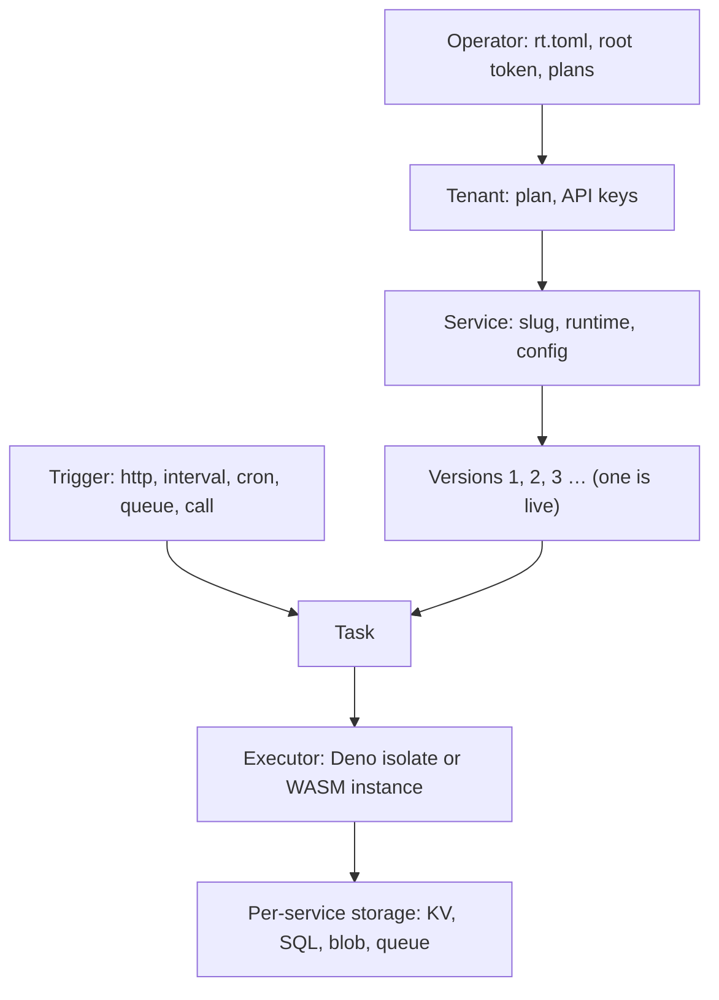

# Concepts

This section explains how the runtime is put together and why it behaves the way it does. Start here for the
mental model and the vocabulary, then open the page for the part you care about. Every page is useful to both
service developers (tenants) and the people who run the node (operators); where a topic is operator-only it is
marked operator.

## The model on one screen

Read it left to right:

1. **One operator runs one node.** The operator owns the `rt` process, its configuration (`rt.toml`), the root
   token, the master key and the **plans** that set every tenant's ceilings.
2. **Tenants** are the operator's customers. Each tenant has a plan and any number of scoped **API keys**
   (`rtk_…`). A tenant only ever sees its own services, data, logs and usage.
3. A tenant owns **services**. A service has a node-wide unique **slug** (its URL is `/s/{slug}/`), a runtime
   (`deno` or `wasm`) and a set of config blocks: limits, access, triggers, ingress and egress rules, callers.
4. Each upload of code creates a new immutable, numbered **version**. Exactly one version is **live**: that is the
   one new requests run. Rolling back means pointing `live` at an older version.
5. A **trigger** (an HTTP request, a schedule tick, a queue batch, a call from another service) creates a
   **task**: one execution of the live version's handler, with its own id (`task_…`), limits and deadline.
6. The scheduler runs the task on an **executor**: a fresh V8 isolate for TypeScript/JavaScript (Deno) or a
   fresh wasmtime instance for a WebAssembly component. Nothing survives the task unless you turned on warm
   reuse, and even then only as a cache.
7. Anything that must persist goes to the service's own **storage**: KV, SQL (SQLite), blobs and the durable
   queue, plus env variables and sealed secrets.

Three consequences show up everywhere in these docs:

- **Services are stateless between requests.** Keep state in `std:kv`, `std:sql` or `std:blob`
  ([Execution and isolation](execution.md)).
- **Busy capacity waits, it does not fail.** A request over a service's current concurrency queues for a slot;
  `429` is reserved for the plan quotas the operator configured ([Scheduler and autoscaling](scheduler.md)).
- **Platform errors and application errors look different.** When the runtime refuses or kills a request, the
  body is `text/plain` and the reason is in the `x-rt-reason` header; responses your code returns never carry
  it ([Error reasons](../reference/errors.md#invoke-reasons-x-rt-reason)).

## Glossary

| Term | Meaning |
|---|---|
| **Operator** | Whoever runs the node. Owns `rt.toml`, the root token (`RT_ROOT_TOKEN`), the master key (`RT_MASTER_KEY`), plans, operator SDKs and bindings. See [Tenants, plans and keys](tenants-and-plans.md). |
| **Tenant** | A customer of the operator (`ten_…`). Owns services, keys and usage; is limited by one plan plus optional per-tenant overrides. |
| **Plan** | A named bundle of quotas and maximum limits, defined by the operator under `[plans.<name>]`. The built-in plan is `free`. See [plans](tenants-and-plans.md#plans). |
| **Key / scope** | A tenant API key, `rtk_<key_id>_<secret>`, shown once at creation. Its **scopes** (`deploy`, `services:write`, `invoke`, …) decide what it may do; it can also be limited to some projects and environments and given an expiry. |
| **Service** | A named deployable unit (`svc_…`): runtime `deno` or `wasm`, config blocks, and a live version. See [Services, versions and builds](services-and-deploys.md). |
| **Slug** | The service's name in URLs and calls, `^[a-z][a-z0-9-]{1,62}$`, unique on the node: `/s/{slug}/`, `{slug}.{base_domain}`, `call("slug", …)`. |
| **Version** | One immutable upload of a service's code, numbered `1, 2, 3, …`, identified by its source digest and carrying a build state (`pending`, `building`, `ready`, `failed`). |
| **Live version** | The version new tasks of a service run (`live_version`). Changed by an upload with `?activate=1` or by `PUT /v1/services/{s}/live`. |
| **Task** | One execution of a handler (`task_…`, returned in `x-rt-task-id`). It has its own wall, CPU and memory limits. |
| **Trigger** | What starts a task: `http`, `interval`, `cron`, `queue` or `call`. Each can be switched off per service and per plan. See [Triggers](triggers.md). |
| **Executor** | The engine that runs guest code: Deno (V8 isolates) for TypeScript and JavaScript, WASM (wasmtime) for WASI Preview 2 components. See [Execution and isolation](execution.md). |
| **Instance** | One concurrently running copy of a service on the node: a Deno isolate or a WASM instance. The scheduler decides how many a service may have at once. See [Scheduler and autoscaling](scheduler.md). |
| **Profile** | A bundle of node and service knobs that trades memory for latency: `max_density`, `balanced` (default) or `min_latency`. A service can pick its own. See [profiles](../config.md#profile-differences-at-a-glance). |
| **Access** | Who may invoke a service over HTTP: `public` (default, anyone), `key` (a key with the `invoke` scope) or `internal` (only the trusted internal listener). |
| **Environment** | A label on every service (default `production`, e.g. `staging`, `pr-42`). By default only services in the same project and environment may call each other. See [service calls](triggers.md#service-calls). |
| **Binding** | An operator-defined upstream (`[[binding]]`) that an operator SDK calls through `platform.fetch` (Deno) or `std:host/platform` (WASM), for the calling tenant. The operator's credentials are injected on the way out; the guest never sees them. See [Operator SDKs and bindings](../guides/operator-sdks.md). |
| **SDK** | An operator's code run by the runtime as a service of the system tenant. Tenants import its contract (`std:sdk`, `sdk:<name>`); grants pick the release per call, so an update needs no tenant redeploy. See [Operator SDKs and bindings](../guides/operator-sdks.md). |
| **T1 / T2 / T3** | The three tiers of the compiled-code cache: T1 is the prepared artifact in RAM, T2 is compiled bytes on disk under `cache/`, T3 is the uploaded source in the artifact store. A service's `status.tier` says whether its live version is in RAM right now (`T1`) or not (`T3`). See [Caching](caching.md). |

## How it works

Mechanism-level pages: what each component does, why it was built that way, and how it behaves under load and under
failure.

-   :material-sitemap:{ .lg .middle } **Architecture**

    ---

    One process, four listeners, one data volume. The components, the design choices behind them, what is on disk
    and what survives a restart.

    [:octicons-arrow-right-24: Architecture](architecture.md)

-   :material-transit-connection-variant:{ .lg .middle } **Request lifecycle**

    ---

    One request end to end, phase by phase: routing, checks, admission, build, execution, response, accounting, and
    where each failure surfaces.

    [:octicons-arrow-right-24: Request lifecycle](request-lifecycle.md)

-   :material-play-circle:{ .lg .middle } **Execution and isolation**

    ---

    How a V8 isolate and a wasmtime component are created, limited and killed; fresh versus warm; the frozen clock.

    [:octicons-arrow-right-24: Execution and isolation](execution.md)

-   :material-cpu-64-bit:{ .lg .middle } **Scheduler and autoscaling**

    ---

    The Go-style scheduler, admission, per-service queues instead of `429`, adaptive concurrency and warm pools.

    [:octicons-arrow-right-24: Scheduler and autoscaling](scheduler.md)

-   :material-layers-triple:{ .lg .middle } **Caching**

    ---

    The T1 / T2 / T3 tiers, the memory governor, eviction and preloading.

    [:octicons-arrow-right-24: Caching](caching.md)

-   :material-database:{ .lg .middle } **Storage**

    ---

    The SQLite engine under KV, SQL and queues: WAL, the writer, group commit, blobs, quotas and logs.

    [:octicons-arrow-right-24: Storage](storage.md)

-   :material-alert-octagon:{ .lg .middle } **Failure behavior**

    ---

    What happens on OOM, CPU limit, crash, restart, reload and a full disk, and what the caller sees each time.

    [:octicons-arrow-right-24: Failure behavior](failure-behavior.md)

-   :material-timer-outline:{ .lg .middle } **Performance characteristics**

    ---

    What costs what: a cost model for isolate creation, warm reuse, WASM instantiation, host calls and queueing.

    [:octicons-arrow-right-24: Performance characteristics](performance.md)

## The platform model

-   :material-account-group:{ .lg .middle } **Tenants, plans and keys**

    ---

    Operator versus tenant, the root token and `x-rt-tenant`, scoped API keys, plans, quotas and limit maxima.

    [:octicons-arrow-right-24: Tenants, plans and keys](tenants-and-plans.md)

-   :material-package-up:{ .lg .middle } **Services, versions and builds**

    ---

    The service object, immutable versions, upload formats, the build pipeline, `npm:` dependencies and rollbacks.

    [:octicons-arrow-right-24: Services, versions and builds](services-and-deploys.md)

-   :material-lightning-bolt:{ .lg .middle } **Triggers**

    ---

    HTTP routes and custom hosts, interval and cron schedules, the durable queue, service-to-service calls and
    the internal listener.

    [:octicons-arrow-right-24: Triggers](triggers.md)

-   :material-shield-lock:{ .lg .middle } **Security model**

    ---

    Isolation boundaries, authentication, the egress guard, header hygiene and what is not in this release.

    [:octicons-arrow-right-24: Security model](security.md)

-   :material-domain:{ .lg .middle } **Multi-tenancy**

    ---

    What is isolated per tenant, what is shared, and what the node does not guarantee.

    [:octicons-arrow-right-24: Multi-tenancy](multi-tenancy.md)

-   :material-chart-line:{ .lg .middle } **Observability**

    ---

    Service logs, stats and events for developers; Prometheus metrics and health endpoints for operators.

    [:octicons-arrow-right-24: Observability](observability.md)

-   :material-scale-balance:{ .lg .middle } **Isolation compared**

    ---

    Isolates and components versus containers, Firecracker microVMs and VPSes: boundary, cold start, density,
    compatibility, operations, and when to choose which.

    [:octicons-arrow-right-24: Isolation compared](isolation-compared.md)

