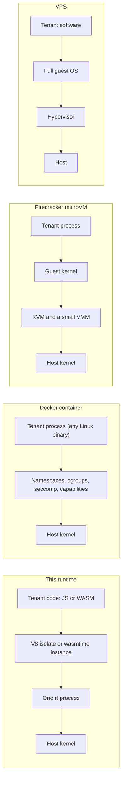

# Isolation compared

Every platform that runs other people's code has to answer one question first: what stands between that code and
everything else on the machine? This page compares the answer this runtime gives (a V8 isolate or a WebAssembly
instance inside one long-lived process) with the three common alternatives: a Docker container, a Firecracker
microVM and a full virtual private server. It is written for people who choose a boundary, so it spends as much time
on what this runtime cannot do as on what it does well.

!!! note "About the numbers"
    Figures for other technologies are typical orders of magnitude or the vendor's own published design goals, not
    measurements made for this documentation. They vary with hardware, image size and configuration; verify them in
    your environment. For this runtime the page explains mechanisms instead of quoting figures: see
    [Performance characteristics](performance.md) and [Resource requirements](../guides/resources.md).

## The four boundaries

What each boundary is made of:

- **This runtime.** Language-level and engine-level isolation. V8 keeps one isolate's heap unreachable from another's,
  and wasmtime keeps a component's linear memory and tables unreachable from the host and from other instances. The
  guest has no system calls of its own: everything it can do (network, storage, time, randomness) is a host function
  the runtime chose to expose. All tenants share one process, one address space of the host and one kernel. The
  boundary is the correctness of V8 and wasmtime plus the runtime's own host functions.
- **Docker container.** Operating-system-level isolation. The tenant runs a normal Linux process on the **host
  kernel**, wrapped in namespaces (what it can see), cgroups (what it can consume), a seccomp filter (which system
  calls it may make) and dropped capabilities. The boundary is the Linux kernel's system call surface and those
  policies.
- **Firecracker microVM.** Hardware-level isolation. The tenant runs a normal Linux process on its **own guest
  kernel** inside a KVM virtual machine. Firecracker is a deliberately small virtual machine monitor (written in Rust,
  with a minimal device model of a few virtio devices, a serial console and little else), and its jailer additionally
  confines the VMM process with namespaces, cgroups and seccomp. A guest escape has to get through the CPU's
  virtualization extensions, KVM and the small VMM.
- **VPS.** A full virtual machine with a general-purpose operating system and an operator who patches it. The
  boundary is the hypervisor, as with a microVM, but the guest is a complete, long-lived server.

## Side-by-side

| | This runtime (isolate / component) | Docker container | Firecracker microVM | VPS |
|---|---|---|---|---|
| **Security boundary** | V8 and wasmtime, in one shared process | Shared host kernel, namespaces, cgroups, seccomp | Hardware virtualization (KVM) plus a minimal VMM | Hypervisor |
| **What a breakout reaches** | The `rt` process: other tenants' memory, the master key, every service's data on the node | The host kernel, so every container on the host | The VMM process on the host (confined by the jailer), not the neighbors directly | The hypervisor |
| **Kernel attack surface exposed to tenant code** | None directly: guests make no system calls. The runtime's own host functions are the surface | The whole system call interface that the seccomp profile allows | The guest kernel's (inside the VM); the host kernel sees only KVM and the VMM's calls | The guest kernel's, inside the VM |
| **Before the first line of tenant code runs** | Create an isolate (or take an instance slot), load a prepared bundle or pre-linked component, run module top level | Create namespaces and a root filesystem from image layers, start a process, run the language runtime and application start-up. A node that lacks the image must pull it first | Boot (or restore a snapshot of) a guest kernel and init, then start the process. Firecracker publishes a design goal of booting to user space in roughly 125 ms | Boot an operating system and its services, typically tens of seconds, or keep it always on |
| **Memory per idle service** | No resident process. An idle service is database rows and files. Its code is in RAM only while recently used | One process and its runtime per service, even while idle (unless you scale to zero and pay the start again) | A guest kernel, page cache and the process, per microVM. Firecracker publishes a VMM overhead goal of a few MiB on top of the guest's own memory | A whole OS, typically hundreds of MiB at least |
| **Memory per running task** | V8: a heap that starts small and grows to `memory_mb`. WASM: a linear memory slot from a pooling allocator | The process's RSS. Libraries from shared image layers share page cache across containers | Guest kernel plus process, not shared between VMs | Guest OS plus processes |
| **Compatibility** | Web-standard JavaScript and WASI 0.2 components. No native binaries, no `node:` built-ins, no raw sockets, no filesystem, no threads. WebSockets are held by the node, one task per message | Any Linux program and library | Any Linux program, with the guest kernel you choose | Anything the OS runs |
| **CPU scheduling and preemption** | The runtime's own scheduler with time slices. WASM yields at epoch ticks; running JavaScript cannot be paused mid-slice, but the monitor thread terminates an isolate that passes its CPU or wall limit | The kernel scheduler with cgroup shares and quotas | The guest scheduler inside vCPU time that the host scheduler grants | As for a microVM |
| **State model** | Stateless handlers; per-service SQLite, KV and blob storage on the node's disk | Whatever the container mounts | Whatever disk is attached to the VM | Persistent disk |
| **Network egress control** | Built in: every outbound request passes an SSRF guard with per-plan quotas | Your job: network policy, proxies, firewalls | Your job, usually at the VM's virtual NIC | Your job |
| **Operations per tenant function** | One upload. No image, no registry, no orchestrator | An image to build and distribute, an orchestrator to schedule | An image or rootfs plus a microVM manager | Provision, patch and monitor a server |
| **Multi-tenant economics** | Highest density, lowest per-request overhead, weakest wall | Good density, medium start cost, medium wall | Lower density, stronger wall, fast enough starts for on-demand | Lowest density, simplest mental model |

## How this runtime differs from Docker

A Docker-based function platform puts a process in a container per function, and often per invocation or per warm
replica. That choice has consequences this runtime was built to avoid:

**Idle cost.** A container that is warm keeps a whole language runtime resident: the interpreter, the standard
library and the application. A platform with thousands of mostly idle functions therefore either holds that memory or
scales to zero and pays a start-up on the next request. Here an idle service holds nothing in memory beyond what the
cache tiers decide is worth keeping ([Caching](caching.md)), and a request to a cold service pays a compile at worst,
not a process start.

**Start path.** A container start involves the kernel (namespaces, mounts, cgroup setup) and a language runtime
start-up. An isolate or WASM instance is created inside a process that is already running, from artifacts that were
prepared at deploy time. What remains per task is isolate or instance creation plus your own top-level code
([What costs what](performance.md)).

**Delivery.** A container function needs an image: a build, a registry, a pull on each node. A service here is an
upload of source (or a component), and the node builds it ([Services, versions and builds](services-and-deploys.md)).

**Fairness inside one machine.** The kernel schedules containers with cgroup CPU shares. The runtime schedules tasks
itself, with time slices, per-service concurrency limits, per-tenant fair queues and memory pressure handling
([Scheduler and autoscaling](scheduler.md)). That gives finer control for short tasks but works only for work that
runs on the runtime's executors.

**What you give up.** A container runs any Linux program. This runtime runs only what fits its two sandboxes. If your
function needs `ffmpeg`, a Python wheel with native extensions, a headless browser, a database server or a long-lived
TCP connection, a container is the right unit. If your function is a webhook handler, an API glue layer, a
validator or a small stateless service, a container is mostly overhead.

**What you gain beyond speed.** Because the guest cannot make system calls, the usual container hardening problem
(shrinking the syscall surface with seccomp profiles) does not arise. The cost is that all the isolation depends on
the engines and host functions being correct, and everything runs in one address space next to the platform's
secrets. A container escape reaches the host kernel; an isolate escape reaches the `rt` process, which holds the
master key and every tenant's data on that node.

## Pros and cons of this runtime

### Strengths

- **Low and predictable per-request overhead.** No operating system or process start per request. The costs that
  remain are known and tunable ([Performance characteristics](performance.md)).
- **High density.** Idle services are rows and files. One node can register far more services than it can run at
  once, and the memory governor decides what stays hot.
- **A small attack surface in the guest.** No system calls, no filesystem, no raw sockets. Outbound HTTP goes through
  the egress guard; storage goes through authorizer-restricted SQLite and per-service namespaces.
- **Platform features that are hard to bolt onto containers.** Per-service queues, schedules, KV, SQL and service
  calls are part of the node, with quotas per plan.
- **One thing to operate.** One binary, one data volume, no orchestrator.

### Limits and honest cons

| Limit | Detail |
|---|---|
| No native binaries or arbitrary processes | Guests are JavaScript/TypeScript or WASI 0.2 components. No subprocesses, no FFI, no native addons |
| No `node:` built-ins | `node:` imports in your own code are rejected at deploy. Packages that import Node server modules deploy but fail at call time. See [Deno languages and frameworks](../languages/deno.md) |
| No raw sockets | `wasi:sockets` is denied and Deno has no socket API. Only HTTP(S) through `fetch` or `wasi:http` |
| No long-lived guest code | A request ends when the response ends, within the wall-time limit. WebSockets are held by the node and each message runs a short task ([WebSockets](../guides/websockets.md)); an outbound `WebSocket` lives only as long as its task. Streaming responses and long polling work |
| No filesystem | Deno has no file API; WASM components get no preopened directories. Use blobs, KV or SQL |
| No threads | `Worker`, `SharedArrayBuffer` and `Atomics.wait` are removed from Deno; WASM components using threads or shared memory are refused |
| WASI 0.2 only | WASI 0.3 components are not accepted |
| Weaker wall than a VM | One process holds all tenants, the master key and decrypted secrets. The V8 sandbox is not enabled and there is no seccomp filter on guests (the process only drops dumpability and sets `NO_NEW_PRIVS` and `RLIMIT_CORE=0`). A V8 or wasmtime vulnerability is a node-wide event |
| Side channels | Tenants share CPU caches and a process. The frozen clock removes local high-resolution timers, which raises the cost of timing attacks but does not remove the class |
| Single node | No clustering, replication or failover. Scale up, and use backups for availability |
| SQLite per service | One writer per service database, no cross-service transactions, local disk only |
| Fixed task limits | Wall, CPU and memory ceilings per task, set by plan. Long batch jobs must be split across schedules and queue messages |

More detail: [Security model](security.md), [Multi-tenancy](multi-tenancy.md) and
[Status and roadmap](../about/status.md).

## When to choose which

| Workload | Good fit | Why |
|---|---|---|
| Webhooks, bots, API glue, integrations written by users or by an AI | This runtime (Deno) | Small stateless handlers, many of them, low idle cost |
| Hot stateless path: gateway, auth check, transform, validation | This runtime (WASM) | Smallest per-request overhead and memory per instance |
| Per-user automation where tenants are semi-trusted (customers of a product, internal teams) | This runtime | The boundary is adequate when you control who can deploy and set tight plans |
| Hostile or anonymous code with sensitive neighbors on the same machine | Firecracker microVMs, or one node per trust domain | A hardware boundary and a separate kernel per tenant |
| Code that needs native libraries, a particular OS, GPUs or arbitrary binaries | Containers (hardened), or microVMs when the code is untrusted | Compatibility comes from running a real Linux userland |
| Chat rooms, live dashboards, small multiplayer games on WebSockets | This runtime (durable objects) | The node holds sockets; per-room state lives in object storage ([guide](../guides/websockets.md)) |
| Long-lived servers, databases, large WebSocket gateways across machines, anything stateful with its own disk | VPS or container with persistent volumes | These are services, not functions; sockets here live on one node |
| Build or CI jobs running arbitrary user commands | Firecracker microVMs or gVisor-style sandboxes | Arbitrary processes plus untrusted code |
| Regulated tenants who must not share a process | Separate nodes, or microVMs | Compliance often asks for a stronger or physical separation |

These are not exclusive. A common arrangement is this runtime for the large number of small, stateless integrations,
with containers or microVMs for the few workloads that need a real operating system, called from the functions over
HTTP.

## If you need a stronger wall

You cannot switch the isolation model of a node, but you can stack controls around it using what exists today:

- **One node per trust domain.** The `rt` process is the blast radius, so separate tenants that must not share it
  onto separate nodes. This is the most effective control and the one the [status page](../about/status.md) recommends.
- **Wrap the node.** Run `rt` inside a container with a non-root user, `cap_drop: ALL` and `no-new-privileges` (the
  shipped compose file does this), or inside a microVM or VM, so that an escape from the process lands in a smaller
  box.
- **Tight plans.** Per-task limits, `max_concurrency`, `rps`, daily invocations and storage quotas shrink what a
  misbehaving tenant can consume ([Tenants, plans and keys](tenants-and-plans.md)).
- **Control who deploys.** Scoped keys, `triggers` and `allowed_triggers` per plan, `access: key` or `internal`
  services, and ingress rules.
- **Egress policy.** `egress.denied_hosts`, `egress.denied_cidrs` and `egress.denied_ports`, plus bindings
  instead of raw network access to your own platform ([Operator SDKs and bindings](../guides/operator-sdks.md)).
- **Network placement.** Keep the control and metrics listeners on loopback or a VPN and put a proxy in front of
  the public listener ([Production deployment](../guides/production.md)).

## See also

- [Security model](security.md): the boundaries and layers inside the node.
- [Multi-tenancy](multi-tenancy.md): what is isolated per tenant and what is shared.
- [Execution and isolation](execution.md): how isolates and components are created, limited and killed.
- [Performance characteristics](performance.md): what each phase of a request costs.
- [Status and roadmap](../about/status.md): which hardening items are not in this release.
