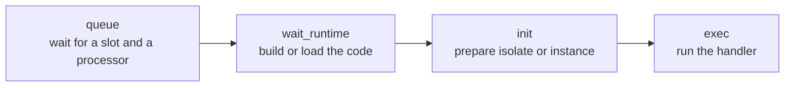

# Performance characteristics

This page is a cost model, not a benchmark. It explains **what costs what** when a task runs: which work happens
once, which per request, which per instance, and which grows with the size of your code or your load. Use it to
predict how a change will behave, then measure on your own hardware with the method in
[Resource requirements](../guides/resources.md). The actions that follow from it are in
[Optimize your service](../guides/optimize.md) (for developers) and [Performance tuning](../guides/performance.md)
(for operators).

## Where a task's time goes

Every response reports four phases in the `server-timing` header, and `21ci stats` aggregates them as percentiles:

| Phase | What it is | Grows with | Mostly a Deno or a WASM cost? |
|---|---|---|---|
| `queue` | Time from admission to start: waiting for the service's concurrency limit, the tenant's cap, the node's run slots and a free processor | Load above capacity; a low `scaling.max_concurrency` | Both |
| `wait_runtime` | Waiting for the version's compiled code: a build (first request after a lazy deploy or an upgrade) or a load from the disk cache | Code size; how cold the version is | Both; Deno builds are heavier (bundling, dependency fetch) |
| `init` | Creating the isolate or instance and running the module's top level or the component's start code | Module top-level work; bundle size; component start-up work | Deno: isolate creation and evaluation. WASM: instantiation plus start code |
| `exec` | Your handler, including everything it awaits: `fetch`, storage, service calls | Your code | Both |

A fifth cost sits outside the header: **response streaming** after the head is sent. It still counts as guest CPU
and wall time, and it is where slow clients and large bodies show up.

## The four levels of "cold"

A request can be cold at several independent levels. Each has its own cost and its own remedy.

| Level | What must happen | Cost | Removed by |
|---|---|---|---|
| Version not built | Transpile, resolve and fetch dependencies, bundle, compile (Deno) or precompile the component (WASM) | The largest: it is real compilation work, and for Deno it may include network fetches | Eager builds at deploy (`21ci push --wait`, `?compile=eager`, `min_latency` profile) |
| Built, not in memory | Load the compiled artifact from the disk cache (T2) and verify its integrity tag | A disk read plus an integrity check | Preloading at startup, a longer `cache.idle_ttl`, a larger `cache.t1_share` |
| In memory, no warm sandbox | Create an isolate or instance | CPU per task | Warm reuse (`deno.reuse_isolates`, `wasm.reuse_instances`) |
| Warm sandbox exists | Nothing: the next task runs on a kept isolate or instance | Only your handler | n/a |

How the tiers work is explained in [Caching](caching.md), and the reuse rules in
[Execution and isolation](execution.md).

## Deno costs

**Isolate creation.** Each task by default gets a new V8 isolate created from a base snapshot compiled into the
binary. That costs CPU on every request and is independent of how small your handler is. The pre-created isolate pool
(`deno.isolate_pool_per_p`) takes the creation off the request path, so latency drops, but the CPU is still spent:
per-core throughput for tiny handlers is bounded by it. Only warm reuse removes the cost.

**Module evaluation.** After the isolate exists, the service's bundle is loaded with its V8 code cache, so source is
not parsed from scratch, and then your module's top level runs. Anything expensive at the top level (building a large
table, compiling a regular expression set, constructing an SDK client, parsing a big JSON file) is paid by every
fresh isolate. With warm reuse it is paid once per kept isolate.

**Bundle size.** The bundle includes your `npm:` and `jsr:` dependencies. A larger bundle costs build time once, disk
and memory in the cache tiers, and load time whenever the artifact is brought into memory. It does not cost parse time
per request thanks to the code cache, but it does cost memory per cached version.

**Heap growth and garbage collection.** The heap starts small (`deno.isolate_base_mb`) and grows in steps up to
`memory_mb`, with steps granted by the node's memory governor. Allocation-heavy handlers pay for growth and for GC
inside their own CPU budget; a handler that buffers a large body pays in memory as well.

**No preemption inside JavaScript.** A running isolate cannot be paused partway through a time slice. A task that
computes for longer than the slice (a hog) is worked around by moving other queued work off its processor, and it is
terminated at its CPU or wall limit. Long synchronous loops therefore hurt other tasks on that processor's neighbors
in tail latency even when they stay under limits.

## WASM costs

**Compilation happens once.** A component is compiled to native code when the version is built, stored in the disk
cache and memory-mapped when loaded. No compilation happens on the request path once the version is built.

**Instantiation.** A task gets an instance from a pre-linked component and a memory slot from a pooling allocator.
Releasing a slot resets its pages, and the allocator can keep slots affine to their component
(`wasm.max_unused_warm_slots`) so the next instance skips remapping. The cost is small and mostly independent of your
code, except for the next point.

**Start code and data segments.** A component's start code runs on every fresh instance, and its data segments
initialize linear memory. A tiny Rust component has almost none of either. A component that embeds a language
runtime (an interpreter image of several megabytes, a Python or JavaScript engine) pays proportionally: more memory to
initialize and more start code to run, on every fresh instance. Warm reuse (`wasm.reuse_instances`) amortizes this
for such services.

**Epoch ticks.** Preemption uses wasmtime epoch interruption, ticking every millisecond. Between ticks the component
runs at native speed; at a slice boundary it yields to the scheduler, so a CPU-bound component does not starve its
neighbors the way a JavaScript hog can.

**The host boundary.** Calls to `std:host` functions cross from guest to host and back. Bodies that cross the boundary
for `blob`, `call` and `platform` are buffered rather than streamed, so large values cost memory and copying.
HTTP request and response bodies do stream.

## Host call costs

Platform calls are where most handlers spend their `exec` time, so their mechanisms matter more than raw CPU.

| Call | Where it runs | What determines its latency |
|---|---|---|
| `kv` get, set, delete, list, `incr` | The blocking pool, against the service's SQLite database | Queue time on the pool, the number of writes waiting on the same database's single writer, and the size of the value |
| `sql` execute, batch, transaction | The blocking pool | Same, plus statement complexity, indexes, rows touched and the per-call statement budget and result caps |
| `blob` | The blocking pool, file I/O | Object size and disk speed |
| `fetch` / `wasi:http` | Async network I/O on the I/O threads | DNS resolution through the egress guard, connection setup (connections are pooled per tenant and validated address), the remote server, and the per-task caps on concurrent and total fetches |
| `queue` enqueue | The blocking pool, the queue database | Queue database contention |
| Service `call` | Re-enters admission as a new task, in process | The callee's own `queue` plus its phases; its CPU is counted separately from the caller's |
| Logging | Buffered and written in batches | Log volume; at most 1,000 lines per task |

Two behaviors follow from the storage design ([Storage](storage.md)):

- **Writes to one service database are serialized**, and queued writes are coalesced by group commit. Throughput of
  write-heavy services grows with batching (several statements per call) and shrinks with many tiny independent
  writes.
- **Storage work competes in a shared pool.** Under contention a tenant is held to a share of the pool's threads
  (`blocking_share`); idle threads may be borrowed. A storage-heavy service on a small node can be limited by the
  pool, not by CPU.

## Queueing in practice

Capacity is a set of limits: the service's adaptive concurrency limit, the tenant's plan `max_concurrency`, and the
node's run slots. A request over any of them **waits** in the service's FIFO queue; tenants take turns.

- While the arrival rate is below the service rate, waiting time is near zero and `queue` is negligible.
- When arrivals exceed the service rate for a sustained period, the queue grows, `queue` grows with it, and tail
  latency rises first. Adding concurrency does not help if the bottleneck is a serialized resource such as a single
  database writer: more concurrent tasks only means more tasks waiting on the same lock.
- A request that waits longer than `sched.queue_timeout` ends as `503 queue_timeout`; a full queue ends as
  `503 overloaded`. Neither is `429`: capacity is not rate limiting.
- The adaptive limit grows while requests wait and latency holds, and shrinks on latency regressions, memory
  pressure or saturated processors. Warm pools follow recent demand and scale to zero when a service is idle.

Little's law is a useful sanity check: the number of tasks in flight is roughly the arrival rate times the average
task duration. A service that spends most of its time awaiting slow upstream calls needs a high concurrency limit
for modest CPU. That is cheap here because several awaiting Deno isolates are bound to one scheduler thread
(`deno.max_bound_per_m`), so a task that is waiting does not occupy a thread of its own.

## Memory costs

| What | Resident when | Bounded by |
|---|---|---|
| A running Deno task | While the task runs | `memory_mb` (heap, `ArrayBuffer`s, `Blob`s, WebAssembly memories) |
| A running WASM task | While the task runs | `memory_mb` (linear memory), and the pooling allocator's slot count |
| Kept isolates and instances | After a clean finish, until idle TTL, max uses or memory pressure | `deno.reuse_*`, `wasm.reuse_max_idle`, `sched.warm_share` |
| Pre-created isolates | Always, per processor, while idle | `deno.isolate_pool_per_p`; dropped under pressure |
| Compiled code (T1) | While recently used | `cache.t1_share`, `cache.idle_ttl` |
| SQLite page cache and WAL | Per open service database | SQLite settings and the quota |
| Threads | Always | The thread pools sized in `rt.toml` |

All memory that scales with load is reserved against one budget. When it fills, a pressure ladder evicts cached code,
drops idle sandboxes and pools, shrinks concurrency and finally sheds load. See
[Scheduler and autoscaling](scheduler.md) and [Failure behavior](failure-behavior.md).

## CPU costs outside your handler

| Work | Where | Notes |
|---|---|---|
| Builds | Dedicated low-priority build threads | Compiling does not take CPU from running services, but a burst of deploys delays other builds |
| Garbage collection | Inside the task's CPU | Counted against `cpu_ms` |
| Isolate and instance disposal | Between tasks and when idle | Off the response path, still CPU on the processor |
| Integrity checks on cache loads | On load from the disk cache | Once per load |
| Scheduler, monitor and autoscaler | Their own threads | Small and independent of request rate |
| TLS | Not in the node | Terminated by your reverse proxy |

CPU limits are judged on the thread's CPU time, not on wall time spent waiting, so awaiting a slow upstream does not
consume `cpu_ms`.

## Profiles as the lever

Profiles do not change what costs what. They change how much memory the node spends to hide a cost and how long it
tolerates waiting.

| Profile | Spends memory on | Accepts |
|---|---|---|
| `max_density` | Little: no isolate pool, short idle TTLs, lazy builds, long queue timeout | Slower first requests, more per-request creation, longer waits under load |
| `balanced` | A small isolate pool, medium TTLs, lazy builds | A first request after a deploy may build |
| `min_latency` | Isolate pools, warm reuse on, eager builds, preloading, long TTLs, a short queue timeout | More resident memory; module state may persist between requests; bursts fail fast |

The exact values are in [Performance tuning](../guides/performance.md) and the
[configuration reference](../config.md#profile-differences-at-a-glance).

## Cost table

| Cost | Applies to | Grows with | How to reduce |
|---|---|---|---|
| Build | First request after deploy (lazy), after upgrade | Bundle and dependency size, component size | Eager build at deploy; fewer or lighter dependencies; `rt.lock` pins avoid refetching |
| Disk-cache load | Version not in memory | Artifact size | Preload; longer idle TTL; smaller artifacts |
| Isolate creation | Every fresh Deno task | Constant | Warm reuse |
| Module top level | Every fresh Deno isolate; every fresh WASM instance start | Your top-level work | Keep it cheap; lazy initialization; warm reuse |
| WASM instantiation | Every fresh WASM task | Component memory image and start code | Smaller components; avoid embedded runtimes; warm reuse |
| Heap growth and GC | Allocation-heavy Deno tasks | Live data size | Stream; batch; avoid large intermediate arrays |
| Storage round trip | Each KV, SQL, blob call | Pool contention, writer contention, statement cost | Batches and transactions; indexes; `kv.incr` for counters; fewer calls |
| Egress | Each outbound request | DNS, connect, remote latency | Parallelize within the fetch cap; reuse connections; timeouts |
| Queue wait | Load above capacity | Arrival rate over service rate | Raise capacity or concurrency where the work is parallel; reduce per-task duration; split work to queues |
| Response streaming | Large or slow bodies | Body size and client speed | Stream instead of buffering; compress; cache public reads |

## See also

- [Optimize your service](../guides/optimize.md): turning this model into code changes.
- [Performance tuning](../guides/performance.md): profiles, pools and scheduler knobs for operators.
- [Resource requirements](../guides/resources.md): sizing and how to measure per-service cost.
- [Request lifecycle](request-lifecycle.md): where each phase sits in the path of a request.
- [Execution and isolation](execution.md) and [Caching](caching.md): the mechanisms behind the costs.
