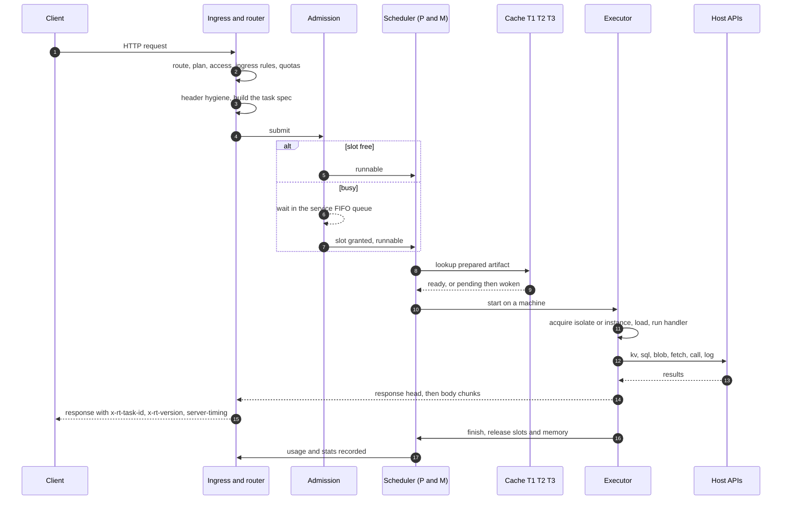

# Request lifecycle

This page follows one HTTP request from the socket to the last byte of the response, then shows how the other
triggers (schedule, queue, service call) join the same path. Each phase says what happens, which part of the node does
it, why it sits where it does, and how a failure in it reaches the caller. For the big picture first, read
[Architecture](architecture.md).

## The whole path

The same sequence in words, with the cost of each step in the `server-timing` header:

| Phase | Component | `server-timing` phase |
|---|---|---|
| 1 to 5: accept, route, checks, quotas, task spec | Ingress (`rt-api`, route table in `rt-triggers`) | before `queue` starts |
| 6: admission and queueing | Scheduler admission (`rt-sched`) | `queue` |
| 7: artifact lookup, build or load | Cache tiers and builder | `wait_runtime` |
| 8: placement and start | Scheduler processors and machines | `queue` (until a machine picks it) |
| 9: sandbox acquisition and module load | Executor | `init` |
| 10: handler and host calls | Executor and host APIs | `exec` |
| 11: response streaming | Executor and ingress | inside `exec` |
| 12: teardown and accounting | Scheduler and executor | after the response |

## 1. Accept and parse

The public listener accepts connections on dedicated I/O threads (`io.threads`). Limits that protect the node from
slow or abusive clients apply here, before any routing: a request head of at most 16 KB and 100 headers, a header
timeout, an idle timeout, a per-IP connection cap, and HTTP/2 stream caps with a rapid-reset guard. These are
enforced where the listener is built, not per request. A request that breaks them gets `431` or a closed connection,
and closures are counted in `rt_ingress_conn_rejected_total`.

*Why here:* connection-level attacks have to be stopped before they cost scheduler time. See
[Security model](security.md#ingress).

## 2. Route

The router looks up the request in an immutable route table held behind an atomic pointer (`ArcSwap`). First match
wins:

1. `Host` equals a **verified** custom host: the path passes through unchanged.
2. `Host` is `{slug}.{routing.base_domain}` (when a base domain is set): the path passes through.
3. The path is `/s/{slug}/{rest}`: the handler sees `/{rest}` and `x-rt-base-path` carries `/s/{slug}`.

On the public listener, a service with `access: internal` does not resolve. A missing route, an unknown slug, a service
without a live version and a service with `triggers.http` off all answer `404 not_found` without saying which.

*Why an atomic table:* a deploy or a `live` flip builds a new table and swaps the pointer, so a request in flight
sees either the old or the new route, never a gap. If the table names a service the service table does not hold yet
(a control change is mid-apply), the request gets `503 route_stale` with `Retry-After: 1`: it is a race, not overload.

## 3. Plan and access

The tenant's plan must allow the `http` trigger (`403 trigger_not_allowed`). The plan lookup is an in-memory cache, not
a database read. Then the service's `access` mode applies:

| Mode | Rule | Failure |
|---|---|---|
| `public` | Anyone | none |
| `key` | A tenant key of the same tenant with the `invoke` scope (and, if the key is limited to services, listing this one), or the root token | `401 unauthorized`; repeated failures from one client are rate-limited (`429 rate_limited`) |
| `internal` | Only the internal listener (a Unix socket, peer UID checked) | `404` on the public listener |

The internal listener skips this phase and the next one: it is trusted.

## 4. Ingress rules and quotas

For the public listener the service's `ingress` block runs: allowed methods (`405 method_not_allowed`), allowed paths
(`403 forbidden`), `ip_allow` against the resolved client address (`403 forbidden`) and a per-service token bucket
(`429 rate_limited`). The client address is the TCP peer, or, when the peer is in `ingress.trusted_proxies`, the first
`X-Forwarded-For` hop that is not itself a trusted proxy.

Then the tenant's quotas: the `rps` token bucket and `invocations_per_day` (`429 rate_limited` or `429 quota_exceeded`,
both with `Retry-After`).

*Why before admission:* these are limits someone **chose**. A refusal here costs almost nothing and never occupies a
run slot or a queue place. Busy capacity, in contrast, is not an error and is handled by waiting (phase 6).

## 5. Header hygiene and the task spec

The headers the handler receives are the client's, minus:

- hop-by-hop headers and `Host`;
- every `x-rt-*` header (only the runtime sets them; on the internal listener `x-rt-invoker` is kept);
- `Authorization` when it carries a runtime credential (an `rtk_` bearer, or the root token that passed an `access: key`
  check). Any other `Authorization` header is the handler's own and arrives unchanged.

The runtime then adds `x-rt-trigger: http`, `x-rt-base-path` (for `/s/{slug}` routes) and `x-rt-client-ip`, and a
`traceparent` header if the client sent none.

The ingress layer then builds the **task spec**: the service, the live version, the resolved limits (service
settings capped by the plan), the trace context and the request. A request whose `Content-Length` is over
`limits.max_body_bytes` is refused here with `413 too_large`. A streamed body that grows past the limit later fails
inside the handler's read (`request_too_large`), because the body is passed to the guest as a stream, not buffered.

## 6. Admission

`Scheduler::submit` is the single entry for every trigger. It applies these checks in order:

| # | Check | Outcome |
|---|---|---|
| 0 | Call depth over 15 | `508 call_depth` |
| 1 | Node in `drain` mode | `503 draining` |
| 2 | Node in `shed` mode and the artifact is not in T1 | `503 shed` |
| 3 | A run slot: the service's adaptive limit, the tenant's plan cap, the node's `sched.max_inflight` less the reserve for calls | run now, or **wait** in the service's FIFO queue |
| 4 | Room to wait: the node's `sched.max_queued` and `sched.max_queued_mb`, with a service and a tenant each limited to half | `503 overloaded` with `Retry-After` |

If no slot is free, the task waits in its service's queue. When slots free up, the waiting tasks are granted in
[admission order](scheduler.md#admission-order): calls first, then the tenant with the least recent slot time, then
within that tenant the earliest deadline, which favours tasks predicted to be short without starving long ones. A
tenant with many busy services does not crowd out a tenant with one. A task that waits longer than the service's queue timeout ends as
`503 queue_timeout` with `Retry-After`. If the client disconnects while its request waits, the place is freed at once;
a task that has already started keeps running.

*Why queue instead of reject:* a burst above the current concurrency limit is normal and not the client's fault. A
short wait is almost always better than an error that clients retry in lockstep. The wait is bounded by the profile
(short in `min_latency`, long in `max_density`) so a saturated node fails fast enough for callers to react. The
mechanism and the adaptive limit are in [Scheduler and autoscaling](scheduler.md).

## 7. Artifact lookup

When the task is admitted, the scheduler asks the cache for the prepared artifact of the service's live version:

- **T1 hit** (in memory): continue at once.
- **Miss:** the cache starts a load (from the disk cache T2 with an integrity check) or a build (from source T3), with
  single-flight semantics: the first task triggers it, concurrent tasks for the same version wait on the same work. The
  waiting task is parked as "waiting for runtime" and woken when the result is recorded. This waiting is `wait_runtime`.
- **Build failure:** the task ends `502 build_failed`, and the live pointer reverts to the previous healthy version
  (auto-rollback).

A task whose memory reservation is refused (the node is near its budget) waits for memory, bounded by the same queue
timeout. See [Caching](caching.md) and [Services, versions and builds](services-and-deploys.md).

## 8. Placement and start

A runnable task is placed on a processor (P) of the right kind (`deno` or `wasm`). An external submit (ingress,
schedules, queue) picks two random processors of the kind and pushes to the one with the shorter local run queue; if both
are full it goes to the kind's global queue. A child task spawned by a service call of the same kind goes to the
calling processor's `runnext` slot. Idle processors of the kind steal half of a busy one's queue. A machine (M, an OS
thread running a single-threaded async runtime) picks the task and starts it. From then on the task lives on that
machine: Deno isolates are thread-pinned, and in this release WASM tasks stay on the machine that started them too. The
scheduler hands the executor a memory reservation, the wall-clock deadline, the current time slice and the CPU budget.

## 9. Sandbox acquisition and module load

The executor gets a sandbox for the task:

=== "Deno"

    1. A **kept isolate** for this service version, if reuse is on, its environment is still current and its memory fits.
    2. Else a **pre-created isolate** from the processor's pool, or a fresh one from the base snapshot.
    3. The V8 heap limit is topped up through the memory governor in 8 MB steps as the task allocates, up to
       `limits.memory_mb`; a refusal terminates the task with `oom`.
    4. The module loader serves **only** from the prepared bundle. Anything else fails with `module_not_in_bundle`:
       there is no network or disk access at run time.
    5. The entry module is evaluated (already evaluated in a kept isolate) and the handler is called.

=== "WASM"

    1. An **idle instance** for this exact `(tenant, service, version, artifact, processor)` built with the same
       environment: a pre-instantiated warm one, or, with reuse on, a used one.
    2. Else a new store instantiated from the pre-linked component (`InstancePre`), taking a slot from the pooling
       allocator, then `wasi:http` `handle` is called.
    3. Linear memory may grow up to `limits.memory_mb`.

Environment variables and secrets are fetched when the guest first reads them (Deno) or before the instance is created
(WASM); a failure to fetch them throws `env_unavailable` instead of blocking. This phase is `init`.

## 10. The handler and host calls

The handler runs under three limits at once: the wall-clock deadline, the CPU budget (judged on the thread's CPU
time, so waiting on I/O does not consume it) and the memory limit. The scheduler's monitor thread enforces them from
outside: it terminates a running isolate, or bumps the epoch to make a WASM instance yield or trap. A running isolate
cannot be paused mid-slice; WASM yields at every slice.

Everything the handler does to the outside world is a host call:

| Call | Path |
|---|---|
| `kv`, `sql`, `blob` | The blocking pool (per-tenant fair queues), against the service's own files. SQL CPU counts against the task's CPU budget |
| `fetch`, `wasi:http` outbound | The egress guard: resolve once, validate every address, connect to the validated IP, apply size, time and quota limits |
| `queue` enqueue | The blocking pool, against `queue.db`, after the call-access and plan checks |
| `std:services` / `std:host/call` | An in-process child task: it goes through admission itself (calls are served first and cannot deadlock behind their parent), runs under `wall = min(own, parent's remaining)`, and its CPU is counted to the child service |
| `platform.fetch` | The binding's checks, credential injection and the upstream request |
| `console.*` and WASI stdout/stderr | The log store, at most 1,000 lines per task, written in batches |

## 11. Response

The response is decided by the **response head**. For Deno, the handler runs inside the task's own future until the
head exists, so CPU is measured and billed; then the body streams through a bounded channel, which gives backpressure.
For WASM, a guest that finishes in that first run hands over a buffered body; otherwise the head is returned and the
same driver keeps running the guest, forwarding chunks through a bounded channel up to
`limits.max_response_stream_bytes`. The CPU limit still applies to the tail, and the tail's CPU is charged to the
tenant.

A failure **after** the head (an exception, a trap, a kill, the size limit) cannot change the status that was already
sent. The body is aborted instead, so the client sees a broken stream, not a clean `200`.

The ingress layer adds `x-rt-task-id`, `x-rt-version` and `server-timing` to every response, including platform errors.
Platform errors are `text/plain` with the reason repeated in `x-rt-reason`; a response your handler returns never
carries `x-rt-reason`.

## 12. Teardown and accounting

When the task finishes, exactly one finisher releases its run slots, its memory reservation and its deadline entry, and
delivers the outcome once. Then:

- **Sandbox:** with reuse on and a clean finish, the isolate or instance is kept for the next task of the same service
  version; otherwise it goes to a dispose queue that is drained between tasks and when the processor is idle, so
  disposal is not part of the response time.
- **Usage:** an invocation, the task's CPU milliseconds and (for egress) bytes are recorded against the tenant and
  service, for quotas and for `21ci tenant usage`. Outcomes that count: a normal reply, a guest error and a kill.
- **Stats, metrics, logs:** latency percentiles per phase, outcome counters and admission state are updated; log lines
  are persisted in batches.
- **`ctx.waitUntil`:** the isolate waits for registered promises, bounded by the wall limit, before it is disposed.

## Other triggers

Schedules, queue batches and service calls skip phases 1 to 5 (there is no client, route or ingress rule) and enter at
phase 6 through the same `Scheduler::submit`:

| Trigger | Who builds the task | What differs |
|---|---|---|
| **Interval and cron schedules** | One timer wheel in the schedule engine, with a small jitter per schedule | A tick is skipped (and counted) while the previous run of the same schedule is still running, so runs never overlap. The plan's `allowed_triggers` is rechecked on every fire. Missed ticks are not backfilled after a restart. Default limits are 300 s wall and 10 s CPU |
| **Queue** | The queue engine leases a batch (up to `queue.batch_size`) per service under `queue.max_concurrency` | The visibility timeout is the task's wall limit plus 10 s. `2xx` (or Form B `msg.ack()`) acknowledges; anything else retries with exponential backoff and jitter up to `queue.max_attempts`, then the dead-letter queue |
| **Service call** | The calling task's host call | The child is a task of its own with depth + 1, placed next to the caller when kinds match, in the same tenant unless the plan allows cross-tenant calls, and admitted only if the target's `call.allowed_callers` (or, when empty, its environment) allows the caller |
| **Internal listener** | Same ingress code | Skips access checks and ingress rules; `x-rt-invoker` is passed to the handler |

## Where each failure shows up

| Phase | Failure | Status and `x-rt-reason` |
|---|---|---|
| Accept | Head too large, too many connections, slow headers | `431`, or the connection is closed |
| Route | No route, no live version, `access: internal` on the public listener | `404 not_found` |
| Route | Control change mid-apply | `503 route_stale` |
| Plan, access | Plan forbids `http` | `403 trigger_not_allowed` |
| Plan, access | Missing or wrong key | `401 unauthorized` (repeated failures `429 rate_limited`) |
| Ingress | Method, path, IP | `405 method_not_allowed`, `403 forbidden` |
| Ingress, quotas | Rate or daily quota | `429 rate_limited`, `429 quota_exceeded` |
| Task spec | Body over the limit | `413 too_large` |
| Admission | Draining, shedding | `503 draining`, `503 shed` |
| Admission | Queue full | `503 overloaded` |
| Admission | Waited too long | `503 queue_timeout` |
| Artifact | Build failed on first use | `502 build_failed` |
| Handler | Threw, trapped, returned a non-`Response` | `500 guest_error` |
| Handler | CPU, memory, wall limits | `502 cpu_limit`, `502 oom`, `504 timeout` |
| Handler | Call chain too deep | `508 call_depth` |
| Response | Failure after the head | Body aborted; status already sent |

Full descriptions and remedies: [Error reasons](../reference/errors.md#invoke-reasons-x-rt-reason). What a failure does
to the sandbox, to in-flight work and to stored state: [Failure behavior](failure-behavior.md).

## See also

- [Architecture](architecture.md): the components this path crosses.
- [Scheduler and autoscaling](scheduler.md): admission, queues and processors in depth.
- [Execution and isolation](execution.md): the sandboxes and their limits.
- [Caching](caching.md): the tiers behind phase 7.
- [Observability](observability.md): reading `server-timing`, logs, stats and metrics for a request.
