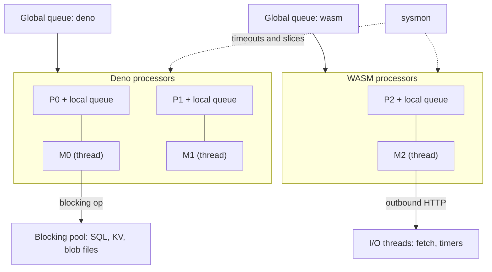
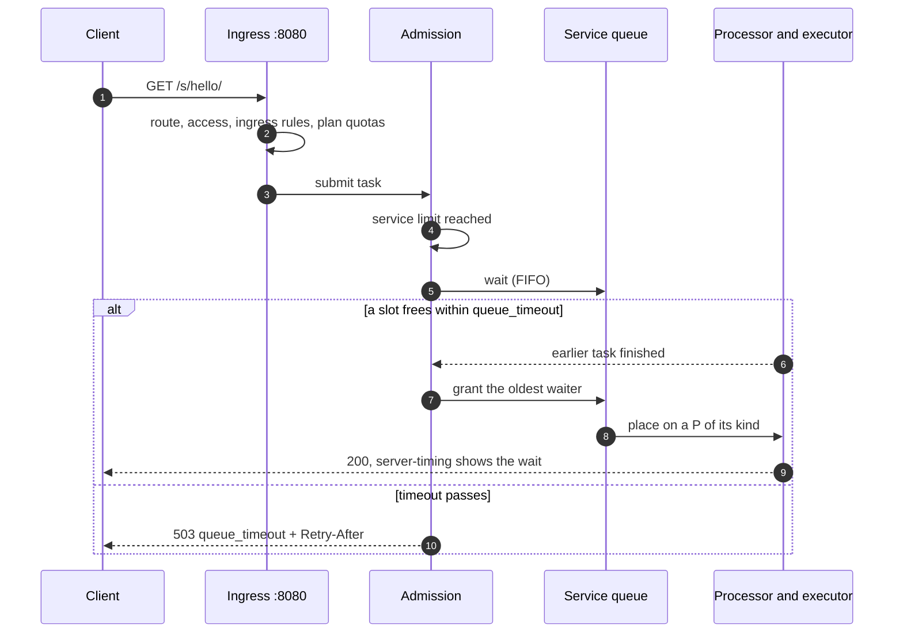

# Scheduler and autoscaling

Every request, schedule fire, queue batch, service call and build becomes a **task** that the node's scheduler
places on a CPU. This page explains how that scheduler works, why a busy service makes requests wait instead of
answering `429`, and how per-service concurrency and warm capacity follow demand. It is written for developers who
want to understand latency and for operators who tune a node.

!!! tip "Short version"
    - Capacity never returns `429`. A request over the current limit waits in its service's queue and runs when a slot
      frees up. Only when the wait runs out does it get `503 queue_timeout` with `Retry-After`.
    - Each service's concurrency limit is adaptive. Set `scaling.max_instances` only if you need a hard cap.
    - Warm instances follow recent demand and scale to zero when a service goes idle, unless
      `scaling.min_instances` keeps a floor.
    - The profile (`max_density`, `balanced`, `min_latency`) decides how long requests may wait and how much the node
      keeps warm.

## The model: tasks, processors and machines

The scheduler follows the design of Go's runtime scheduler (the "GMP" model). If you have read Go's `proc.go`, the
vocabulary will look familiar.

| Term | What it is | Go equivalent |
|---|---|---|
| **Task** | One unit of work: an invocation (HTTP, interval, cron, queue, call) or a build. Kinds `deno`, `wasm`, `build` | goroutine (G) |
| **Processor (P)** | A run slot with a kind. A P only runs tasks of its kind and owns a local run queue | P (`GOMAXPROCS`) |
| **Machine (M)** | An OS thread that executes the tasks of the P it holds | M |
| **sysmon** | A monitor thread without a P: timeouts, limits, preemption, re-kinding, autoscaling, memory | `sysmon` |



### Processors per executor kind

`sched.processors` sets the number of Ps (`0`, the default, follows the container's CPU quota or the core count).
The Ps are split between the two executor kinds within `sched.kinds.deno.{min,max}` and `sched.kinds.wasm.{min,max}`
(defaults: at least 1 each, `max = 0` means "all Ps minus the other kind's minimum"). Builds get their own
low-priority Ps (`build.threads`, at most 2) outside `sched.processors`, so compiling a service never takes CPU from
requests.

The split is **elastic**. Every `rebalance.interval`, sysmon compares the pressure of each kind (runnable + running +
memory-waiting tasks per P). When one kind is over `rebalance.up_threshold` (2.0) and the other has an idle P above its
minimum, that P switches kind. A P re-kinds at most once per `rebalance.cooldown` (1 s), and a P whose thread still
holds started Deno tasks is never re-kinded. A kind with no live services can shrink to zero.

### Machines and thread pinning

A Machine is an OS thread. It never blocks on a system call: SQL, KV and blob file work goes to the
[blocking pool](#blocking-pool-for-service-data), outbound HTTP and timers to the I/O threads. While a task waits for
one of those, the P runs other tasks.

V8 isolates are bound to the thread that created them. Once a Deno task has started, it is **bound** to its M and
resumes only there; a WASM task can resume on any WASM P. One M holds at most `deno.max_bound_per_m` started Deno tasks
(64 in `balanced`); at that cap it only resumes the ones it has, and new tasks stay in its local queue where other
Ps can steal them. With `sched.pin_threads` (on in `min_latency`) each M is pinned to a core.

## Run queues and work stealing

Each P has a local run queue (256 entries) plus a one-task `runnext` slot; each kind has a global run queue.

- **New work** (a request, a schedule fire, a queue batch) goes to the shorter local queue of two randomly chosen Ps of
  its kind, or to the global queue when both are full.
- **A service call of the same kind** goes into the caller's `runnext`, so the child starts next on the same P with
  warm caches.
- **An idle P** looks for work in this order: resumable Deno tasks of its M, `runnext`, its local queue, a batch from
  the global queue, then it steals half of another P's local queue of the **same kind**. A WASM P never steals Deno
  work and the reverse. Every 61st pick it checks the global queue first, so nothing starves there.
- With nothing to do, an M spins for `sched.spin_us` (0 / 10 / 50 µs by profile) and then parks. An idle node uses
  almost no CPU.

## Time slices, preemption and limits

A task may run for one time slice (`sched.time_slice`: 20 / 10 / 5 ms) before the scheduler intervenes. What
"intervene" means depends on the executor:

| | WASM | Deno |
|---|---|---|
| Time slice used up | Real preemption: the instance yields at the next epoch check and goes to the back of the local queue | V8 cannot yield mid-JavaScript. **Hog handoff**: sysmon moves the hogging P's queued tasks to the global queue so other Ps start them |
| `sched.handoff_on_hog` (on in `min_latency`) | | sysmon gives the hogging P to a spare M, so the queue keeps moving while the hog finishes on its old thread |
| CPU limit (`limits.cpu_ms`) | Trap at the next epoch check: `502 cpu_limit` | The isolate is terminated: `502 cpu_limit` |
| Wall limit (`limits.wall_ms`) | Cancelled: `504 timeout` | Terminated or dropped: `504 timeout` |
| Memory limit (`limits.memory_mb`) | Growth refused, trap: `502 oom` | Heap or `ArrayBuffer` limit: `502 oom` (a resizable buffer throws `RangeError`) |

CPU time is measured per task on its own thread, and time a [blocking-pool](#blocking-pool-for-service-data) job
spends on the task's behalf is added to it. The [execution model](execution.md) page covers limits per trigger.

## sysmon

sysmon is a dedicated thread with no P. Its tick starts at 20 µs, doubles after 1 ms without anything to do, and stops
growing at `sysmon.max_tick` (20 / 10 / 2 ms). Any action resets it to 20 µs.

| Duty | How often | What it does |
|---|---|---|
| Queue timeouts | every tick | Tasks that did not start within their `queue_timeout` end with `503 queue_timeout` |
| Limits | every tick | CPU and wall checks of running tasks |
| Hog detection | every tick | A task past its time slice: WASM epoch bump, Deno hog handoff |
| Lost-wakeup guard | every tick | Global queue has work, a P is idle, nobody spins: wake a P |
| Re-kinding | `rebalance.interval` (250 / 100 / 50 ms) | Move idle Ps to the busier kind |
| Autoscaler | `rebalance.interval` | Adapt concurrency limits, publish warm targets, refresh the `Retry-After` estimate (on its own thread) |
| Memory | `memory.check_interval` (250 ms) | Wake memory waiters; at `Critical` pressure switch the node to `shed` mode, and back once below `High` |
| Stats | 1 s | Update gauges and run a self-check |

## Blocking pool for service data

SQL statements, KV operations and blob file I/O run on the blocking pool, not on a P. The pool has `blocking.threads`
threads (`0` = `max(4, cores)`) and is fair between tenants:

- each tenant has its own FIFO lane, and lanes are served round-robin;
- under contention one tenant occupies at most `floor(plan.blocking_share × threads)` threads (`blocking_share` is
  0.25 by default, at least 1 thread);
- the pool is work-conserving: when threads are idle, a busy tenant may borrow more, always leaving one thread free
  for a tenant that arrives;
- the thread CPU time of each job is charged to the calling task, and a single SQL statement is aborted after
  `storage.sql_budget_ms` (1,000 ms) with `sql_timeout`.

So a tenant that runs a heavy cross join slows down its own queries, not another tenant's KV reads.
`blocking_share` is a [plan](tenants-and-plans.md) setting.

## Admission: queueing instead of 429

When a request arrives, admission decides whether it runs now, waits, or is refused. A busy service does **not** get
`429`: capacity problems turn into waiting, and only a wait that runs out becomes an error.

| # | Check | Outcome |
|---|---|---|
| 0 | Call depth over 15 | `508 call_depth` |
| 1 | Node in `drain` mode | `503 draining` |
| 2 | Node in `shed` mode and this version is not in RAM (T1) | `503 shed` + `Retry-After` |
| 3 | A run slot is free: the service's adaptive limit (at most `scaling.max_instances`), the tenant's plan cap (`max_concurrency`) and the node's `sched.max_inflight` (less a 1/8 reserve) | **Run now** |
| 4 | Otherwise: room in the queues (node `sched.max_queued` / `sched.max_queued_mb`; one service and one tenant may each hold half of either; `scaling.max_queued` can only lower the service's share) | **Wait** in the service's FIFO queue, else `503 overloaded` + `Retry-After` |

Service-to-service calls (`std:services`) and pub/sub `request()` reply deliveries run on behalf of a task that already
holds a slot: they are served before the service's waiting requests and may use the 1/8 reserve. They are held by
`scaling.max_instances`, by the tenant's call allowance (calls in flight at each call depth, at most the plan's
`max_concurrency`) and by `sched.max_inflight`. One exception: a call or request reply that a task of the **same
service** made (a self-call, or a `request()` on a subject the service answers itself) may run past
`max_instances` on the instance its parent lends. Its parent waits for it while holding one of the service's
instances, so at `max_instances: 1` it could otherwise never start and would end `queue_timeout`. Each waiting parent
lends one instance: a `Promise.all` of self-calls from one task runs one child past `max_instances` at a time, the
others wait for it (a child that calls itself again lends its own). Request replies carry no parent id, so each
running one counts as its own lender. The overshoot is the number of lending parents, never more than the call depth
limit (15). The call still takes the tenant's call allowance at its depth, a `max_inflight` slot and its own memory
reservation. Request replies are calls: they use the `max_inflight` call reserve and the per-depth allowance, not the
tenant's request cap. An indirect cycle (A calls B, B calls A) is not detected: keep `max_instances` above 1 for services in one.

Then, while it waits:

- A waiting request that gets no slot within its **queue timeout** ends with `503 queue_timeout` + `Retry-After`. The
  timeout comes from the service's profile: `min_latency` 1 s, `balanced` 5 s, `max_density` 10 s. An explicit
  `sched.queue_timeout` in `rt.toml` overrides it node-wide. The same budget covers waiting for a P, for the artifact
  to load or compile, and for memory.
- A client that disconnects while waiting is taken out of the queue at once. A request that has started runs on.
- `Retry-After` is the time the current waiters need to drain at the recent completion rate, between 1 and 60 s,
  plus up to 50 % random jitter so refused clients do not come back in lockstep.

The full flow for a request that has to wait:



The time a request spent waiting shows up in the `queue` phase of its `server-timing` response header.

### Where 429 still comes from

`429` is reserved for quotas the operator configured in the tenant's plan: the tenant-wide `rps` token bucket,
`invocations_per_day`, and a service's own `ingress.rate_limit`. These are checked at ingress, before admission. The old
`tenant_concurrency` and `service_concurrency` reasons are no longer produced. See
[error reasons](../reference/errors.md#invoke-reasons-x-rt-reason).

### Slot classes and fairness

- **Requests** (HTTP, interval, cron, queue) are held by all three limits and may use `sched.max_inflight` minus 1/8.
- **Service-to-service calls** run on behalf of a request that already holds slots. They may use the whole
  `max_inflight` (the 1/8 reserve is for them and for builds), count against the tenant cap without waiting for it,
  and are served before the target's waiting requests. Nested calls therefore cannot deadlock behind their parents. One
  task has at most 16 calls in flight; further calls wait within its deadline.
- **Builds** count in `max_inflight` only and never wait.
- **Fairness**: when slots free up, the waiting work is ordered as described in [Admission order](#admission-order)
  below. A service's own requests keep their arrival order unless their predicted run times differ.
- **Queue consumption**: a service consumes its durable queue with at most `queue.max_concurrency` (4) tasks at once,
  within its concurrency limit.

!!! note "Plan caps are per tenant"
    The plan's `max_concurrency` (10 on the built-in `free` plan) bounds all running tasks of a tenant. Requests over it
    wait like any other. A plan change applies with the next request.

### Admission order

When a run slot frees up, the scheduler grants it to the waiting task that comes first in this order:

1. **Calls before requests** within a tenant. Calls are served FIFO among themselves. Builds never wait.
2. **Between tenants, least service first.** Each tenant has a virtual slot time. A grant charges the tenant the task's
   predicted run time, and the charge is corrected to the actual run time when the task finishes. The backlogged
   tenant with the least virtual time goes first, so equal tenants alternate. An idle tenant comes back at most 20 ms
   behind the others, so it cannot bank credit and then take the whole node.
3. **Between a tenant's services, earliest deadline first.** Each waiting task gets a deadline key:
   `arrival + min(sched.aging_factor × predicted, queue_timeout / 2)`. A task predicted short gets an early key and
   overtakes long tasks that arrived a little before it. A task predicted long gets at most half its queue timeout of
   credit, so it is overtaken only by work that arrived within that window and is not starved into a timeout. With
   `sched.aging_factor = 0` the order inside a tenant is plain arrival order.

The prediction is an exponentially weighted average (gain 1/8) of the run time of the service version, measured from
slot grant to finish. Interactive work (HTTP, calls, pub/sub) and background work (queue, stream, schedules) keep
separate averages, so slow batch consumers do not inflate the estimate for a service's requests. Until a task has a
sample, the prediction is 50 ms. Samples are clamped to at least 1 ms and at most 1 h. A task killed by its wall limit
counts as a sample of the time it ran before the kill.

**Behaviour change.** Earlier releases gave each tenant one turn and then each of its services one turn, one task per
turn. Now the services of one tenant share a single deadline order. Tasks with similar predicted run times still run in
arrival order, but a service with short tasks no longer gets an equal share of turns regardless of how long its tasks
take. Set `sched.aging_factor = 0` for the old within-tenant arrival order.

**Guarantees.** A waiting task can be overtaken within its tenant only by calls, and by tasks that arrived within
its own deadline window. Between tenants, two always-busy tenants' slot time over any window differs by at most one
tenant quantum (20 ms) plus the longest predicted run time.

Constants (built into the runtime, not configuration):

| Constant | Value | Meaning |
|---|---|---|
| Default prediction | 50 ms | Used before the first sample of a service version |
| Minimum prediction | 1 ms | Lower bound of a sample |
| Maximum sample | 1 h | Upper bound of a sample |
| EWMA gain | 1/8 | Weight of each new sample |
| Tenant quantum | 20 ms | The most credit an idle tenant can bank |
| Delay credit cap | 1/2 of `queue_timeout` | Upper bound of a long task's deadline credit |

Node setting: `sched.aging_factor` (default 4, `0` to 64). See [configuration](../config.md).

## Instances and autoscaling

An **instance** is one concurrently running copy of a service on the node: a Deno isolate or a WASM instance. A
service's concurrency limit is therefore its instance target, and the autoscaler moves it between two bounds you can
set per service. Scaling is per node; there is no multi-node scaling.

| Setting | Meaning | Default | Upper bound |
|---|---|---|---|
| `scaling.min_instances` | Instances kept warm. The service never scales to zero, and the concurrency limit never falls below it | 0 (scale to zero) | the plan's `max_instances` |
| `scaling.max_instances` | Most instances running at once. Requests beyond it **wait** in the service's queue; they are not refused. Only the service's own nested calls and request replies may exceed it (see [Admission](#admission-queueing-instead-of-429)) | the plan's `max_instances`, else the profile ceiling (256 / 1,024 / 1,024) | the plan's `max_instances` |

The plan's **`max_instances`** is a per-service limit the operator sets (0 = the node default; the example plans in the
configuration use `free` 4, `pro` 32, `business` 256). A larger value on a service is clamped to it, and the service's
`effective` block shows `plan` as the source. `min_instances` above `max_instances` is `422 validation_failed`. The
tenant-wide plan cap `max_concurrency` bounds all of a tenant's services together on top of that.

=== "21ci"

    ```bash
    21ci service update hello --min-instances 2 --max-instances 16 --set scaling.max_queued=200
    21ci service update hello --unset scaling.max_instances     # back to the plan's limit or the profile ceiling
    21ci service get hello                                      # Instances: min 2 (service), max 16 (service)
    ```

=== "curl"

    ```bash
    curl -sS -X PATCH -H "Authorization: Bearer $RT_KEY" -H 'Content-Type: application/json' \
      -d '{"scaling": {"min_instances": 2, "max_instances": 16, "max_queued": 200}}' \
      "$RT_API/v1/services/$SVC"
    ```

A `PATCH` replaces the whole block you send (`21ci service update` merges your fields into the current block for you).
`max_queued` bounds this service's queue; over it new requests get `503 overloaded`. `scaling.max_concurrency` is the
old name of `max_instances`: the API and `21ci --set` still accept it, and it is never returned.

### How the limit moves

Once per `rebalance.interval` (100 ms) the autoscaler, on its own thread, adjusts each service's limit. It works like
TCP congestion control (slow start, then additive increase, multiplicative decrease), guarded by latency and by the
arrival-rate trend. Scale-up is fast (one step per tick, doubling during slow start); scale-down is slow (one 1/8 step
per 10 s cooldown).

| Signal (first match wins) | New limit | Metric `cause` |
|---|---|---|
| Node memory pressure `Critical` | halve | `memory` |
| Memory pressure `High` | −25 % | `memory` |
| Mean latency above the service's baseline × tolerance | −25 % | `latency` |
| The kind's Ps are saturated (p90 run-queue wait > 2 × time slice) and the service runs more than its start limit | −25 % | `cpu` |
| Requests waited and the limit was reached (**queue length**) | grow: double below the slow-start threshold, then `+√limit`, never more than the queue asked for. When requests waited longer than a quarter of the queue timeout (**queue wait**), double regardless | `queue` |
| The arrival rate rose fast and the limit is at least 75 % used, before a queue forms (**trend**) | grow like the queue rule, to at most `rate × latency × 1.25` once the latency is known | `trend` |
| No queue, less than half the limit in use, last change older than the cooldown | decay by 1/8 toward the start limit | `idle` |

- **Bounds.** The limit stays within `[min, max]`: `max` is `max_instances` (else the plan's limit or the profile
  ceiling) and the tenant cap, `min` is the profile floor raised to `min_instances`. The start value is raised to
  `min_instances` and capped by `max_instances`. A service update that moves the bounds pulls the limit inside them
  at its next request (cause `bounds`).
- **Arrival rate** is the requests that reached admission per second (queued and refused ones count, builds do not),
  kept as a fast (0.5 s) and a slow (10 s) moving average. It counts as *rising* when the fast one is at least 1.5 ×
  the slow one and at least 5 req/s above it, so the trend rule grows the limit before requests start to queue.
- **Latency** is measured from slot grant to finish, without artifact waits. The baseline is a moving average that
  follows improvements fast and regressions slowly, so a lasting change (a slower upstream API) becomes the new normal
  instead of throttling the service forever. A tick needs at least 3 completions and more than 2 ms above the baseline
  to count as unhealthy.
- **Decreases** cut what the service actually uses (at least its start limit), so a service that did not cause a
  node-wide signal settles near its start value, not at its floor. A CPU cut only hits services running more than
  their start limit.

| Profile | Start | Min | Ceiling | Latency tolerance |
|---|---|---|---|---|
| `max_density` | 4 | 1 | 256 | 300 % |
| `balanced` | 16 | 2 | 1,024 | 200 % |
| `min_latency` | 32 | 4 | 1,024 | 150 % |

These are profile constants, not config keys. To bound a service yourself, set `min_instances` and `max_instances`.

### What you can see

`status.admission` of `GET /v1/services/{s}` (also `admission` in `…/stats`, `21ci service stats`, and `services[]` of
`GET /v1/node/scheduler`) is the service's admission view, `null` while the service has not run recently:

| Field | Meaning |
|---|---|
| `limit`, `min`, `max` | The adaptive concurrency limit and its current bounds |
| `instances` | Instances running now |
| `min_instances`, `max_instances` | The effective bounds |
| `target_instances` | The warm target the autoscaler wants kept |
| `running`, `queued`, `max_queued`, `queue_wait_ms`, `queue_timeouts` | What runs, what waits, the smoothed wait of queued requests, `503 queue_timeout` count |
| `rps`, `demand`, `latency_baseline_ms`, `warm_per_proc` | Smoothed arrival rate, decaying peak of running tasks, the latency baseline, warm instances per processor |
| `last_change` | `{reason, from, to, ago_ms}` with the reasons `queue`, `trend`, `latency`, `memory`, `cpu`, `idle`, `bounds` |

Metrics: `rt_autoscale_adjustments_total{direction,cause}` and, for labelled services, `rt_service_min_instances`,
`rt_service_max_instances`, `rt_service_target_instances` and `rt_service_arrival_rate`.

## Warm targets and scale to zero

From the same tick, the autoscaler publishes a **warm target** per service and version: how many ready instances each
P of its kind should keep, so the next request does not pay for creating one.

- **Demand** is a decaying peak of the service's running tasks (half-life 15 s).
- **Per P**: `ceil(demand × headroom / Ps of the kind)`, capped by the profile (headroom 100 % / 125 % / 150 %, at most
  1 / 4 / 16 per P for `max_density` / `balanced` / `min_latency`). Below half an instance of demand there is no target.
- **Node cap**: all warm instances together stay within `sched.warm_share` of the memory budget (5 % / 15 % / 30 %);
  the services with the lowest demand are trimmed first. Targets are halved at `High` memory pressure and dropped at
  `Critical`.
- **Scale to zero**: once a service has been idle longer than its idle TTL, its target is 0 and the executors drop what
  they kept.

The executors converge on these targets between tasks: WASM pre-instantiates fresh instances (or keeps reusable ones
when `wasm.reuse_instances` is on), Deno keeps reusable isolates when `deno.reuse_isolates` is on. Warm instances are
kept per service and are never shared between services or tenants, even when two services deploy identical code. The
[caching](caching.md#warm-instances-are-not-the-code-cache) page explains how this differs from the code cache.

### The `min_instances` floor

`min_instances` is a floor under all of the above: each P of the service's kind keeps
`ceil(min_instances / Ps of the kind)` ready instances, so at least `min_instances` in total. The floor is not cut by
the profile cap, the idle TTL, the memory share or `High` pressure; only `Critical` memory pressure releases it. A
service with a floor also keeps its admission state while idle.

The floor does not wait for traffic. The node pins every routable service with `min_instances > 0` when it starts,
when a version goes live, and when the service's scaling, profile or plan changes: the live version is loaded (or
built) into memory off the request path and the executors pre-warm it. A service that loses its floor, is deleted or
stops being routable is released. Warm instances cost memory whether or not requests come, so keep floors for
latency-sensitive services.

## Degradation modes

The node is always in one of three modes, shown as `mode` in `GET /v1/node/status`:

| Mode | Effect | How it starts and ends |
|---|---|---|
| `normal` | Everything is admitted as described above | default |
| `shed` | Requests whose version is in RAM (T1) are served; anything that would need a load or compile gets `503 shed` + `Retry-After` | automatically at `Critical` memory pressure (back to `normal` once below `High`), or set by the operator |
| `drain` | Every new task gets `503 draining`; `/readyz` turns `503`; running tasks finish | `POST /v1/node/drain`, `degradation_mode: "drain"`, or shutdown. One-way: restart to resume |

A mode the operator sets is kept: automatic shedding never overrides it.

=== "21ci"

    ```console
    $ 21ci node config set degradation.mode=shed
    Applied: degradation_mode
    $ 21ci node config set degradation.mode=normal
    $ 21ci node drain
    ```

=== "curl"

    ```bash
    curl -sS -X PUT -H "Authorization: Bearer $RT_ROOT_TOKEN" -H 'Content-Type: application/json' \
      -d '{"degradation_mode": "shed"}' "$RT_API/v1/node/config"
    curl -sS -X POST -H "Authorization: Bearer $RT_ROOT_TOKEN" "$RT_API/v1/node/drain"   # 202
    ```

## How profiles change scheduling

A profile fills every knob you did not set explicitly. The node's `node.default_profile` covers node-wide knobs; a
service's `profile` covers its own (queue timeout, concurrency constants, warm headroom, reuse).

| Knob | `max_density` | `balanced` | `min_latency` |
|---|---|---|---|
| `sched.queue_timeout` | 10 s | 5 s | 1 s |
| `sched.time_slice` | 20 ms | 10 ms | 5 ms |
| `sched.spin_us` | 0 | 10 | 50 |
| `sched.pin_threads`, `sched.handoff_on_hog` | off | off | on |
| `sysmon.max_tick` | 20 ms | 10 ms | 2 ms |
| `rebalance.interval` | 250 ms | 100 ms | 50 ms |
| `deno.max_bound_per_m` | 128 | 64 | 32 |
| `sched.warm_share` | 5 % | 15 % | 30 % |
| Concurrency start / ceiling | 4 / 256 | 16 / 1,024 | 32 / 1,024 |
| Warm headroom / max per P | 100 % / 1 | 125 % / 4 | 150 % / 16 |

`max_density` packs more services onto a node and lets requests wait longer; `min_latency` spends CPU (spinning,
pinned threads) and memory (warm instances) to cut tail latency. The
[performance guide](../guides/performance.md) shows how to choose, and
[profiles at a glance](../config.md#profile-differences-at-a-glance) lists every profile-controlled key.

Some scheduler keys can change without a restart: `sched.max_inflight`, `sched.max_queued`, `sched.max_queued_mb`,
`sched.queue_timeout`, `sched.spin_us`, `sched.time_slice`, `sched.handoff_on_hog`, `sysmon.max_tick`,
`rebalance.interval` and `deno.max_bound_per_m` are re-read on `SIGHUP` (see
[applying changes](../config.md#live-updatable-vs-restart-required)). `sched.processors`, `sched.warm_share` and thread counts
need a restart.

## Observing the scheduler

=== "21ci"

    ```console
    $ 21ci node status        # mode, processors per kind, memory pressure, in-flight tasks
    $ 21ci node scheduler     # Ps, Ms, run queues, admission bounds and one row per busy service
    $ 21ci stats hello        # one service: adaptive limit, running, queued, queue wait, autoscaler
    ```

=== "curl"

    ```bash
    curl -sS -H "Authorization: Bearer $RT_ROOT_TOKEN" "$RT_API/v1/node/status"
    curl -sS -H "Authorization: Bearer $RT_ROOT_TOKEN" "$RT_API/v1/node/scheduler"
    curl -sS -H "Authorization: Bearer $RT_KEY" "$RT_API/v1/services/$SVC/stats"
    ```

`GET /v1/node/scheduler` (operator token; `21ci node scheduler --json` prints it raw) returns `mode`, `procs` (per P:
`kind`, `status`, `lrq_len`, `busy_ns`, steals, preemptions, re-kinds), `machines` (per M: held P, `bound_count`,
`spinning`, `parked`), the global queue lengths `grq`, `idle`, `spinning`, `waiting_runtime`, `waiting_memory`,
`inflight` and task counters, plus the node-wide `admission` bounds and `services`: one admission view per service
that has run recently.

A service's own admission view is `status.admission` in `GET /v1/services/{s}` and `admission` in
`GET /v1/services/{s}/stats` (scope `logs:read`): the adaptive `limit` with its `min` and `max`, `running`, `queued`,
`max_queued`, the smoothed `queue_wait_ms`, `queue_timeouts`, the autoscaler's `demand`, `latency_baseline_ms`,
`warm_per_proc` and `idle_ms`. It is `null` while the service is idle. This is the first place to look when a
service answers `503 queue_timeout`.

For a running trace, start the node with `RT_SCHEDTRACE=<ms>`. It prints one line per interval to stderr:

```text
SCHED 1000ms: procs=4 deno=3 wasm=1 idle=1 spinning=0 grq=[deno:12 wasm:0 build:1] lrq=[3 0 5 | 0] bound=[2 0 1] waitrt=4 waitmem=0
```

`waitrt` counts tasks waiting for their artifact to load or compile, `waitmem` tasks waiting for memory.

Prometheus series on the metrics listener (the [metrics reference](../reference/metrics.md) has the full list):

| Series | Use it to see |
|---|---|
| `rt_admission_running`, `rt_admission_queued`, `rt_admission_queued_bytes` | Slots in use and requests waiting, node-wide |
| `rt_admission_queue_wait_seconds` | How long queued requests waited (histogram) |
| `rt_admission_rejects_total{reason}` | `queue_timeout`, `overloaded`, `shed`, `draining`, … |
| `rt_autoscale_adjustments_total{direction,cause}` | Why limits went up or down |
| `rt_warm_target_instances{kind}` | Warm instances the autoscaler asks for |
| `rt_sched_processors{kind}`, `rt_sched_rekinds_total{from,to}` | The P split and how often it moves |
| `rt_sched_grq_len{kind}`, `rt_sched_lrq_len{p}`, `rt_sched_steals_total{kind}` | Run-queue depth and stealing |
| `rt_sched_preemptions_total{kind}`, `rt_sched_hog_handoffs_total` | Long-running tasks |
| `rt_task_phase_seconds{kind,phase}` | Time in `queue`, `wait_runtime`, `init`, `exec` |
| `rt_service_concurrency_limit`, `rt_service_running`, `rt_service_queued`, `rt_service_queue_wait_seconds` | Per service, only with `metrics.per_service = true` |

??? info "Under the hood"
    - Per-service and per-tenant admission state lives in sharded maps of atomics: a request whose slots are free takes
      them with three compare-and-swaps. The queues sit behind one mutex that is only taken when something waits.
    - A waiting request is charged 4 KiB plus its known body size against `sched.max_queued_mb`. `sched.max_queued = 0`
      means 4 × `max_inflight`; `sched.max_queued_mb = 0` means 1/16 of the memory budget.
    - Local run queues are lock-free rings. Overflow moves half of the queue plus the new task to the global queue.
      `runnext` is never stolen.
    - Before a task starts, it reserves memory (Deno: `deno.isolate_base_mb`, WASM: the declared initial memory). If
      the memory governor refuses, the task waits as `WaitingMemory` (FIFO) until memory frees up, within its queue
      timeout.

## See also

- [Execution and isolation](execution.md): isolates, instances and limits per trigger.
- [Caching](caching.md): why the first request after a deploy can be slower.
- [Configuration: `[sched]`](../config.md#scheduler), [`[rebalance]`](../config.md#scheduler),
  [`[blocking]`](../config.md#service-data-storage-blocking), [service `scaling`](../config.md#scheduler).
- [Performance tuning](../guides/performance.md) and [running in production](../guides/production.md).
