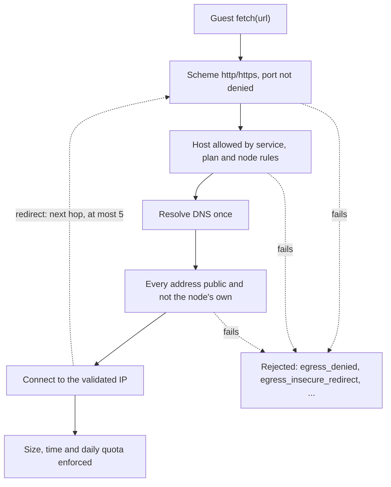

# Security model

A node runs code that you, the operator, did not write and should not trust: services written by other teams,
customers, or an AI assistant. This page describes what the runtime defends against, which boundaries do the work,
how to configure them, and where the current release stops. Read the [gaps](#what-is-not-there-yet) before you put
mutually hostile tenants on one node.

## Threat model

| Who | Wants to | What stands in the way |
|---|---|---|
| Malicious or careless tenant code | Escape the sandbox, read other tenants' data or secrets, reach your internal network, exhaust the node | A fresh isolate or instance per task, no filesystem, socket or process APIs, per-service data files, the SSRF guard, CPU/memory/wall limits, plan quotas and admission |
| A leaked or over-privileged developer key | Act on other tenants, escalate its scopes | Scoped keys, tenant-bound lookups (another tenant's resource is `404`), audit events |
| An attacker on the public listener | Denial of service, header spoofing, guessing keys | Connection and header limits, rate limits, `shed`/`drain` modes, access checks before admission, stripping of `x-rt-*` headers |
| A compromised dependency (npm, CDN) | Inject code at build time | Dependencies are fetched only at build time, from `build.allowed_hosts`, and pinned by hash in the version's `rt.lock` |
| A V8 or wasmtime bug, a side channel | Read another tenant's memory or the master key | Short-lived isolates, frozen clock, no shared memory or threads. The V8 sandbox is **not** in this release ([gaps](#what-is-not-there-yet)) |
| Tampered compiled files on disk | Run code by swapping a `.cwasm` or code cache | A MAC on every compiled file, verified before loading |

## Tenancy and isolation boundaries

```text
Operator (root token, rt.toml)
 └─ Tenant (plan, overrides, API keys)
     └─ Service (runtime, profile, limits ≤ plan, access, egress)
         └─ Version (immutable) ── live pointer
```

A tenant's services, data, logs, keys and usage are visible only to that tenant's keys and the operator. Looking up
another tenant's resource returns `404`, so existence is not revealed.

### One isolate or instance per task

- <span class="rt-badge rt-badge--deno">Deno</span> By default every task gets a **new V8 isolate**: top-level code runs
  per task and no state survives the request. With `deno.reuse_isolates` (default on only in `min_latency`), an
  isolate that finished cleanly may serve later requests of the **same tenant, service and version** on the same
  thread. It is replaced after any error or kill, a leftover timer or `waitUntil`, an env or secret change, 1,000
  requests, idle time or memory pressure.
- <span class="rt-badge rt-badge--wasm">WASM</span> Every task gets a **fresh instance** (possibly pre-instantiated by
  the warm pool, never used before). With `wasm.reuse_instances`, a cleanly finished instance may serve the next task
  of the same service and version on the same processor; a trap, kill, timeout, env change or new version gets a new
  instance.

Warm reuse never crosses a `(tenant, service, version)` boundary. Two services with identical code share compiled code
in the [cache](caching.md), which holds no state, but never an isolate or instance. Each service's KV, SQL and blobs
live in its own files ([storage](storage.md)).

### Limits

| Limit | Deno | WASM | Outcome |
|---|---|---|---|
| Memory (`limits.memory_mb`) | V8 heap limit plus a counting `ArrayBuffer` allocator; wasm memories inside JS count too | `ResourceLimiter` on linear memory growth | `502 oom` (a resizable `ArrayBuffer` throws `RangeError`) |
| CPU (`limits.cpu_ms`) | Thread CPU time per task; the isolate is terminated | Thread CPU time; trap at the next epoch check | `502 cpu_limit` |
| Wall time (`limits.wall_ms`) | Terminated, or dropped while waiting | Cancelled | `504 timeout` |

Service limits cannot exceed the plan's `limits_max` (`422 limit_exceeds_plan`). Work the host does for a task is
charged to it: SQL CPU time counts against `cpu_ms`, a single statement stops after `storage.sql_budget_ms`, the
blocking pool is shared fairly between tenants, and compressed responses are capped on their **decompressed** size.
Defaults per trigger are on the [execution model](execution.md) page.

### Frozen clock

`Date.now()`, `performance.now()` and the WASI clocks advance only at I/O and timer boundaries, never during
synchronous code. A busy loop measures 0 ms. This takes away the high-resolution timer that most cache-timing side
channels need. In WASM, a boundary counts only if the wait really waited, and readings are whole milliseconds.
`security.clock = "frozen"` is the default (`"coarse"` is the alternative).

### Removed APIs

| Runtime | Not available |
|---|---|
| Deno | `Worker`, `SharedWorker`, `SharedArrayBuffer`, `Atomics.wait` / `waitAsync` / `notify`, `ShadowRealm`, `caches` (`WebSocket` connects out only, through the egress guard); the `Deno` namespace is reduced to `Deno.env` (read-only); `import()` of anything outside the deployed bundle fails with `module_not_in_bundle`; no inspector in any build |
| WASM | No filesystem preopens; `wasi:sockets` denies every address; components that use threads or shared memory are rejected at deploy (`422 invalid_artifact`) |

## Egress: the SSRF guard

Guest code may call the public internet by default. Every outbound request, `fetch` in Deno and
`wasi:http/outgoing-handler` in WASM, goes through the egress guard, which is always on:



| Rule | Default |
|---|---|
| Schemes | `http` and `https` only |
| Denied addresses | Loopback, RFC 1918 private, link-local (including the `169.254.169.254` metadata address), CGNAT `100.64.0.0/10`, `0.0.0.0/8`, `192.0.0.0/24`, `198.18.0.0/15`, `240.0.0.0/4`, broadcast, multicast, unspecified; IPv6 loopback, ULA, link-local, site-local, multicast, unspecified and Teredo; IPv4-mapped and 6to4 addresses are judged by the IPv4 address they embed |
| Self-denylist | The addresses of every listener and network interface of the node, every binding `base_url` (and S3/OTLP endpoints when configured), plus `egress.denied_cidrs`. Resolved before the node serves and refreshed every 5 minutes |
| DNS | Resolved once; every address is checked; the connection goes to the validated IP, so DNS rebinding does not work |
| Redirects | Followed by the guard and re-checked per hop, at most 5. `https` → `http` fails with `egress_insecure_redirect` unless `egress.allow_https_downgrade = true` |
| Ports | `egress.denied_ports` = 25, 465, 587 (no direct SMTP) |
| Hosts | Node-wide `egress.denied_hosts`; per service `egress.allowed_hosts` (non-empty = allowlist) and `egress.denied_hosts`. Entries match the host exactly or as a dot-suffix (`telegram.org` covers `api.telegram.org`) |
| Plan | `egress_default = "deny"` turns every service of the plan into allowlist-only; `egress_mb_per_day` caps daily egress (`egress_quota`) |
| Per task | 50 fetches, 6 concurrent for HTTP and calls (200 / 6 for schedules and queues); response ≤ 100 MB after decompression, inflate ratio over 100 aborts; connect timeout 10 s; total within the task's wall time |
| Connection reuse | Pooled per tenant and per validated address: a kept-alive connection never carries another tenant's requests |

A refused fetch rejects with a `TypeError` whose message is the code: `egress_denied`, `egress_limit`,
`egress_too_large`, `egress_quota`, `egress_timeout`, `egress_dns`, `egress_upstream`. The builder's dependency
fetches use the same guard with `build.allowed_hosts`.

Lock a service down to the APIs it needs:

```bash
curl -sS -X PATCH -H "Authorization: Bearer $RT_KEY" -H 'Content-Type: application/json' \
  -d '{"egress": {"allowed_hosts": ["api.telegram.org"], "denied_hosts": []}}' \
  "$RT_API/v1/services/$SVC"
```

Operator [bindings](../guides/operator-sdks.md) (`platform.fetch`) are the sanctioned way to reach your own internal
APIs: they bypass the public-egress rules but are restricted to their `base_url`, `allowed_methods` and
`allowed_paths`, and inject credentials the guest never sees. Only operator SDK services (the system tenant) reach
them, on behalf of the tenant that called the SDK: a tenant's own `platform.fetch` is `403 binding_not_allowed`.

## Ingress

On the public listener, a request passes these checks in order before it can take a run slot:

1. **Route**: slug, `{slug}.{routing.base_domain}` or an active custom host.
2. **Plan**: the tenant's plan must allow the `http` trigger (`403 trigger_not_allowed`).
3. **Access** (`access` on the service): `public`, `key` (an `rtk_…` key with `invoke` scope, or the root token,
   else `401`) or `internal` (`404` on the public listener).
4. **Ingress rules** (`ingress` on the service): `allowed_methods` (`405`), `allow_paths` (exact paths, or prefixes ending
   in `*`; `403`), `ip_allow` IPv4 and IPv6 CIDRs (`403`), `rate_limit {rps, burst}` (`429`).
5. **Quotas**: plan `rps` and `invocations_per_day` (`429`).
6. **Admission** ([scheduler](scheduler.md#admission-queueing-instead-of-429)).

Before the request reaches your handler, the runtime cleans its headers:

- Every client-sent `x-rt-*` header is removed, including `x-rt-key` and any spoofed `x-rt-client-ip`: only the
  runtime sets `x-rt-*` headers.
- An `Authorization: Bearer rtk_…` (a tenant API key) is always removed, whether or not it admitted the request, and
  so is the root token when it passed an `access = key` check. Any other `Authorization` header is your handler's own
  and arrives unchanged, so you can check your own tokens. Clients of an `access = key` service that also need their
  own token send the invoke key in `x-rt-key`.
- Hop-by-hop headers are removed.
- For HTTP requests the runtime adds `x-rt-client-ip` (also `ctx.client.ip` in Deno): the client address as ingress
  resolved it: the TCP peer or, when the peer is in `ingress.trusted_proxies`, the first `X-Forwarded-For` hop from the
  right that is not a trusted proxy. A client-sent `x-rt-client-ip` is removed first, so it cannot be spoofed. It is
  absent for schedules, queues, service calls and on the internal socket.

Node-wide connection limits live in [`[ingress]`](../config.md#ingress):

| Key | Default | Protects against |
|---|---|---|
| Request head | ≤ 16 KB and ≤ 100 headers (`431`) | Oversized headers |
| `header_timeout` | 10 s | Slowloris |
| `idle_timeout` | 60 s | Idle keep-alive connections |
| `max_conns_per_ip` | 256 (trusted proxies exempt) | Connection floods; closures count in `rt_ingress_conn_rejected_total` |
| `h2_max_streams` | 100, plus a stream-reset rate guard | HTTP/2 rapid reset |
| `sse_streams_per_key` | 10 | Log-stream exhaustion |
| `trusted_proxies` | `[]` | CIDRs whose `X-Forwarded-For` is believed; without it, client IP rules and per-IP limits see the proxy |

`rt` does not terminate TLS: put a reverse proxy in front of the **public** listener only, and keep the control and
metrics listeners on loopback or a VPN, since they have no network ACL. See [running in production](../guides/production.md).
Custom hosts need a plan suffix and DNS TXT verification or operator approval
([custom domains](../guides/custom-domains.md)).

## Authentication and authorization

| Principal | Credential | Notes |
|---|---|---|
| Operator | `RT_ROOT_TOKEN` (or `RT_ROOT_TOKEN_FILE`) as `Authorization: Bearer …` or `x-rt-key` | All routes; compared in constant time. A release build without it answers every control route `503 control_disabled`. A debug build without it serves the control API openly and refuses to start unless `listeners.control` is a loopback address |
| Tenant key | `rtk_<key_id>_<secret>` | The secret is 43 base62 characters (about 256 bits), shown once at creation. Only `HMAC-SHA256(pepper, secret)` is stored, with a pepper derived from the master key, and compared in constant time. Revocation takes effect at once |

Keys carry **scopes** (`services:read`, `services:write`, `deploy`, `invoke`, `logs:read`, `env:write`,
`secrets:write`, `queue:write`, `data:admin`, `keys:write`), can be limited to a list of projects (`prj_…` ids) and environments and can expire. A key limited to
some projects or environments sees the other services as `404`. Operator-only routes (`/v1/node/*`, `/v1/plans`, `/v1/tenants*`) answer
tenant keys `403 insufficient_scope`; the one exception is a key with `logs:read` reading its own tenant's
`GET /v1/tenants/{t}/usage`. Any valid credential may call `GET /v1/me` (who am I, which scopes, which plan) and
`GET /v1/version`. Details: [tenants, plans and keys](tenants-and-plans.md).

A key with `keys:write` can mint further keys for its own tenant, but never with more scopes, services or lifetime
than itself (`403 insufficient_scope`, `details.reason: "escalation"`). The MCP endpoint (`POST /mcp`) accepts tenant
keys only, refuses the operator token and any non-loopback `Origin`, and runs every tool as a control API call with the
caller's key, so an AI assistant can do exactly what its key allows. See [AI assistants (MCP)](../mcp.md).

**Failed authentication is rate-limited** per client: after 10 failures in a minute, `429 rate_limited` with
`Retry-After`. A client is an IPv4 address or an IPv6 /64, found by walking `X-Forwarded-For` through
`ingress.trusted_proxies`, so clients behind one proxy do not share a lockout. The control API and `access = key`
invokes on the public listener have separate budgets, so wrong invoke keys from a shared address cannot lock the
operator out.

## The internal listener

The internal listener (`unix:/data/rt.sock` by default) serves the same invoke routes as the public one, but
**trusted**: no access check, no ingress rules, and the `x-rt-invoker` header is passed through to the handler
(`ctx.invoker` in Deno). Use it for sidecars and jobs on the same host.

- Only processes running as the node's own UID, or a UID listed in `listeners.internal_allowed_uids`, may connect. The
  peer credentials are checked (`SO_PEERCRED` / `getpeereid`) before anything is read; root is allowed only when
  listed.
- A TCP internal listener cannot check the peer, so it needs `listeners.allow_tcp_internal = true`, and then every
  local user is trusted. Prefer the Unix socket.

## Secrets and the master key

The **master key** (`RT_MASTER_KEY` or `RT_MASTER_KEY_FILE`, or `security.master_key_file`: 32 bytes as 64 hex
characters) is the root of the node's cryptography. If none is given, `rt` generates `<data_dir>/master.key` (mode
`0600`). From it the node derives:

- the key that **seals tenant secrets**: AES-256-GCM, a fresh nonce per value, bound to `tenant|service|name`, and
  tagged with the id of the master key that sealed it;
- the **pepper** for API key hashes;
- the **MAC key for compiled code** (T2): every `.cwasm`, code cache and snapshot file carries an HMAC-SHA256 over its
  entry key, file name and bytes, checked before deserialization. A mismatch deletes the entry, rebuilds it from
  source and records a `security.artifact_tamper` event.

Back the master key up separately from the data volume: without it, sealed secrets cannot be opened.

### Rotating the master key

1. Back up `meta.db` and generate a new key: `openssl rand -hex 32`.
2. Restart with `RT_MASTER_KEY=<new>` and `RT_MASTER_KEY_PREVIOUS=<old>`. New secrets are sealed with the new key,
   existing ones still open with the old one, API keys issued before keep working, and the compiled-code cache is
   rebuilt on demand.
3. Re-seal every stored secret under the new key: `rt secrets reseal` (in Compose:
   `docker compose exec rt rt secrets reseal`). It is safe to re-run and exits `1`, naming service and secret, for any
   value neither key opens.
4. API key hashes cannot be re-sealed: have tenants create new keys and revoke the old ones.
5. Once reseal reports `failed: 0` and old keys are revoked, restart without `RT_MASTER_KEY_PREVIOUS`.

## Process hardening

On Linux with `security.seccomp = true` (the default), the node sets `PR_SET_DUMPABLE=0` (no ptrace attach, no core
dump of its memory), `PR_SET_NO_NEW_PRIVS` and `RLIMIT_CORE=0` before it accepts traffic. The container image runs as
the non-root user `10001`; the Compose file adds `cap_drop: ALL` and `no-new-privileges`.

## What is not there yet

These parts of the design are not in this release. They matter for how you deploy.

| Missing | Consequence |
|---|---|
| **V8 sandbox** <span class="rt-badge rt-badge--planned">planned</span> | The node links prebuilt V8 without the V8 sandbox. `GET /v1/node/status` reports `v8_sandbox: false`. `security.require_v8_sandbox` must be `false`: the built-in default is `true`, which makes this release refuse to start (`v8_sandbox_required`), so the container image and every reference config set `false`. A V8 memory-safety bug is not contained by a second layer |
| **seccomp filter and Landlock** | `security.seccomp` applies only the three settings above; there is no syscall filter and no filesystem restriction |
| **Supervisor / executor split** <span class="rt-badge rt-badge--planned">planned</span> | Control plane, master key and tenant code share one process (`--role=all`) |

!!! danger "One node, one trust domain"
    The per-task isolate or instance is the only boundary between tenants. **Do not mix mutually hostile tenants with
    sensitive operator data on one node.** Good fits today: your own teams' services, a single customer per node, or
    tenants whose code you review. Keep operator credentials in [bindings](../guides/operator-sdks.md) used by your
    operator SDKs (they run in the runtime, never in a tenant's isolate), and update the node promptly when V8 or
    wasmtime fixes ship.

## Audit events

Control-plane actions are recorded as events, each with the actor (operator, key id, or system), the tenant, the
service and a data object that never contains secret values. Every event is also written to the system log
(target `rt::audit`).

| Area | Event kinds |
|---|---|
| Deploys | `deploy`, `rollback`, `rollback.auto`, `rebuild`, `build.failed` |
| Services | `service.created`, `service.updated`, `service.deleted`, `service.environment_changed` |
| Config and data | `env.written`, `secret.written`, `secret.deleted`, `data.exported` |
| Triggers | `schedule.created`, `schedule.updated`, `schedule.deleted`, `dlq.redrive`, `dlq.purge` |
| Hosts | `host.attached`, `host.detached`, `host.verified`, `host.expired` |
| Tenants and keys | `tenant.created`, `tenant.updated`, `tenant.deleted`, `key.created`, `key.deleted` |
| Security | `security.artifact_tamper` |

A service's events are in `GET /v1/services/{s}/events` and `21ci events <svc>`; see
[observability](observability.md#events).

## See also

- [Multi-tenancy](multi-tenancy.md): what is isolated per tenant, what is shared, and what is not guaranteed.
- [Isolation compared](isolation-compared.md): this boundary against containers, microVMs and VPSes.
- [Failure behavior](failure-behavior.md): what happens when a limit trips or a component fails.
- [Running in production](../guides/production.md): TLS, ports, backups and the security checklist.
- [Configuration: `[security]`](../config.md#security), [`[egress]`](../config.md#security),
  [`[ingress]`](../config.md#ingress), [`[listeners]`](../config.md#listeners).
- [Tenants, plans and keys](tenants-and-plans.md): scopes and quotas.
