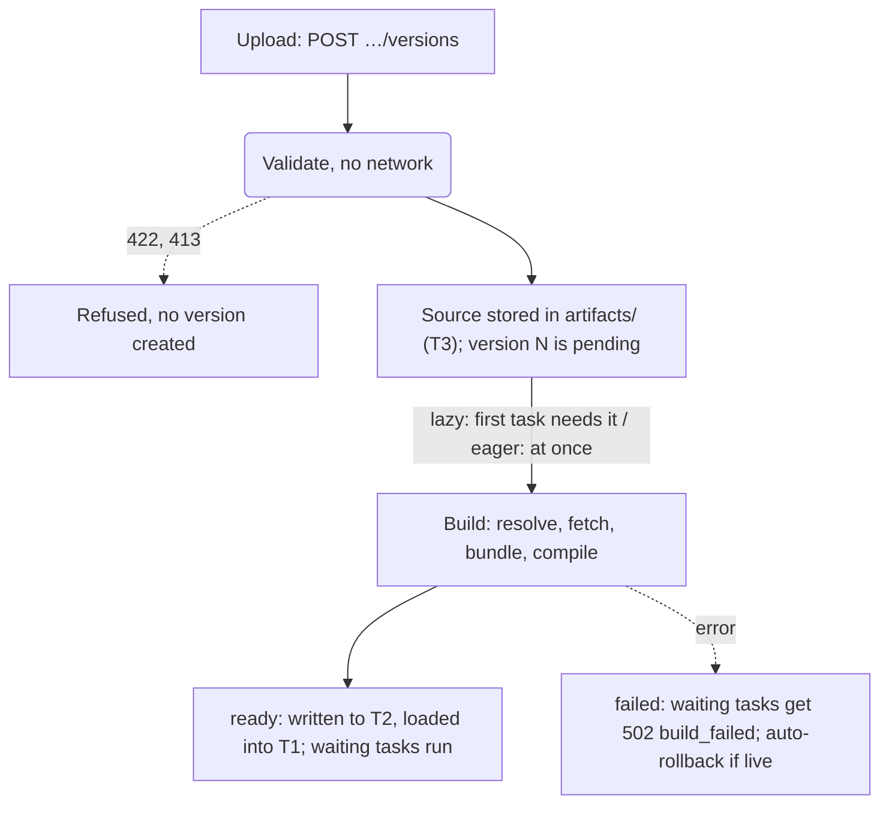

# Services, versions and builds

A **service** is the unit you deploy and call. Its code arrives as immutable, numbered **versions**, and the
node compiles each version inside itself, usually on its first request. This page covers the service object,
how updates work, what you can upload, how builds and dependencies are resolved, and how to roll back. It is
written for service developers; the operator-side build settings are linked where they come up.

## The service object

`GET /v1/services/{s}` (or `21ci service get <slug> -o json`) returns the whole service:

```json
{
  "id": "svc_01M3XM1AMYAKX6EREP6J536ATG",
  "tenant_id": "ten_01M3XM135SCP9EP41ZZXAQ5CCZ",
  "slug": "hello",
  "runtime": "deno",
  "name": "hello",
  "profile": null,
  "project": "default",
  "environment": "production",
  "live_version": 2,
  "etag": "\"5\"",
  "access": "public",
  "limits": {"wall_ms": null, "cpu_ms": 500, "memory_mb": null, "max_body_bytes": null},
  "scaling": {"min_instances": null, "max_instances": null, "max_queued": null, "keep_resident": null},
  "triggers": {"http": true, "interval": true, "cron": true, "queue": true, "call": true},
  "ingress": {"allowed_methods": [], "allow_paths": [], "ip_allow": [], "rate_limit": {"rps": 0, "burst": 0}},
  "egress": {"allowed_hosts": [], "denied_hosts": []},
  "call": {"allowed_callers": []},
  "status": {"build_state": "ready", "tier": "T1", "inflight": 0, "last_error": null, "admission": null},
  "effective": {
    "cpu_ms": {"value": 500, "source": "service"},
    "wall_ms": {"value": 30000, "source": "default"},
    "memory_mb": {"value": 128, "source": "default"},
    "compile": {"value": "lazy", "source": "profile:balanced"},
    "reuse_isolates": {"value": false, "source": "profile:balanced"}
  }
}
```

The `effective` object above is abridged; the real one lists every resolved knob.

| Field | Meaning |
|---|---|
| `slug` | URL and call name, `^[a-z][a-z0-9-]{1,62}$`, unique on the node (`409 slug_taken`). Fixed at creation |
| `runtime` | `deno` or `wasm`. Fixed at creation |
| `profile` | `max_density`, `balanced` or `min_latency` for this service's knobs; `null` = the node's default profile |
| `project` | The project the service belongs to (`default` unless named at creation). Fixed at creation. See [Projects and environments](../guides/projects.md) |
| `environment` | One of the project's environments, `^[a-z][a-z0-9-]{0,31}$`, default `production`; decides call rules |
| `live_version` | The version new tasks run; `null` until something is activated |
| `etag` | Changes on every write; send it back in `If-Match` |
| `status` | Build state of the live (or newest) version, the cache tier it is in (`T1` when it is prepared in memory, otherwise `T3`), the tasks running now (`inflight`), the last build error, and `admission`: the service's queueing and autoscaler state (adaptive limit, running, queued, queue wait), `null` while the service is idle. See [Scheduler and autoscaling](scheduler.md) |
| `effective` | Every resolved value with its source |

### Config blocks

| Block | Fields | Default | Details |
|---|---|---|---|
| `access` | `public`, `key` or `internal` | `public` | [Triggers: HTTP](triggers.md#access-modes) |
| `limits` | `wall_ms`, `cpu_ms`, `memory_mb`, `max_body_bytes` | Per-trigger defaults, capped by the plan | [Execution: limits](execution.md#limits) |
| `scaling` | `min_instances` (kept warm, no scale to zero), `max_instances` (hard cap of the adaptive limit; both at most the plan's `max_instances`), `max_queued` (queue bound, over it `503 overloaded`), `keep_resident` (accepted, not active yet: see [Caching](caching.md#how-t1-decides-what-to-keep)) | Adaptive, from the profile | [Instances and autoscaling](scheduler.md#instances-and-autoscaling) |
| `triggers` | `http`, `interval`, `cron`, `queue`, `call` (booleans) | All `true` | [Triggers](triggers.md#turning-triggers-on-and-off) |
| `ingress` | `allowed_methods[]`, `allow_paths[]` (exact, or prefix with a trailing `*`), `ip_allow[]` (CIDRs), `rate_limit {rps, burst}` | No rules | [Triggers: HTTP](triggers.md#ingress-rules) |
| `egress` | `allowed_hosts[]` (non-empty = allowlist), `denied_hosts[]` | Plan default | [Security model](security.md) |
| `call` | `allowed_callers[]`: slugs, `svc_…` ids or `env:<name>`, at most 64 | `[]` (same environment) | [Triggers: service calls](triggers.md#service-calls) |
| `deno` | `reuse_isolates` (bool) | Node config, then profile | [Execution: warm reuse](execution.md#warm-reuse) |
| `wasm` | `reuse_instances` (bool) | Node config, then profile | [Execution: warm reuse](execution.md#warm-reuse) |

Unknown fields are rejected with `422 validation_failed`. A limit above the plan maximum is
`422 limit_exceeds_plan` (see [plans](tenants-and-plans.md#limits-maxima)).

### Where effective values come from

Each knob is resolved in this order, and `effective` tells you which step won:

```text
plan maximum  ≥  service explicit  >  node config (rt.toml)  >  service profile  >  built-in default
```

Sources read `service`, `config`, `profile:<name>`, `plan` (the plan capped a default or an explicit value) or
`default`. When a request behaves differently than you expected, `effective` is the first place to look.

## Creating and updating a service

=== "21ci"

    ```bash
    21ci service create billing --runtime deno --access key --env staging --allowed-caller env:staging
    21ci service update billing --set limits.cpu_ms=500 --set triggers.cron=false
    21ci service update billing --env production --no-allowed-callers
    21ci service delete billing            # --keep-data keeps its KV, SQL and blobs
    ```

    `21ci push <path> --service <slug> --create` creates the service on its first deploy. `--set BLOCK.KEY=VALUE`
    and `--unset BLOCK.KEY` change single fields: the CLI reads the service, merges your fields into the block
    and sends it back with `If-Match`. See [`21ci service`](../cli.md#service).

=== "curl"

    ```bash
    curl -sS -H "Authorization: Bearer $RT_KEY" -H 'Content-Type: application/json' \
      -d '{"slug":"billing","runtime":"deno","access":"key","limits":{"cpu_ms":500}}' "$RT_API/v1/services"
    ```

### `PATCH` replaces whole blocks

`PATCH /v1/services/{s}` takes any of `name`, `profile`, `environment`, `access`, `limits`, `scaling`,
`triggers`, `ingress`, `egress`, `call`, `deno`, `wasm`. Each block you send **replaces** that block; blocks you
leave out stay as they are. Fields missing inside a block you sent fall back to their defaults.

!!! warning "Send the whole block"
    If `limits` is `{"cpu_ms": 500, "memory_mb": 256}` and you `PATCH` `{"limits": {"wall_ms": 10000}}`, the
    result is `{"wall_ms": 10000}`: `cpu_ms` and `memory_mb` are back to their defaults. Read the service,
    change the block, send it back, or let `21ci service update --set` do that merge for you.

To avoid overwriting someone else's change, send the `ETag` you read as `If-Match`. If the service changed in
between, the write fails with `412 precondition_failed`:

```bash
ETAG=$(curl -sS -H "Authorization: Bearer $RT_KEY" "$RT_API/v1/services/$SVC" | jq -r .etag)
curl -sS -X PATCH -H "Authorization: Bearer $RT_KEY" -H "If-Match: $ETAG" -H 'Content-Type: application/json' \
  -d '{"limits":{"cpu_ms":500,"memory_mb":256,"wall_ms":10000}}' "$RT_API/v1/services/$SVC"
```

`PUT …/live` accepts `If-Match` the same way. Env variables and secrets are separate resources, not blocks
(see [Storage](storage.md)); changes to them apply to the next task without a redeploy.

## Versions

Every upload creates a new version, numbered `1, 2, 3, …` per service. A version is immutable: its source never
changes, and a fix is always a new version. Each version records:

| Field | Meaning |
|---|---|
| `version` | The number |
| `source_digest` | `sha256:…` of the uploaded bytes (the source is stored content-addressed, so identical uploads share storage but still get a new number) |
| `lock_digest` | Digest of the version's `rt.lock` once a Deno build resolved its dependencies |
| `build_state` | `pending`, `building`, `ready` or `failed` |
| `failure` | `{reason, message, diagnostics}` for a failed build |

The node keeps the newest `deploy.retain_versions` (default 10) versions of a service plus the live one, and
deletes older ones (and their artifacts, once nothing references them) on the next upload.

### Upload formats

`POST /v1/services/{s}/versions` takes the raw bytes; `Content-Type` selects the format.

| Upload | `Content-Type` | Runtime | Limits |
|---|---|---|---|
| One TypeScript file | `application/typescript` | deno | 1 MB |
| One JavaScript file | `text/javascript` | deno | 1 MB |
| JSON bundle `{entry, files: {path: content}, imports?}` | `application/json` | deno | 1,000 files, 1 MB per file, 10 MB total |
| Zip archive | `application/zip` | deno | Same, plus inflate ratio ≤ 100 |
| Tar archive (optionally gzip-compressed) | `application/x-tar`, `application/gzip` | deno | Same |
| WASI P2 component | `application/wasm` | wasm | 50 MB |

In a bundle or archive, an optional `rt.json` sets the entry module and an import map:

```json title="rt.json"
--8<-- "sample/deno/npm-zod/rt.json"
```

Without `entry`, the node looks for `main.ts`, `main.tsx`, `main.js`, `main.jsx`, `main.mjs` in that order.
Archive entries with `..`, absolute paths or links are refused. `21ci push` builds the right upload from a file
or directory for you (see [`21ci push`](../cli.md#push)).

### Validation at upload

Before a version exists, the node checks the upload synchronously and without network access:

- **Deno:** archive safety and size, the entry exists, every file parses (TypeScript, TSX, JSX, JavaScript,
  JSON), and every import specifier is allowed (see [dependencies](#dependencies)).
- **WASM:** the bytes are a component (not a core module), validate without threads or shared memory, export
  `wasi:http/incoming-handler` (any `0.2.x`), and import only interfaces the runtime links.
- **Both:** the tenant's `builds_per_hour` is not used up (`429 build_quota`).

A failed check creates no version. Source errors come back with diagnostics:

```console
$ 21ci push broken.ts --service hello
error: validation_failed: the upload failed validation (HTTP 422)
  {
    "diagnostics": [
      { "file": "broken.ts", "line": 1, "col": 17, "message": "Expression expected" }
    ]
  }
```

Other refusals are `422 invalid_artifact` (a bad component) and `413 too_large`.

## Builds

The node compiles versions itself, on dedicated low-priority build processors (`build.threads`, default 1).
A Deno build transpiles TypeScript (no type-check), resolves and fetches dependencies, bundles every module
into one artifact and produces a V8 code cache. A WASM build compiles the component to native code (`.cwasm`).
The result goes to the T2 disk cache with a MAC and is loaded into T1; only then is the version `ready`.



What each stage does and why it is there:

| Stage | What happens | Why |
|---|---|---|
| Validate | Archive safety, parse every file, check import specifiers, or check the component's imports and exports. No network | Reject bad input before it costs anything, and keep the upload path free of outbound traffic |
| Store | Bytes are written content-addressed under `artifacts/<sha256>/`, and a numbered version row is added | Identical code shares storage; rollbacks and rebuilds need only a pointer and the source |
| Resolve (Deno) | The import map from `rt.json` is applied, `npm:` and `jsr:` specifiers go to the configured CDN, remote modules are fetched through the egress guard and recorded with their digests in `rt.lock` | Dependencies are pinned once and never fetched at request time, so a CDN outage or a changed package cannot break a running service |
| Transpile and bundle (Deno) | TypeScript and JSX are stripped to JavaScript (no type-check) and all modules are bundled into one artifact | The isolate loads one prepared bundle and nothing else, which is also what makes `module_not_in_bundle` the answer to any runtime import |
| Code cache (Deno) | A V8 code cache is produced for the bundle | A fresh isolate can load compiled bytecode instead of parsing source |
| Precompile (WASM) | wasmtime compiles the component to native code (`.cwasm`) | No compilation on the request path; the file is memory-mapped when loaded |
| Seal | The result is written to the T2 disk cache with a MAC | A tampered or half-written file is detected before it is loaded |
| Activate | The `live` pointer moves and the route table is swapped atomically | A request sees the old or the new version, never neither |

Builds run on their own low-priority threads. A build can fail without touching running traffic as long as the version
was not made live, and when the failed version is live, the newest older ready version is the automatic fallback
([Failure behavior](failure-behavior.md#builds-and-deploys)).

### Lazy and eager

| Mode | Default in | Upload answers | When the build runs |
|---|---|---|---|
| `lazy` | `max_density`, `balanced` | `201`, `build_state: pending` | On the first task that needs the version; that task (and any that arrive meanwhile) waits for one shared build |
| `eager` | `min_latency` | `202`, `build_state: building` | Right away |

Override the service's mode per upload with `?compile=lazy|eager`, or `21ci push --compile …`.
`21ci push --wait` implies `eager` and returns once the version is `ready` (exit code 1 if it failed).

`?activate=1` makes the new version live at upload time, in both modes. With `eager`, requests that arrive
before the build finishes wait for it instead of starting it. If you want `live` to move only after a
successful build, upload without activating, wait, then switch:

```bash
21ci push ./svc --service payments --no-activate --wait     # prints the new version number
21ci rollback payments --to 7                               # PUT …/live {"version": 7}
```

!!! tip "Heavy builds: build eagerly"
    A request waits for a lazy build only as long as its queue timeout (5 s in `balanced`); after that it ends
    with `503 queue_timeout` while the build carries on. Large components and dependency-heavy bundles should be
    built with `--compile eager` (or `--wait`) so no request is the first to wait.

### Build logs and failures

Build progress goes to the service logs with `kind=build` and to a per-version stream:

=== "21ci"

    ```bash
    21ci build-logs payments 7        # streams until the build is ready or failed
    21ci versions payments            # BUILD column: pending, building, ready, failed
    21ci versions payments 7          # one version, with its failure
    21ci logs payments --kind build   # build records of every version
    ```

=== "curl"

    ```bash
    curl -sSN -H "Authorization: Bearer $RT_KEY" "$RT_API/v1/services/$SVC/versions/7/build/logs"   # SSE
    curl -sS  -H "Authorization: Bearer $RT_KEY" "$RT_API/v1/services/$SVC/versions/7"              # failure
    ```

A failed version carries `failure.reason`: `syntax`, `resolve` (an import that cannot be resolved, such as a
missing file), `fetch` (a dependency could not be downloaded), `lock_mismatch`, `timeout` (`build.timeout`, 60 s
for Deno; `build.wasm_timeout`, 120 s for WASM), `oom` (`build.memory_mb`), `too_large` or `internal`.

What happens next:

- Tasks waiting for the build end with `502 x-rt-reason: build_failed`.
- The failure is remembered: the node does not retry the build on every request. Fix the code and upload a new
  version, or clear it with `POST …/versions/{v}/rebuild` (`21ci rebuild <svc> <v>`) if the cause was outside
  your code, such as a CDN outage.
- **Auto-rollback** (`deploy.auto_rollback`, on by default): if the failed version is live and an older version
  is `ready`, `live` moves back to the newest such version and a `rollback.auto` event is recorded
  (`21ci events <svc>`).

A failed version cannot be made live (`409 version_not_ready`); a `pending` one can.

### After a runtime upgrade

Compiled artifacts are tied to an engine fingerprint (runtime, V8 and wasmtime versions and flags). After an
upgrade that changes it, versions are rebuilt lazily from their stored source and `rt.lock` on their next use,
with the same dependencies as before. Nothing needs to be redeployed.

## Rollbacks

Rolling back is moving the `live` pointer: `PUT /v1/services/{s}/live {"version": N}`. It is atomic; tasks
already running finish on the version they started with.

=== "21ci"

    ```console
    $ 21ci versions hello
    VERSION  BUILD    LIVE  DIGEST               CREATED
    2        ready    *     sha256:e5fdfbd20a63  2026-10-02T06:15:26Z
    1        ready    -     sha256:4128185bbcac  2026-10-02T06:15:14Z

    $ 21ci rollback hello
    Service hello (svc_01M3XM1AMYAKX6EREP6J536ATG) is now live at version 1 (was 2).
    ```

    Without `--to`, `21ci rollback` picks the newest version older than the live one that did not fail; `--to N`
    also rolls forward. It sends the service's `ETag` as `If-Match`.

=== "curl"

    ```bash
    curl -sS -X PUT -H "Authorization: Bearer $RT_KEY" -H 'Content-Type: application/json' \
      -H "If-Match: $ETAG" -d '{"version":1}' "$RT_API/v1/services/$SVC/live"
    ```

You can only roll back to versions that are still retained (`deploy.retain_versions`).

## Dependencies

Deno services can import more than their own files. Every import is resolved **at build time**; at run time
the isolate loads modules only from the built bundle and never touches the network or disk.

| Specifier | Resolves to |
|---|---|
| `./x.ts`, `../lib/y.js` | Files of your upload |
| `std:kv`, `std:sql`, `std:blob`, `std:queue`, `std:services`, `std:platform` | Built-in runtime modules |
| `sdk:<name>`, `std:sdk` | An operator SDK published on the node: a generated shim of its contract, never its code; an unknown name is refused |
| `npm:pkg@range[/sub]` | `{build.npm_cdn}/pkg@range[/sub]?target=es2022` (default CDN `https://esm.sh`) |
| `jsr:@scope/pkg@range` | `{build.npm_cdn}/jsr/@scope/pkg@range?target=es2022` |
| `https://host/…` | Fetched only if `host` is in `build.allowed_hosts` (default `esm.sh`, `jsr.io`, `deno.land`, `cdn.jsdelivr.net`, `unpkg.com`) |
| A bare name such as `zod` | Only through the import map in `rt.json` (`"zod": "npm:zod@3"`) |
| `file:`, `node:` | Refused at upload |

The import map is applied first, then the rules above. Static imports and dynamic `import()` with a literal
string are bundled; a dynamic import of a computed specifier works only for a module that is already in the
bundle, and anything else fails with `module_not_in_bundle`.

```ts title="main.ts"
--8<-- "sample/deno/npm-zod/main.ts:1:10"
```

### `rt.lock` and vendoring

The first successful build of a source records every remote module it fetched, with its digest and content
type, in an `rt.lock` (the version's `lock_digest`). The fetched modules themselves are stored in the artifact
store next to the source. A later build of the **same source**, a rebuild, or a rebuild after a runtime upgrade,
uses that lock and the stored modules, so it produces the same code even if the CDN now serves something else
or is unreachable. If a locked URL has to be fetched again and its content changed, the build fails with
`lock_mismatch`. Any change to your source is a new digest and resolves its dependencies afresh.

You do not write `rt.lock` yourself and there is no lock file to upload: pin versions in your specifiers
(`npm:zod@3.23.8`) when you need exact control.

Builds share an in-memory dependency cache, so a second service importing the same module does not download it
again. Limits per build: `build.max_deps_mb` (50 MB) for all remote modules together, 10 MB per module and
`build.fetch_timeout` (30 s) per fetch. Fetches go through the same egress guard as guest `fetch`. Operators of
air-gapped nodes point `build.npm_cdn` at an internal esm.sh mirror and narrow `build.allowed_hosts` (see
[`[build]`](../config.md#other-sections)).

### What does not work

- **Node.js built-ins.** There is no Node compatibility layer: every `node:` import is refused at upload, and
  packages that need Node APIs with no web equivalent (`fs`, `net`, `child_process`, raw sockets) do not work.
  Packages built for browsers or for web-standard runtimes (`fetch`, Web Crypto, streams) usually do.
- **Runtime module loading.** No `import("https://…")` at run time, no reading modules from disk.
- **Type-checking.** The build strips types; run `tsc` or `deno check` in your own CI if you want it.
- **Non-JavaScript modules.** Only JavaScript, TypeScript and JSON can be imported. Load WebAssembly with the
  `WebAssembly` API instead (see [Execution and isolation](execution.md#webassembly-inside-deno)).

WASM components have no dependency resolution: everything is compiled into the component by your toolchain.
Pre-initialization of components at build time (Wizer) is
<span class="rt-badge rt-badge--planned">planned</span>.

## See also

- [Deno services](../guides/deno.md) and [WASM services](../guides/wasm.md): writing the code you deploy here.
- [Your first service](../getting-started/first-service.md): the whole loop, step by step.
- [Deploy and roll back](../guides/deploy.md): the commands for every upload form, activation and rollback.
- [Languages and frameworks](../languages/index.md): what you can build and deploy for each runtime.
- [Caching](caching.md): what T1, T2 and T3 mean for latency after a deploy.
- [API reference](../api.md) and [`21ci` versions, rollback, rebuild](../cli.md#versions-rollback-rebuild-build-logs-source).
