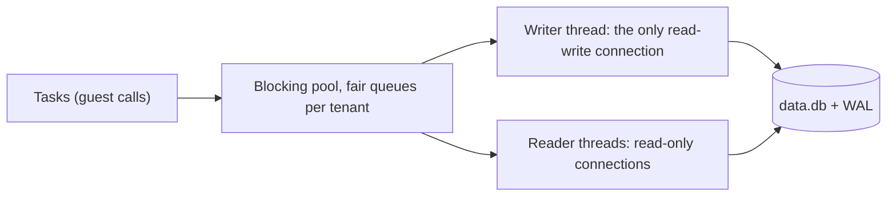

# Storage

Every service gets private storage on the node: a key/value store, a SQLite database, a blob store, and its own env
vars and secrets. There is no filesystem API for guest code; these modules are how a service keeps state between
requests. This page explains how each one works, its limits, and where the data lives. Full call signatures are in the
[guest API reference](../reference/guest-api.md).

## At a glance

| | KV (`std:kv`) | SQL (`std:sql`, `std:sqlite`) | Blobs (`std:blob`) |
|---|---|---|---|
| Good for | Small values by key, caches, sessions, TTL data, counters and rate limits | Relational data, anything you query | Files and large payloads |
| Shape | Key → JSON value or bytes | SQLite tables | Key → byte stream + content type |
| Limits | Key ≤ 2 KB, value ≤ 1 MB | 10,000 rows and 10 MiB per result; 1 s per statement | Key ≤ 1 KB, object ≤ 100 MB |
| Stored in | The service's `data.db` | The service's `data.db` | Files under `blobs/<service-id>/` |

Common rules:

- **Per service, not per tenant.** Service A cannot read service B's data, even in the same tenant. To share data, call
  the owning service ([calls and queues](../guides/calls-and-queues.md)).
- **Strongly consistent.** One node, SQLite in WAL mode: a write is visible to the next read.
- **Off the CPU.** Storage calls run on the [fair blocking pool](scheduler.md#blocking-pool-for-service-data), so a
  slow query does not hold a processor, and the thread time it uses is charged to your task's CPU limit.
- **Stable error codes.** Failures throw (Deno) or return (WASM) a stable code such as `storage_quota`, never a host
  path or driver message. See [codes inside guest code](../reference/errors.md#codes-inside-guest-code).
- **Quota.** KV, SQL and blobs of all services of a tenant count against the plan's `storage_mb`
  ([below](#storage-quota)).

## KV

`std:kv` stores JSON-serializable values or `Uint8Array`s under string keys. Keys sort lexicographically, so prefixes
work as namespaces.

| Call | Notes |
|---|---|
| `kv.get(key)` / `kv.getMany(keys)` | Value or `null` (missing or expired) |
| `kv.set(key, value, { ttlSeconds? })` | Overwrites. With `ttlSeconds`, the key reads as `null` after that time |
| `kv.delete(key)` | `true` if the key existed |
| `kv.list({ prefix?, cursor?, limit? })` | `{ entries, cursor }`, lexicographic, `limit` default 100, max 1,000. Pass `cursor` back for the next page; `null` means done |
| `kv.incr(key, delta = 1, { ttlSeconds? })` | Atomically adds `delta` to an integer counter and returns the new value (`number`, or `bigint` for a `bigint` delta) |
| `kv.cas(key, expected, next, { ttlSeconds? })` | Atomic compare-and-swap: writes `next` (`null` deletes) only if the current value equals `expected` (`null` = absent or expired); resolves to `true` when it swapped |
| `kv.expire(key, ttlSeconds \| null)` / `kv.ttl(key)` | Sets or clears the expiry of a live key (`false` when absent) / seconds left, rounded up (`null` when there is none) |

- **Limits**: non-empty key ≤ 2 KB, value ≤ 1 MB (`kv_key_too_large`, `kv_value_too_large`).
- **TTL**: an expired key is hidden from reads immediately; the row itself is deleted by a sweep every 60 seconds.
- **Counters**: `kv.incr` reads and writes in one transaction on the service's single SQLite writer, so concurrent
  increments from any number of tasks never lose an update. A missing or expired key starts at 0. `ttlSeconds`
  applies only when the call **creates** the counter; later increments keep that expiry, which gives fixed windows
  (`kv.incr("rl:" + ip, 1, { ttlSeconds: 60 })` counts one minute from the first hit). The counter is stored as JSON,
  so `kv.get` returns the number and `kv.set(key, 0)` resets it. A value that is not a JSON integer fails
  `kv_not_integer`, a result outside the 64-bit range `kv_overflow`; the value is unchanged then.
- **Read-modify-write is not atomic.** `get` followed by `set` can lose an update when two requests run at once. Use
  `incr` for counters and [`std:sql`](#sql) transactions for anything more complex.

=== "Deno"

    ```ts title="main.ts"
    import { kv } from "std:kv";

    export default async function (req: Request, ctx: { client?: { ip: string } }): Promise<Response> {
      // A fixed one-minute window per client: the TTL is set when incr creates the counter.
      const hits = await kv.incr(`rl:${ctx.client?.ip ?? "unknown"}`, 1, { ttlSeconds: 60 });
      if (hits > 100) return new Response("slow down", { status: 429 });

      await kv.set("last-visit", { path: new URL(req.url).pathname }, { ttlSeconds: 3600 });
      const page = await kv.list({ prefix: "rl:", limit: 100 });
      return Response.json({ hits, last: await kv.get("last-visit"), clients: page.entries.length, next: page.cursor });
    }
    ```

    `sample/deno/kv-counter/` in the runtime repository shows `get`, `set`, `delete` and `list` with cursors.

=== "WASM (Rust)"

    ```rust
    // wit_bindgen::generate!({ path: "wit", world: "guest" }) generates `rt::host::*`
    use rt::host::kv;

    fn visit(name: &str) -> Result<i64, kv::Error> {
        let opts = kv::SetOptions { ttl_seconds: Some(3600) };
        kv::set(name.as_bytes(), &kv::Value::Json(r#"{"seen":true}"#.to_string()), opts)?;
        let _seen = kv::get(name.as_bytes())?; // Some(Value::Json(text) | Value::Bytes(bytes)) or None
        kv::incr(b"visits", 1, kv::SetOptions { ttl_seconds: None }) // atomic; returns the new count
    }
    ```

    WASM components import `std:host/kv` from `wit/rt-host.wit`: keys are bytes, values are `json(string)` or
    `bytes(list<u8>)`. There is no `getMany`. See the [WIT reference](../reference/wit.md).

## SQL

`std:sql` gives each service its own SQLite database. You write plain SQL with `?` parameters; there are no tagged
templates.

Deno services can also reach the same database synchronously through **`std:sqlite`** (importable as `bun:sqlite`,
with bun's API). Its statements run on the task's own thread instead of the storage pool: a few microseconds per short
statement, at most 100 ms each, and at most 20 ms of waiting for a write lock. Writes through either API are visible
to the other at once; a synchronous write commits on its own instead of joining group commit. When to use which:
[`std:sqlite` or `std:sql`?](../guides/sub-services.md#stdsqlite-or-stdsql).

| Call | Result |
|---|---|
| `sql.execute(sql, args?)` | `{ columns, rows, rowsAffected, lastInsertRowid }`. **Rows are arrays** in `columns` order, not objects |
| `sql.batch(stmts, "read" \| "write")` | One result per statement, all in one transaction. A `"read"` batch refuses writes |
| `sql.transaction(async (tx) => …)` | Interactive transaction: commits when the callback resolves, rolls back when it throws. At most 5 seconds, then rolled back (`sql_timeout`). Deno only |

Arguments map as `null`/`undefined` → `NULL`, `boolean` → `0`/`1`, `number`, `bigint`, `string`, `Uint8Array` → `BLOB`.

=== "Deno"

    ```ts title="main.ts"
    import { sql } from "std:sql";

    // An upsert and a read in one write transaction.
    export default async function (req: Request): Promise<Response> {
      const name = new URL(req.url).searchParams.get("name") ?? "visits";
      const [, , read] = await sql.batch([
        "CREATE TABLE IF NOT EXISTS counters (name TEXT PRIMARY KEY, n INTEGER NOT NULL)",
        { sql: "INSERT INTO counters (name, n) VALUES (?, 1) ON CONFLICT (name) DO UPDATE SET n = n + 1", args: [name] },
        { sql: "SELECT n FROM counters WHERE name = ?", args: [name] },
      ], "write");
      return Response.json({ name, count: read.rows[0][0] }); // rows are arrays
    }
    ```

    `sample/deno/sql-todo/` in the runtime repository is a complete CRUD service, including read batches.

=== "WASM (Rust)"

    ```rust
    use rt::host::sql::{self, SqlValue, Statement};

    fn bump(name: &str) -> Result<i64, sql::Error> {
        let arg = || vec![SqlValue::Text(name.to_string())];
        let stmts = [
            Statement { sql: "INSERT INTO counters (name, n) VALUES (?, 1) ON CONFLICT (name) DO UPDATE SET n = n + 1".into(), args: arg() },
            Statement { sql: "SELECT n FROM counters WHERE name = ?".into(), args: arg() },
        ];
        let results = sql::batch(&stmts, true)?; // true = write transaction
        match results[1].rows.first().and_then(|row| row.first()) {
            Some(SqlValue::Integer(n)) => Ok(*n),
            _ => Ok(0),
        }
    }
    ```

    WASM has `execute` and `batch`; there is no interactive transaction. Values are the `sql-value` variant
    (`null`, `integer`, `real`, `text`, `blob`).

### Guardrails

| Guardrail | Effect |
|---|---|
| SQLite authorizer | `ATTACH`, `load_extension`, the runtime's own `_rt_*` tables and schema- or storage-changing pragmas (`journal_mode`, `synchronous`, `page_size`, `writable_schema`, …) fail with `sql_not_authorized` |
| Statement budget | A statement running longer than `storage.sql_budget_ms` (1,000 ms) is aborted: `sql_timeout`. Its thread CPU time counts against your task |
| Result caps | At most 10,000 rows per statement and 10 MiB of values per call (statement or batch): `sql_result_too_large`. Page with `LIMIT` / `OFFSET` or select fewer columns |
| Size | The database cannot grow past what the tenant has left of `storage_mb`: `storage_quota` |

### Concurrency and write batching

Each database has one **writer** connection and up to `storage.readers_per_db` (4) read-only **readers**. In WAL mode,
queries and read batches run on readers while a write is in progress, so reads do not queue behind writes. Keep read
paths free of writes to benefit.

KV writes (including `incr`) and blob index updates that queue up for the same database are **group-committed**: up to 64 of them share
one SQLite transaction, each in its own savepoint. This raises write throughput under concurrency without changing
what each call sees. Write statements you send through `std:sql` run on the writer one at a time.

Connections open lazily. `storage.max_open_dbs` (256) caps all open connections of all services, and idle services are
closed whole, least recently used first. The page cache of all connections shares `storage.sql_cache_mb` (512).
See [`[storage]`](../config.md#service-data-storage-blocking).

## Blobs

`std:blob` stores objects with a content type. In Deno, both directions are **streamed**: you can store a 50 MB upload
without holding it in memory.

| Call | Notes |
|---|---|
| `blob.put(key, body, { contentType? })` | `body`: string, `Uint8Array`, `ArrayBuffer`, `ReadableStream` (for example `req.body`) or a `Blob` |
| `blob.get(key)` | `{ body: ReadableStream, size, contentType }` or `null` |
| `blob.head(key)` | `{ size, contentType }` or `null` |
| `blob.delete(key)` | `true` if it existed |
| `blob.list({ prefix?, cursor?, limit? })` | `{ objects: [{ key, size, contentType }], cursor }` |

Limits: key ≤ 1 KB (`blob_key_too_large`), object ≤ 100 MB.

```ts title="main.ts"
--8<-- "sample/deno/blob-upload/main.ts:42:60"
```

Pass `req.body` straight to `blob.put` and return `obj.body` as the response: `req.arrayBuffer()` or `req.formData()`
would buffer the whole upload inside your isolate and count against `memory_mb`.

<span class="rt-badge rt-badge--wasm">WASM</span> In this release, `std:host/blob` takes and returns whole byte lists
(`list<u8>`): a WASM component holds the full object in its linear memory. Size `memory_mb` accordingly.

Objects are files on the node's local disk, under `blobs/<service-id>/`, with an index table in the service's
`data.db`.

!!! info "S3 backend not available yet"
    <span class="rt-badge rt-badge--planned">planned</span> Blobs and artifacts are stored on local disk only.
    `storage.blob_backend = "s3"`, `storage.blob_cache_mb` and the `[s3]` section are accepted for forward
    compatibility, but nothing uses them in this release.

## Storage quota

The plan's `storage_mb` (100 MB on the built-in `free` plan) covers KV, SQL and blobs of **all services of a tenant**.
The node measures each tenant's usage every 30 seconds; each database may then grow only by what its tenant has left,
and a blob `put` may write only that much. Over the quota, writes fail with `storage_quota` while reads keep working.
Usage per service and day is in `GET /v1/tenants/{t}/usage` (`storage_bytes`), which the operator can read for any
tenant and a tenant key with `logs:read` for its own (`21ci tenant usage`).

## Env vars and secrets

Env vars and secrets are per-service settings that reach your code as environment variables. They are **not
versioned**: a change applies to the **next task** without a redeploy, and every version sees the current values.

| | Env vars | Secrets |
|---|---|---|
| Through the API | Readable; `PUT` replaces the whole map | Write-only; listing shows names and `updated_at` only |
| At rest | Plain, in `meta.db` | Sealed with AES-256-GCM, in `meta.db` |
| In guest code | `Deno.env.get(name)`; WASM: the WASI environment (for example `std::env::var`) | Same, alongside env vars |
| Limits | ≤ 100 per service, value ≤ 32 KB | ≤ 100 per service, value ≤ 32 KB |
| Scopes | `env:write` | `secrets:write` |

Names match `[A-Z_][A-Z0-9_]*`; the `RT_` prefix is reserved. Inside the guest, `Deno.env` is read-only (`set` and
`delete` throw) and secrets are as readable as env vars: never log or return them.

=== "21ci"

    ```console
    $ 21ci env set hello GREETING=hi LOG_LEVEL=debug
    $ printf %s "$STRIPE_KEY" | 21ci secret set hello STRIPE_API_KEY
    $ 21ci secret list hello
    NAME            UPDATED
    STRIPE_API_KEY  2026-10-02T06:15:26Z
    ```

=== "curl"

    ```bash
    curl -sS -X PUT -H "Authorization: Bearer $RT_KEY" -H 'Content-Type: application/json' \
      -d '{"GREETING":"hi","LOG_LEVEL":"debug"}' "$RT_API/v1/services/$SVC/env"
    jq -n --arg v "$STRIPE_KEY" '{value: $v}' | \
      curl -sS -X PUT -H "Authorization: Bearer $RT_KEY" -H 'Content-Type: application/json' \
      --data-binary @- "$RT_API/v1/services/$SVC/secrets/STRIPE_API_KEY"   # 204
    ```

How secrets are protected:

- Each value is sealed with AES-256-GCM under a key derived from the node's **master key** (`RT_MASTER_KEY`), with a
  fresh nonce per value. The ciphertext is bound to `tenant|service|name`, so a value copied into another service's row
  does not open.
- Values are decrypted only when a task of the service needs them, zeroized when dropped, and leave memory after
  10 minutes without use. The runtime never writes them to logs, metrics or API responses.
- Lose the master key and every sealed secret is unreadable. Rotating it is covered in the
  [security model](security.md#secrets-and-the-master-key).

## How the engine works

KV, SQL, the blob index, the queue and the node's metadata are all SQLite. The design is the same for each database:



- **Dedicated threads per database.** A database is served by one writer thread that owns its only read-write
  connection, plus `storage.readers_per_db` reader threads with read-only connections (`query_only`). Calls reach them
  through channels from the blocking pool, so a slow query parks a pool thread, never a scheduler processor. The pool
  gives each tenant a bounded share of its threads (`blocking_share`), so one tenant's storage load cannot take them all.
- **WAL, `synchronous=NORMAL`.** Readers see the last committed snapshot while the writer is inside a transaction,
  so reads never wait behind writes. Commits are cheap (a WAL append, no fsync per commit), at the price described
  under [durability](#durability).
- **One writer per database, so writes are serialized.** This is also what makes `kv.incr` atomic and `sql.transaction`
  simple: there is no write-write conflict to retry. It is also the throughput ceiling of one service's writes.
- **Group commit.** When several KV writes (including `incr`) or blob-index updates are queued for the same database,
  the writer takes up to 64 of them and runs them in **one** transaction, each in its own savepoint. A job that fails
  rolls back only its savepoint. The commit cost is paid once for the whole group, which raises write throughput under
  concurrency without changing what any call sees. Statements you send through `std:sql` are not merged: each runs
  as you wrote it, on the writer, one after another.
- **Lazy connections.** Connections open on first use; readers only appear under concurrency. `storage.max_open_dbs`
  caps all of them together, and idle services are closed whole, least recently used first. The SQLite page cache of
  all connections shares `storage.sql_cache_mb`.
- **Guest SQL is fenced in.** Each guest connection carries SQLite limits, an authorizer that denies `ATTACH`,
  `load_extension`, the runtime's `_rt_*` tables and schema-changing pragmas, a progress handler that aborts a
  statement after `storage.sql_budget_ms`, and result caps counted by in-memory size.
- **Size is enforced in the database.** A service's database may grow only by what its tenant has left of
  `storage_mb` (measured every 30 s); SQLite's own "database full" condition is reported as `storage_quota` too.

### Why one SQLite file per service

| Benefit | Cost |
|---|---|
| Data separation by construction: a bug in one service's query cannot touch another service's file | No transactions across services; use the queue or a service call and design for eventual consistency |
| No database server to deploy, tune or secure; backup is copying files (with `.backup`) | One node, local disk. There is no replication or failover |
| Per-service export, quota and deletion are file operations | One writer per service: a write-heavy service is limited by single-writer throughput |
| Idle services cost nothing (closed files) | Many hot services mean many open files and caches, bounded by `storage.max_open_dbs` and `storage.sql_cache_mb` |

### Durability

Every database runs in WAL mode with `synchronous=NORMAL`. A committed transaction survives a crash of the `rt`
process or `kill -9`. After a power loss or a kernel crash, the most recent commits may be lost, and the database
rolls back to an earlier consistent state. Blobs are plain files. See [Failure behavior](failure-behavior.md) for what
else happens on crashes and on a full disk.

## Where it lives on disk

Everything is under the node's data directory (`node.data_dir`, `/data` in the container image):

```text
/data/
  meta.db                       tenants, keys (hashed), services, versions, env, sealed secrets, events
  queue.db                      durable queues and DLQs
  services/<service-id>/data.db KV (table _rt_kv) + your SQL tables + the blob index
  blobs/<service-id>/           blob objects
  artifacts/<sha256>/           uploaded sources and components (content-addressed)
  cache/v2/                     compiled code (T2), rebuildable
  logs/<service-id>/            log segments
```

A hot copy of SQLite files is not consistent. The [production guide](../guides/production.md) covers backups.

## Exporting a service's data

`GET /v1/services/{s}/data/export` (scope `data:admin`) returns a consistent snapshot of the service's `data.db` as a
standalone SQLite file (`application/vnd.sqlite3`). It contains the KV store (table `_rt_kv`) and your SQL tables;
blob contents are files and are not included.

=== "21ci"

    ```console
    $ 21ci data export hello --out hello.db
    $ sqlite3 hello.db '.tables'
    ```

=== "curl"

    ```bash
    curl -sS -H "Authorization: Bearer $RT_KEY" -o hello.db "$RT_API/v1/services/$SVC/data/export"
    sqlite3 hello.db '.tables'
    ```

Every export is recorded as a `data.exported` event of the service.

## Deleting a service

`DELETE /v1/services/{s}` removes the service with its `data.db`, blobs, logs, schedules, queue, hosts and cached
code. Add `?keep_data=1` (`21ci service delete hello --keep-data`) to leave `data.db` and the blobs on disk.

=== "21ci"

    ```console
    $ 21ci service delete hello --keep-data
    ```

=== "curl"

    ```bash
    curl -sS -X DELETE -H "Authorization: Bearer $RT_KEY" "$RT_API/v1/services/$SVC?keep_data=1"   # 204
    ```

## See also

- [KV, SQL, blobs and other sub-services](../guides/sub-services.md): how to use each one, with Deno and Rust examples.
- [Failure behavior](failure-behavior.md): disk full, crashes and durability.
- [Guest API reference](../reference/guest-api.md): every call, argument and error code.
- [Limits](../reference/limits.md): all size and time limits in one place.
- [Tenants, plans and keys](tenants-and-plans.md): `storage_mb` and the other plan quotas.
- [Security model](security.md): secrets, the master key and isolation.
