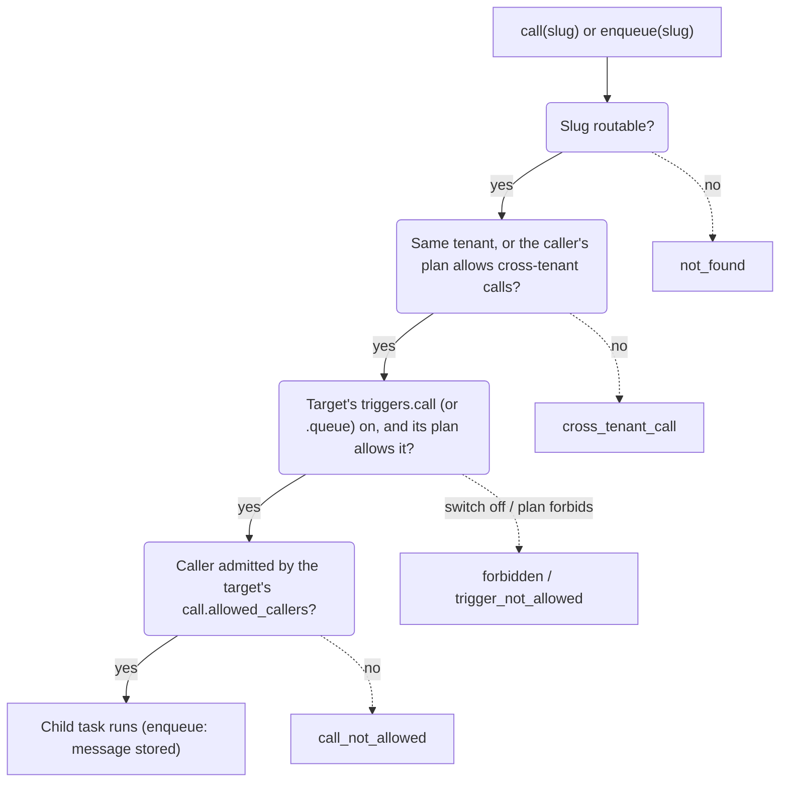

# Triggers

A **trigger** is whatever starts a task: `http`, `interval`, `cron`, `queue`, `call`, `websocket` and `alarm`. Every
trigger builds a task and hands it to the same admission and scheduler, so limits, logs and stats work the same
way for all of them. This page explains each trigger's semantics, how it reaches your handler, and how the
service owner and the operator switch triggers on and off.

| Trigger | Started by | Delivery | Handler entry point (Deno Form B) |
|---|---|---|---|
| `http` | A request on the public or internal listener | Once, response returned to the client | `fetch(req, ctx)` |
| `interval` | A schedule with `every_seconds` | Never overlapping; missed ticks skipped | `scheduled(event, ctx)` |
| `cron` | A schedule with a cron expression and time zone | Never overlapping; missed ticks skipped | `scheduled(event, ctx)` |
| `queue` | Messages in the service's durable queue | At least once, in batches, with retries and a DLQ | `queue(batch, ctx)` |
| `call` | Another service calling `call()` or enqueueing | Once, in process, response returned to the caller | `fetch(req, ctx)` |
| `websocket` | A message, close or error of a socket the service accepted | At least once, one at a time per object, in order | `webSocketMessage` / `webSocketClose` / `webSocketError` |
| `alarm` | A durable object's alarm coming due | At least once, with retries | `alarm(info, ctx)` of the durable class |

`websocket` and `alarm` are covered in [WebSockets and durable objects](../guides/websockets.md); the WebSocket upgrade
itself is an `http` (or `call`) task.

Handlers that only speak HTTP (Deno Form A, every WASM component) still get every trigger; see
[how triggers reach your handler](#how-triggers-reach-your-handler).

## HTTP

### Routes

A request reaches a service in one of three ways, checked in this order:

| Match | Example | Path the handler sees |
|---|---|---|
| A verified **custom host** mapped to the service | `https://bot.example.com/webhook` | `/webhook` (unchanged) |
| `{slug}.{routing.base_domain}`, when the operator set `base_domain` | `https://hello.fn.example.com/x` | `/x` (unchanged) |
| The path prefix `/s/{slug}` | `http://127.0.0.1:8080/s/hello/x?y=1` | `/x?y=1`, with `x-rt-base-path: /s/hello` |

With the path prefix, the runtime strips `/s/{slug}` so the same code works behind any of the three. If you build
absolute links, prefix them with `x-rt-base-path` when it is present. `req.url` in Deno is
`http://localhost/<path>?<query>`: the original `Host` is not passed on.

A request matches nothing, or matches a service with no live version or with `triggers.http` off: `404
not_found`. Custom hosts are claimed per service (`21ci host attach <svc> <host>`, or
`PUT /v1/services/{s}/hosts/{host}`); a tenant's claim is
active once the node finds the DNS TXT record `_rt-verify.<host>` or the operator approves it. See
[Custom domains](../guides/custom-domains.md).

### Headers

| Direction | Added by the runtime | Removed by the runtime |
|---|---|---|
| Request to your handler | `x-rt-task-id`, `x-rt-trigger: http`, `x-rt-base-path` (path routes), `x-rt-client-ip` (public listener), `traceparent` (generated when absent), `x-rt-invoker` (internal listener only); WASM also gets `x-rt-deadline` (epoch ms) | Every client-sent `x-rt-*` header (`x-rt-key` and `x-rt-client-ip` included), hop-by-hop headers, `Host`, and an `Authorization: Bearer rtk_…` (a tenant key) or the root token that passed `access: key` |
| Response to the client | `x-rt-task-id`, `x-rt-version`, `server-timing: queue;dur=…, wait_runtime;dur=…, init;dur=…, exec;dur=…` | Nothing: your status, headers (including several `Set-Cookie`) and body pass through |

Because clients can never send `x-rt-*` headers through, your handler can trust every `x-rt-*` header it sees.
Any other `Authorization` header (your own bearer tokens, `Basic …`) reaches your handler unchanged, so a
service can check its own credentials.

**Client address.** `x-rt-client-ip` (and `ctx.client.ip` in Deno) is the address ingress resolved: the TCP
peer, or, when the peer is listed in `ingress.trusted_proxies`, the first `X-Forwarded-For` hop, counting from
the right, that is not a trusted proxy. It is the same address the `ip_allow` rule checks. It exists only for the `http` trigger on the
public listener: schedules, queue batches, calls and requests on the internal socket have none.

### Access modes

A service's `access` decides who may invoke it over HTTP:

| `access` | Public listener | Internal listener |
|---|---|---|
| `public` (default) | Anyone | Yes |
| `key` | `Authorization: Bearer rtk_…` (or `x-rt-key`) of the same tenant with the `invoke` scope, or the root token; otherwise `401 unauthorized`. 10 wrong keys per minute from one client, then `429` | Yes, no key needed |
| `internal` | `404 not_found`, as if it did not exist | Yes |

The invoke key never reaches your handler. If a client of an `access: key` service also needs to send the
service's own `Authorization` header, it passes the invoke key in `x-rt-key` instead.

`access` governs HTTP only. Calls between services have their own rules: [service calls](#service-calls).

=== "21ci"

    ```bash
    21ci service create reports --access key
    21ci invoke reports /daily --key "$INVOKE_KEY"      # or RT_INVOKE_KEY
    ```

=== "curl"

    ```bash
    curl -H "Authorization: Bearer $INVOKE_KEY" "$RT_INVOKE/s/reports/daily"
    ```

### Ingress rules

On the public listener, after the access check, the service's `ingress` block can narrow traffic further:

```json
{"ingress": {
  "allowed_methods": ["GET", "POST"],
  "allow_paths": ["/webhook", "/api/*"],
  "ip_allow": ["203.0.113.0/24", "2001:db8::/32"],
  "rate_limit": {"rps": 20, "burst": 40}
}}
```

| Rule | Refusal |
|---|---|
| `allowed_methods` | `405 method_not_allowed` |
| `allow_paths` (exact match, or prefix with a trailing `*`, matched against the path the handler sees) | `403 forbidden` |
| `ip_allow` (IPv4 and IPv6 CIDRs; the client address is taken from `X-Forwarded-For` only behind `ingress.trusted_proxies`) | `403 forbidden` |
| `rate_limit` (per-service token bucket) | `429 rate_limited` + `Retry-After` |

Empty lists and `rps: 0` mean no rule. After the ingress rules come the tenant's plan quotas and admission; the
full order is on the [Architecture](architecture.md#the-path-of-an-http-request) page.

### The internal listener

The internal listener (`unix:/data/rt.sock` by default) serves the same routes as the public one, for the
operator's own platform. It is trusted: no access check, no ingress rules, and it keeps an `x-rt-invoker`
header, which the handler reads as `ctx.invoker` (Deno) or as the request header (WASM). Use it to tell a
service which end user a platform call is for.

```bash
curl --unix-socket /data/rt.sock -H 'x-rt-invoker: user-42' http://localhost/s/hello/
```

Only processes running as the node's own UID (or a UID listed in `listeners.internal_allowed_uids`) may connect;
others are disconnected before any response. A TCP internal listener cannot check the peer and needs the explicit
opt-in `listeners.allow_tcp_internal = true` (see [`[listeners]`](../config.md#listeners)). The plan's
`allowed_triggers` and quotas still apply.

## Schedules

A schedule fires a service on a timer, with a JSON payload (≤ 64 KB) that the handler receives as
`event.payload`.

| Kind | Body | Notes |
|---|---|---|
| `interval` | `{"kind":"interval","every_seconds":300,"payload":{…}}` | At least the plan's `min_schedule_seconds` |
| `cron` | `{"kind":"cron","cron":"0 9 * * MON-FRI","timezone":"Europe/Berlin","payload":{…}}` | 5 fields, or 6 with a leading seconds field; IANA time zone, default `UTC`. Days of the week are numbered `1`-`7` with Sunday = `1` (so `1-5` is Sunday to Thursday): prefer names such as `MON-FRI`. The gap between two fires must also respect `min_schedule_seconds` |

=== "21ci"

    ```bash
    21ci schedule add reports --every 5m --payload '{"job":"cleanup"}'
    21ci schedule add reports --cron "0 9 * * MON-FRI" --tz Europe/Berlin
    21ci schedule list reports
    ```

=== "curl"

    ```bash
    curl -sS -H "Authorization: Bearer $RT_KEY" -H 'Content-Type: application/json' \
      -d '{"kind":"interval","every_seconds":300,"payload":{"job":"cleanup"}}' "$RT_API/v1/services/$SVC/schedules"
    ```

How schedules behave:

- **No overlap.** While a run of a schedule is still going, its next tick is skipped (and counted in
  `rt_schedule_skipped_total`). A slow job never piles up behind itself.
- **No backfill.** Ticks missed while the node was down, or skipped, are not run later. Schedules are not
  at-least-once; if every run matters, have the schedule enqueue a message and do the work in the queue
  handler.
- **Jitter.** Each schedule fires up to `min(1 s, interval / 10)` late, a fixed offset per schedule, so many
  schedules with the same period do not fire in the same millisecond.
- **Quotas.** At most `max_schedules` per service (`403 quota_exceeded`); a period below `min_schedule_seconds`
  is `422 schedule_too_frequent`. The `free` plan allows 3 per service, 60 s apart, and no `cron`.

Scheduled tasks get longer default limits than HTTP (300 s wall, 10 s CPU), capped by the plan maxima; see
[limits](execution.md#limits). More patterns: [Schedules guide](../guides/schedules.md).

## Queue

Every service has a durable queue (stored in `queue.db`, so it survives restarts). Delivery is
**at least once** and **unordered**: write handlers that tolerate a message twice.

**Enqueue** from the control API (scope `queue:write`), from guest code with `enqueue()` from `std:queue` (Deno)
or `std:host/queue` (WASM), or with the CLI:

=== "21ci"

    ```bash
    21ci queue send orders --body '{"orderId":1}' --delay 30s --dedup order-1
    21ci queue stats orders
    21ci queue dlq orders                 # --redrive or --purge
    ```

=== "curl"

    ```bash
    curl -sS -H "Authorization: Bearer $RT_KEY" -H 'Content-Type: application/json' \
      -d '{"body":{"orderId":1},"delay_seconds":30,"dedup_id":"order-1"}' "$RT_API/v1/services/$SVC/queue"
    # 202 {"id":"msg_…"}
    ```

=== "Deno"

    ```ts
    import { enqueue } from "std:queue";
    await enqueue("orders", { orderId: 1 }, { delaySeconds: 30, dedupId: "order-1" });
    ```

| Aspect | Behavior |
|---|---|
| Message | JSON (or bytes from guest code), at most 1 MB |
| Delay | Optional, up to 7 days |
| Dedup | A second message with the same `dedup_id` within 24 hours is dropped |
| Batches | Up to `queue.batch_size` (10) messages per task |
| Visibility | A leased batch is invisible to other consumers for the task's wall limit + 10 s; if the task never finishes (crash, restart), the messages come back after that |
| Ack | Form B: messages you do not `retry()` are acked when the handler returns; a throw retries the batch. Form A and WASM: a `2xx` response acks the batch, except the messages named in an `x-rt-queue-retry` response header (comma-separated ids, each optionally with `;delay=<seconds>`); anything other than `2xx` retries the whole batch |
| Retry | Backoff `2 s × 2^(attempt-1)` (2 s, 4 s, 8 s, …) ±20 % jitter, up to `queue.max_attempts` (5) |
| Dead letters | After the last attempt the message moves to the service's DLQ: list, redrive (attempt reset to 1) or purge |
| Concurrency | At most `queue.max_concurrency` (4) queue tasks per service at once, within the service's own limit |
| Depth | At most the plan's `max_queue_depth` waiting messages per service, then `429 queue_full` |

A queue is consumed only while its service has a live version and its `queue` trigger is allowed; otherwise
messages wait without using attempts. Patterns and the full API: [Service calls and queues](../guides/calls-and-queues.md).

## Pub/sub

A service subscribes to subjects in `events.subscribe` (`{subject, group?}`, at most 32). A subject is `.`-separated
tokens: `*` matches one token and `>` (last token only) matches the rest, for example `orders.*.created` or
`orders.>`. A publish (`std:pubsub` `publish(subject, body, opts)`, or `POST /v1/pubsub/publish`) delivers one copy to
every matching service of the same tenant, project and environment. Services that name the same `group` share the
deliveries round robin, so one member gets each message. `request()` picks one receiver in round robin and waits for
its reply (5 s default, 30 s max).

The handler is the `pubsub(msg, ctx)` export (Deno) and `ctx.trigger` is `"pubsub"`. A publish returns
`{receivers, dropped}`: `receivers` is how many services a delivery was queued for, and `dropped` how many were
skipped (fan-out above 100, a subscriber with 64 deliveries in flight, the tenant quota, or admission refused). A
delivery is best effort: a dropped message is not retried. Use a topic when you need a record that is kept and
replayed. The plan must allow `pubsub`, and a service whose plan does not allow it receives nothing.

## Streams

A **topic** is a partitioned, replayable log. Producers append records (`std:stream` `append` or `POST
/v1/topics/{t}/messages`). Each partition keeps records in offset order, and a record with a `key` always goes to the
same partition. A consumer block in `events.consume` (`{topic, group?, start?, batch_size?}`) receives batches with
the handler export `stream(batch, ctx)`, and `ctx.trigger` is `"stream"`. Each consumer group keeps its own committed
offset per partition, so groups read the same topic independently and a restart resumes where the group stopped.

A failed record is retried up to `max_attempts` times (default 10), then moved to the consumer's dead letters, or the
consumer blocks (`on_exhausted`: `dlq`, `skip` or `block`). Reset a group with `POST
/v1/services/{s}/consumers/{topic}/{group}/reset` (`earliest`, `latest`, an offset or a time). Retention is set per
topic (`retention_hours`, the plan's maximum applies) and `max_mb` caps the topic's bytes. Topics are tenant
resources: create them with the control API or `21ci topic create`, and consume them with a service's `events.consume`.

A topic with more than one partition needs `partition` when it is read directly (`read` / `GET .../messages`). The
plan must allow `stream`.

## Async invocations

An HTTP invocation can run in the background. Set `async.enabled` on the service (default `false`), then send
`Prefer: respond-async` or `X-Rt-Invocation-Type: Event`. The caller gets `202 {"id":"inv_…"}` at once, and the
runtime runs the handler later with the same request. A `5xx` or `429` answer is retried up to `async.max_attempts`
times (default 3). An invocation pending longer than `async.max_event_age_s` (default 3600) fails. Inspect and
recover failed work with `GET /v1/services/{s}/invocations`, `POST .../invocations/redrive` and `DELETE
.../invocations?state=failed`. The full contract, including headers, idempotency and limits, is in [the invoke
API](../api.md#invoke-api).

## Service calls

A service can call another service of the same tenant by slug. The call runs **in process**: no HTTP hop, no
TCP connection, no TLS. The child is a separate task (`trigger: call`) of the target service with its own CPU
and memory limits, placed next to its parent when the runtimes match.

=== "Deno"

    ```ts
    import { call } from "std:services";
    const res = await call("billing", new Request("http://svc/charge", { method: "POST", body: JSON.stringify({ sku: "a" }) }));
    ```

=== "WASM (Rust)"

    ```rust
    // Bindings generated with wit_bindgen::generate! from wit/rt-host.wit
    use rt::host::call as rtcall;

    let req = rtcall::Request {
        method: "POST".into(),
        path_with_query: "/charge".into(),
        headers: vec![("content-type".into(), b"application/json".to_vec())],
        body: br#"{"sku":"a"}"#.to_vec(),
    };
    match rtcall::call("billing", &req) {
        Ok(res) => { /* res.status, res.headers, res.body */ }
        Err(e) => { /* e.code: not_found, call_not_allowed, … */ }
    }
    ```

Only the request's method, path, query, headers and body are used (the host part of the URL is ignored). The
callee sees `x-rt-trigger: call` and `x-rt-base-path: /s/{its slug}`; `x-rt-*` headers set by the caller are
dropped.

| Rule | Value |
|---|---|
| Depth | At most 15 nested calls; deeper is a `508` response with `x-rt-reason: call_depth` |
| Deadline | The child's wall limit is `min(its own limit, the parent's remaining time)` |
| Accounting | CPU and memory count to the child service; both count toward the tenant's concurrency |
| Failure | A child that fails or is killed comes back as a 5xx `Response` (`x-rt-reason` set); refusals are errors with a `code` |

### Who may call whom

Every service has an `environment` label (default `production`) and a `call.allowed_callers` list. The same
list also governs `enqueue()` into another service's queue.

| Caller | Admitted when |
|---|---|
| The target itself | Always |
| Same tenant, empty `allowed_callers` | Both services are in the same project and environment |
| Same tenant, non-empty list | The list names the caller's slug, its `svc_…` id, or `env:<caller's environment>` |
| Another tenant | The caller's plan has `allow_cross_tenant_calls` **and** the list names the caller's `svc_…` id (slugs and `env:` entries never admit another tenant) |

A non-empty list names **every** admitted caller: add `env:production` to keep same-environment callers of a
`production` service. A slug entry admits whichever service holds that slug at call time; use ids where that
matters.



The depth check (`call_depth`) runs before all of these for calls; an enqueue checks `max_queue_depth`
(`queue_full`) after them. Every check uses in-memory tables, so a refused call costs no task and no database
round trip.

=== "21ci"

    ```bash
    # billing accepts calls from staging services and from checkout, wherever checkout lives
    21ci service update billing --allowed-caller env:staging --allowed-caller checkout
    21ci service update billing --no-allowed-callers          # back to "same environment"
    ```

=== "curl"

    ```bash
    curl -sS -X PATCH -H "Authorization: Bearer $RT_KEY" -H 'Content-Type: application/json' \
      -d '{"call":{"allowed_callers":["env:staging","svc_01M3XM1AMYAKX6EREP6J536ATG"]}}' "$RT_API/v1/services/$SVC"
    ```

## How triggers reach your handler

| Trigger | Deno Form B (`export default { fetch, scheduled, queue }`) | Deno Form A (`export default function`) and WASM components |
|---|---|---|
| `http`, `call` | `fetch(req, ctx)` | The function / `wasi:http/incoming-handler` |
| `interval`, `cron` | `scheduled(event, ctx)` with `{scheduleId, scheduledTime, payload}` | `POST /__rt/scheduled`, JSON `{scheduleId, scheduledTime, payload}`, header `x-rt-trigger: interval` or `cron`; the status is only logged |
| `queue` | `queue(batch, ctx)`, each message with `id`, `body`, `attempt`, `ack()`, `retry({delaySeconds?})` | `POST /__rt/queue`, JSON `{messages: [{id, body, attempt}]}`; `2xx` acks all but the ids listed in `x-rt-queue-retry`, anything else retries all |

A Form B module without the matching export falls back to `fetch` with the same synthetic request; one without
`fetch` answers HTTP and calls with `500 guest_error`. `ctx.trigger` (Deno) or the `x-rt-trigger` header tells
you which trigger is running. Check the synthetic paths before your own routing so they cannot be mistaken for
user traffic:

```ts title="main.ts"
export default async function (req: Request, ctx: { trigger: string }): Promise<Response> {
  const { pathname } = new URL(req.url);
  if ((ctx.trigger === "interval" || ctx.trigger === "cron") && pathname === "/__rt/scheduled") {
    const { payload } = await req.json();
    // … run the job …
    return new Response("ok");
  }
  return new Response("hello");
}
```

The full handler contract is in the [Deno guide](../guides/deno.md) and the [WASM guide](../guides/wasm.md).

## Turning triggers on and off

Two switches must both allow a trigger: the service owner's `triggers` block and the operator's plan.

| Trigger | `triggers.<name>: false` on the service | Missing from the plan's `allowed_triggers` |
|---|---|---|
| `http` | `404 not_found` on every listener | `403 trigger_not_allowed` on every listener |
| `interval`, `cron` | New schedules of that kind: `403 trigger_not_allowed`; existing ones do not fire | New schedules: `403 trigger_not_allowed`; fires of existing ones are dropped |
| `queue` | Enqueue: `403 trigger_not_allowed` (API) or `forbidden` (guest); queued messages wait | Enqueue: `403 trigger_not_allowed` / `trigger_not_allowed`; queued messages wait |
| `call` | `call()` fails with `forbidden` | `call()` fails with `trigger_not_allowed` |
| `websocket` | Upgrades: `403 trigger_not_allowed` | Upgrades: `403 trigger_not_allowed` |

=== "21ci"

    ```bash
    21ci service update worker --set triggers.http=false
    ```

=== "curl"

    ```bash
    curl -sS -X PATCH -H "Authorization: Bearer $RT_KEY" -H 'Content-Type: application/json' \
      -d '{"triggers":{"http":false,"interval":true,"cron":true,"queue":true,"call":true}}' "$RT_API/v1/services/$SVC"
    ```

`PATCH` replaces the whole `triggers` block, and a field you leave out is `true`. The plan side is described in
[Tenants, plans and keys](tenants-and-plans.md#what-allowed_triggers-does).

## See also

- [Service calls and queues](../guides/calls-and-queues.md) and [Schedules](../guides/schedules.md): patterns and recipes.
- [Execution and isolation](execution.md): the limits each trigger runs with.
- [Error reasons](../reference/errors.md#invoke-reasons-x-rt-reason) and [guest codes](../reference/errors.md#codes-inside-guest-code).
- [`21ci schedule`](../cli.md#schedule), [`21ci queue`](../cli.md#queue), [`21ci invoke`](../cli.md#invoke).
