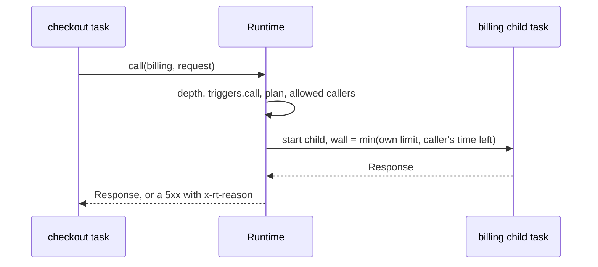
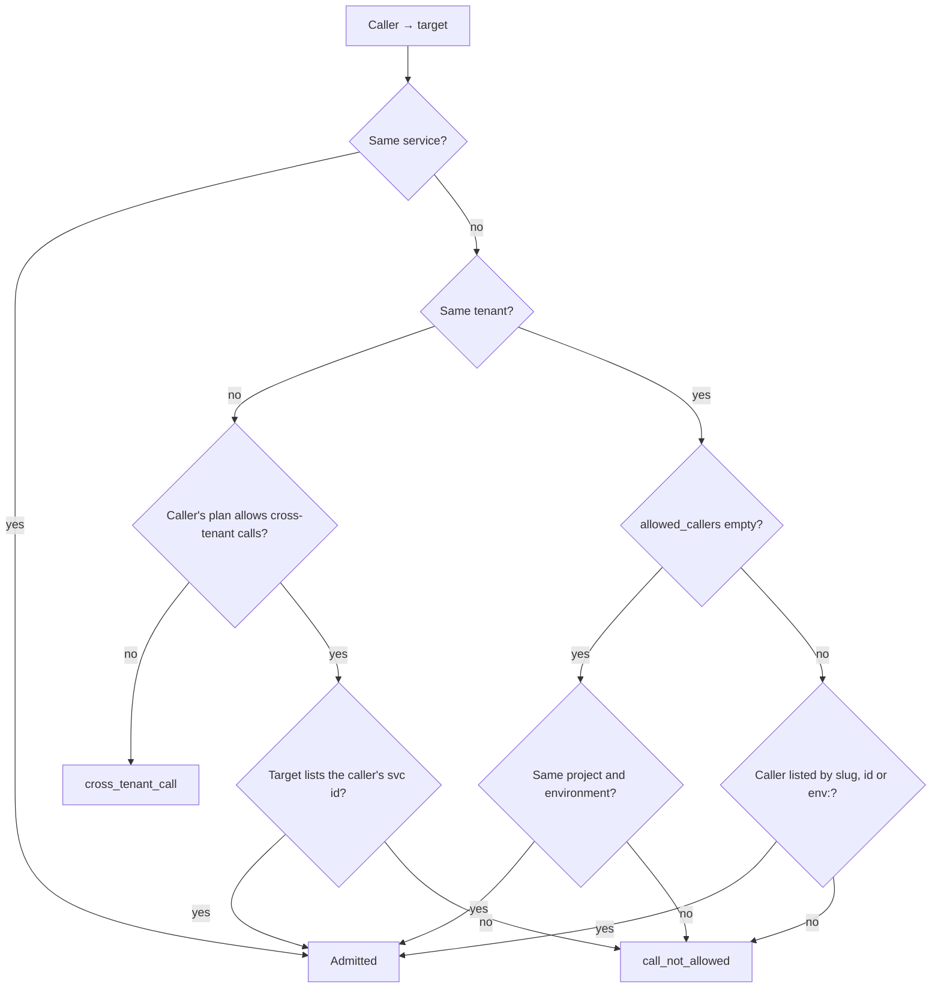
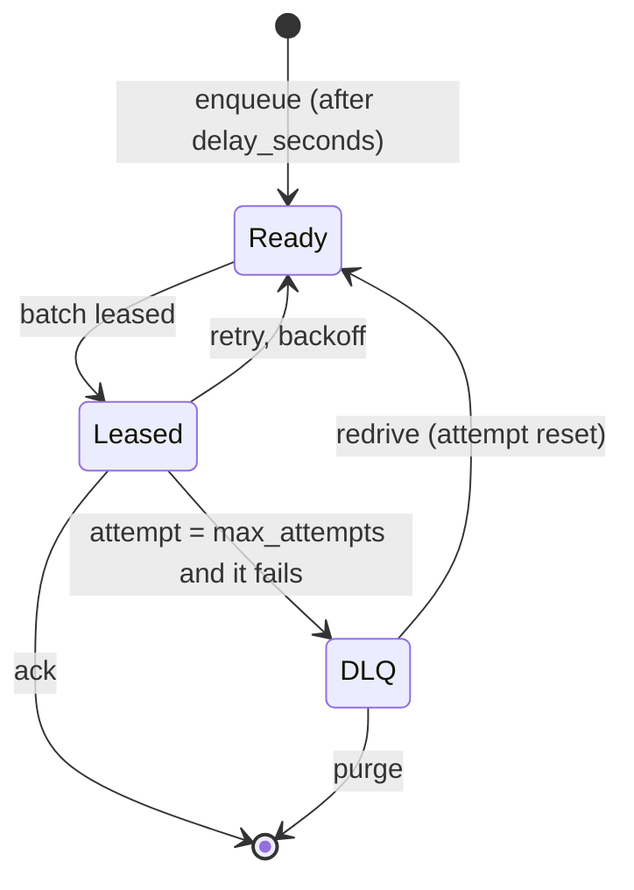

# Service calls and queues

Services of one tenant can talk to each other in two ways: a **call** runs another service right now and gives you its
response, a **queue message** hands work to a service that processes it later, with retries. This guide covers both,
plus the access rules (environments and allowed callers) that decide which service may call or enqueue to which.

| | Service call | Queue message |
|---|---|---|
| Style | Synchronous request/response | Asynchronous, fire and forget |
| Transport | In-process child task, no HTTP hop | Durable per-service queue on the node's disk |
| Guest API | `std:services` `call()` (Deno), `std:host/call` (WASM) | `std:queue` `enqueue()` (Deno), `std:host/queue` (WASM), control API, `21ci queue send` |
| Failure | You get the callee's 5xx response | Retried with backoff, then moved to a dead-letter queue |
| Delivery | Exactly what you asked for, once | At least once, unordered |
| Use it for | Splitting an app into services, internal APIs | Background jobs, webhooks you must not lose, fan-out |

## Service-to-service calls

### How a call works

A call does not open a connection. The runtime turns your request into a **child task** of the target service and
runs it through the same scheduler as any other task (when both services use the same runtime kind, the child is
placed next in line on the caller's processor). The caller waits for the child's response.



- **Same tenant only** by default. Calls to another tenant's service need an operator-enabled plan setting, see
  [Cross-tenant calls](#cross-tenant-calls).
- **Depth limit 15.** A call made from a task that is already 15 calls deep answers `508` with
  `x-rt-reason: call_depth`; every task in the chain still finishes normally.
- **Deadline.** The child's wall limit is the smaller of its own limit and the time the caller has left. A child that
  runs out of time is killed and the caller gets a `504` response (`x-rt-reason: timeout`).
- **Accounting.** The child's CPU time and memory count toward the target service; the tenant's concurrency counts
  both tasks.
- **Up to 16 calls in flight per task.** More concurrent `call()`s wait for a slot, and the wait counts against the
  caller's deadline.

### Make a call

=== "Deno"

    `call(slug, request)` takes a standard `Request` (or the same arguments as `new Request(input, init)`) and
    resolves with a `Response`. The URL's host is a placeholder: only the method, path and query, headers and body
    reach the target. Use an absolute URL such as `http://svc/charge`.

    ```ts title="sample/deno/service-call/main.ts (excerpt)"
    --8<-- "sample/deno/service-call/main.ts:1:1"

    --8<-- "sample/deno/service-call/main.ts:40:59"
    ```

=== "WASM (Rust)"

    `std:host/call` takes a `request` record (`method`, `path-with-query`, `headers`, `body`) and returns a
    `response` record. Bodies are buffered; a response larger than the task's buffered-response limit fails with
    `response_too_large`.

    ```rust title="src/lib.rs (excerpt)"
    // Bindings generated by wit-bindgen from wit/rt-host.wit (world "guest").
    use rt::host::call as rtcall;

    let req = rtcall::Request {
        method: "POST".into(),
        path_with_query: "/charge".into(),
        headers: vec![("content-type".into(), b"application/json".to_vec())],
        body: br#"{"orderId":"o-1","amount":4200}"#.to_vec(),
    };
    match rtcall::call("billing", &req) {
        Ok(res) if res.status < 500 => { /* billing answered: res.status, res.headers, res.body */ }
        Ok(res) => { /* billing ran and failed: the reason is in the x-rt-reason header */ }
        Err(e) => { /* refused before it ran: e.code is call_not_allowed, not_found, … */ }
    }
    ```

The full Deno program is `sample/deno/service-call/` in the runtime repository (it also shows a recursive call that
hits the depth limit). The WASM gateway in the [edge gateway tutorial](../tutorials/edge-gateway.md) forwards requests
to backend services with `std:host/call`.

### What the callee sees

The callee runs its normal HTTP handler (`fetch`, or the Form A default export) with:

| Item | Value |
|---|---|
| Method, path + query, headers, body | As the caller sent them. Headers starting with `x-rt-` are removed |
| `x-rt-trigger` | `call` (and `ctx.trigger === "call"` in Deno) |
| `x-rt-base-path` | `/s/{target-slug}`, the callee's own path prefix |
| `access` mode, ingress rules | Not applied: they govern HTTP requests only. An `access: internal` service can still be called |
| Limits | The callee's own limits, with the wall limit capped by the caller's remaining time |

!!! tip "Internal-only services"
    Give a service that should only be reached by other services `access: internal`
    (`21ci service create billing --access internal`). The public listener answers `404` for it, while calls from
    admitted services keep working.

### Results and errors

A call either **resolves with a response** or, when the runtime refuses to start the child at all, **fails with a
code**.

| What happened | Deno | WASM |
|---|---|---|
| The callee returned a response | That `Response`, any status | `ok(response)` |
| The callee failed (uncaught error, CPU limit, out of memory, timeout) | A `5xx` `Response` with `x-rt-reason` (`guest_error`, `cpu_limit`, `oom`, `timeout`) | `ok(response)` with the same status and header |
| Depth over 15 | `508` `Response`, `x-rt-reason: call_depth` | `ok(response)`, `508` |
| Refused before it started | Throws an `Error` whose `code` (and message) is the reason | `err(error)` with `code` |

Codes of a refused call:

| `code` | Meaning |
|---|---|
| `not_found` | No service with that slug, or it is not routable (no live version) |
| `forbidden` | The target turned its `call` trigger off (`triggers.call = false`) |
| `call_not_allowed` | The target's [allowed callers](#who-may-call-a-service) or environment do not admit the caller |
| `cross_tenant_call` | The target belongs to another tenant and the caller's plan does not allow cross-tenant calls |
| `trigger_not_allowed` | The target tenant's plan does not allow the `call` trigger |
| `call_failed` | The call could not complete, for example the caller ran out of time while waiting |
| `invalid_request`, `response_too_large` | WASM only: a malformed request record, or a response over the buffered limit |

A refused call starts no task in the target. Treat a thrown error as "the other service is not reachable" and a 5xx
response as "it ran and failed".

### Background calls

A response can go out before a call finishes: pass the promise to `ctx.waitUntil()`. The isolate stays alive for it,
bounded by the caller's wall limit.

```ts title="sample/deno/service-call/main.ts (excerpt)"
--8<-- "sample/deno/service-call/main.ts:62:72"
```

For work that must survive a crash or a timeout, enqueue a message instead.

## Who may call a service

Every call, and every `std:queue` enqueue to **another** service, is checked against the target's caller rules. A
service may always call and enqueue to itself.

### Environments

Each service has an `environment` label, `production` unless you set another one (`staging`, `pr-42`, …; it must
match `^[a-z][a-z0-9-]{0,31}$`). The label is only used for access decisions: it does not change routing, limits or
storage.

Changing a service's environment needs the operator token or a tenant key with no project or environment restriction
(otherwise `403 insufficient_scope`), because it changes who may call whom.

### Allowed callers

A service's `call.allowed_callers` list names who may call it. Each entry is one of:

| Entry | Admits |
|---|---|
| `checkout` (a slug) | The service that holds this slug **at call time** |
| `svc_01J…` (a service id) | Exactly that service. Ids are stored in canonical (uppercase) form |
| `env:staging` | Every service of the same project whose environment is `staging` (the environment labels are per project) |

The rules:

- **Empty list (the default):** services of the same project **in the same environment** may call.
- **Non-empty list:** only the listed callers may call. The list replaces the same-environment rule, so add
  `env:production` if a `production` service should keep accepting all `production` callers.
- **Another tenant's service** is admitted only by its **service id**, and only when its plan allows cross-tenant
  calls. Slugs, `env:` entries and the empty list never admit another tenant.

!!! warning "Prefer ids for sensitive services"
    A slug entry admits whichever service holds the slug when the call is made. If the listed service is deleted, a
    new service can take the slug. List `svc_…` ids where that matters.



### Cross-tenant calls

Off by default. Two parties must agree:

1. The **operator** sets `allow_cross_tenant_calls = true` on the **caller's** plan
   (see [`[plans.<name>]`](../api.md#plans-built-in-free-more-under-plansname)).
2. The **target's owner** lists the caller's service id in `call.allowed_callers`.

The target's tenant plan must also allow the `call` trigger. Slugs are unique on a node, so the caller still calls the
target by its slug.

### Worked example: checkout and billing

Two services of one tenant: `checkout` calls `billing` to charge an order. Later a staging copy of `checkout` needs to
reach the same `billing`.

```ts title="billing/main.ts"
export default async function (req: Request, ctx: { trigger: string }): Promise<Response> {
  if (req.method !== "POST" || new URL(req.url).pathname !== "/charge") {
    return new Response("not found", { status: 404 });
  }
  const { orderId, amount } = await req.json();
  // … charge the customer …
  return Response.json({ orderId, amount, charged: true, via: ctx.trigger });
}
```

```ts title="checkout/main.ts"
import { call } from "std:services";

export default async function (_req: Request): Promise<Response> {
  const order = { orderId: crypto.randomUUID(), amount: 4200 };
  let res: Response;
  try {
    res = await call("billing", new Request("http://billing/charge", {
      method: "POST",
      headers: { "content-type": "application/json" },
      body: JSON.stringify(order),
    }));
  } catch (e) {
    // Refused before billing ran: call_not_allowed, not_found, forbidden, …
    return Response.json({ error: (e as { code?: string }).code }, { status: 502 });
  }
  if (!res.ok) {
    return Response.json({ error: "billing failed", reason: res.headers.get("x-rt-reason") }, { status: 502 });
  }
  return Response.json({ order, billing: await res.json() });
}
```

**1. Deploy both in `production`.** `billing` is `internal`, so only other services reach it.

=== "21ci"

    ```console
    $ 21ci service create billing --access internal
    $ 21ci push billing/main.ts --service billing
    $ 21ci push checkout/main.ts --service checkout --create
    $ curl -sS "$RT_INVOKE/s/checkout/"
    {"order":{"orderId":"…","amount":4200},"billing":{"orderId":"…","amount":4200,"charged":true,"via":"call"}}
    ```

=== "curl"

    ```bash
    H=(-H "Authorization: Bearer $RT_KEY")
    BILLING=$(curl -sS "${H[@]}" -H 'Content-Type: application/json' \
      -d '{"slug":"billing","runtime":"deno","access":"internal"}' "$RT_API/v1/services" | jq -r .id)
    curl -sS "${H[@]}" -H 'Content-Type: application/typescript' --data-binary @billing/main.ts \
      "$RT_API/v1/services/$BILLING/versions?activate=1"

    CHECKOUT=$(curl -sS "${H[@]}" -H 'Content-Type: application/json' \
      -d '{"slug":"checkout","runtime":"deno"}' "$RT_API/v1/services" | jq -r .id)
    curl -sS "${H[@]}" -H 'Content-Type: application/typescript' --data-binary @checkout/main.ts \
      "$RT_API/v1/services/$CHECKOUT/versions?activate=1"

    curl -sS "$RT_INVOKE/s/checkout/"
    ```

Both services are in `production` and `billing` has an empty caller list, so the call is admitted.

**2. Add a staging checkout.** It runs the same code in the `staging` environment.

=== "21ci"

    ```console
    $ 21ci service create checkout-staging --env staging
    $ 21ci push checkout/main.ts --service checkout-staging
    $ curl -sS "$RT_INVOKE/s/checkout-staging/"
    {"error":"call_not_allowed"}
    ```

=== "curl"

    ```bash
    STAGING=$(curl -sS "${H[@]}" -H 'Content-Type: application/json' \
      -d '{"slug":"checkout-staging","runtime":"deno","environment":"staging"}' "$RT_API/v1/services" | jq -r .id)
    curl -sS "${H[@]}" -H 'Content-Type: application/typescript' --data-binary @checkout/main.ts \
      "$RT_API/v1/services/$STAGING/versions?activate=1"
    curl -sS "$RT_INVOKE/s/checkout-staging/"     # {"error":"call_not_allowed"}
    ```

A different environment and an empty list: refused, and `billing` never ran.

**3. Admit exactly the callers you want.** Production `checkout` (by id) plus everything in `staging`:

=== "21ci"

    ```console
    $ 21ci service get checkout          # note the ID
    $ 21ci service update billing --allowed-caller svc_01J… --allowed-caller env:staging
    $ curl -sS "$RT_INVOKE/s/checkout-staging/"
    {"order":{…},"billing":{…,"via":"call"}}
    ```

=== "curl"

    ```bash
    curl -sS "${H[@]}" -X PATCH -H 'Content-Type: application/json' \
      -d "{\"call\":{\"allowed_callers\":[\"$CHECKOUT\",\"env:staging\"]}}" \
      "$RT_API/v1/services/$BILLING"
    ```

    `PATCH` replaces the whole `call` block. Add an `If-Match` header with the service's `etag` to avoid
    overwriting a concurrent change (`412 precondition_failed`).

Now:

| Caller | Environment | Result |
|---|---|---|
| `checkout` | `production` | Admitted (listed by id) |
| `checkout-staging` | `staging` | Admitted (`env:staging`) |
| Any other `production` service | `production` | `call_not_allowed`: the list no longer includes the same-environment rule |
| A service of another tenant | any | `cross_tenant_call` (or `call_not_allowed` if its plan allows cross-tenant calls) |

To go back to the default same-environment rule, clear the list: `21ci service update billing --no-allowed-callers`
(or `PATCH` with `{"call":{"allowed_callers":[]}}`).

## Queues

Every service has its own durable queue. You put JSON (or bytes) messages into it; the runtime delivers them to the
service's queue handler in batches, retries failures with exponential backoff and moves messages that keep failing to
a per-service dead-letter queue (DLQ).

### How the queue works

1. A message is written to `queue.db` on the node's data volume (SQLite, separate from the metadata database) and
   survives restarts.
2. The queue engine leases a **batch** of up to `queue.batch_size` (10) ready messages and runs one task with them.
   Up to `queue.max_concurrency` (4) batches of one service run at once, within the service's own concurrency limit (`scaling.max_instances`).
3. A leased message is invisible for the task's wall limit plus 10 seconds. If the node dies mid-task, the lease
   expires and the message is delivered again.
4. When the task ends, each message is **acked** (deleted) or **retried** (made visible again after a delay). A
   message whose attempts are used up moves to the DLQ.



### Enqueue from code

`enqueue` sends a message to a service of the same tenant, by slug: the service itself or another one. Enqueuing to
another service follows the same [caller rules](#who-may-call-a-service) as a call.

=== "Deno"

    ```ts title="sample/deno/scheduled-queue/main.ts (excerpt)"
    --8<-- "sample/deno/scheduled-queue/main.ts:2:2"

    --8<-- "sample/deno/scheduled-queue/main.ts:72:78"
    ```

    `enqueue(service, body, { delaySeconds?, dedupId? })` resolves with `{ id }`. A `Uint8Array` body is sent as
    bytes; anything else is sent as JSON. On failure it throws an `Error` with a `code`.

=== "WASM (Rust)"

    ```rust title="src/lib.rs (excerpt)"
    use rt::host::queue;

    let opts = queue::SendOptions {
        delay_seconds: None,
        dedup_id: Some(format!("order:{order_id}")),
    };
    match queue::enqueue("mailer", br#"{"template":"receipt"}"#, &opts) {
        Ok(msg_id) => { /* "msg_01J…" */ }
        Err(e) => { /* e.code: not_found, forbidden, call_not_allowed, queue_full, … */ }
    }
    ```

    `enqueue(slug, body, send-options)` returns the message id, or an `error` with a `code`. The body is raw bytes
    (send JSON if a Deno consumer should see parsed JSON).

Enqueue codes: `not_found`, `forbidden` (the target's `queue` trigger is off), `call_not_allowed`,
`cross_tenant_call`, `trigger_not_allowed` (the target tenant's plan does not allow `queue`), `queue_full`.

### Enqueue from the API or the CLI

Useful for webhooks from your other systems, scripts and tests. The tenant key needs the `queue:write` scope.

=== "21ci"

    ```console
    $ 21ci queue send jobs --body '{"text":"resize","id":42}'
    $ 21ci queue send jobs --body @job.json --delay 30s --dedup order-42
    $ cat job.json | 21ci queue send jobs --body -
    ```

=== "curl"

    ```bash
    curl -sS -H "Authorization: Bearer $RT_KEY" -H 'Content-Type: application/json' \
      -d '{"body":{"text":"resize","id":42},"delay_seconds":30,"dedup_id":"order-42"}' \
      "$RT_API/v1/services/$SVC/queue"
    # 202 {"id":"msg_01J…"}
    ```

    `Idempotency-Key` works on this route: the same key and body within 24 hours replays the first response
    instead of enqueuing again.

### Consume messages

=== "Deno, Form B"

    Export a `queue(batch, ctx)` handler. Each message has `id`, `body` (parsed JSON, or a string when the body is
    not JSON), `attempt` (1 on the first delivery), `ack()` and `retry({ delaySeconds? })`.

    ```ts title="sample/deno/scheduled-queue/main.ts (excerpt)"
    --8<-- "sample/deno/scheduled-queue/main.ts:104:112"
    --8<-- "sample/deno/scheduled-queue/main.ts:115:125"
    ```

    Without an argument, `retry()` uses the backoff curve described under
    [Delivery guarantees](#delivery-guarantees).

=== "Deno Form A, WASM"

    A handler without `queue()` (a Form A function, or any WASM component) receives the batch as a synthetic
    HTTP request:

    ```http
    POST /__rt/queue
    content-type: application/json
    x-rt-trigger: queue

    {"messages":[{"id":"msg_01J…","body":{"text":"resize","id":42},"attempt":1}]}
    ```

    A `2xx` response acks every message of the batch; any other status retries all of them. To retry only some
    messages, answer `2xx` with an `x-rt-queue-retry` header that lists their ids, comma-separated, each optionally
    followed by `;delay=<seconds>` (for example `msg_01…;delay=30,msg_01…`). Every message not listed is acked.

How a batch is settled:

| Handler outcome | Result |
|---|---|
| Form B returns normally | Messages you `retry()` are retried; every other message is acked (an explicit `ack()` is optional) |
| Form B throws, or the task is killed (timeout, CPU, memory) | **Every** message of the batch is retried, including ones you already acked |
| Form A / WASM returns `2xx` | All acked, except the ids listed in `x-rt-queue-retry` |
| Form A / WASM returns anything else, or fails | All retried |

If you call both `ack()` and `retry()` on one message, `retry()` wins unless `ack()` came first. Catch errors per
message, as the sample does, so one bad message does not send the whole batch around again.

### Delivery guarantees

- **At least once.** A message can be delivered more than once: after a crash, after a lease expires, or when a batch
  is retried as a whole. Make processing idempotent (an `INSERT … ON CONFLICT DO NOTHING` keyed by `msg.id` or by
  your own id is usually enough).
- **Unordered.** Messages are not delivered in enqueue order, and batches of one service run in parallel.
- **Retries with backoff.** A failed delivery comes back after `2 s × 2^(attempt − 1)`, ±20 % jitter (one jitter
  sample per batch):

    | Failed attempt | Next delivery after |
    |---|---|
    | 1 | ≈ 2 s |
    | 2 | ≈ 4 s |
    | 3 | ≈ 8 s |
    | 4 | ≈ 16 s |
    | 5 (`queue.max_attempts`) | moved to the DLQ |

    `msg.retry({ delaySeconds: n })` replaces the backoff delay for that message. It still uses up an attempt.
- **Consumption can pause.** While the service has no live version, its `queue` trigger is off, or its tenant's plan
  does not allow `queue`, nothing is leased: messages wait and no attempts are used.

Queue tasks get their own default limits: 300 s wall time and 10 s CPU, capped by the plan's
[`limits_max`](../api.md#plans-built-in-free-more-under-plansname) (on the built-in `free` plan that is 30 s and 1 s). A `wall_ms` or
`cpu_ms` set in the service's `limits` applies to queue tasks too.

### Delays and deduplication

- **Delay:** `delaySeconds` / `delay_seconds` / `--delay`, at most 7 days. The message stays invisible until then.
- **Deduplication:** a `dedupId` / `dedup_id` / `--dedup` that was already used for the same service in the last
  24 hours does not create a second message; the call returns the first message's id. Use it to make producers
  idempotent, for example `dedupId: "order:" + order.id` from a webhook that may be sent twice.

### Dead-letter queue

The DLQ keeps messages that failed `queue.max_attempts` times, per service. Inspect it, fix the bug, then redrive.

=== "21ci"

    ```console
    $ 21ci queue dlq jobs              # list dead letters
    $ 21ci queue dlq jobs --redrive    # move all of them back to the queue
    $ 21ci queue dlq jobs --purge      # delete all of them
    ```

=== "curl"

    ```bash
    curl -sS -H "Authorization: Bearer $RT_KEY" "$RT_API/v1/services/$SVC/dlq"
    # {"items":[{"id":"msg_01J…","body":{…},"attempts":5,"failed_at":1767225600000}]}   (at most 100)
    curl -sS -X POST -H "Authorization: Bearer $RT_KEY" "$RT_API/v1/services/$SVC/dlq/redrive"
    # {"redriven":1}
    curl -sS -X DELETE -H "Authorization: Bearer $RT_KEY" "$RT_API/v1/services/$SVC/dlq"
    # 204
    ```

Redriven messages start again at attempt 1. Redrive and purge need `queue:write`; listing needs `services:read`.

### Queue stats

=== "21ci"

    ```console
    $ 21ci queue stats jobs
    Depth:          1
    In flight:      0
    Oldest age ms:  9
    DLQ:            0
    ```

=== "curl"

    ```bash
    curl -sS -H "Authorization: Bearer $RT_KEY" "$RT_API/v1/services/$SVC/queue"
    # {"depth":1,"in_flight":0,"oldest_age_ms":9,"dlq":0}
    ```

`depth` counts messages waiting (including delayed ones), `in_flight` those leased by a running task,
`oldest_age_ms` the age of the oldest waiting message. On the metrics listener, `rt_queue_depth` and
`rt_queue_dlq_total` cover the whole node (see [Metrics](../reference/metrics.md)).

### Limits and errors

| Limit | Value | When exceeded |
|---|---|---|
| Message body | 1 MB | `413 too_large` (API) |
| Delay | 7 days | `422 validation_failed` (API) |
| Waiting messages per service | plan `max_queue_depth` (10,000 on `free`) | `429 queue_full` (API), `queue_full` (guest) |
| Queue trigger | service `triggers.queue` and plan `allowed_triggers` | `403 trigger_not_allowed` (API), `forbidden` / `trigger_not_allowed` (guest) |
| DLQ listing | 100 messages per request | |

Node-wide settings (`queue.batch_size`, `queue.max_attempts`, `queue.max_concurrency`) are in
[`[queue]`](../config.md#other-sections).

## Next steps

- [Schedules](schedules.md): run a handler on an interval or a cron expression, and feed a queue from it.
- [Triggers](../concepts/triggers.md): how HTTP, schedules, queues and calls become tasks.
- [Guest API](../reference/guest-api.md) and [WIT](../reference/wit.md): exact signatures of `std:services`,
  `std:queue`, `std:host/call` and `std:host/queue`.
- [Error reasons](../reference/errors.md#codes-inside-guest-code): every code a call or enqueue can fail with.
- CLI reference: [`service`](../cli.md#service) (`--env`, `--allowed-caller`) and
  [`queue`](../cli.md#queue).
- The [live queue tutorial](../tutorials/live-queue.md) builds a complete app on these features.
