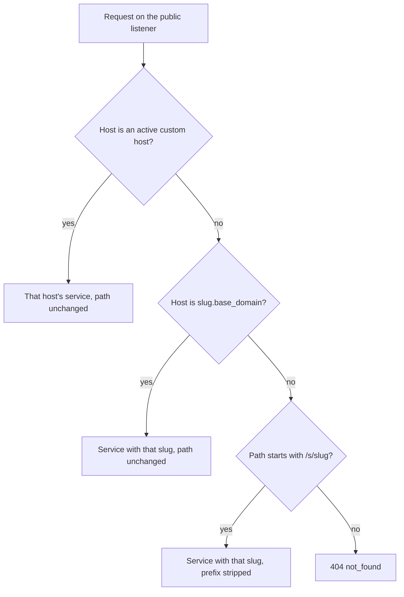
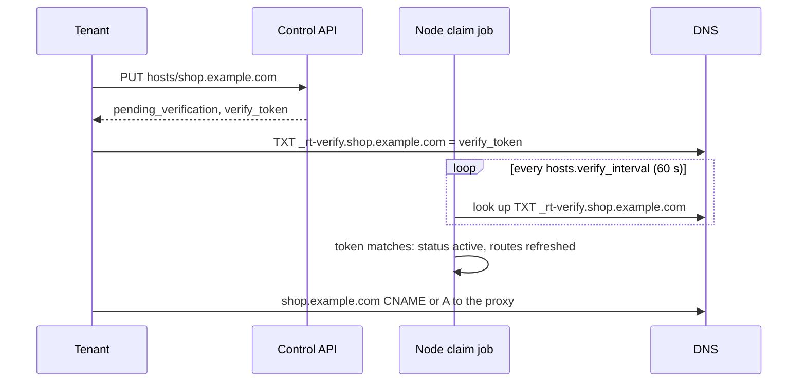

# Custom domains

Every service is reachable at `/s/{slug}/` on the node's public listener. This guide shows the two other ways in, a
wildcard subdomain per service and your own host names, how a tenant proves it owns a host (a DNS TXT record) and how
to put a reverse proxy with TLS in front. Tenants need the first half; operators also need
[Operator settings](#operator-settings) and [Reverse proxy and TLS](#reverse-proxy-and-tls).

## Three ways to reach a service

| Route | Example | Handler sees | Needs |
|---|---|---|---|
| Path | `http://127.0.0.1:8080/s/shop/cart?id=1` | `/cart?id=1`, header `x-rt-base-path: /s/shop` | Nothing: always on |
| Wildcard subdomain | `https://shop.fn.example.com/cart?id=1` | `/cart?id=1` | Operator sets `routing.base_domain`, wildcard DNS and certificate |
| Custom host | `https://shop.example.com/cart?id=1` | `/cart?id=1` | A verified host claim (tenant) or an operator mapping |

The node picks the route from the `Host` header (port and case ignored), first match wins:



Things that follow from this:

- On a custom host or a wildcard subdomain, the **path is passed through unchanged**. `/s/other/` on
  `shop.example.com` is just a path of `shop`, not a route to `other`.
- A subdomain of the base domain whose slug does not exist is `404`; it does not fall back to path routing. The bare
  base domain itself (`fn.example.com/s/shop/`) uses path routing.
- The handler never sees the `Host` header: `req.url` is always `http://localhost/<path>?<query>`. Serve one host per
  service rather than switching on the host name.
- `access: internal` services are not reachable on the public listener by any route.

### Links that work on every route

On path routes the handler sees `/cart`, while the browser is at `/s/shop/cart`. Read `x-rt-base-path` (set only on
path routes) and prefix your absolute links with it, or use relative links:

```ts
export default function (req: Request): Response {
  const base = req.headers.get("x-rt-base-path") ?? ""; // "/s/shop" or "" on host routes
  return new Response(`<a href="${base}/cart">Cart</a>`, { headers: { "content-type": "text/html" } });
}
```

## Wildcard subdomains

Set the base domain in the operator's `rt.toml` and restart the node:

```toml title="rt.toml"
[routing]
base_domain = "fn.example.com"
```

Then `{slug}.fn.example.com` reaches the service `{slug}`, for every service, with no per-service setup. You need:

- A wildcard DNS record: `*.fn.example.com` (and `fn.example.com`) pointing at your reverse proxy.
- A wildcard TLS certificate for `*.fn.example.com`. Public CAs issue those only through the DNS-01 challenge, so
  configure your proxy's DNS provider plugin.
- Only one label in front: `a.b.fn.example.com` does not match.

Hosts under the base domain can never be claimed as custom hosts, so no tenant can take over `admin.fn.example.com`
by claiming it.

## Custom hosts

A custom host maps one host name (`shop.example.com`) to one service. Who can attach which host:

| Who | Which hosts | Status after `PUT` |
|---|---|---|
| Operator (root token) | Any host, except `security.reserved_hosts` and hosts under `routing.base_domain` | `active` at once |
| Tenant (key with `services:write`) | Only proper subdomains of a suffix in its plan's `custom_host_suffixes` | `pending_verification` until verified |

With `custom_host_suffixes = ["example.com"]`, a tenant can claim `shop.example.com` and `api.eu.example.com`, but not
`example.com` itself or `evilexample.com`. The built-in `free` plan has no suffixes, so its tenants cannot attach hosts:
only the operator can.

### The claim flow



### Step by step

**1. Claim the host.**

=== "21ci"

    ```console
    $ 21ci host attach shop shop.example.com
    ```

    The output shows the status, when the claim expires and the TXT record to create, for example
    `_rt-verify.shop.example.com. IN TXT "<token>"`. `21ci host list shop` shows every host of the service.

=== "curl"

    ```bash
    curl -sS -X PUT -H "Authorization: Bearer $RT_KEY" \
      "$RT_API/v1/services/$SVC/hosts/shop.example.com"
    ```

    ```json
    {"host":"shop.example.com","status":"pending_verification","verify_token":"…",
     "created_at":1791370812000,"expires_at":1791975612000}
    ```

    `$SVC` is the service id. `GET $RT_API/v1/services/$SVC/hosts` lists the service's hosts, and
    `GET …/hosts/shop.example.com` reads one.

**2. Publish the token** as a TXT record named `_rt-verify.<host>` with the `verify_token` as its value. The value must
match exactly (surrounding whitespace is ignored); other TXT records at that name do not hurt.

**3. Wait for activation.** The node checks pending claims every `hosts.verify_interval` (60 s by default). Once its
resolver sees the record, the claim becomes `active` and the route table is updated, with no restart. DNS caching can
add a few minutes.

=== "21ci"

    ```console
    $ 21ci host get shop shop.example.com --wait      # polls until active (default timeout 15m)
    ```

    Without `--wait`, `21ci host get` prints the host's current status once (`host status` is an alias).

=== "curl"

    ```bash
    curl -sS -H "Authorization: Bearer $RT_KEY" \
      "$RT_API/v1/services/$SVC/hosts/shop.example.com" | jq -r .status
    ```

**4. Point the host at your proxy** (CNAME to `fn.example.com`, or A/AAAA records) and make sure the proxy serves a
certificate for it, see [Reverse proxy and TLS](#reverse-proxy-and-tls). You can do this before or after activation:
until the claim is active, the node treats the host like any other name, so `/cart` answers `404` and only
`/s/{slug}/` paths route.

Once active, a mapping never expires. To release a host:

=== "21ci"

    ```console
    $ 21ci host detach shop shop.example.com
    ```

=== "curl"

    ```bash
    curl -sS -X DELETE -H "Authorization: Bearer $RT_KEY" \
      "$RT_API/v1/services/$SVC/hosts/shop.example.com"      # 204
    ```

Deleting a service releases its hosts too.

### Claim rules

- **Expiry.** A pending claim expires `hosts.pending_ttl` (7 days) after it was made (`expires_at`). An expired claim
  is deleted and no longer blocks anyone.
- **The token is stable.** Claiming your own pending host again returns the same token and the same expiry, so a
  TXT record you already published stays valid. Deleting the claim and claiming it again within its TTL also continues
  the old claim.
- **No endless retries.** When a tenant's claim ended unverified (expired, or deleted and its TTL ran out), the same
  tenant gets `409 host_cooldown` for that host until one more TTL has passed (`details.retry_at`). Other tenants
  may claim it meanwhile.
- **Pending claims per tenant:** at most `hosts.max_pending_per_tenant` (10), otherwise `403 quota_exceeded`.
- **First come, first served.** A host that another service holds, active or pending, answers `409 host_taken`.
  Only an operator mapping replaces another service's pending claim; an active mapping must be released first.

| Error | HTTP | Cause |
|---|---|---|
| `host_not_allowed` | 403 | Not under one of the plan's `custom_host_suffixes`, reserved, or under `routing.base_domain` |
| `quota_exceeded` | 403 | Too many pending claims for this tenant |
| `host_taken` | 409 | Another service holds the host |
| `host_cooldown` | 409 | This tenant's earlier claim expired unverified; retry after `details.retry_at` |
| `validation_failed` | 422 | Not a valid host name (letters, digits, `.` and `-`, at most 253 characters) |

## Operator settings

<span class="rt-badge rt-badge--operator">Operator</span>

| Key | Default | Effect |
|---|---|---|
| `routing.base_domain` | `""` (off) | Enables `{slug}.{base_domain}` routing; hosts under it can never be claimed |
| `hosts.verify_dns` | `true` | Look up `_rt-verify.<host>` TXT records of pending claims. `false`: no DNS queries, tenant claims wait for operator approval |
| `hosts.verify_interval` | `60s` | How often pending claims are checked and expired |
| `hosts.pending_ttl` | `7d` | Lifetime of an unverified claim, and the cooldown after it |
| `hosts.max_pending_per_tenant` | `10` | Pending claims per tenant |
| `security.reserved_hosts` | `[]` | Exact host names nobody can attach, including the operator (your dashboard, API, …) |
| `custom_host_suffixes` in `[plans.<name>]` | `[]` | Suffixes the plan's tenants may claim under |

```toml title="rt.toml"
[routing]
base_domain = "fn.example.com"

[hosts]
verify_dns = true
verify_interval = "60s"

[security]
reserved_hosts = ["example.com", "www.example.com", "api.example.com"]

[plans.pro]
custom_host_suffixes = ["example.com", "customers.example.net"]
```

Plans reload on `SIGHUP`; `[routing]`, `[hosts]` and `[security]` changes need a restart
([applying changes](../config.md#live-updatable-vs-restart-required)).

**Approving a claim by hand.** With `verify_dns = false`, or when a tenant cannot create TXT records, `PUT` the same
host for the same service with the root token: the claim becomes `active` at once. The operator can also attach hosts
for tenants on plans without suffixes this way.

=== "21ci"

    ```console
    $ RT_KEY="$RT_ROOT_TOKEN" 21ci host attach svc_01J… shop.example.com
    ```

=== "curl"

    ```bash
    curl -sS -X PUT -H "Authorization: Bearer $RT_ROOT_TOKEN" \
      "$RT_API/v1/services/svc_01J…/hosts/shop.example.com"
    ```

Expired claims and verifications are recorded as `host.expired` / `host.verified` audit events.

## Reverse proxy and TLS

`rt` does not terminate TLS. Put a reverse proxy in front of the **public** listener only, and keep the control and
metrics listeners on loopback or a VPN. The proxy must forward the original `Host` header, or host routing cannot work.

=== "Caddy"

    ```caddy title="Caddyfile"
    fn.example.com, *.fn.example.com {          # the wildcard needs routing.base_domain = "fn.example.com" and a DNS-challenge cert
      reverse_proxy 127.0.0.1:8080
    }

    shop.example.com {                          # one block per custom host; Caddy gets its certificate
      reverse_proxy 127.0.0.1:8080
    }
    ```

    Caddy passes the `Host` header through by default.

=== "nginx"

    ```nginx title="nginx.conf"
    server {
      listen 443 ssl; http2 on; server_name fn.example.com *.fn.example.com;
      ssl_certificate /etc/ssl/fn.pem; ssl_certificate_key /etc/ssl/fn.key;
      location / {
        proxy_pass http://127.0.0.1:8080;
        proxy_set_header Host $host;
        proxy_set_header X-Forwarded-For $proxy_add_x_forwarded_for;
        proxy_buffering off;                      # streamed responses
      }
    }

    server {
      listen 443 ssl; http2 on; server_name shop.example.com;
      ssl_certificate /etc/ssl/shop.pem; ssl_certificate_key /etc/ssl/shop.key;
      location / {
        proxy_pass http://127.0.0.1:8080;
        proxy_set_header Host $host;
        proxy_set_header X-Forwarded-For $proxy_add_x_forwarded_for;
        proxy_buffering off;
      }
    }
    ```

Tell the node which proxies to trust, so it takes the client address from `X-Forwarded-For`:

```toml title="rt.toml"
[ingress]
trusted_proxies = ["127.0.0.1/32"]   # the proxy's address as the node sees it, as an IP or CIDR
```

When the TCP peer is a trusted proxy, the client address is the first `X-Forwarded-For` hop from the right that is
not a trusted proxy; otherwise it is the peer itself. That address is what per-service `ip_allow` rules and per-IP
limits match, and what HTTP handlers get as the `x-rt-client-ip` header (and `ctx.client.ip` in Deno). A client-sent
`x-rt-client-ip` is removed first, so it cannot be spoofed.

Without `trusted_proxies`, `X-Forwarded-For` is ignored and every request appears to come from the proxy. When the
node runs in a container, the proxy's address is the one the container sees (for example the Docker bridge gateway),
not `127.0.0.1`.

## Next steps

- [Production deployment](production.md): the rest of a public setup (secrets, plans, backups).
- [Security model](../concepts/security.md): invoke access, header hygiene and why claims are verified.
- [Configuration reference](../config.md#custom-hosts): every `[hosts]`, [`[routing]`](../config.md#routing)
  and [`[ingress]`](../config.md#ingress) key.
- [CLI reference: `host`](../cli.md#host) and [API reference](../api.md#env-secrets-hosts):
  every command and route for hosts.
