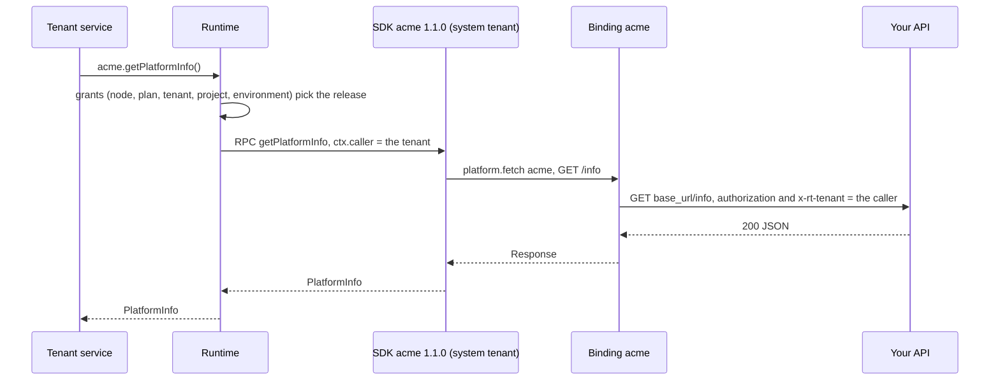

# Operator SDKs and bindings

<span class="rt-badge rt-badge--operator">Operator</span>

If you run the node for customers, you probably have an API of your own (accounts, billing, AI features, telephony)
that tenant services should use. The runtime gives you two pieces for that:

- an **operator SDK**: your code, published to the node and run **by the runtime** as a service of the system tenant.
  Tenants import its contract (`import { acme } from "std:sdk"`) and call it; no SDK code ever enters their bundle or
  their sandbox. You can publish a new release, roll it back or remove it, and every tenant service picks the change up
  on its next call, without a rebuild or a redeploy;
- a **platform binding**: node configuration that names one upstream API, the headers the node adds (your token) and
  what may be called. Only SDK services reach bindings, and they call on behalf of the tenant that called the SDK.

This guide is the operator's side: publishing, grants, bindings and writing an SDK. For the tenant's side (importing,
types, errors), see [Use operator SDKs](use-sdks.md).

## How the pieces fit



- **Contract at build, bind at run time.** The tenant's build sees the SDK's contract only (its method names), and turns
  `std:sdk` / `sdk:acme` into a small generated shim. Each call is resolved at run time to the release the caller's
  grants select.
- **Your code, your sandbox.** The SDK runs in its own isolate under the system tenant `sys`, with its own secrets,
  storage and limits. Tenants cannot read its code or module state, and a crash is an error for the one call, never for
  the caller's task.
- **The caller is stamped.** The SDK gets `ctx.caller` (tenant, plan, project, environment, service, release) from the
  runtime; nothing in the request can change it. The binding forwards that tenant to your API.

## Publish an SDK

An SDK is a Deno module (or a WASM component) whose default export is `defineSdk({ methods })` from `std:sdk/server`:

```ts title="sample/operator-sdk/acme-sdk/mod.ts (excerpt)"
--8<-- "sample/operator-sdk/acme-sdk/mod.ts:16:23"

--8<-- "sample/operator-sdk/acme-sdk/mod.ts:90:100"
```

Publish a release with the root token. The source is a file or a directory, as for `21ci push`:

=== "21ci"

    ```console
    $ 21ci sdk publish acme 1.0.0 sample/operator-sdk/acme-sdk
    Published acme 1.0.0 (service version 1).
    Members   getPlatformInfo,listIntegrations,callService,audit
    Channels  stable
    ```

=== "curl"

    ```bash
    curl -sS -X POST -H "Authorization: Bearer $RT_ROOT_TOKEN" -H 'Content-Type: application/json' \
      -d "$(jq -nc --rawfile s sample/operator-sdk/acme-sdk/mod.ts \
            '{name: "acme", version: "1.0.0", content_type: "application/typescript", source: ($s | @base64)}')" \
      "$RT_API/v1/sdks"
    ```

What happens:

- The name (`^[a-z][a-z0-9_]{1,31}$`) is what tenants import. The version is a semver.
- The release becomes a new version of the SDK's service in the system tenant, and is **built at once**, so the first
  call does not wait for a build.
- The **contract** is read from the source: the method names, the first parameter and return types of each method, and
  the module's interfaces and types. Tenants download it as a `.d.ts`. Give your own with `--contract FILE` and
  `--member NAME` (required for a WASM SDK).
- A method that never reads `ctx.caller` is refused (`422 sdk_unchecked_caller`), unless `defineSdk` has an `authorize`
  hook. That is the confused-deputy guard: every SDK method must decide by who is calling.
- The first release of an SDK becomes `stable`. Later releases move only the channel you name with `--channel`.

## Releases and channels

A **channel** is a named pointer to a release: `stable`, `canary`, or any name of `^[a-z][a-z0-9-]{0,31}$`. Grants pick
a channel (default `stable`); moving the pointer changes what every caller on that channel runs, at its next call.

```bash
21ci sdk publish acme 1.1.0 sample/operator-sdk/acme-sdk --channel canary   # try it on canary first
21ci sdk promote acme 1.1.0                                                 # stable -> 1.1.0
21ci sdk rollback acme                                                      # stable -> the release before (1.0.0)
21ci sdk releases acme
21ci sdk ls
```

`rollback` moves the channel back to the version it pointed to before the last move. In-flight calls finish on the
release they started on.

**Removal.** `21ci sdk rm acme` (`DELETE /v1/sdks/acme`) marks the SDK removed: calls answer `sdk_unavailable`, and new
deploys that import it are refused. Its releases are kept; publishing again restores it.

## Grants: who gets which release

Nothing is granted until you say so. A grant attaches to one scope and one SDK (or `*`, every SDK):

| Scope | Written as | Typical use |
|---|---|---|
| The node | `node` | Every tenant |
| A plan | `plan:pro` | Paid tiers |
| A tenant | `tenant:ten_…` | One customer: deny, pin a version, beta access |
| A project | `project:prj_…` | One product of a customer |
| An environment | `environment:prj_…/staging` | Staging on `canary` |

```bash
21ci sdk grants set node acme --allow                                # every tenant, stable, pinned to ^1
21ci sdk grants set environment:prj_01J…/staging acme --channel canary
21ci sdk grants set tenant:ten_01J… acme --deny                       # this customer: no acme
21ci sdk grants set tenant:ten_01J… acme                              # no flags: delete that grant
21ci sdk grants get
```

How a call resolves, from the node down to the caller's environment:

- **A lower level can only narrow.** A `deny` at any level wins. At least one `allow` is needed.
- **Every `version_req` must hold** (`^1`, `~1.4`, `1.4.2`, `*`). An `allow` written without one is pinned to the major
  of the stable release, so minor releases roll out on the channel while **a new major is a grant change**: publish
  2.0.0, then move tenants with `--version-req ^2` where you are ready.
- **The most specific `channel` wins** (default `stable`). When the channel's release does not satisfy the
  requirements, the newest release that does runs: tenants pinned to `^1` keep 1.x while `stable` points at 2.0.0.
- Nothing is ever set per service.

Grants, channels and releases ride the node's route snapshot: a change applies to the next call everywhere.

## Platform bindings (`[[binding]]`)

Each `[[binding]]` table describes one upstream API that an SDK calls through `platform.fetch(name, request)` (Deno)
or `std:host/platform` (WASM).

```toml title="sample/operator-sdk/rt.toml (binding part)"
--8<-- "sample/operator-sdk/rt.toml:13:31"
```

| Key | Default | Meaning |
|---|---|---|
| `name` | | The name the SDK passes to `platform.fetch` |
| `base_url` | | `http(s)://host[:port][/prefix]`. Requests go to this origin; a path prefix is kept in front of the SDK's path. May point at internal or private addresses |
| `inject_headers` | `{}` | Headers the node adds to every upstream request. A value `env:NAME` is read from the node's environment at startup, so the secret stays out of `rt.toml` |
| `tenant_header` | `""` | Header the node sets to the **calling tenant's** id (`ten_…`): the tenant that called the SDK. Empty: no tenant header |
| `allowed_plans` | `[]` | Plans of the calling tenants that may use the binding. Empty: every plan |
| `allowed_methods` | `[]` | HTTP methods allowed (case-insensitive). **Empty allows nothing** |
| `allowed_paths` | `[]` | Path patterns allowed: `*` matches any run of characters including `/`, `?` matches one character. **Empty allows nothing** |
| `rate_limit.rps` | `0` | Requests per second per calling tenant on this binding. `0` = unlimited |
| `rate_limit.burst` | `0` | Bucket size of that limit (at least 1 is used) |

!!! note "Bindings belong to SDKs"
    A tenant service that calls `platform.fetch` itself gets `403 binding_not_allowed`. Tenants reach your API through an
    SDK, which authorizes them by `ctx.caller` first.

### What happens on each call

The node checks a call in this order and stops at the first refusal:

1. The binding exists, else `404 binding_not_found`.
2. The caller is an SDK service, else `403 binding_not_allowed`.
3. The calling tenant's plan is in `allowed_plans` (when the list is not empty), else `403 binding_not_allowed`.
4. The method is in `allowed_methods`, else `403 binding_denied`.
5. The path is percent-decoded and normalized: a `..` segment, a backslash, a control character or a malformed escape
   is refused (decoding is repeated, so `%252e%252e` does not slip through); `.` and empty segments are dropped. The
   result must match an `allowed_paths` pattern, else `403 binding_denied`.
6. The calling tenant has a token left in the binding's rate limit, else `429 rate_limited`.
7. The request goes to `base_url` + the normalized path + the original query string, with the SDK's method and body,
   the filtered headers below, the injected headers and the tenant header. Redirects are not followed, and the upstream
   call is bounded by the call's deadline. A connection failure, a timeout or an invalid `base_url` is
   `502 binding_upstream`.
8. The upstream response comes back with its own status, headers and body, minus `Set-Cookie`.

Path matching examples, for `allowed_paths = ["/info", "/services/*"]`:

| SDK path | Normalized | Allowed |
|---|---|---|
| `/info` | `/info` | yes |
| `//info` | `/info` | yes |
| `/info/` | `/info/` | no: the trailing slash is kept |
| `/services/billing` | `/services/billing` | yes |
| `/services/a/b` | `/services/a/b` | yes: `*` also matches `/` |
| `/services/../admin` | refused | no: `binding_denied` |
| `/services/%2e%2e/admin` | refused | no: `binding_denied` |

### Headers

| Direction | Removed | Added |
|---|---|---|
| SDK → upstream | `authorization`, `cookie`, `proxy-authorization`, `host`, `content-length`, hop-by-hop headers, every `x-rt-*` header, and any header with the same name as an injected header or the tenant header | `inject_headers`, `tenant_header: ten_…` (the caller) |
| Upstream → SDK | `set-cookie` | nothing |

The injected values are added on the node side and never enter guest memory.

### Responses, never exceptions

A refused binding call is not an error in SDK code: it **resolves with a response** carrying the reason in
`x-rt-reason` (`binding_denied`, `binding_not_allowed`, `binding_not_found`, `rate_limited`, `binding_upstream`). Turn it
into an error code your callers see: an error with a `code` property thrown from an SDK method reaches the tenant as
`SdkError.code`.

### Bindings and egress

Guest `fetch()` goes through the SSRF guard, which denies private and loopback addresses. Bindings use a separate,
operator-trusted path, so `base_url` may be an internal host such as `http://billing.internal:8000`. The addresses of
every binding's `base_url` are on the node's self-denylist, so a tenant's plain `fetch()` to your API's address fails
with `egress_denied`. The SDK, through the binding, is the only way in.

## Worked example: the `acme` SDK

The runtime repository ships a complete setup:

| File | Role |
|---|---|
| `sample/operator-sdk/acme-sdk/mod.ts` | The SDK (`defineSdk`) |
| `sample/operator-sdk/rt.toml` | The `[[binding]]` fragment |
| `sample/operator-sdk/mock-platform-api/server.js` | A stand-in for your API (Node.js, no dependencies) |
| `sample/deno/platform-sdk/main.ts` | A tenant service that uses the SDK |
| `sample/apps/edge-gateway/` | A WASM gateway and a Deno service shipping audit events through the SDK, with a smoke that updates it under them |

### 1. Start the stand-in API

The mock requires the token the node will inject and echoes the tenant header back:

```bash
ACME_INTERNAL_TOKEN=dev-internal-token node sample/operator-sdk/mock-platform-api/server.js 3000
```

```js title="sample/operator-sdk/mock-platform-api/server.js (excerpt)"
--8<-- "sample/operator-sdk/mock-platform-api/server.js:46:65"
```

### 2. Configure the binding

Merge the fragment into the node's `rt.toml` and start the node with `ACME_INTERNAL_TOKEN=dev-internal-token` in its
environment. The binding admits the `pro` and `business` plans, so they must exist (`[plans.pro]`, `[plans.business]`).
`base_url` is resolved from the node: in a container, `127.0.0.1` is the container itself.

### 3. Publish and grant the SDK

```bash
21ci sdk publish acme 1.0.0 sample/operator-sdk/acme-sdk
21ci sdk grants set node acme --allow
```

### 4. A tenant uses it

```ts title="sample/deno/platform-sdk/main.ts (excerpt)"
--8<-- "sample/deno/platform-sdk/main.ts:13:15"

--8<-- "sample/deno/platform-sdk/main.ts:30:32"
```

```console
$ 21ci --as-tenant ten_01J… push sample/deno/platform-sdk --service platform-sdk --create
$ curl -sS "$RT_INVOKE/s/platform-sdk/info"
{"platform":"acme","version":"1.0.0","features":["storage","api","webhooks"],"tenant":"ten_01J…","sdk":"1.0.0"}
```

### 5. Update it without redeploying the tenant

Turn on `INFO_WITH_INTEGRATIONS` in `mod.ts` and publish it to `stable`:

```console
$ 21ci sdk publish acme 1.1.0 sample/operator-sdk/acme-sdk --channel stable
$ curl -sS "$RT_INVOKE/s/platform-sdk/info"
{"platform":"acme",…,"sdk":"1.1.0","integrations":["slack","github","stripe","sendgrid"]}
$ 21ci sdk rollback acme
$ curl -sS "$RT_INVOKE/s/platform-sdk/info"
{"platform":"acme",…,"sdk":"1.0.0"}
```

`21ci versions platform-sdk` still shows one version: the tenant service was not rebuilt or redeployed. The edge
gateway smoke (`sample/apps/edge-gateway/smoke.sh`) does the same with a WASM component, then removes the SDK and checks
that the next call answers `sdk_unavailable`.

## Write your own SDK

### Design rules

1. **Authorize every method by `ctx.caller`.** `ctx.caller.tenant` is the only tenant identity to trust. `defineSdk`
   refuses a method that never reads it, unless an `authorize(caller, method, args)` hook checks every call.
2. **Key tenant data by the caller.** The SDK's own `std:kv`, `std:sql` and blobs are shared by every tenant that calls
   it. Prefix keys and scope rows by `ctx.caller.tenant`.
3. **Treat arguments as untrusted.** They are the tenant's JSON (256 KiB at most). Validate them; never let them choose
   a URL, a path outside your API or another tenant.
4. **Reach your API only through a binding.** Keep credentials in `inject_headers` or the SDK service's secrets.
5. **Type the methods.** The contract tenants download is generated from the first parameter and return annotations
   and the module's interfaces and types.
6. **Version for compatibility.** Minor releases reach every tenant on the channel at once; keep their contract
   compatible. Put breaking changes in a new major and move tenants with a grant.

### Errors

A `ServiceError`, or any error with a `code` property, reaches the tenant as an `SdkError` with that code and its
message (never the stack). Any other error is `internal_error`.

### The provider side of the call

Your API receives what the binding sends: the method, path, query and body the SDK built, the injected
`authorization` header and the calling tenant's id in the tenant header. Rules for the API:

- **Authenticate the node, not the tenant.** The injected token proves the call came from your node. Compare it in
  constant time and reject everything else.
- **Take identity from the tenant header only.** It is the tenant the runtime stamped on the SDK call; scope every query
  by it.
- **Expect retries.** Honor an idempotency key on writes.
- **Log the tenant header** with every request: it is your audit trail for who called what.

## Operating notes

| Topic | Behavior |
|---|---|
| Who may publish | The operator only (root token). Tenants cannot publish SDKs |
| The system tenant | `ten_00000000000000000000000SYS` owns SDK services. It is not listed among tenants and cannot be changed, deleted or given keys; `sys-` slugs are reserved |
| Usage | The SDK's CPU is recorded in the calling tenant's usage, against the SDK's service |
| Limits | An SDK call is a call hop: the caller's depth (15) and remaining time apply. The SDK runs under its own service limits |
| Applying changes | Publishing, channel moves, removals and grants apply to the next call. `[[binding]]` is read at startup: restart the node |
| Secrets | Use `env:NAME` in `inject_headers`, or secrets on the SDK service |
| The old `[[sdk]]` section | Removed: it bundled SDK code into tenant services. A config that still has it fails to load with a pointer to `21ci sdk publish` |

## Next steps

- [Use operator SDKs](use-sdks.md): the tenant's side, types and errors.
- [Configuration reference](../config.md#other-sections): [`[[binding]]`](../config.md#other-sections) and
  [`[plans.<name>]`](../api.md#plans-built-in-free-more-under-plansname).
- [CLI reference](../cli.md#sdk): `21ci sdk`.
- [Security model](../concepts/security.md): the egress guard and why bindings are the confused-deputy guard.
- The [edge gateway tutorial](../tutorials/edge-gateway.md): a WASM component using the SDK.
