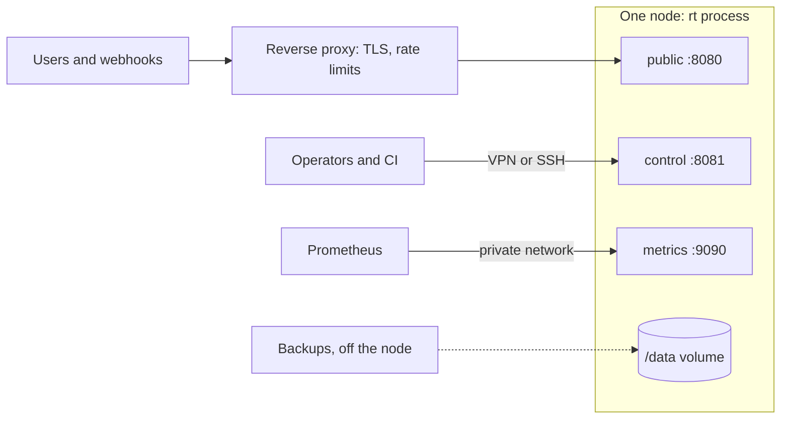

# Production deployment <span class="rt-badge rt-badge--operator">operator</span>

This guide is for operators who run a node for real users. It covers the container setup, secrets and
configuration, the reverse proxy in front of the public listener, health checks and monitoring, backups,
upgrades, configuration reloads and master key rotation. For a first local node, start with
[Install](../getting-started/install.md).

A node is one container running `rt serve` with one data volume. There is no clustering in this release: one node
serves all its tenants, and you scale it vertically. A machine without Docker runs the same binary under systemd:
see [Self-hosting](self-hosting.md).



## Requirements

| | |
|---|---|
| Host | Linux x86_64 or arm64 with Docker, Compose v2 and BuildKit. macOS is fine for development (`make dev`), not for production nodes |
| First build | `docker compose up --build` downloads a prebuilt V8 and compiles the workspace: 20 minutes or more. Later builds reuse the BuildKit caches |
| Size | The node sizes itself from the container limits (see [Sizing](#sizing)); how much you need is a capacity question: [Resource requirements](resources.md) and [Capacity planning](#capacity-planning) |
| Disk | One volume for `/data`: metadata, uploaded artifacts, service databases, blobs, logs and the compiled-code cache. Plan for `cache.t2_max_mb` (4 GiB by default) on top of your tenants' data |

### What the image gives you

The image is built from the `Dockerfile` in the runtime repository:

- `debian:bookworm-slim` runtime stage (glibc, which the prebuilt V8 needs) with `ca-certificates` and `curl` only.
- A non-root user, `uid:gid 10001`, and `/data` as the working directory and volume. A host bind mount must be
  writable by uid 10001.
- A healthcheck: `curl -fsS http://127.0.0.1:9090/healthz` every 10 s (liveness only, so a slow start or a drain does
  not get the container restarted).
- Reference configurations in `/etc/rt/defconfigs/`.
- An entrypoint that runs `rt --config /etc/rt/rt.toml serve` when that file exists, else `rt serve` on the built-in
  defaults (profile `balanced`, only the built-in `free` plan). Arguments after the image name replace `serve`, for
  example `--print-config`.
- Environment defaults that bind every listener inside the container and turn off the V8 sandbox requirement (the
  prebuilt V8 has no sandbox in this release, see [Security](../concepts/security.md)):

    ```text
    RT__NODE__DATA_DIR=/data
    RT__LISTENERS__PUBLIC=0.0.0.0:8080
    RT__LISTENERS__INTERNAL=unix:/data/rt.sock
    RT__LISTENERS__CONTROL=0.0.0.0:8081
    RT__LISTENERS__METRICS=0.0.0.0:9090
    RT__SECURITY__REQUIRE_V8_SANDBOX=false
    RT_LOG=info
    ```

## Docker Compose setup

The repository ships a compose file for one node. It publishes all three ports on the host's loopback only, so
nothing is reachable from the network until you put a proxy in front of the public port.

```yaml title="docker-compose.yml"
--8<-- "docker-compose.yml"
```

Bring it up:

```bash
cp .env.example .env
sed -i.bak "s/^RT_ROOT_TOKEN=.*/RT_ROOT_TOKEN=$(openssl rand -hex 32)/; s/^RT_MASTER_KEY=.*/RT_MASTER_KEY=$(openssl rand -hex 32)/" .env && rm .env.bak
docker compose up -d --build
until curl -fsS http://127.0.0.1:9090/readyz; do sleep 1; done
```

What the compose file adds on top of the image: `cap_drop: ALL`, `no-new-privileges`, `nofile` 65536,
`restart: unless-stopped`, `init: true` (signals reach `rt` through a small init process) and a 30 s stop grace
period. The named volume is `rt_rt-data`. `docker compose down` keeps it; `docker compose down -v` deletes every
tenant, service and sealed secret.

| Variable (compose and scripts only) | Default | Meaning |
|---|---|---|
| `RT_IMAGE` | `rt:dev` | Image tag to build and run |
| `RT_PUBLIC_PORT` | `8080` | Host port of the public listener (on `127.0.0.1`) |
| `RT_CONTROL_PORT` | `8081` | Host port of the control API |
| `RT_METRICS_PORT` | `9090` | Host port of `/metrics`, `/healthz`, `/readyz` |

!!! tip "Prometheus on the same host"
    Prometheus itself listens on port 9090 by default. If it runs on the node's host, move the node's metrics port,
    for example `RT_METRICS_PORT=19090` in `.env`.

## Secrets

The node reads two secrets, only from the environment or from files:

| Variable | What it is |
|---|---|
| `RT_ROOT_TOKEN` / `RT_ROOT_TOKEN_FILE` | The operator's Bearer token for the control API. A release build without it answers every control route `503 control_disabled` |
| `RT_MASTER_KEY` / `RT_MASTER_KEY_FILE` | 32 bytes as 64 hex characters (`openssl rand -hex 32`). Seals tenant secrets and derives the API-key pepper and the MAC key of the compiled-code cache. `security.master_key_file` in `rt.toml` is a third way to point at a file |
| `RT_MASTER_KEY_PREVIOUS` / `RT_MASTER_KEY_PREVIOUS_FILE` | Only during a [key rotation](#rotating-the-master-key) |

Set either `NAME` or `NAME_FILE`, never both: that is a startup error. A file may end with a newline. If no master
key is given at all, `rt` generates `<data_dir>/master.key` (mode 0600). That is convenient for a test node, but in
production the key would then live on the same volume as the data it protects; pass it in instead.

!!! danger "Back up the master key"
    Lose it and every sealed secret on the volume is unreadable, and every tenant API key stops verifying. Store it
    apart from the data backups.

`.env.example` ships `change-me-…` placeholders that are not valid hex on purpose: the node rejects them as a master
key. To keep the secrets out of the environment, use files. Replace the two secret entries of `environment:` with:

```yaml title="docker-compose.override.yml"
services:
  rt:
    environment:
      RT_ROOT_TOKEN: ""            # empty counts as unset
      RT_MASTER_KEY: ""
      RT_ROOT_TOKEN_FILE: /run/secrets/rt_root_token
      RT_MASTER_KEY_FILE: /run/secrets/rt_master_key
    volumes:
      - ./secrets/rt_root_token:/run/secrets/rt_root_token:ro
      - ./secrets/rt_master_key:/run/secrets/rt_master_key:ro
```

The files must be readable by uid 10001 (`chown 10001 secrets/*; chmod 0400 secrets/*`). Compose still insists that
`RT_ROOT_TOKEN` and `RT_MASTER_KEY` exist in `.env` or the shell (the base file uses `${…:?}`), so either keep any
non-empty placeholder there or edit the base file directly.

## Configuration

Without a config file the node runs on built-in defaults. For production you want your own `rt.toml`, at least for
tenant plans and the reverse proxy settings below.

```bash
make defconfig PROFILE=balanced > rt.toml       # or copy config/defconfigs/<profile>.toml
# edit rt.toml, then uncomment in docker-compose.yml:
#   - ./rt.toml:/etc/rt/rt.toml:ro
docker compose up -d
docker compose run --rm --no-deps rt --print-config   # the resolved configuration the node sees
```

Keep these rules in mind:

- **The image's `RT__` variables win over the file.** Environment overrides (`RT__SECTION__KEY=value`) beat
  `rt.toml`, and the image sets the listener addresses, `node.data_dir` and `security.require_v8_sandbox`. Those keys
  in a mounted file have no effect; change them with `RT__…` entries under `environment:` instead.
- **Unknown keys stop the node.** A typo such as `sched.procesors` fails startup with the key path. Check a file
  with `rt --config rt.toml --print-config` before you mount it.
- **`security.require_v8_sandbox` defaults to `true` in the binary**, and this release has no V8 sandbox, so a node
  with that value refuses to start (`v8_sandbox_required`). The image sets it to `false`, and so does every file in
  `config/defconfigs/`. Outside the image, a hand-written `rt.toml` (or `rt serve` with no file) must set it:

    ```toml
    [security]
    require_v8_sandbox = false
    ```

Keys operators usually set:

| Key | Default | Why |
|---|---|---|
| [`[plans.<name>]`](../api.md#plans-built-in-free-more-under-plansname) | only the built-in `free` | Tenant plans: quotas, per-task limit maxima, allowed triggers, custom host suffixes |
| [`routing.base_domain`](../config.md#routing) | `""` (off) | `{slug}.<domain>` URLs for every service |
| [`ingress.trusted_proxies`](../config.md#ingress) | `[]` | Addresses whose `X-Forwarded-For` the node believes |
| [`security.reserved_hosts`](../config.md#security) | `[]` | Hosts tenants can never claim |
| [`egress.denied_ports`, `denied_hosts`, `denied_cidrs`](../config.md#security) | ports 25, 465, 587 | Extra outbound denials on top of the SSRF guard |
| [`build.npm_cdn`, `build.allowed_hosts`](../config.md#other-sections) | esm.sh and four CDNs | Point both at an internal mirror for air-gapped nodes |
| [`deploy.retain_versions`](../config.md#other-sections), [`logs.retention_days`, `logs.max_mb_per_service`](../config.md#other-sections) | 10, 7, 50 | Disk growth |

The full list is in the [configuration reference](../config.md); the [limits reference](../reference/limits.md)
shows every plan key and what happens when a tenant hits it.

### Sizing

`sched.processors = 0` and `memory.budget_mb = 0` (the defaults) make the node size itself from the container:

- **Processors** follow the cgroup CPU quota (`cpus:` in compose, `--cpus` in `docker run`), else the number of
  cores.
- **Memory budget** is 85 % of the cgroup `memory.max` (`mem_limit:`), else of physical RAM. A 2 GiB limit gives a
  budget of 1,740 MB. Everything that scales with load (isolate heaps, WASM memories, the in-memory code cache, SQLite
  page caches) is reserved against this budget.

Set limits on the container rather than in `rt.toml`, so the node and the kernel agree:

```yaml
services:
  rt:
    cpus: 4
    mem_limit: 2g
```

The [performance tuning guide](performance.md) explains profiles, warm pools and the other knobs that trade memory
for latency.

## Reverse proxy and TLS

`rt` does not terminate TLS. Put a proxy in front of the **public** listener only, and keep control and metrics
private: they have no network ACL of their own.

=== "Caddy"

    ```caddy
    fn.example.com, *.fn.example.com {
      reverse_proxy 127.0.0.1:8080
    }
    ```

    The wildcard site needs `routing.base_domain = "fn.example.com"` in `rt.toml` and a certificate from a DNS
    challenge (wildcards cannot use the HTTP challenge). Caddy passes `Host` and sets `X-Forwarded-For` by default
    and streams responses.

=== "nginx"

    ```nginx
    server {
      listen 443 ssl; http2 on;
      server_name fn.example.com *.fn.example.com;
      ssl_certificate     /etc/ssl/fn.pem;
      ssl_certificate_key /etc/ssl/fn.key;

      location / {
        proxy_pass http://127.0.0.1:8080;
        proxy_http_version 1.1;
        proxy_set_header Host $host;
        proxy_set_header X-Forwarded-For $proxy_add_x_forwarded_for;
        proxy_buffering off;          # streamed responses reach the client as they are written
        proxy_read_timeout 300s;      # at least the longest wall limit your plans allow
      }
    }
    ```

    `Host` must reach the node unchanged: it routes `{slug}.<base_domain>` and custom hosts by it.
    `proxy_buffering off` matters for streamed responses and server-sent events.

Then tell the node which peer to believe:

```toml title="rt.toml"
[ingress]
trusted_proxies = ["172.18.0.1"]   # the address the proxy connects from, as the node sees it
```

Without it, `X-Forwarded-For` is ignored: every request appears to come from the proxy, so per-service `ip_allow`
rules, the per-client lockout after failed authentications, and the client address your tenants' code reads
(`x-rt-client-ip` header, `ctx.client.ip` in Deno) all see the proxy. With it, the node walks `X-Forwarded-For` from
the right to the first address that is not a trusted proxy. Entries are IPs or CIDRs. Trusted proxies
are also exempt from `ingress.max_conns_per_ip` (256), since all clients arrive from their address: limit clients at
the proxy instead.

!!! warning "Which address is the proxy?"
    With the compose setup, a proxy on the host reaches the node through Docker's port mapping, so the node sees the
    Docker network's gateway (for example `172.18.0.1`), not `127.0.0.1`. `docker network inspect rt_default` shows
    the gateway and subnet. If the proxy runs as another container on the same compose network, trust that
    container's address or the network's subnet.

Built-in ingress protection on every TCP listener: request head ≤ 16 KB and ≤ 100 headers (`431`), 10 s to send the
head, 256 connections per client IP, 100 concurrent HTTP/2 streams per connection. The
[limits reference](../reference/limits.md#ingress) lists all of them.

### Keep control and metrics private

The control API (`:8081`) carries the root token and every tenant's deployments; the metrics listener (`:9090`)
needs no credentials at all. Reach them over SSH or a VPN, never through the public proxy:

```bash
ssh -N -L 8081:127.0.0.1:8081 -L 9090:127.0.0.1:9090 ops@node.example.com
export RT_API=http://127.0.0.1:8081 RT_KEY="$RT_ROOT_TOKEN"
```

Failed authentications on the control API are limited per client: after 10 in a minute the client gets
`429 rate_limited`.

## Health checks

Both endpoints live on the metrics listener:

| Endpoint | `200` when | `503` when | Use it for |
|---|---|---|---|
| `GET /healthz` | The scheduler's monitor thread ticked within the last second | The node is stuck | Liveness: restart the container (the image's `HEALTHCHECK` uses it) |
| `GET /readyz` | Migrations are applied, the base snapshot is loaded, the node is not draining | Starting up or draining | Readiness: load balancer probes, deploy scripts |

Do not use `/readyz` as a liveness probe: a node that is draining for an upgrade is healthy but not ready, and a
restart would cut its in-flight requests.

## Monitoring

Scrape `/metrics` with Prometheus. Every node metric exists from the first scrape (zero-valued), so dashboards and
alerts do not break on a fresh node.

```yaml title="prometheus.yml"
scrape_configs:
  - job_name: rt
    scrape_interval: 15s
    static_configs:
      - targets: ["127.0.0.1:9090"]   # the node's metrics listener
```

Alerts worth having from day one:

```yaml title="rt-alerts.yml"
groups:
  - name: rt
    rules:
      - alert: RtDown
        expr: up{job="rt"} == 0
        for: 1m
      - alert: RtMemoryCritical            # the node sheds load at this level
        expr: rt_mem_pressure_level >= 2
        for: 2m
      - alert: RtMemoryHigh
        expr: rt_mem_pressure_level >= 1
        for: 15m
      - alert: RtQueueTimeouts             # requests waited longer than queue_timeout
        expr: increase(rt_admission_rejects_total{reason="queue_timeout"}[5m]) > 0
      - alert: RtAdmissionWaitHigh
        expr: histogram_quantile(0.99, sum by (le) (rate(rt_admission_queue_wait_seconds_bucket[5m]))) > 1
        for: 10m
      - alert: RtPublic5xx
        expr: |
          sum(rate(rt_http_requests_total{listener="public",status_class="5xx"}[5m]))
            / sum(rate(rt_http_requests_total{listener="public"}[5m])) > 0.05
        for: 10m
      - alert: RtTasksKilled               # tasks over their CPU, memory or wall limit
        expr: sum by (outcome) (increase(rt_tasks_total{outcome=~"cpu_limit|oom|timeout"}[15m])) > 10
      - alert: RtBuildsFailing
        expr: increase(rt_build_total{result="failed"}[1h]) > 3
      - alert: RtDeadLetters
        expr: increase(rt_queue_dlq_total[15m]) > 0
      - alert: RtConnectionsRejected       # ingress.max_conns_per_ip reached
        expr: increase(rt_ingress_conn_rejected_total[5m]) > 0
```

`RtPublic5xx` also counts 5xx responses your tenants' code returns on purpose; scope it to what you own. The
[metrics reference](../reference/metrics.md) lists every metric, its labels and more PromQL. The node does not export
disk usage: watch the `/data` filesystem with your host monitoring (the code cache garbage-collects itself below
`disk.low_free_mb`, tenant data does not).

For a closer look at a running node, the operator token can read:

=== "21ci"

    ```bash
    21ci node status       # mode (normal | shed | drain), processors, memory budget and pressure
    21ci node scheduler    # processors, run queues, waiting tasks, admission per service (--json: raw JSON)
    21ci node cache        # cache tiers and hit rates (JSON)
    21ci node config get   # the configuration the node runs with, secrets redacted
    ```

=== "curl"

    ```bash
    curl -sS -H "Authorization: Bearer $RT_KEY" "$RT_API/v1/node/status"
    curl -sS -H "Authorization: Bearer $RT_KEY" "$RT_API/v1/node/scheduler"
    curl -sS -H "Authorization: Bearer $RT_KEY" "$RT_API/v1/node/cache"
    curl -sS -H "Authorization: Bearer $RT_KEY" "$RT_API/v1/node/config"
    ```

## Logs

The node writes two kinds of logs:

- **System logs**: JSON lines on stdout (`docker compose logs rt`), filtered by `RT_LOG` (default `info`; for
  example `RT_LOG=info,rt_sched=debug`). `RUST_LOG` is read only when `RT_LOG` is unset. System logs never contain
  env or secret values.
- **Service logs**: what tenants' code prints, plus build logs and runtime notes about the service. They are stored
  per service under `/data/logs/` and read through the API (`GET /v1/services/{s}/logs`, `21ci logs`). Retention is
  `logs.retention_days` (7) and `logs.max_mb_per_service` (50 MB), oldest segments first. Each service may log
  100 lines/s with bursts of 1,000; the rest is dropped and counted (`rt_logs_dropped_total`).

To ship service logs to your own pipeline, set `logs.stdout = true`: every record is also written to stdout as one
JSON line, next to the system logs.

## Backups

Everything lives under `/data`:

```text
/data/
  meta.db, queue.db              tenants, hashed keys, services, versions, schedules, usage, events / queue + DLQ (SQLite, WAL)
  master.key                     only when no master key was passed in
  artifacts/<sha256>/            uploaded sources and wasm, content-addressed
  services/<service-id>/data.db  KV + SQL of one service
  blobs/<service-id>/            blob store of one service
  logs/<service-id>/             service log segments
  cache/v2/<engine-fp>/          compiled code (rebuildable)
  deps/                          created at startup, unused in this release
  rt.sock                        internal listener
```

**What to back up:** `meta.db`, `queue.db`, `artifacts/`, `services/`, `blobs/`, and the master key, stored
separately. `logs/` if you need the history. `cache/` and `deps/` can be dropped: the node rebuilds the compiled
code on demand from `artifacts/`, which also holds the fetched dependencies of every build.

**Cold backup** (consistent, short downtime): a running node keeps SQLite files open in WAL mode, so a plain copy of
them is not consistent. Stop the node, archive the volume, start it again:

```bash
docker compose stop rt
docker run --rm -v rt_rt-data:/data -v "$PWD":/backup debian:bookworm-slim \
  tar czf /backup/rt-data-$(date +%F).tgz -C /data .
docker compose start rt
```

**Hot backups** of the metadata use SQLite's online backup with the `sqlite3` command line tool, which is not part of
the image. Run it where the volume's files are visible:

```bash
sqlite3 /path/to/data/meta.db  ".backup '/backups/meta.db'"
sqlite3 /path/to/data/queue.db ".backup '/backups/queue.db'"
```

The per-service databases are SQLite files too. A hot copy of all of them, one consistent snapshot each:

```bash
mkdir -p /backups/services
for db in /path/to/data/services/*/data.db; do
  id=$(basename "$(dirname "$db")")
  sqlite3 "$db" ".backup '/backups/services/$id.db'"
done
```

Blob files and `artifacts/` are plain files, copied separately from the databases. A blob written or deleted while the
backup runs can disagree with its index row in the copy. When you need an exact, consistent copy of everything, take the
cold backup above.

**Per-service data**: a consistent SQLite snapshot of one service's KV and SQL data is one API call (scope
`data:admin`, or the operator token):

```bash
curl -sS -H "Authorization: Bearer $RT_KEY" -o hello.sqlite "$RT_API/v1/services/svc_01J…/data/export"
```

To restore, stop the node, put the files back on the volume (owned by uid 10001), and start it with the **same
master key**.

## Upgrades

Single node, so an upgrade is a restart:

1. **Back up** `meta.db` (migrations run forward only: an older binary cannot open a migrated database).
2. **Build** the new image: `docker compose build`.
3. **Drain** (optional): `POST /v1/node/drain` (`202`). New tasks get `503 draining`, `/readyz` turns `503`, and
   your load balancer stops sending traffic. Drain is one-way: only a restart leaves it.
4. **Restart**: `docker compose up -d`. `rt` gets `SIGTERM`, refuses new work, waits up to 30 s for in-flight tasks,
   flushes usage counters and logs, and exits. Compose waits `stop_grace_period` (30 s) before it kills the
   container; raise it a little if your plans allow wall limits close to 30 s.
5. **Migrations** run at startup. `/readyz` returns `200` once they are done.
6. **Compiled code** is keyed by an engine fingerprint (V8, wasmtime, flags). If the new build changed it, every
   version misses the cache and is rebuilt on its next request from the stored source and its `rt.lock`. Rebuild hot
   services ahead of traffic with `POST /v1/services/{s}/versions/{v}/rebuild` (`21ci rebuild`).

!!! warning "Schema reset on development nodes"
    This release consolidates the metadata schema into one version, and API keys are scoped by projects and
    environments instead of services. A `meta.db` from an earlier build is not migrated. On a development node, stop
    it, delete `data/meta.db*` (and `data-test`), start it again and create the tenants, keys and services anew. This
    removes every tenant, key and service in that database.

=== "21ci"

    ```bash
    21ci node drain
    ```

=== "curl"

    ```bash
    curl -sS -X POST -H "Authorization: Bearer $RT_KEY" "$RT_API/v1/node/drain"
    ```

## Reloading configuration (SIGHUP)

`rt.toml` is read at startup. Two groups of keys can change without a restart when you send `SIGHUP`:

- **`[plans]`**: quotas, limit maxima, allowed triggers, egress stance, blocking shares. Use it to add a plan or
  change a tenant tier.
- **Live keys**: `sched.spin_us`, `sched.time_slice`, `sched.handoff_on_hog`, `sched.max_inflight`,
  `sched.max_queued`, `sched.max_queued_mb`, `sched.queue_timeout`, `sysmon.max_tick`, `rebalance.interval`,
  `deno.max_bound_per_m`, `memory.high`, `memory.critical`.

```bash
docker compose kill -s SIGHUP rt
docker compose logs --since 1m rt | grep SIGHUP
```

The same signal re-reads the route and service tables. Everything else (listeners, processors, pool sizes, cache
settings, `[egress]`, `[logs]`, `[metrics]`, `[[binding]]`) is logged as changed and applies at the next
restart. The reload is refused, and the running configuration kept, when the file fails to load or validate, or when a
plan that tenants still use is missing from it (those tenants would silently fall back to `free`).

If a plan is lowered below a service's explicit limit, the plan wins from the next task on; the service's `effective`
view shows the value with source `plan`. No event is recorded for it.

At runtime, `PUT /v1/node/config` changes `default_profile` (re-deriving the profile's live keys) and
`degradation_mode` (`normal`, `shed`, `drain`); see [Performance tuning](performance.md#live-tuning).

## Rotating the master key

Each sealed secret records which key sealed it, so a rotation needs no downtime beyond two restarts.

1. Back up `meta.db` and generate the new key: `openssl rand -hex 32`.
2. Restart with `RT_MASTER_KEY=<new>` and `RT_MASTER_KEY_PREVIOUS=<old>` (or the `*_FILE` variants). Add the second
   variable to `environment:` in the compose file:

    ```yaml
    environment:
      RT_MASTER_KEY: "${RT_MASTER_KEY:?}"
      RT_MASTER_KEY_PREVIOUS: "${RT_MASTER_KEY_PREVIOUS:?}"
    ```

    New secrets are sealed with the new key; existing ones still open with the old one; API keys issued before keep
    authenticating. The compiled-code cache is dropped at startup and rebuilds on demand.
3. Re-seal every stored secret under the new key, with the same configuration and environment as the node:

    ```bash
    docker compose exec rt rt secrets reseal
    ```

    It prints how many values it rewrote, skips values that are already current (safe to re-run), and exits `1`,
    naming service and secret, for any value neither key opens. Those are left untouched.
4. API keys cannot be re-sealed: only a hash is stored. Keys issued before step 2 verify only while
   `RT_MASTER_KEY_PREVIOUS` is set. Have tenants create new keys and revoke the old ones.
5. Once reseal reports `failed: 0` and the old keys are revoked, restart without `RT_MASTER_KEY_PREVIOUS` and destroy
   the old key.

## Capacity planning

Plan capacity in this order, and revisit it when tenants, plans or traffic change. The formulas and the measurement
protocol are on [Resource requirements](resources.md); this is the routine.

1. **Define plans first.** Plans bound what any tenant can consume: `max_concurrency`, `rps`, `invocations_per_day`,
   `limits_max` (CPU, wall, memory), `storage_mb`, `egress_mb_per_day`, `builds_per_hour`. Capacity is the sum of the
   plans you sell or hand out, not the average tenant.
2. **Size memory from concurrency.** Peak tasks in flight (arrival rate times task duration) times typical per-task
   memory, plus caches and warm state, must stay under the `memory.high` watermark. If you host WASM services, check the
   pooling-allocator slot rule: it is derived from the memory budget and the largest `limits_max.memory_mb`.
3. **Size CPU from per-request cost.** Measure CPU per request for your representative services on your hardware
   (`21ci tenant usage` reports `cpu_ms` per invocation), then requests per second times that cost must fit in your cores
   at a target utilization well below 100 %.
4. **Size disk from the formula.** Tenant data up to the plans' `storage_mb`, the compiled-code cache
   (`cache.t2_max_mb`), artifacts, logs, and headroom for backups and rebuilds.
5. **Watch the leading indicators:** `rt_mem_pressure_level`, `rt_admission_queued`, the p99 of
   `rt_admission_queue_wait_seconds`, outcome counts in `rt_tasks_total` and disk free on the data volume. Rising queue
   wait under flat traffic means the node is short of CPU, memory or a downstream limit.
6. **Scale up, not out.** Give the container more CPU and memory, or move to a bigger machine (stop, copy the volume,
   start). To split load, run separate nodes and route tenants to them; nodes share nothing.

## Availability and recovery

One node means one failure domain. Be explicit about what you promise.

| Failure | What happens | How you recover |
|---|---|---|
| Process crash or OOM kill | In-flight requests fail; queue messages are redelivered after their visibility timeout; schedules resume at the next tick | A restart policy (`restart: unless-stopped`, `Restart=on-failure`) brings the node back; state is on the volume |
| Host reboot | Same as a crash, plus the drain you did not get | Start the unit or container at boot |
| Volume lost or corrupted | Everything on the node is gone | Restore the latest backup on a new machine with the **same master key**, then start |
| Machine lost | The node is down | As above on another machine, then repoint DNS or the proxy |
| Bad deploy by a tenant | That tenant's service fails | `21ci rollback`; auto-rollback already handles a failed build ([Failure behavior](../concepts/failure-behavior.md)) |

For a shorter recovery time, keep a **warm standby**: a second machine with the same binary and configuration, the same
secrets, and the most recent backup restored (or replicated at the file level with your usual tooling) but not
running. A failover is then: stop writes to the old node if it still answers, start the standby, repoint the proxy or
DNS. Two nodes must never run on the same data: SQLite files and queue leases assume a single process. There is no
active-active mode and no automatic failover in this release ([Status and roadmap](../about/status.md)). Test the restore
before you need it: restore a backup on a scratch machine, start the node with the same master key, and call a service.

## Incident runbook

Start with `21ci node status` and `21ci node scheduler` (operator token, over your private route), then match the symptom.

| Symptom | Check | Action |
|---|---|---|
| Everything answers `503 queue_timeout` or `overloaded` | `21ci node status` (mode, memory pressure), `rt_admission_queued`, CPU and memory of the host | Find the busy tenant or service (`21ci node scheduler`, per-service admission), cap it (`21ci service update <svc> --set scaling.max_concurrency=N`) or lower its tenant's plan; add capacity |
| Memory pressure `High` or `Critical` | `rt_mem_committed_bytes` by category | Turn off warm reuse for the heavy services, lower plan `limits_max.memory_mb`, raise the container limit. As a last resort `21ci node config set degradation.mode=shed` serves only versions already in memory |
| One tenant is abusing the node | `21ci tenant usage <ten>`, per-service stats | Lower their plan limits (`21ci tenant update <ten> --overrides '{...}'`), or stop them: `21ci tenant update <ten> --disable` removes their services from routing |
| One service misbehaves | `21ci stats <svc>`, `21ci logs <svc> --level error` | `21ci rollback <svc>`, or switch off a trigger: `21ci service update <svc> --set triggers.http=false` (also `triggers.cron`) |
| A leaked tenant key | `21ci key list --tenant <ten>` | `21ci key revoke <key_id> --tenant <ten>` (effective at once), issue a new one |
| A leaked root token | Audit events and node logs | Set a new `RT_ROOT_TOKEN`, restart, review recent `tenant.*`, `key.*` and `service.*` events |
| A leaked master key | Treat every secret as exposed | Rotate the master key ([above](#rotating-the-master-key)), have tenants rotate their secrets, revoke tenant keys |
| Disk full | `df`, `du -sh /data/*` | Free space (old backups, `logs/`, `cache/` can be deleted), then check the failures described in [Failure behavior](../concepts/failure-behavior.md#storage-and-disk) |
| The node will not start | `journalctl -u rt` or `docker compose logs rt`, and `rt --config rt.toml --print-config` | The message names the key or secret; see [Troubleshooting](#troubleshooting) |
| Needs a clean stop | | `21ci node drain`, wait for `In flight: 0`, then stop the process |

Keep this table, adjusted for your environment, where on-call can find it.

## Security checklist

- [ ] Root token and master key are random, not in the image or in git (`.env` is git-ignored); prefer `*_FILE`.
- [ ] Ports are published on loopback; TLS and the proxy sit in front of the public listener only; control and
      metrics are reachable only over SSH or a VPN.
- [ ] `ingress.trusted_proxies` names the proxy, and nothing else.
- [ ] The container runs as uid 10001 with `cap_drop: ALL` and `no-new-privileges`; no `docker.sock` is mounted.
- [ ] Plans set `max_services`, `rps`, `invocations_per_day`, `storage_mb`, `limits_max` and `builds_per_hour` per
      tenant tier; the built-in `free` plan is not what paying tenants run on by accident.
- [ ] `security.reserved_hosts` lists your own hostnames; `egress.denied_*` blocks internal services the SSRF guard
      cannot know about.
- [ ] The master key is backed up apart from the data.
- [ ] You understand the isolation boundary: in this release the per-task V8 isolate or WASM instance is the only
      boundary between tenants (no V8 sandbox, no seccomp filter, one process). Do not mix mutually hostile tenants
      with sensitive operator data on one node. See [Security](../concepts/security.md).

## Troubleshooting

| Symptom | Cause and fix |
|---|---|
| Exits at start with `v8_sandbox_required` | `security.require_v8_sandbox` is `true`: the built-in default outside the image, or set in your file. Set it to `false` in `rt.toml` (or `RT__SECURITY__REQUIRE_V8_SANDBOX=false`); this release has no V8 sandbox |
| `RT_MASTER_KEY … 64 hex characters` or `must be hex` | Generate it with `openssl rand -hex 32`; the `change-me-` placeholders are rejected |
| `both RT_MASTER_KEY and RT_MASTER_KEY_FILE are set` | Set one of the two (an empty value counts as unset) |
| `unknown key a.b` / `invalid value for a.b` | The message names the key; check with `rt --config rt.toml --print-config` |
| Control routes answer `503 control_disabled` | No root token in a release build |
| `401` then `429 rate_limited` on the control API | Wrong token; 10 failures a minute lock the client out for the rest of the window |
| `422 validation_failed: unknown plan` on tenant create | The plan must exist: `free` is built in, others go under `[plans.<name>]` |
| `SIGHUP: reload failed` in the log | The file did not load or validate, or it dropped a plan tenants still use; the old configuration stays |
| First request after a deploy or upgrade is slow | Lazy build: that request compiles the version. Deploy with `?compile=eager`, or rebuild ahead of traffic |
| `502 build_failed` | Read the version's build logs (`GET /v1/services/{s}/versions/{v}/build/logs`), fix, upload again or `rebuild` |
| `503` with `x-rt-reason: overloaded`, `queue_timeout` or `shed` | The node is at capacity or under memory pressure. Check `21ci node status` and `rt_mem_pressure_level`; give the container more memory or CPU; see [Performance tuning](performance.md) |
| Clients get connection resets under load | `ingress.max_conns_per_ip` (256) reached (`rt_ingress_conn_rejected_total`), or the accept backlog is full: raise `ingress.backlog` and the kernel's `net.core.somaxconn` |
| `permission denied` on `/data` with a bind mount | `chown -R 10001:10001` the directory |
| Port already in use | Set `RT_PUBLIC_PORT`, `RT_CONTROL_PORT` or `RT_METRICS_PORT` |
| No debug logs | Use `RT_LOG=<filter>` (for example `info,rt_sched=debug`); `RT_LOG` wins over `RUST_LOG` |

The [error reference](../reference/errors.md#invoke-reasons-x-rt-reason) explains every `x-rt-reason`.

## Running from source

For development, or to run a release binary without Docker, build from a checkout of the runtime repository. The
[Install](../getting-started/install.md) page has the details; in short:

```bash
make dev                                          # debug build on config/defconfigs/dev.toml, data in ./data
make run CONFIG=rt.toml                           # the same script with your config file
make release                                      # target/release/rt
target/release/rt --config rt.toml --print-config # check the file
RT_ROOT_TOKEN=… RT_MASTER_KEY=… target/release/rt --config rt.toml serve
```

`make dev` is a development node: debug build, loopback listeners, `dev-root-token`, small limits. Never measure
performance on it (see [Benchmark your own node](performance.md#benchmark-your-own-node)). A release binary outside a container needs
`security.require_v8_sandbox = false` in its file (the defconfigs have it), and sizes itself from cgroup limits when
there are any, else from the whole machine.

## See also

- [Performance tuning](performance.md): profiles, warm reuse, memory and queue knobs.
- [Limits and quotas](../reference/limits.md): every limit, its error code and the key that changes it.
- [Metrics](../reference/metrics.md): every Prometheus series the node exports.
- [Custom domains](custom-domains.md): tenant hosts and DNS verification.
- [Configuration reference](../config.md).
