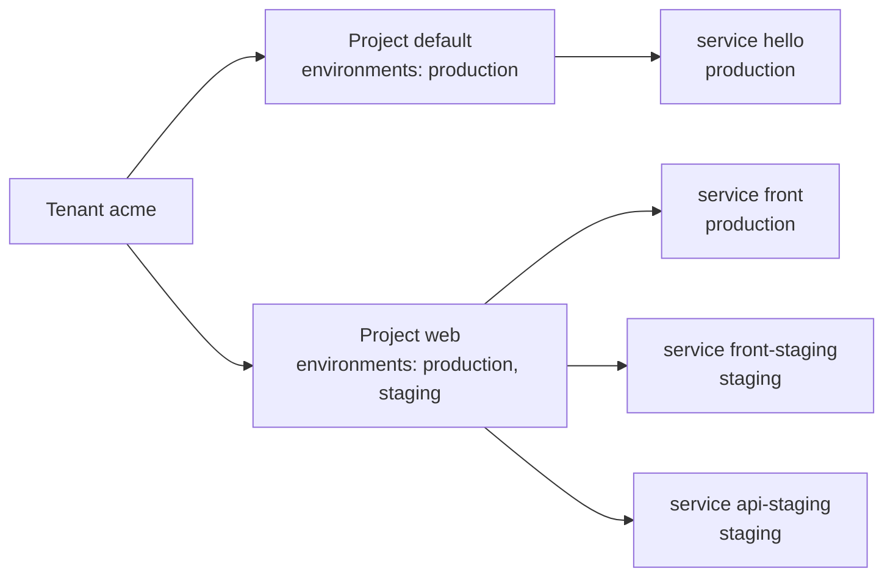

# Projects and environments

A **project** groups the services of one tenant and lists the **environments** they may live in. Every service is in
exactly one project and one of that project's environments. Use projects to keep apps apart (`web`, `billing`,
`bots`), and environments to keep stages of one app apart (`production`, `staging`, `pr-42`).



| | Project | Environment |
|---|---|---|
| Is | An object with an id (`prj_…`), a slug and a name | A label (`^[a-z][a-z0-9-]{0,31}$`) in a project's list |
| Every tenant has | A `default` project | `production` in the `default` project |
| A service has | One, chosen at creation, never changed | One of its project's, changeable |
| Decides | Grouping and filtering (`service list --project`) | Grouping, and which services may [call each other](#environments-decide-who-may-call) |

Service slugs are unique on the whole node, not per project or environment (the slug is the URL `/s/{slug}`), so two
projects cannot both hold a service called `api`. Name the staging copy `api-staging`, or use one slug per environment in
your CI script.

## Create a project

Creating, changing and deleting a project needs `services:write` **and** a key with no project or environment
restriction (an unrestricted tenant key, or the operator with `x-rt-tenant`). Listing needs `services:read`.

=== "21ci"

    ```console
    $ 21ci project create web --name "Web shop" --env production,staging
    ID:            prj_01M4Q2GB5APYBGEPYPBX1X4ZYJ
    Slug:          web
    Name:          Web shop
    Environments:  production, staging
    Created:       2026-10-12T04:12:20Z

    $ 21ci project list
    ID                              SLUG     NAME      ENVIRONMENTS
    prj_01M4Q2FNM85KHERVGN5ZJAK0TK  default  Default   production
    prj_01M4Q2GB5APYBGEPYPBX1X4ZYJ  web      Web shop  production,staging
    ```

=== "curl"

    ```bash
    curl -sS -X POST "$RT_API/v1/projects" \
      -H "Authorization: Bearer $RT_KEY" -H 'Content-Type: application/json' \
      -H "Idempotency-Key: $(uuidgen)" \
      -d '{"slug":"web","name":"Web shop","environments":["production","staging"]}'
    # 201 {"id":"prj_…","tenant_id":"ten_…","slug":"web","name":"Web shop","environments":["production","staging"],…}

    curl -sS -H "Authorization: Bearer $RT_KEY" "$RT_API/v1/projects"
    # {"items":[…],"next_cursor":null}
    ```

- The slug matches `^[a-z][a-z0-9-]{1,62}$` and is fixed at creation. The name defaults to the slug.
- A project has 1 to 20 environments, `["production"]` when you give none.
- A tenant holds at most 100 projects (`403 quota_exceeded`); a taken slug is `409 project_slug_taken`.
- Every command and route takes a project as its slug or its `prj_…` id.

## Add and remove environments

=== "21ci"

    ```bash
    21ci project update web --add-env dev          # production, staging, dev
    21ci project update web --remove-env dev
    21ci project update web --env production,staging,pr-42   # replace the whole list
    ```

=== "curl"

    ```bash
    curl -sS -X PATCH "$RT_API/v1/projects/web" \
      -H "Authorization: Bearer $RT_KEY" -H 'Content-Type: application/json' \
      -d '{"environments":["production","staging","pr-42"]}'
    curl -sS -H "Authorization: Bearer $RT_KEY" "$RT_API/v1/projects/web/environments"
    # {"project":"prj_…","environments":["production","staging","pr-42"]}
    ```

    `PATCH` takes the complete new list. `21ci` reads the current one for `--add-env` and `--remove-env`.

An environment that a service is still in cannot be removed: `409 environment_in_use`. Move or delete those services
first.

## Create services in a project

Name the project when you create the service; the environment must be one of the project's.

=== "21ci"

    ```console
    $ 21ci service create front --project web --env production
    $ 21ci service create front-staging --project web --env staging
    $ 21ci push ./src --service api-staging --create --project web --env staging
    $ 21ci service list --project web
    ID                              SLUG           RUNTIME  PROJECT  ENV         LIVE  BUILD    ACCESS
    svc_01M4Q2GB5APYBGEPYPBX1X4ZYJ  front          deno     web      production  -     pending  public
    svc_01M4Q2H2Q8B5C9V0D4E7F1G3HJ  front-staging  deno     web      staging     -     pending  public
    …
    $ 21ci service list --project web --env staging
    ```

=== "curl"

    ```bash
    curl -sS -X POST "$RT_API/v1/services" \
      -H "Authorization: Bearer $RT_KEY" -H 'Content-Type: application/json' \
      -d '{"slug":"front-staging","runtime":"deno","project":"web","environment":"staging"}'
    curl -sS -H "Authorization: Bearer $RT_KEY" "$RT_API/v1/services?project=web&environment=staging"
    ```

- Without a project the service goes into `default`, without an environment into `production`.
- An environment the project does not list is `422 validation_failed`, and the message lists the allowed ones.
- The project of a service never changes: a `PATCH` that names another project is `422`. To move a service, create a
  new one in the other project and deploy the same code to it.
- The environment can change (`21ci service update front-staging --env production`), but only with a key that has no
  project or environment restriction, because the environment decides who may call the service. Each change is audited
  as `service.environment_changed`.

## Environments decide who may call

Service-to-service calls (`std:services`, `std:host/call`) and `std:queue` enqueues between services of a tenant are
admitted by the target's `call.allowed_callers`. With an empty list, only services of the **same project in the same
environment** may call it, so `front-staging` reaches `api-staging` but not `api`. Environment labels are per project:
a `staging` service of another project is not admitted by `env:staging`. A non-empty list names every admitted caller:
service slugs, `svc_…` ids or `env:<environment>` (of the target's own project). Details and examples are in
[Configure a service](configure.md#environments-and-allowed-callers) and [Calls and queues](calls-and-queues.md).

## Delete a project

```bash
21ci project delete web       # DELETE /v1/projects/web
```

A project that still holds a service is `409 project_not_empty`; delete or keep its services elsewhere first. The
`default` project is where services without a project go.

## A typical layout

| Project | Environments | Services |
|---|---|---|
| `default` | `production` | small one-off services |
| `web` | `production`, `staging` | `front`, `api`, and `front-staging`, `api-staging` |
| `bots` | `production`, `pr-<n>` per pull request | `telegram`, `telegram-pr-42` |

In CI, create the preview environment and service on the first run of a pull request, deploy on every push, and remove
both when the pull request closes:

```bash
21ci project update bots --add-env "pr-$PR"                       # once per pull request
21ci push ./src --service "telegram-pr-$PR" --create --project bots --env "pr-$PR" --wait
# when the pull request closes:
21ci service delete "telegram-pr-$PR"
21ci project update bots --remove-env "pr-$PR"
```

The CI key needs `services:write` and no project or environment restriction for the project changes; a key that only
deploys existing services can be narrower (see [Get access](access.md#scopes)).

## See also

- [Deploy and roll back](deploy.md): the full project → environment → service flow with a first deploy.
- [Configure a service](configure.md): environments and allowed callers on one service.
- [API reference](../api.md#projects): every project route.
- [CLI reference](../cli.md#project): `21ci project`.
