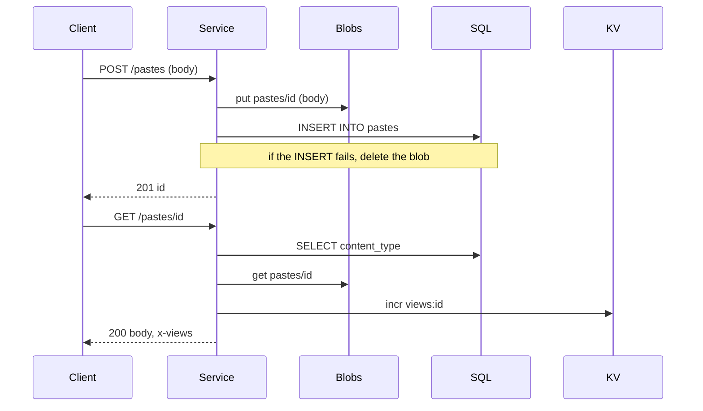

# KV, SQL, blobs and other sub-services

Every service on a node gets a set of **sub-services**: a key/value store, a SQLite database, a blob store, a queue,
schedules, calls to other services and operator bindings. You do not create, configure or authenticate any of them.
They are imports of your handler (`std:kv`, `std:sql`, ... in Deno, `std:host/kv`, `std:host/sql`, ... in WASM), and every
call is made as your service, against your service's private data.

This page is the practical guide: what each one is for, what it guarantees, its limits, and a runnable example in
TypeScript (Deno) and in Rust (WASM). The exact signatures are in the [guest API reference](../reference/guest-api.md)
and the [WIT reference](../reference/wit.md); how the data is stored is in [Storage](../concepts/storage.md).

## The sub-services at a glance

| Sub-service | What it is | Deno module | WASM interface | Key limits | Consistency |
|---|---|---|---|---|---|
| [KV](#kv) | Small values by key, TTL, atomic counters | `std:kv` | `std:host/kv` | key 2 KB, value 1 MB, 1,000 per list page | Strong. Read-your-writes on the node; single-key atomic `incr`; no multi-key transaction |
| [SQL](#sql) | A private SQLite database; [`std:sqlite`](#synchronous-sql-stdsqlite) is its synchronous API | `std:sql`, `std:sqlite` | `std:host/sql` | 1 s per statement, 10,000 rows and 10 MiB per result, 5 s per transaction | Serializable writes (one writer); reads see the last committed snapshot |
| [Blobs](#blobs) | Whole objects with a content type | `std:blob` | `std:host/blob` | key 1 KB, object 100 MB; WASM `get` 10 MB | A completed `put` replaces the object atomically; streamed in Deno, buffered in WASM |
| [Queues](#queues) | Durable per-service queue with retries and a DLQ | `std:queue` and a `queue` handler | `std:host/queue` and `POST /__rt/queue` | body 1 MB, delay 7 days, dedup 24 h, depth by plan | At least once, unordered |
| [Schedules](#schedules) | Interval and cron triggers | a `scheduled` handler | `POST /__rt/scheduled` | count and minimum period by plan, payload 64 KB | Fixed grid, never overlapping, no backfill, no retry |
| [Service calls](#service-calls) | Call another service in-process | `std:services` | `std:host/call` | depth 15, caller rules | Synchronous, once |
| [Operator SDKs](#platform-bindings-and-sdks) | The operator's code and APIs, run by the runtime | `std:sdk`, `sdk:<name>` | `std:host/sdk` | 256 KiB JSON each way, call depth | Whatever the SDK does |

Per-item sizes (key, value, object, message) are the runtime's defaults. **Totals and counts are plan dependent**: the
plan's `storage_mb` covers KV, SQL and blobs of all your services (100 MB on the built-in `free` plan), `max_queue_depth`
caps waiting messages (10,000 on `free`), `max_schedules` and `min_schedule_seconds` bound schedules (3 and 60 s on
`free`), and `allowed_triggers` decides whether queues, calls and cron are available at all. `21ci whoami --json` shows your
plan's effective settings; see also [Limits](../reference/limits.md) and
[Tenants, plans and keys](../concepts/tenants-and-plans.md).

!!! info "Why built in, and what it costs you"
    A call to a sub-service is a function call into the node, not a network hop: there is no connection string, no
    credential to leak, no pool to size, and the node can account every byte and every CPU millisecond to the right
    tenant. The price is that the data lives on **one node's local disk**. There is no replication or failover, one
    service's writes go through one writer, and nothing spans two services (no cross-service transaction). Use the
    queue or a call between services and design for eventual consistency. [Storage](../concepts/storage.md) explains the
    engine and its trade-offs.

Three rules hold for all of them:

- **Per service.** Service A cannot read service B's KV keys, tables or blobs, even in the same tenant. Share data by
  calling the owning service.
- **Stable error codes.** A failure throws (Deno) or returns (WASM) a short code such as `storage_quota`, never a host
  path or a driver message. [Handling errors](#handling-errors) lists them.
- **Storage calls cost CPU time.** They run on the node's blocking pool, and the thread time they use counts against
  your task's CPU limit. A slow query is a CPU and wall-time problem, not only a latency one.

## Before the examples

Every example below is complete: a Deno example is the whole `main.ts` of a service, and the Rust examples are the
modules of one crate that you build once.

=== "Deno"

    Put an example into its own directory as `main.ts` and push it. Nothing else is needed: the `std:*` modules are built
    into the runtime, never bundled.

    ```bash
    21ci push kv-demo --service kv-demo --create --wait
    21ci invoke kv-demo /
    ```

    For editor checks you can save the ambient declarations from the
    [guest API reference](../reference/guest-api.md#type-declarations) as `rt.d.ts`.

=== "WASM (Rust)"

    All Rust examples are modules of one crate named `sub-services`. The crate has the vendored world file next to
    it (copy `wit/rt-host.wit` from the runtime repository, or from the [WIT reference](../reference/wit.md#the-full-file)):

    ```text
    sub-services/
    ├── Cargo.toml
    ├── wit/rt-host.wit      the std:host@0.1.0 package, world "guest"
    └── src/
        ├── lib.rs           generates the bindings and routes requests
        ├── glue.rs          HTTP helpers shared by all examples
        └── kv_demo.rs, sql_demo.rs, ...   one module per sub-service
    ```

    ```toml title="Cargo.toml"
    [package]
    name = "sub-services"
    version = "0.1.0"
    edition = "2021"
    publish = false

    # A cdylib built for wasm32-wasip2 is already a WebAssembly component.
    [lib]
    crate-type = ["cdylib"]

    [dependencies]
    wasip2 = "2"          # wasi:http types and the incoming-handler export
    wit-bindgen = "0.62"  # bindings for std:host, generated from wit/rt-host.wit
    serde_json = "1"

    [profile.release]
    opt-level = "s"
    lto = true
    strip = true
    panic = "abort"
    codegen-units = 1
    ```

    `lib.rs` generates the `rt::host::*` bindings once, exports the `wasi:http` handler and routes by path. A queue
    batch or a schedule fire reaches a component as a synthetic `POST` too, so the router decides by the
    `x-rt-trigger` header, which only the runtime can set ([Queues](#queues) and [Schedules](#schedules) explain why):

    ```rust title="src/lib.rs"
    wit_bindgen::generate!({
        path: "wit",     // the directory that holds rt-host.wit
        world: "guest",
    });

    mod blob_demo;
    mod call_demo;
    mod glue;
    mod kv_demo;
    mod pastes;
    mod platform_demo;
    mod queue_demo;
    mod schedule_demo;
    mod sql_demo;

    use wasip2::exports::http::incoming_handler::Guest;
    use wasip2::http::types::{IncomingRequest, ResponseOutparam};

    struct Component;
    wasip2::http::proxy::export!(Component);

    impl Guest for Component {
        fn handle(request: IncomingRequest, out: ResponseOutparam) {
            let pwq = request.path_with_query().unwrap_or_else(|| "/".to_string());
            let (path, query) = pwq.split_once('?').unwrap_or((pwq.as_str(), ""));
            let method = glue::method(&request);

            // Queue batches and schedule fires arrive as synthetic POSTs. Decide by the header, not the path.
            let trigger = glue::header(&request, "x-rt-trigger").unwrap_or_default();
            let reply = match trigger.as_str() {
                "queue" => queue_demo::consume(&request),
                "interval" | "cron" => schedule_demo::run(&request),
                _ => route(&request, &method, path, query),
            };
            glue::send(out, reply);
        }
    }

    fn route(request: &IncomingRequest, method: &str, path: &str, query: &str) -> glue::Reply {
        match path.split('/').nth(1).unwrap_or("") {
            "kv" => kv_demo::handle(query),
            "events" => sql_demo::handle(method, path, query),
            "blob" => blob_demo::handle(request, method, path.trim_start_matches("/blob/")),
            "enqueue" => queue_demo::produce(&glue::query_param(query, "order").unwrap_or_default()),
            "call" => call_demo::handle(),
            "platform" => platform_demo::handle(),
            "pastes" => pastes::handle(request, method, path, query),
            _ => glue::Reply::text(404, "not found"),
        }
    }
    ```

    ??? info "src/glue.rs: the HTTP plumbing every example uses"
        A component answers by writing the response head, then the body through `wasi:io` streams. `glue.rs` wraps that,
        reads a request body into memory with a size cap, and reads headers and query parameters. The edge gateway sample
        (`sample/apps/edge-gateway/gateway`) has the same helpers in a larger program.

        ```rust title="src/glue.rs"
        use wasip2::http::types::{
            Fields, IncomingBody, IncomingRequest, Method, OutgoingBody, OutgoingResponse, ResponseOutparam,
        };
        use wasip2::io::streams::StreamError;

        /// What a route returns. `send` turns it into a `wasi:http` response.
        pub struct Reply {
            pub status: u16,
            pub content_type: String,
            pub body: Vec<u8>,
            pub headers: Vec<(String, String)>,
        }

        impl Reply {
            pub fn text(status: u16, body: impl Into<String>) -> Reply {
                Reply::bytes(status, "text/plain; charset=utf-8", body.into().into_bytes())
            }

            pub fn json(status: u16, body: &serde_json::Value) -> Reply {
                Reply::bytes(status, "application/json", body.to_string().into_bytes())
            }

            pub fn bytes(status: u16, content_type: impl Into<String>, body: Vec<u8>) -> Reply {
                Reply { status, content_type: content_type.into(), body, headers: Vec::new() }
            }

            pub fn header(mut self, name: &str, value: impl Into<String>) -> Reply {
                self.headers.push((name.to_string(), value.into()));
                self
            }
        }

        /// Sends the head first, then the body in chunks of at most 4096 bytes, and finishes the body.
        pub fn send(out: ResponseOutparam, reply: Reply) {
            let headers = Fields::new();
            let _ = headers.set("content-type", &[reply.content_type.as_bytes().to_vec()]);
            for (name, value) in &reply.headers {
                let _ = headers.append(name, &value.as_bytes().to_vec());
            }
            let response = OutgoingResponse::new(headers);
            let _ = response.set_status_code(reply.status);
            let body = response.body().expect("response body");
            ResponseOutparam::set(out, Ok(response));
            if let Ok(stream) = body.write() {
                for chunk in reply.body.chunks(4096) {
                    if stream.blocking_write_and_flush(chunk).is_err() {
                        break;
                    }
                }
            }
            let _ = OutgoingBody::finish(body, None);
        }

        /// Reads the request body into memory, up to `max` bytes.
        pub fn read_body(request: &IncomingRequest, max: usize) -> Result<Vec<u8>, Reply> {
            let incoming = request.consume().map_err(|_| Reply::text(400, "cannot read the body"))?;
            let stream = incoming.stream().map_err(|_| Reply::text(400, "cannot read the body"))?;
            let mut buf = Vec::new();
            loop {
                match stream.blocking_read(16 * 1024) {
                    Ok(chunk) => {
                        if buf.len() + chunk.len() > max {
                            return Err(Reply::text(413, "body too large"));
                        }
                        buf.extend_from_slice(&chunk);
                    }
                    Err(StreamError::Closed) => break,
                    Err(_) => return Err(Reply::text(400, "the body could not be read")),
                }
            }
            drop(stream);
            let _ = IncomingBody::finish(incoming);
            Ok(buf)
        }

        pub fn method(request: &IncomingRequest) -> String {
            match request.method() {
                Method::Get => "GET".into(),
                Method::Post => "POST".into(),
                Method::Put => "PUT".into(),
                Method::Delete => "DELETE".into(),
                Method::Head => "HEAD".into(),
                Method::Patch => "PATCH".into(),
                Method::Options => "OPTIONS".into(),
                Method::Connect => "CONNECT".into(),
                Method::Trace => "TRACE".into(),
                Method::Other(o) => o,
            }
        }

        /// First value of `key` in a query string such as `a=1&b=two` (no percent-decoding).
        pub fn query_param(query: &str, key: &str) -> Option<String> {
            query
                .split('&')
                .filter_map(|pair| pair.split_once('='))
                .find(|(k, _)| *k == key)
                .map(|(_, v)| v.to_string())
        }

        /// The value of a request header, if present and valid UTF-8.
        pub fn header(request: &IncomingRequest, name: &str) -> Option<String> {
            let values = request.headers().get(name);
            values.into_iter().next().and_then(|v| String::from_utf8(v).ok())
        }
        ```

    Build and push the component. `wasm32-wasip2` is a rustup target (`rustup target add wasm32-wasip2`):

    ```bash
    cargo build --release --target wasm32-wasip2
    21ci push target/wasm32-wasip2/release/sub_services.wasm --service sub-services --create --wait
    21ci invoke sub-services '/kv?ip=203.0.113.7'
    ```

    The toolchain details for Rust and other languages are in [WASM languages](../languages/wasm.md). The component
    imports only `wasi:*` interfaces and `std:host/*`, which is what the node accepts.

## KV

`std:kv` stores small values under byte-string keys. Use it for caches, sessions, flags, rate-limit and hit counters,
and any lookup by a key you know. It is the cheapest sub-service: one indexed row per key, reads that never wait for
writes, and writes that are batched together under load.

| Operation | Deno | WASM |
|---|---|---|
| Read | `kv.get(key)`, `kv.getMany(keys)` | `kv::get(key)`; no `getMany`, call `get` per key |
| Write | `kv.set(key, value, { ttlSeconds })` | `kv::set(key, &value, SetOptions { ttl_seconds })` |
| Delete | `kv.delete(key)` resolves to `true` if the key existed | `kv::delete(key)` returns a `bool` |
| List | `kv.list({ prefix, cursor, limit })` | `kv::list(&ListOptions { prefix, cursor, limit })`; `limit` is required |
| Counter | `kv.incr(key, delta = 1, { ttlSeconds })` | `kv::incr(key, delta, SetOptions { ttl_seconds })`; `delta` is required |

What to know:

- **Values** are anything JSON can encode, or bytes (`Uint8Array` in Deno, `kv::Value::Bytes` in WASM). The type is
  kept: you get back what you stored. A value JSON cannot encode (`undefined`, a function) throws a `TypeError`.
  In WASM a value is `kv::Value::Json(String)` or `kv::Value::Bytes(Vec<u8>)`.
- **Keys** are non-empty and at most 2 KB; values at most 1 MB. Deno keys are strings, WASM keys are bytes of the same
  keyspace. Keys sort as bytes, so a prefix is a namespace (`user:42:session`), and numbers should be zero-padded to
  list in numeric order (`order:000042`).
- **`list` returns values, not only keys**, in key order. `limit` defaults to 100 (Deno), is clamped to 1 to 1,000, and
  a page of large values is large: ask for fewer entries when values are big. Pass the returned `cursor` back for the
  next page; `null` means the last page.
- **TTL.** `ttlSeconds` on `set` makes the key read as missing after that time. An expired key is hidden at once; the
  row is removed by a sweep that runs every 60 seconds. A `set` without `ttlSeconds` replaces the value **and removes
  an earlier expiry**.
- **`incr` is the one atomic read-modify-write.** It adds `delta` (negative is fine) to an integer and returns the new
  value, in one transaction on the service's single writer, so concurrent tasks never lose an update. A missing or
  expired key starts at 0. `ttlSeconds` applies only when the call **creates** the counter; later increments keep that
  expiry, which gives fixed windows. The counter is stored as JSON: `kv.get` returns a number, and `kv.set(key, 0)`
  resets it. An existing value that is not a JSON integer fails with `kv_not_integer` (and stays unchanged), a result
  outside the signed 64-bit range with `kv_overflow`. With a `bigint` delta (Deno) the result is a `bigint`, exact
  beyond 2^53.
- **`get` then `set` is not atomic.** Two tasks can read the same value and both write. Use `incr` for counters and
  [SQL](#sql) for anything that must change together or conditionally. There is no compare-and-set.
- **Consistency.** One node, one writer: a completed write is visible to the next read from any task. Writes queued for
  the same service are committed together in groups, which does not change what each call sees. A crash of the `rt`
  process loses nothing that was acknowledged; a power loss can lose the most recent commits
  ([durability](../concepts/storage.md)).

=== "Deno"

    ```ts title="kv-demo/main.ts"
    import { kv } from "std:kv";

    interface Ctx {
      client?: { ip: string };
    }

    export default async function (req: Request, ctx: Ctx): Promise<Response> {
      const url = new URL(req.url);

      // 1. Fixed-window rate limit. incr is atomic; the TTL is set when the call creates the key,
      //    so each minute gets its own counter that expires by itself.
      const minute = Math.floor(Date.now() / 60_000);
      const hits = await kv.incr(`rl:${ctx.client?.ip ?? "unknown"}:${minute}`, 1, { ttlSeconds: 120 });
      if (hits > 60) {
        return new Response("slow down", { status: 429, headers: { "retry-after": "60" } });
      }

      // 2. Cache-aside: keep an upstream answer for five minutes. DELETE /rates drops it early.
      if (url.pathname === "/rates" && req.method === "DELETE") {
        return Response.json({ deleted: await kv.delete("cache:rates") });
      }
      if (url.pathname === "/rates") {
        let rates = await kv.get<Record<string, number>>("cache:rates");
        if (rates === null) {
          const res = await fetch("https://api.example.com/rates");
          if (!res.ok) return new Response("upstream error", { status: 502 });
          rates = await res.json();
          await kv.set("cache:rates", rates, { ttlSeconds: 300 });
        }
        return Response.json({ rates, hits });
      }

      // 3. Walk a prefix page by page.
      if (url.pathname === "/counters") {
        const keys: string[] = [];
        let cursor: string | null = null;
        do {
          const page: { entries: { key: string; value: unknown }[]; cursor: string | null } =
            await kv.list({ prefix: "rl:", cursor, limit: 500 });
          keys.push(...page.entries.map((e) => e.key));
          cursor = page.cursor;
        } while (cursor !== null && keys.length < 5_000);
        return Response.json({ count: keys.length, truncated: cursor !== null });
      }

      return Response.json({ hits });
    }
    ```

    The complete sample with `get`, `set`, `delete` and `list` is `sample/deno/kv-counter/` in the runtime repository
    (`21ci init my-fn --template deno-kv` scaffolds it).

=== "WASM (Rust)"

    ```rust title="src/kv_demo.rs"
    use std::time::{SystemTime, UNIX_EPOCH};

    use serde_json::json;

    use crate::glue::{query_param, Reply};
    use crate::rt::host::kv;

    /// GET /kv?ip=203.0.113.7: count the visit in a fixed one-minute window, remember the last visit.
    pub fn handle(query: &str) -> Reply {
        let ip = query_param(query, "ip").unwrap_or_else(|| "unknown".to_string());
        let minute = SystemTime::now().duration_since(UNIX_EPOCH).map(|d| d.as_secs() / 60).unwrap_or(0);

        // Atomic counter. The TTL is applied when this call creates the key, so the window expires by itself.
        let key = format!("rl:{ip}:{minute}");
        let hits = match kv::incr(key.as_bytes(), 1, kv::SetOptions { ttl_seconds: Some(120) }) {
            Ok(n) => n,
            Err(e) => return Reply::text(500, format!("kv: {}", e.code)),
        };
        if hits > 60 {
            return Reply::text(429, "slow down").header("retry-after", "60");
        }

        // A JSON value with a one-hour TTL; keys and values are bytes / a `Value` variant.
        let last = json!({ "ip": ip, "minute": minute }).to_string();
        if let Err(e) = kv::set(b"last-visit", &kv::Value::Json(last), kv::SetOptions { ttl_seconds: Some(3600) }) {
            return Reply::text(500, format!("kv: {}", e.code));
        }
        let previous = match kv::get(b"last-visit") {
            Ok(Some(kv::Value::Json(text))) => text,
            Ok(Some(kv::Value::Bytes(_))) | Ok(None) => "null".to_string(),
            Err(e) => return Reply::text(500, format!("kv: {}", e.code)),
        };

        // One page of the counters, in key order.
        let page = match kv::list(&kv::ListOptions { prefix: b"rl:".to_vec(), cursor: None, limit: 100 }) {
            Ok(p) => p,
            Err(e) => return Reply::text(500, format!("kv: {}", e.code)),
        };
        let keys: Vec<String> = page.entries.iter().map(|(k, _)| String::from_utf8_lossy(k).into_owned()).collect();

        Reply::json(200, &json!({ "hits": hits, "last": previous, "counters": keys, "more": page.next_cursor.is_some() }))
    }
    ```

    `SystemTime::now()` works (it reads `wasi:clocks`), but the clock is frozen during computation and only
    advances at I/O boundaries, see [Clocks](wasm.md#clocks).

## SQL

`std:sql` gives each service its own SQLite database: one file, full SQL, `?` placeholders, indexes, constraints,
triggers, JSON functions. Use it for data you query, filter, sort, join or change together. If you only ever read a
value by its key, [KV](#kv) is cheaper.

### Calls and the result shape

| Operation | Deno | WASM |
|---|---|---|
| One statement | `sql.execute(sql, args?)` | `sql::execute(&Statement { sql, args })` |
| Several statements, one transaction | `sql.batch(stmts, "read" \| "write")` | `sql::batch(&stmts, write)` where `write: bool` |
| Interactive transaction | `sql.transaction(async (tx) => ...)` | none: use `batch` |

Every call returns the same result:

```ts
interface SqlResult {
  columns: string[];                       // column names, in order
  rows: unknown[][];                       // rows are ARRAYS in `columns` order, not objects
  rowsAffected: number;                    // rows changed by INSERT / UPDATE / DELETE, 0 for SELECT
  lastInsertRowid: number | bigint | null; // the rowid of the last INSERT
}
```

In WASM the fields are `columns`, `rows` (a `Vec<Vec<SqlValue>>`), `rows_affected` and `last_insert_rowid`
(`Option<i64>`). `batch` returns one result per statement, in order. A `SELECT` in a write batch is fine: that is how
you read what you just wrote.

Rows are arrays because it is the compact form for large results. Turn them into objects where you need names:

```ts
const objects = r.rows.map((row) => Object.fromEntries(r.columns.map((c, i) => [c, row[i]])));
```

**Parameters.** Write `?` in the statement and pass the values in `args`, in order. Never build SQL by concatenating
user input. The arguments map as follows:

| Deno argument | WASM value | Stored as |
|---|---|---|
| `null`, `undefined` | `SqlValue::Null` | `NULL` |
| `boolean` | `SqlValue::Integer(0 or 1)` | `INTEGER` |
| `number` | `Integer(i64)` or `Real(f64)` | `INTEGER` if it is a whole number, else `REAL` |
| `bigint` | `Integer(i64)` | `INTEGER` (64-bit) |
| `string` | `Text(String)` | `TEXT` |
| `Uint8Array` | `Blob(Vec<u8>)` | `BLOB` |
| an object or array | encode it yourself | `TEXT` holding JSON (use `JSON.stringify`, and `json_extract` to query it) |

Results come back as `null`, `number` (a `bigint` for an integer outside the safe range), `string` or `Uint8Array`.
SQLite has no boolean or date type: store booleans as 0 and 1, and times as integer epoch seconds or milliseconds.

### Reads and writes

Each database has **one writer** connection and a few read-only readers (`storage.readers_per_db`, 4 by default). The
node routes by what the statement does:

- A statement that only reads, and a `"read"` batch, runs on a reader. It sees the last committed snapshot and never
  waits for a write in progress.
- A statement that writes, a `"write"` batch (the default) and every transaction run on the writer, **one at a time**.
  This is also what makes `kv.incr` atomic and removes write conflicts: there is nothing to retry. It is the
  throughput ceiling of one service's writes.

So keep read paths free of writes. A handler that runs `CREATE TABLE IF NOT EXISTS` on every request takes the writer
every time, even when the table exists. The next section shows how to avoid that.

### Schema once, and migrations

The first request of a new service meets an empty database. Create the schema lazily and **only when it is missing**,
and give the schema a version so later deploys can change it:

1. Keep an append-only list of migration steps in the code. Never edit a step that has shipped: add a new one.
2. Store the applied version in a table of your own (`app_schema`, not a name starting with `_rt_`, which is
   reserved).
3. On each request do one cheap read of the version. Only a database that is behind pays for a write, and the write
   runs in one transaction, so a crash leaves the old or the new schema, never half of one. DDL is transactional in
   SQLite.
4. Make a lost race harmless. Two first requests can both see "version 0": in Deno a `sql.transaction` serializes them
   on the writer (the second one finds nothing left to do), in WASM you re-read the version when the batch fails.

A module-level `schemaReady` flag only saves the version read while a Deno isolate is reused
([warm reuse](deno.md#warm-reuse)); without reuse, every task does the one cheap read, which is the design.

=== "Deno"

    ```ts title="sql-demo/main.ts"
    import { sql } from "std:sql";

    // Append-only list of schema steps. Never edit an entry that has shipped: add a new one.
    const MIGRATIONS: string[][] = [
      // v1
      [
        `CREATE TABLE events (
           id         INTEGER PRIMARY KEY AUTOINCREMENT,
           title      TEXT    NOT NULL,
           seats_left INTEGER NOT NULL CHECK (seats_left >= 0)
         )`,
        `CREATE TABLE bookings (
           id       INTEGER PRIMARY KEY AUTOINCREMENT,
           event_id INTEGER NOT NULL,
           name     TEXT    NOT NULL
         )`,
        `CREATE INDEX bookings_event ON bookings (event_id)`,
      ],
      // v2
      [`ALTER TABLE events ADD COLUMN starts_at INTEGER`],
    ];

    let schemaReady = false; // only helps while an isolate is reused; the check below is one cheap read

    async function currentVersion(): Promise<number> {
      try {
        const r = await sql.execute("SELECT version FROM app_schema");
        return r.rows.length ? Number(r.rows[0][0]) : 0;
      } catch (e) {
        if ((e as { code?: string }).code === "sql_error") return 0; // the table does not exist yet
        throw e;
      }
    }

    // Schema once. The common case is one read (on a read connection); only an outdated database writes.
    async function migrate(): Promise<void> {
      if (schemaReady) return;
      if ((await currentVersion()) < MIGRATIONS.length) {
        // A transaction holds the single writer, so two first requests cannot apply a step twice.
        await sql.transaction(async (tx) => {
          await tx.execute("CREATE TABLE IF NOT EXISTS app_schema (version INTEGER NOT NULL)");
          await tx.execute("INSERT INTO app_schema (version) SELECT 0 WHERE NOT EXISTS (SELECT 1 FROM app_schema)");
          const v = Number((await tx.execute("SELECT version FROM app_schema")).rows[0][0]);
          for (const step of MIGRATIONS.slice(v)) {
            for (const statement of step) await tx.execute(statement);
          }
          await tx.execute("UPDATE app_schema SET version = ?", [MIGRATIONS.length]);
        });
      }
      schemaReady = true;
    }

    export default async function (req: Request): Promise<Response> {
      const url = new URL(req.url);
      const parts = url.pathname.split("/").filter(Boolean); // "/events/3/book" -> ["events", "3", "book"]
      await migrate();

      // INSERT: lastInsertRowid is the new primary key, rowsAffected the row count.
      if (req.method === "POST" && parts.length === 1 && parts[0] === "events") {
        const { title, seats } = await req.json();
        const r = await sql.execute("INSERT INTO events (title, seats_left) VALUES (?, ?)", [title, seats]);
        return Response.json({ id: Number(r.lastInsertRowid), rowsAffected: r.rowsAffected }, { status: 201 });
      }

      // SELECT: rows are arrays in `columns` order. Two reads in one read-only transaction: a consistent
      // snapshot that never waits for a writer.
      if (req.method === "GET" && parts.length === 1 && parts[0] === "events") {
        const [list, count] = await sql.batch([
          "SELECT id, title, seats_left FROM events ORDER BY id LIMIT 100",
          "SELECT COUNT(*) FROM bookings",
        ], "read");
        const events = list.rows.map((row) => Object.fromEntries(list.columns.map((c, i) => [c, row[i]])));
        return Response.json({ events, bookings: count.rows[0][0] });
      }

      // Read, decide, write: an interactive transaction keeps the three steps together.
      if (req.method === "POST" && parts.length === 3 && parts[0] === "events" && parts[2] === "book") {
        const id = Number(parts[1]);
        const { name } = await req.json();
        const bookingId = await sql.transaction(async (tx) => {
          const r = await tx.execute("SELECT seats_left FROM events WHERE id = ?", [id]);
          if (r.rows.length === 0 || Number(r.rows[0][0]) < 1) return null; // nothing was written
          await tx.execute("UPDATE events SET seats_left = seats_left - 1 WHERE id = ?", [id]);
          const b = await tx.execute("INSERT INTO bookings (event_id, name) VALUES (?, ?)", [id, name]);
          return Number(b.lastInsertRowid);
        });
        return bookingId === null
          ? Response.json({ error: "sold out or unknown event" }, { status: 409 })
          : Response.json({ bookingId }, { status: 201 });
      }

      return new Response("not found", { status: 404 });
    }
    ```

    `sample/deno/sql-todo/` is a complete CRUD service with the same schema-once idea.

=== "WASM (Rust)"

    There is no interactive transaction in WASM, so the booking is one write `batch`: the conditional `UPDATE` takes a
    seat only if one is left, and the `INSERT ... SELECT ... WHERE changes() > 0` records the booking only if the
    `UPDATE` changed a row. Both run in one transaction.

    ```rust title="src/sql_demo.rs"
    use serde_json::{json, Value};

    use crate::glue::{query_param, Reply};
    use crate::rt::host::sql::{self, SqlValue, Statement};

    /// Append-only list of schema steps. Never edit an entry that has shipped: add a new one.
    const MIGRATIONS: &[&[&str]] = &[
        // v1
        &[
            "CREATE TABLE events (
               id         INTEGER PRIMARY KEY AUTOINCREMENT,
               title      TEXT    NOT NULL,
               seats_left INTEGER NOT NULL CHECK (seats_left >= 0)
             )",
            "CREATE TABLE bookings (
               id       INTEGER PRIMARY KEY AUTOINCREMENT,
               event_id INTEGER NOT NULL,
               name     TEXT    NOT NULL
             )",
            "CREATE INDEX bookings_event ON bookings (event_id)",
        ],
        // v2
        &["ALTER TABLE events ADD COLUMN starts_at INTEGER"],
    ];

    fn stmt(text: &str, args: Vec<SqlValue>) -> Statement {
        Statement { sql: text.to_string(), args }
    }

    fn int(row: &[SqlValue], i: usize) -> i64 {
        match row.get(i) {
            Some(SqlValue::Integer(n)) => *n,
            _ => 0,
        }
    }

    fn cell(v: &SqlValue) -> Value {
        match v {
            SqlValue::Null => Value::Null,
            SqlValue::Integer(n) => json!(n),
            SqlValue::Real(f) => json!(f),
            SqlValue::Text(s) => json!(s),
            SqlValue::Blob(b) => json!(format!("<{} bytes>", b.len())),
        }
    }

    /// The applied schema version; 0 before the first migration.
    fn current_version() -> Result<i64, sql::Error> {
        match sql::execute(&stmt("SELECT version FROM app_schema", vec![])) {
            Ok(r) => Ok(r.rows.first().map(|row| int(row, 0)).unwrap_or(0)),
            Err(e) if e.code == "sql_error" => Ok(0), // the table does not exist yet
            Err(e) => Err(e),
        }
    }

    /// Schema once. The check is one read (it runs on a read connection); only an outdated database writes.
    fn migrate() -> Result<(), sql::Error> {
        let target = MIGRATIONS.len() as i64;
        let version = current_version()?;
        if version >= target {
            return Ok(());
        }
        let mut steps = vec![
            stmt("CREATE TABLE IF NOT EXISTS app_schema (version INTEGER NOT NULL)", vec![]),
            stmt("INSERT INTO app_schema (version) SELECT 0 WHERE NOT EXISTS (SELECT 1 FROM app_schema)", vec![]),
        ];
        for step in &MIGRATIONS[version as usize..] {
            steps.extend(step.iter().map(|text| stmt(text, vec![])));
        }
        steps.push(stmt("UPDATE app_schema SET version = ?", vec![SqlValue::Integer(target)]));

        // One batch is one transaction: all steps apply or none does.
        if let Err(e) = sql::batch(&steps, true) {
            // A concurrent request may have applied the same steps first: then there is nothing left to do.
            if current_version()? < target {
                return Err(e);
            }
        }
        Ok(())
    }

    /// POST /events?title=Meetup&seats=2, GET /events, POST /events/1/book?name=Ada
    pub fn handle(method: &str, path: &str, query: &str) -> Reply {
        match run(method, path, query) {
            Ok(reply) => reply,
            Err(e) => Reply::text(500, format!("sql: {}", e.code)),
        }
    }

    fn run(method: &str, path: &str, query: &str) -> Result<Reply, sql::Error> {
        migrate()?;
        let parts: Vec<&str> = path.split('/').filter(|p| !p.is_empty()).collect();

        match (method, parts.as_slice()) {
            ("POST", ["events"]) => {
                let title = query_param(query, "title").unwrap_or_default();
                let seats: i64 = query_param(query, "seats").and_then(|s| s.parse().ok()).unwrap_or(0);
                let r = sql::execute(&stmt(
                    "INSERT INTO events (title, seats_left) VALUES (?, ?)",
                    vec![SqlValue::Text(title), SqlValue::Integer(seats)],
                ))?;
                Ok(Reply::json(201, &json!({ "id": r.last_insert_rowid, "rowsAffected": r.rows_affected })))
            }
            ("GET", ["events"]) => {
                // Two reads in one read-only transaction: a consistent snapshot, no write lock taken.
                let results = sql::batch(
                    &[
                        stmt("SELECT id, title, seats_left FROM events ORDER BY id LIMIT 100", vec![]),
                        stmt("SELECT COUNT(*) FROM bookings", vec![]),
                    ],
                    false,
                )?;
                let columns = &results[0].columns;
                let events: Vec<Value> = results[0]
                    .rows
                    .iter()
                    .map(|row| Value::Object(columns.iter().cloned().zip(row.iter().map(cell)).collect()))
                    .collect();
                let bookings = results[1].rows.first().map(|row| int(row, 0)).unwrap_or(0);
                Ok(Reply::json(200, &json!({ "events": events, "bookings": bookings })))
            }
            ("POST", ["events", id, "book"]) => {
                let id: i64 = id.parse().unwrap_or(0);
                let name = query_param(query, "name").unwrap_or_default();
                // Take a seat only if one is left, and record the booking only if the seat was taken
                // (`changes()` is the row count of the UPDATE before it). Both run in one transaction.
                let results = sql::batch(
                    &[
                        stmt(
                            "UPDATE events SET seats_left = seats_left - 1 WHERE id = ? AND seats_left > 0",
                            vec![SqlValue::Integer(id)],
                        ),
                        stmt(
                            "INSERT INTO bookings (event_id, name) SELECT ?, ? WHERE changes() > 0",
                            vec![SqlValue::Integer(id), SqlValue::Text(name)],
                        ),
                    ],
                    true,
                )?;
                if results[0].rows_affected == 0 {
                    return Ok(Reply::json(409, &json!({ "error": "sold out or unknown event" })));
                }
                Ok(Reply::json(201, &json!({ "bookingId": results[1].last_insert_rowid })))
            }
            _ => Ok(Reply::text(404, "not found")),
        }
    }
    ```

### Batches and transactions

| | `execute` | `batch(..., "read")` | `batch(..., "write")` | `transaction` (Deno) |
|---|---|---|---|---|
| Round trips | 1 per statement | 1 | 1 | 1 per `tx.execute` |
| Atomic | the one statement | read snapshot | all statements or none | all or none, with your code in between |
| Runs on | reader if it only reads, else writer | reader | writer | writer |
| Writes allowed | yes | no: `sql_error` | yes | yes |
| Use it for | a single query or change | consistent multi-query reads | several changes that belong together, migrations | read, decide, write |

The semantics worth knowing:

- **A batch is all or nothing.** If one statement fails, the transaction is rolled back and the call fails with that
  statement's error; earlier statements in the batch leave no trace. Fixed statements with no code in between are the
  cheapest way to be atomic.
- **A transaction takes the writer when it starts** (`BEGIN IMMEDIATE`), even if it only reads, and holds it until it
  ends. While it is open, **every other write of your service waits**: SQL writes, `kv.set`, `kv.incr`, `kv.delete` and
  blob writes. Reads (`execute` of a `SELECT`, read batches, `kv.get`, `kv.list`, `blob.get`) keep running on readers
  and see the last committed state, not your uncommitted changes. A second `sql.transaction` waits for the first, so
  transactions are serialized and never conflict.
- **Keep a transaction short.** Do no `fetch`, no `await` of anything slow, and no large loops inside the callback: the
  writer stays held for all of it. The cap is 5 seconds: past it the transaction is rolled back and the call rejects
  with an `Error` whose message is `sql_timeout`. An abandoned transaction (a task killed mid-way) is rolled back at the
  latest when the cap expires.
- **Commit and rollback.** The callback's return value is what `sql.transaction` resolves with when it commits; a throw
  rolls back and rethrows the same error. Using `tx` after the end throws `transaction is finished`.
- **A conditional write often needs no transaction.** `UPDATE events SET seats_left = seats_left - 1 WHERE id = ? AND
  seats_left > 0` is atomic by itself; check `rowsAffected`. Prefer it over read-then-write whenever one statement can
  express the condition.
- **Transaction control in the SQL text is refused.** `BEGIN`, `COMMIT`, `ROLLBACK` and `SAVEPOINT` fail with
  `sql_not_authorized`: the runtime owns transactions, you ask for them through `batch` and `transaction`.

### Limits and forbidden statements

| Limit | Value |
|---|---|
| Time per statement | `storage.sql_budget_ms`, 1,000 ms by default: the statement is aborted with `sql_timeout`; its thread CPU time counts against your task |
| Interactive transaction | 5 seconds, then rolled back (`sql_timeout`) |
| Result size | 10,000 rows per statement and 10 MiB of values per call (a statement or a whole batch): `sql_result_too_large` |
| Statement text | 1 MB; up to 10,000 bound parameters; up to 1,000 columns; one string or blob value up to 16 MB |
| Database size | what your tenant has left of the plan's `storage_mb`: `storage_quota`. Reads still work |

The SQLite authorizer refuses, with `sql_not_authorized`: `ATTACH`/`DETACH`, `load_extension`, `fts3_tokenizer`, the runtime's own
tables (names starting with `_rt_`, where your KV and blob index live; renaming a table to or from such a name included), temporary tables and indexes, transaction
control, and pragmas that change durability, limits or the file layout (`journal_mode`, `synchronous`, `page_size`,
`writable_schema`, `cache_size`, `max_page_count`, `wal_checkpoint`, ...). Ordinary tables, indexes, views, triggers and the built-in SQL and JSON functions work.

Practical consequences: put an index on every column you filter or sort by, page with `LIMIT` and a keyset condition
(`WHERE id > ? ORDER BY id LIMIT 100`) instead of large `OFFSET`s, select only the columns you need, and read a list
once and fetch related rows with `WHERE id IN (...)` or a join instead of one query per item. More in
[Optimize your service](optimize.md#use-storage-efficiently).

## Synchronous SQL (`std:sqlite`)

`std:sqlite` (also importable as **`bun:sqlite`**) is the same per-service database as `std:sql`, with
[bun:sqlite](https://bun.sh/docs/api/sqlite)'s synchronous API: no `await`, no promise. The statement runs on the thread
that runs your code instead of being handed to the storage thread pool and back, so a point lookup costs a few
microseconds (about 3 to 10 µs, against 50 to 80 µs through `std:sql`). Code written for `bun:sqlite` runs unchanged.
Deno only; WASM services use `std:host/sql`.

```ts
import { Database } from "std:sqlite"; // or "bun:sqlite"

const db = new Database();             // the service's own database; takes no path
db.run("CREATE TABLE IF NOT EXISTS todos (id INTEGER PRIMARY KEY, title TEXT NOT NULL, done INTEGER DEFAULT 0)");
const add = db.query("INSERT INTO todos (title) VALUES ($title)");
const byId = db.query("SELECT id, title, done FROM todos WHERE id = ?");

export default () => {
  const { lastInsertRowid } = add.run({ $title: "write docs" }); // { changes, lastInsertRowid }
  return Response.json(byId.get(lastInsertRowid));               // a row object, or null
};
```

| Call | Result |
|---|---|
| `new Database(options?)` | The service's database. A path (`":memory:"` too) is `not_supported`. Options: `strict` (named parameters without the `$`/`:`/`@` prefix; a missing one throws), `safeIntegers` (`INTEGER` as `bigint`), `readonly` |
| `db.query(sql)` / `db.prepare(sql)` | A `Statement`; `query` caches up to 20 by their text, `prepare` does not |
| `stmt.all()` / `.get()` / `.values()` / `.run()` | Rows as objects / the first row or `null` / rows as arrays / `{ changes, lastInsertRowid }` |
| `stmt.iterate()` | An iterator over the rows (the statement runs to completion first, under the result caps) |
| `db.run(sql, ...p)` / `db.exec(sql)` | `{ changes, lastInsertRowid }`; without parameters the text may hold several statements |
| `db.transaction(fn)` | A function that runs `fn` between `BEGIN` and `COMMIT` and rolls back when it throws; `.deferred` / `.immediate` / `.exclusive`; nested calls are savepoints. `fn` must be synchronous |

Parameters are positional (`?`, `?NNN`) or named (`$x`, `:x`, `@x`, passed as one object). Errors are `SQLiteError`
with SQLite's `code` (`SQLITE_CONSTRAINT_UNIQUE`) and the platform's `rtCode` (`sql_error`, `sql_timeout`, `sql_busy`,
`sql_not_authorized`, `sql_result_too_large`, `storage_quota`). The full table is in the
[guest API reference](../reference/guest-api.md#stdsqlite-synchronous-sqlite).

### `std:sqlite` or `std:sql`?

Both see the same tables, and a write by one is visible to the other at once. They differ in where the statement runs:

| | `std:sqlite` (synchronous) | `std:sql` (async) |
|---|---|---|
| Best for | Short statements on the request path: point lookups, small inserts and updates, read-modify-write in `db.transaction` | Long queries, reports, read batches, transactions that must `await` between statements (a `fetch` in the middle) |
| Cost per statement | A few µs, on your task's thread | Tens of µs: two thread hand-offs and a queue on the shared storage pool |
| Time per statement | **100 ms**, then `sql_timeout` | 1,000 ms (`storage.sql_budget_ms`) |
| Waiting for the write lock | **20 ms**, then `sql_busy` | up to 5 s |
| CPU | Counts against the task's `cpu_ms` like any JS | The storage thread's time counts too |
| Writes | Each commits on its own | Joins group commit with other writes of the service |
| Transactions | `db.transaction(fn)`, synchronous `fn` only | `sql.transaction(async tx => …)`, up to 5 s |

Rules of thumb:

- Pick **one API per write-heavy path**. A synchronous write that meets the lock held by an `std:sql` transaction or batch
  waits only 20 ms; answer `sql_busy` with `503` and `Retry-After`, as the sample below does, or keep those writes on
  one API.
- Use `db.transaction.immediate(fn)` for read-then-write transactions, so the write lock is taken up front.
- Run allowed pragmas (`PRAGMA foreign_keys = ON`) and `CREATE … IF NOT EXISTS` at module top level: they are cheap, need
  no `await`, and every request evaluates them.
- Not supported: a path or `:memory:`, `serialize`, `deserialize`, `loadExtension`, `fileControl`, and `BEGIN` /
  `SAVEPOINT` / `COMMIT` in the SQL text (use `db.transaction`). The authorizer, the result caps and the storage quota
  are the same as for `std:sql`.

??? example "The `sqlite-sync` sample: REST CRUD with `std:sqlite`"

    ```ts title="sample/deno/sqlite-sync/main.ts"
    --8<-- "sample/deno/sqlite-sync/main.ts"
    ```

    Deploy it with `21ci push sample/deno/sqlite-sync/main.ts --service sqlite-sync --create`, then
    `21ci invoke sqlite-sync / -X POST -d '{"title":"Buy milk"}'`.

## Blobs

`std:blob` stores whole objects (files, images, exports, large payloads) under string keys, each with a content type.
There is no file system for guest code; this is where large data goes. Do not put it in KV (1 MB values) or in SQL
(10 MiB results).

| Operation | Deno | WASM |
|---|---|---|
| Write | `blob.put(key, body, { contentType })` | `blob::put(key, content_type, &data)` returns the `meta` |
| Read | `blob.get(key)` resolves to `{ body, size, contentType }` or `null` | `blob::get(key)` returns `Some((meta, bytes))` or `None` |
| Metadata only | `blob.head(key)` | `blob::head(key)` |
| Delete | `blob.delete(key)` resolves to `true` if it existed | `blob::delete(key)` |
| List | `blob.list({ prefix, cursor, limit })` | `blob::list(prefix, cursor, limit)`; `limit` is required |

What to know:

- **Limits.** Keys are non-empty strings of at most 1 KB; an object is at most 100 MB, and the tenant's `storage_mb`
  must have room for it (`storage_quota`). `list` pages by 100 by default, at most 1,000, with a `cursor`.
- **Deno streams in both directions.** `blob.put` accepts a string, `Uint8Array`, `ArrayBuffer`, `Blob` or a
  `ReadableStream` and consumes a stream chunk by chunk, so `blob.put(key, req.body)` stores a 90 MB upload while your
  isolate holds a few kilobytes. `blob.get` returns a stream you can hand straight to a `Response`. Calling
  `req.arrayBuffer()` or `req.formData()` instead buffers the whole upload and counts against `memory_mb`.
- **WASM buffers.** In `std:host@0.1.0` the data is a `list<u8>`: `put` takes the whole object from your linear memory
  and `get` returns the whole object into it. `get` fails with `blob_too_large` above 10 MB, and everything you hold
  counts against the component's memory limit (128 MB by default). Check the size with `head` before you `get`, keep
  large objects small enough for your memory limit, or serve them from a Deno service.
- **A put replaces atomically.** The bytes are written to a temporary file, renamed into place, and the index entry is
  swapped by a normal group-committed write, so a concurrent reader gets the old object or the new one, never a
  partial one. There is no partial update or append: to change an object, write it again.
- **Where it lives.** Objects are plain files under `blobs/<service-id>/` on the node's disk; the index (key, size,
  content type) is in your service's `data.db`. A data export (`21ci data export`) contains the index but not the
  object files. The S3 backend settings are accepted but not used in this release ([Storage](../concepts/storage.md)).
- **No cross-store transaction.** A blob and a SQL row are two writes. Write the blob first, then the row, and delete
  the blob if the row fails, as the [end-to-end example](#end-to-end-a-paste-service) does.

=== "Deno"

    ```ts title="blob-demo/main.ts"
    import { blob } from "std:blob";

    export default async function (req: Request): Promise<Response> {
      const url = new URL(req.url);
      const key = decodeURIComponent(url.pathname.replace(/^\/+/, "")); // "/photos/a.png" -> "photos/a.png"

      // GET / : one page of keys under a prefix
      if (key === "") {
        const page = await blob.list({
          prefix: url.searchParams.get("prefix") ?? "",
          cursor: url.searchParams.get("cursor"),
          limit: 100,
        });
        return Response.json(page); // { objects: [{ key, size, contentType }], cursor }
      }

      switch (req.method) {
        case "PUT": {
          if (!req.body) return new Response("empty body", { status: 400 });
          // The request stream goes to disk chunk by chunk: a 90 MB upload never sits in the isolate's memory.
          await blob.put(key, req.body, { contentType: req.headers.get("content-type") ?? "application/octet-stream" });
          return Response.json(await blob.head(key), { status: 201 });
        }
        case "GET": {
          const obj = await blob.get(key);
          if (obj === null) return new Response("not found", { status: 404 });
          // Pass the stream on; nothing is buffered.
          return new Response(obj.body, {
            headers: {
              "content-type": obj.contentType ?? "application/octet-stream",
              "content-length": String(obj.size),
            },
          });
        }
        case "HEAD": {
          const meta = await blob.head(key); // size and type, no body read
          return meta === null
            ? new Response(null, { status: 404 })
            : new Response(null, { headers: { "content-length": String(meta.size) } });
        }
        case "DELETE":
          return Response.json({ deleted: await blob.delete(key) });
        default:
          return new Response("method not allowed", { status: 405 });
      }
    }
    ```

    The sample `sample/deno/blob-upload/` is the same service with more validation.

=== "WASM (Rust)"

    ```rust title="src/blob_demo.rs"
    use serde_json::json;
    use wasip2::http::types::IncomingRequest;

    use crate::glue::{header, read_body, Reply};
    use crate::rt::host::blob;

    /// PUT/GET/HEAD/DELETE /blob/<key>, GET /blob/ lists. Objects are whole byte lists in std:host@0.1.0.
    pub fn handle(request: &IncomingRequest, method: &str, key: &str) -> Reply {
        if key.is_empty() {
            return match blob::list("", None, 100) {
                Ok(page) => {
                    let items: Vec<_> = page.items.iter().map(|m| json!({ "key": m.key, "size": m.size })).collect();
                    Reply::json(200, &json!({ "objects": items, "more": page.next_cursor.is_some() }))
                }
                Err(e) => Reply::text(500, format!("blob: {}", e.code)),
            };
        }
        match method {
            "PUT" => {
                // The whole upload is held in linear memory: cap it well below memory_mb.
                let data = match read_body(request, 8 * 1024 * 1024) {
                    Ok(d) => d,
                    Err(reply) => return reply,
                };
                let content_type = header(request, "content-type");
                match blob::put(key, content_type.as_deref(), &data) {
                    Ok(meta) => Reply::json(201, &json!({ "key": meta.key, "size": meta.size })),
                    Err(e) => Reply::text(500, format!("blob: {}", e.code)),
                }
            }
            "GET" => match blob::get(key) {
                Ok(Some((meta, data))) => {
                    let content_type = meta.content_type.unwrap_or_else(|| "application/octet-stream".to_string());
                    Reply::bytes(200, content_type, data)
                }
                Ok(None) => Reply::text(404, "not found"),
                // `blob_too_large`: get() returns at most 10 MB; use head() to look before you fetch.
                Err(e) => Reply::text(500, format!("blob: {}", e.code)),
            },
            "HEAD" => match blob::head(key) {
                Ok(Some(meta)) => Reply::json(200, &json!({ "size": meta.size, "contentType": meta.content_type })),
                Ok(None) => Reply::text(404, "not found"),
                Err(e) => Reply::text(500, format!("blob: {}", e.code)),
            },
            "DELETE" => match blob::delete(key) {
                Ok(existed) => Reply::json(200, &json!({ "deleted": existed })),
                Err(e) => Reply::text(500, format!("blob: {}", e.code)),
            },
            _ => Reply::text(405, "method not allowed"),
        }
    }
    ```

## Queues

Every service has its own durable queue on the node's disk. Use it for work that must not be lost and need not finish
inside the request: sending an email, calling a slow API, fan-out, processing an upload, a webhook you acknowledge
first. A message is JSON or bytes; the runtime delivers it later to the queue handler of the target service, in
batches, retries failures with exponential backoff, and moves a message that keeps failing to a dead-letter queue
(DLQ).

| | Deno | WASM |
|---|---|---|
| Enqueue | `enqueue(slug, body, { delaySeconds, dedupId })` resolves to `{ id }` | `queue::enqueue(slug, &bytes, &SendOptions { delay_seconds, dedup_id })` returns the id |
| Consume | `queue(batch, ctx)` handler (Form B) | a synthetic `POST /__rt/queue` with `x-rt-trigger: queue` |

- **Target.** `slug` names a service of the same tenant, your own included. Enqueuing to another service follows the
  same [caller rules](calls-and-queues.md#who-may-call-a-service) as a call, and the target's `queue` trigger must be on
  and allowed by its plan.
- **Limits.** Body at most 1 MB; `delaySeconds` at most 7 days; waiting messages per service at most the plan's
  `max_queue_depth` (`queue_full` when it is reached).
- **Deduplication.** A `dedupId` already used for that service in the last 24 hours creates no new message and returns
  the first one's id. Use it to make a producer idempotent, for example `receipt:${orderId}` from a webhook that may
  arrive twice.
- **Delivery is at least once and unordered.** A message can arrive twice (a crash, an expired lease, a batch retried as
  a whole), so make the consumer idempotent: an `INSERT ... ON CONFLICT DO NOTHING` keyed by the message id or by your
  own id is usually enough.
- **Batches.** A task receives up to 10 messages (`queue.batch_size`). Handle each message on its own: `ack()` it when
  done, `retry({ delaySeconds })` it when it should come back, and catch errors per message. A throw or a kill retries
  the **whole** batch, including messages you already acked.
- **Retries.** Without a delay a failed message comes back after `2 s x 2^(attempt - 1)` (plus or minus 20 %). After
  `queue.max_attempts` (5) it goes to the DLQ, where `21ci queue dlq <service>` lists it and `--redrive` puts it back.
- **WASM batches.** The body arrives as JSON `{"messages":[{"id","body","attempt"}]}`. A `2xx` acks every message; any
  other status retries all. To retry only some, answer `2xx` with an `x-rt-queue-retry` header listing the ids,
  comma-separated, each optionally followed by `;delay=<seconds>`. That header is the only way a component settles messages
  individually. The consumer should check `x-rt-trigger` rather than the path, because any client can send
  `POST /__rt/queue`.

The whole story (leases, stats, the DLQ API, limits and errors) is in
[Service calls and queues](calls-and-queues.md#queues).

=== "Deno"

    ```ts title="queue-demo/main.ts"
    import { enqueue } from "std:queue";

    interface Message {
      id: string;
      body: unknown;
      attempt: number;
      ack(): void;
      retry(o?: { delaySeconds?: number }): void;
    }

    async function sendReceipt(order: string): Promise<void> {
      const res = await fetch("https://api.example.com/receipts", {
        method: "POST",
        headers: { "content-type": "application/json" },
        body: JSON.stringify({ order }),
      });
      if (!res.ok) throw new Error(`receipt api answered ${res.status}`);
    }

    export default {
      // Producer: runs for HTTP requests.
      async fetch(req: Request): Promise<Response> {
        const order = new URL(req.url).searchParams.get("order") ?? "unknown";
        try {
          const { id } = await enqueue(
            "orders", // the slug of the consuming service; this one is allowed too
            { kind: "receipt", order },
            { delaySeconds: 5, dedupId: `receipt:${order}` }, // dedupId: the same id within 24 h is delivered once
          );
          return Response.json({ id }, { status: 202 });
        } catch (e) {
          // not_found, forbidden, call_not_allowed, queue_full, ...
          const code = (e as { code?: string }).code ?? "unknown";
          return Response.json({ error: code }, { status: code === "queue_full" ? 429 : 503 });
        }
      },

      // Consumer: up to 10 messages per task. Settle each message on its own.
      async queue(batch: { messages: Message[] }): Promise<void> {
        for (const msg of batch.messages) {
          try {
            const { order } = msg.body as { order: string };
            await sendReceipt(order);
            msg.ack();
          } catch (e) {
            console.error("receipt failed", msg.id, msg.attempt, e);
            msg.retry({ delaySeconds: 30 }); // still uses up an attempt; after queue.max_attempts: DLQ
          }
        }
      },
    };
    ```

    Deploy it as the service `orders` (`21ci push queue-demo --service orders --create --wait`), then
    `21ci invoke orders '/?order=42'` and `21ci queue stats orders`.

=== "WASM (Rust)"

    ```rust title="src/queue_demo.rs"
    use serde_json::{json, Value};
    use wasip2::http::types::IncomingRequest;

    use crate::glue::{read_body, Reply};
    use crate::rt::host::{log, queue};

    /// POST /enqueue?order=42: send a message to this service's own queue.
    pub fn produce(order: &str) -> Reply {
        let body = json!({ "kind": "receipt", "order": order }).to_string();
        let opts = queue::SendOptions {
            delay_seconds: Some(5),                       // not before 5 s from now (at most 7 days)
            dedup_id: Some(format!("receipt:{order}")),   // the same id within 24 h is delivered once
        };
        match queue::enqueue("orders", body.as_bytes(), &opts) {
            Ok(id) => Reply::json(202, &json!({ "id": id })),
            Err(e) => Reply::text(503, format!("enqueue: {}", e.code)), // not_found, forbidden, queue_full, ...
        }
    }

    /// POST /__rt/queue with `x-rt-trigger: queue`: the runtime delivers a batch as one HTTP request.
    pub fn consume(request: &IncomingRequest) -> Reply {
        let raw = match read_body(request, 1024 * 1024) {
            Ok(b) => b,
            Err(reply) => return reply,
        };
        let batch: Value = serde_json::from_slice(&raw).unwrap_or(Value::Null);
        let mut retry: Vec<String> = Vec::new();
        for msg in batch["messages"].as_array().into_iter().flatten() {
            let id = msg["id"].as_str().unwrap_or_default();
            let attempt = msg["attempt"].as_u64().unwrap_or(1);
            if msg["body"]["order"].is_null() {
                // A message that cannot work gets a later retry; after queue.max_attempts it lands in the DLQ.
                retry.push(format!("{id};delay={}", 2u64.pow(attempt.min(6) as u32)));
                continue;
            }
            log::log(log::Level::Info, &format!("receipt for order {}", msg["body"]["order"]));
        }
        // 2xx acks every message that is not listed in x-rt-queue-retry.
        let reply = Reply::text(200, "ok");
        if retry.is_empty() { reply } else { reply.header("x-rt-queue-retry", retry.join(",")) }
    }
    ```

    The service must be called `orders` for the example to enqueue to itself. The body of a message is bytes: send
    JSON, so that a Deno consumer sees it parsed.

## Schedules

A schedule runs your service on its own, every N seconds (interval) or at the times a cron expression names, in the
timezone you choose. It is the right tool for cleanup, polling an API, digests and reports. A schedule is not a code
feature: you create it on the service (`21ci schedule add`, or the API), and your handler receives each fire.

```bash
21ci schedule add maintenance --every 1h --payload '{"job":"cleanup"}'
21ci schedule add maintenance --cron "0 9 * * MON-FRI" --tz Europe/Berlin --payload '{"job":"digest"}'
```

- **Fixed grid, never overlapping.** An interval fires at creation time plus N, 2N, ...; if the previous run is still
  going when the next tick comes, that tick is skipped.
- **No backfill and no retry.** Ticks missed while the node was down are not run later, and a failing run is only
  logged: the next tick runs normally. Write jobs that catch up by themselves ("delete everything older than 30 days",
  not "delete yesterday's rows"), and put work that must not be lost into a [queue](#queues) from the scheduled
  handler.
- **Limits by plan.** The number of schedules per service (`max_schedules`, 3 on `free`), the shortest period
  (`min_schedule_seconds`, 60 on `free`), whether `cron` is allowed at all (`allowed_triggers`), and a payload of at
  most 64 KB. Scheduled tasks get more time than HTTP requests (300 s wall and 10 s CPU by default) within the plan's
  maximum.
- **Deno** exports `scheduled(event, ctx)` (Form B). **WASM** receives `POST /__rt/scheduled` with JSON
  `{"scheduleId","scheduledTime","payload"}` and `x-rt-trigger: interval` or `cron`; the response status is only
  logged.

The complete guide, with the cron syntax, timing guarantees and recipes, is [Schedules](schedules.md).

=== "Deno"

    ```ts title="schedule-demo/main.ts"
    import { kv } from "std:kv";
    import { sql } from "std:sql";

    interface ScheduledEvent {
      scheduleId: string;
      scheduledTime: number;
      payload: { job?: string };
    }

    export default {
      async fetch(): Promise<Response> {
        return Response.json({ runs: await kv.get("runs:cleanup") });
      },

      // Called for interval and cron fires. A throw is logged; there is no retry, the next tick runs.
      async scheduled(event: ScheduledEvent): Promise<void> {
        if (event.payload.job !== "cleanup") return;
        // Idempotent and self-catching-up: "everything older than 30 days", not "yesterday".
        const cutoff = Math.floor(event.scheduledTime / 1000) - 30 * 86_400;
        const r = await sql.execute("DELETE FROM sessions WHERE created_at < ?", [cutoff]);
        await kv.incr("runs:cleanup");
        console.log(`cleanup ${event.scheduleId}: removed ${r.rowsAffected}`);
      },
    };
    ```

    The example assumes a `sessions` table that your service creates elsewhere (see
    [Schema once](#schema-once-and-migrations)).

=== "WASM (Rust)"

    ```rust title="src/schedule_demo.rs"
    use serde_json::Value;
    use wasip2::http::types::IncomingRequest;

    use crate::glue::{read_body, Reply};
    use crate::rt::host::{kv, log};

    /// POST /__rt/scheduled with `x-rt-trigger: interval` or `cron`: the runtime delivers a fire as one HTTP request.
    pub fn run(request: &IncomingRequest) -> Reply {
        let raw = read_body(request, 64 * 1024).unwrap_or_default();
        let fire: Value = serde_json::from_slice(&raw).unwrap_or(Value::Null);
        let job = fire["payload"]["job"].as_str().unwrap_or("none");
        log::log(log::Level::Info, &format!("schedule {} fired, job {job}", fire["scheduleId"]));

        // Count the run. Only the status is logged: a failing run is not retried, the next tick is.
        match kv::incr(format!("runs:{job}").as_bytes(), 1, kv::SetOptions { ttl_seconds: None }) {
            Ok(n) => Reply::text(200, format!("run {n}")),
            Err(e) => Reply::text(500, e.code),
        }
    }
    ```

## Locks

`std:lock` serializes work on a key within one service. Use it for read-modify-write steps that
must not interleave, such as the next step of a chat dialog, with the state kept in KV:

```ts
import { lock } from "std:lock";
import { kv } from "std:kv";

export default {
  async fetch(req: Request): Promise<Response> {
    const user = new URL(req.url).searchParams.get("user") ?? "anon";
    // One caller at a time per key. A caller that waits more than 5 s gets `lock_timeout`.
    const count = await lock(`counter/${user}`, async () => {
      const next = ((await kv.get(`count/${user}`)) ?? 0) + 1;
      await kv.set(`count/${user}`, next);
      return next;
    }, { waitMs: 5000, leaseMs: 10000 });
    return Response.json({ count });
  },
};
```

`lock.try(key, fn)` answers `{ acquired: false }` instead of waiting. The lock is released when the
callback settles, also when it throws, and when the task ends. `leaseMs` is the longest a holder keeps
a key it never releases: after it, the next waiter gets the key, so finish the work inside the lease.
Locks live in the node's memory: they coordinate the tasks of one node, and they are gone after a
restart. For work that must survive one, store the state and make the step idempotent.

## Service calls

A call runs another service of the same tenant right now and gives you its response. There is no HTTP hop and no
network: the node starts a child task of the target and the caller waits for it. Use it to split an application into
services (billing, auth, search), to keep an internal API off the public listener (`access: internal` on the target),
and to share data that lives in another service's storage.

| | Deno | WASM |
|---|---|---|
| Call | `call(slug, request, init?)` resolves to a `Response` | `call::call(slug, &Request { method, path_with_query, headers, body })` returns a `Response` record |
| Body | request buffered, response streamed | both buffered; a response over 10 MB is `response_too_large` |

- **What reaches the target:** the method, path and query, headers (except `x-rt-*`) and body. The URL's host is a
  placeholder. The target sees `x-rt-trigger: call`.
- **A failing child is a response, not an exception.** If the target throws, runs out of CPU, memory or time, you get a
  `5xx` response with an `x-rt-reason` header. An exception (Deno) or `err` (WASM) means the call was refused before
  anything ran, with a code such as `not_found`, `forbidden`, `call_not_allowed`, `cross_tenant_call` or
  `trigger_not_allowed`.
- **Deadline and depth.** The child's wall limit is the smaller of its own and your remaining time. Calls nest up to 15
  deep; a call deeper than that answers `508` with `x-rt-reason: call_depth`.
- **Who may call whom.** By default only services of the same tenant, project **and environment** can call a service.
  Narrow or widen that with `call.allowed_callers` (slugs, service ids or `env:<name>`). See
  [Who may call a service](calls-and-queues.md#who-may-call-a-service).
- **Costs.** The child's CPU time and memory count toward the target service, and the tenant's concurrency counts both
  tasks.

=== "Deno"

    ```ts title="calls-demo/main.ts"
    import { call } from "std:services";

    export default async function (req: Request): Promise<Response> {
      try {
        // Only method, path, query, headers and body matter; the host part is a placeholder.
        const res = await call("billing", new Request("http://billing/charge", {
          method: "POST",
          headers: { "content-type": "application/json" },
          body: JSON.stringify({ orderId: "o-1", amount: 4200 }),
        }));
        // A callee that failed is a 5xx response with x-rt-reason, not an exception.
        if (res.status >= 500) {
          return Response.json({ error: "billing failed", reason: res.headers.get("x-rt-reason") }, { status: 502 });
        }
        return new Response(res.body, { status: res.status, headers: res.headers });
      } catch (e) {
        // The call was refused before billing started: not_found, forbidden, call_not_allowed, cross_tenant_call, ...
        return Response.json({ error: (e as { code?: string }).code ?? "call_failed" }, { status: 502 });
      }
    }
    ```

    `sample/deno/service-call/` also shows a background call under `ctx.waitUntil` and the depth limit.

=== "WASM (Rust)"

    ```rust title="src/call_demo.rs"
    use serde_json::json;

    use crate::glue::Reply;
    use crate::rt::host::call as rtcall;

    /// GET /call: call the service `billing` in-process and pass its answer on.
    pub fn handle() -> Reply {
        let req = rtcall::Request {
            method: "POST".to_string(),
            path_with_query: "/charge".to_string(),
            headers: vec![("content-type".to_string(), b"application/json".to_vec())],
            body: br#"{"orderId":"o-1","amount":4200}"#.to_vec(),
        };
        match rtcall::call("billing", &req) {
            // billing ran. A failing child is a 5xx response with x-rt-reason, not an error.
            Ok(res) => {
                let reason = res
                    .headers
                    .iter()
                    .find(|(name, _)| name.eq_ignore_ascii_case("x-rt-reason"))
                    .map(|(_, value)| String::from_utf8_lossy(value).into_owned());
                let body = String::from_utf8_lossy(&res.body).into_owned();
                Reply::json(200, &json!({ "status": res.status, "reason": reason, "body": body }))
            }
            // billing did not start: not_found, forbidden, call_not_allowed, cross_tenant_call, ...
            Err(e) => Reply::json(502, &json!({ "error": e.code })),
        }
    }
    ```

    The [edge gateway tutorial](../tutorials/edge-gateway.md) forwards authenticated requests to backend services with
    exactly this call.

## Typed RPC

A service can also expose functions to its callers. A Deno callee exports an `rpc` table (a WASM callee exports the
`std:host/rpc` interface), and the caller calls a method by name with one JSON argument and gets the JSON value back:

```ts title="billing/main.ts"
import { ServiceError } from "std:services";

export const rpc = {
  async createInvoice(args: { amount: number }, ctx: { caller?: { service: { slug: string | null } } }) {
    if (!(args.amount > 0)) throw new ServiceError("invalid_amount", "amount must be positive");
    return { id: `inv_${args.amount}`, amount: args.amount, from: ctx.caller?.service.slug ?? null };
  },
};

export default { fetch: () => new Response("billing") };
```

```ts title="checkout/main.ts"
import { services, ServiceError } from "std:services";

interface Billing {
  createInvoice(args: { amount: number }): Promise<{ id: string; amount: number; from: string | null }>;
}
const billing = services.bind("billing") as unknown as Billing;

export default {
  async fetch(): Promise<Response> {
    try {
      // The same call without the proxy: services.call("billing", "createInvoice", { amount: 100 })
      return Response.json(await billing.createInvoice({ amount: 100 }));
    } catch (e) {
      if (e instanceof ServiceError) return Response.json({ code: e.code, message: e.message }, { status: 422 });
      throw e;
    }
  },
};
```

- **Same rules as a call.** RPC uses the call path above: the same tenant, `call.allowed_callers`, depth limit and
  deadline. A refused call is a `ServiceError` whose `code` is the reason (`call_not_allowed`, `call_depth`, ...).
- **Typed errors.** A `ServiceError` the callee throws reaches the caller with its `code` and `message`. Any other
  error arrives as `internal_error` with its message only, so the callee's stack never leaves it.
- **`ctx.caller`** in the callee is the calling service (`id`, `slug`), its `tenant`, `project` and `environment`, as
  the runtime stamped them. The caller cannot change it.
- **Names.** Methods are identifiers or dotted paths (`invoices.create` reaches `rpc.invoices.create`). Arguments and
  results are JSON, at most 256 KiB each way.
- **Types.** `21ci types billing -d types` writes `types/billing.d.ts`, read from the callee's source: its types and an
  interface `BillingRpc` with one signature per method. Import it in the caller instead of declaring the shape by hand:
  `services.bind("billing") as unknown as BillingRpc`.
- **WASM.** A component calls RPC with `call::call_rpc(slug, method, args_json)` (JSON text in and out) and serves it by
  exporting `std:host/rpc` `handle(method, args_json, caller)` (world `rpc-service`, see the
  [WIT reference](../reference/wit.md#rpc-export)). Deno and WASM services call each other both ways.

## Platform bindings and SDKs

An operator can expose their own APIs to tenant code without handing out credentials. An **operator SDK** is the
operator's code, run **by the runtime** (not in your service): your code imports its contract and calls it, and each
call runs the SDK release your grants select. The SDK reaches the operator's API through a **binding**, a named
upstream on the node whose credentials no guest sees; a binding is reachable from SDKs only, never from your code.

- **Deno:** `import { acme } from "std:sdk"` (or `import acme from "sdk:acme"`), then `await acme.method(arg)`. Failures
  throw `SdkError` with `code`: `sdk_not_granted`, `sdk_unavailable`, `sdk_not_found`, or the SDK's own. Importing an
  SDK that is not published on the node is rejected at deploy with `422 validation_failed`.
- **WASM:** `sdk::invoke("acme", "method", args_json)` returns the JSON text of the result or an `error` with the same
  codes.
- **Updates reach you without a redeploy.** A new release, a rollback or a removal of the SDK applies to your next call.
- **Calling `platform.fetch` yourself** answers `403 binding_not_allowed`: bindings belong to SDKs.

`21ci sdk ls` shows the SDKs your grants allow, `21ci sdk types acme -d types` downloads the TypeScript types. The full
guide is [Use operator SDKs](use-sdks.md); how operators publish them is in
[Operator SDKs and bindings](operator-sdks.md).

=== "Deno"

    ```ts title="platform-demo/main.ts"
    import { acme, SdkError } from "std:sdk";

    export default async function (): Promise<Response> {
      try {
        // Runs in the runtime, in the SDK release your grants select; no SDK code is in this service.
        return Response.json(await acme.getPlatformInfo());
      } catch (e) {
        if (e instanceof SdkError) return Response.json({ error: e.code }, { status: 502 });
        throw e;
      }
    }
    ```

    `sample/deno/platform-sdk/` uses the sample operator SDK of `sample/operator-sdk/`.

=== "WASM (Rust)"

    ```rust title="src/platform_demo.rs"
    use serde_json::json;

    use crate::glue::Reply;
    use crate::rt::host::sdk;

    /// GET /platform: the operator SDK `acme`, which reaches the operator's API for this tenant.
    pub fn handle() -> Reply {
        match sdk::invoke("acme", "getPlatformInfo", "null") {
            Ok(json) => Reply::bytes(200, "application/json", json.into_bytes()),
            // sdk_not_granted, sdk_unavailable, sdk_not_found, or the SDK's own code.
            Err(e) => Reply::json(502, &json!({ "error": e.code })),
        }
    }
    ```

## End to end: a paste service

A small service that uses KV, SQL and blobs together, each for what it does best:

| Store | Holds | Why this store |
|---|---|---|
| Blobs | the paste content | any size up to 100 MB, streamed, not subject to the SQL result caps |
| SQL | id, title, size, content type, created time | listed, sorted and filtered by a query; indexed |
| KV | a view counter per paste | a hot counter: `incr` is one atomic write, not a SQL read-modify-write |



The order of the writes matters because there is no transaction across stores. The blob is written first, then the
row; if the row fails the blob is deleted, so a failure leaves nothing behind. Deleting does the opposite: row first
(the paste disappears from listings at once), then the blob and the counter. A crash between two steps can leave an
orphan blob; a periodic [schedule](#schedules) that lists `pastes/` and removes blobs without a row cleans it up.

=== "Deno"

    ```ts title="pastes/main.ts"
    import { blob } from "std:blob";
    import { kv } from "std:kv";
    import { sql } from "std:sql";

    let schemaReady = false;

    // Schema once: a read finds the index; only a fresh database runs the write batch.
    async function ensureSchema(): Promise<void> {
      if (schemaReady) return;
      const found = await sql.execute("SELECT 1 FROM sqlite_master WHERE type = 'index' AND name = 'pastes_created'");
      if (found.rows.length === 0) {
        await sql.batch([
          `CREATE TABLE IF NOT EXISTS pastes (
             id           TEXT PRIMARY KEY,
             title        TEXT NOT NULL,
             size         INTEGER NOT NULL,
             content_type TEXT NOT NULL,
             created_at   INTEGER NOT NULL DEFAULT (CAST(strftime('%s', 'now') AS INTEGER))
           )`,
          "CREATE INDEX IF NOT EXISTS pastes_created ON pastes (created_at)",
        ], "write");
      }
      schemaReady = true;
    }

    export default async function (req: Request): Promise<Response> {
      const url = new URL(req.url);
      const parts = url.pathname.split("/").filter(Boolean); // ["pastes", "<id>"]
      if (parts[0] !== "pastes") return new Response("not found", { status: 404 });
      await ensureSchema();

      // POST /pastes?title=Notes : the body goes to the blob store, the metadata to SQL
      if (req.method === "POST" && parts.length === 1) {
        if (!req.body) return new Response("empty body", { status: 400 });
        const id = crypto.randomUUID().replaceAll("-", "").slice(0, 12);
        const contentType = req.headers.get("content-type") ?? "text/plain";

        await blob.put(`pastes/${id}`, req.body, { contentType }); // streamed to disk
        const meta = await blob.head(`pastes/${id}`);
        try {
          await sql.execute("INSERT INTO pastes (id, title, size, content_type) VALUES (?, ?, ?, ?)", [
            id,
            url.searchParams.get("title") ?? "untitled",
            meta?.size ?? 0,
            contentType,
          ]);
        } catch (e) {
          await blob.delete(`pastes/${id}`); // do not leave an orphan object behind
          throw e;
        }
        return Response.json({ id, size: meta?.size }, { status: 201 });
      }

      // GET /pastes : newest first, with the view counters from KV
      if (req.method === "GET" && parts.length === 1) {
        const r = await sql.execute("SELECT id, title, size FROM pastes ORDER BY created_at DESC LIMIT 50");
        const views = await kv.getMany<number>(r.rows.map((row) => `views:${row[0]}`));
        return Response.json({
          pastes: r.rows.map((row, i) => ({ id: row[0], title: row[1], size: row[2], views: views[i] ?? 0 })),
        });
      }

      // GET /pastes/<id> : metadata from SQL, content streamed from the blob store, a hot counter in KV
      if (req.method === "GET" && parts.length === 2) {
        const id = parts[1];
        const r = await sql.execute("SELECT content_type FROM pastes WHERE id = ?", [id]);
        if (r.rows.length === 0) return new Response("not found", { status: 404 });
        const obj = await blob.get(`pastes/${id}`);
        if (obj === null) return new Response("not found", { status: 404 });
        const views = await kv.incr(`views:${id}`); // one atomic write, no SQL read-modify-write
        return new Response(obj.body, {
          headers: { "content-type": String(r.rows[0][0]), "x-views": String(views) },
        });
      }

      // DELETE /pastes/<id>
      if (req.method === "DELETE" && parts.length === 2) {
        const id = parts[1];
        const r = await sql.execute("DELETE FROM pastes WHERE id = ?", [id]);
        if (r.rowsAffected === 0) return new Response("not found", { status: 404 });
        await Promise.all([blob.delete(`pastes/${id}`), kv.delete(`views:${id}`)]);
        return Response.json({ deleted: id });
      }

      return new Response("method not allowed", { status: 405 });
    }
    ```

    ```console
    $ 21ci push pastes --service pastes --create --wait
    $ curl -sS -X POST --data-binary 'hello' -H 'content-type: text/plain' "$RT_INVOKE/s/pastes/pastes?title=Notes"
    {"id":"3f9c2a7d1b4e","size":5}
    $ curl -si "$RT_INVOKE/s/pastes/pastes/3f9c2a7d1b4e" | grep -i -E '^(HTTP|x-views)'
    ```

    Each `GET` increments the counter: the first answers `x-views: 1`, the next `x-views: 2`. The upload is streamed, so
    a paste of 50 MB costs the isolate a few kilobytes. The path is `/s/pastes/pastes/<id>` because the service is
    called `pastes` and its own routes start with `/pastes`.

=== "WASM (Rust)"

    The WASM version holds each paste in memory (buffered blobs), so it caps a paste at 1 MB.

    ```rust title="src/pastes.rs"
    use serde_json::{json, Value};
    use wasip2::http::types::IncomingRequest;

    use crate::glue::{header, query_param, read_body, Reply};
    use crate::rt::host::{blob, kv, sql};
    use crate::rt::host::sql::{SqlValue, Statement};

    fn stmt(text: &str, args: Vec<SqlValue>) -> Statement {
        Statement { sql: text.to_string(), args }
    }

    fn text(row: &[SqlValue], i: usize) -> String {
        match row.get(i) {
            Some(SqlValue::Text(s)) => s.clone(),
            _ => String::new(),
        }
    }

    fn int(row: &[SqlValue], i: usize) -> i64 {
        match row.get(i) {
            Some(SqlValue::Integer(n)) => *n,
            _ => 0,
        }
    }

    /// Schema once: a read finds the index, only a fresh database writes.
    fn ensure_schema() -> Result<(), sql::Error> {
        let found = sql::execute(&stmt(
            "SELECT 1 FROM sqlite_master WHERE type = 'index' AND name = 'pastes_created'",
            vec![],
        ))?;
        if found.rows.is_empty() {
            sql::batch(
                &[
                    stmt(
                        "CREATE TABLE IF NOT EXISTS pastes (
                           id           TEXT PRIMARY KEY,
                           title        TEXT NOT NULL,
                           size         INTEGER NOT NULL,
                           content_type TEXT NOT NULL,
                           created_at   INTEGER NOT NULL DEFAULT (CAST(strftime('%s', 'now') AS INTEGER))
                         )",
                        vec![],
                    ),
                    stmt("CREATE INDEX IF NOT EXISTS pastes_created ON pastes (created_at)", vec![]),
                ],
                true,
            )?;
        }
        Ok(())
    }

    fn fail(what: &str, code: &str) -> Reply {
        Reply::json(500, &json!({ "error": format!("{what}: {code}") }))
    }

    pub fn handle(request: &IncomingRequest, method: &str, path: &str, query: &str) -> Reply {
        if let Err(e) = ensure_schema() {
            return fail("sql", &e.code);
        }
        let parts: Vec<&str> = path.split('/').filter(|p| !p.is_empty()).collect();
        match (method, parts.as_slice()) {
            ("POST", ["pastes"]) => create(request, query),
            ("GET", ["pastes"]) => list(),
            ("GET", ["pastes", id]) => view(id),
            ("DELETE", ["pastes", id]) => remove(id),
            _ => Reply::text(404, "not found"),
        }
    }

    fn create(request: &IncomingRequest, query: &str) -> Reply {
        let data = match read_body(request, 1024 * 1024) {
            Ok(d) if !d.is_empty() => d,
            Ok(_) => return Reply::text(400, "empty body"),
            Err(reply) => return reply,
        };
        let title = query_param(query, "title").unwrap_or_else(|| "untitled".to_string());
        let content_type = header(request, "content-type").unwrap_or_else(|| "text/plain".to_string());
        let id = format!("{:012x}", wasip2::random::random::get_random_u64() & 0xffff_ffff_ffff);

        // 1. The content goes to the blob store, the metadata to SQL. Blob first: a failed write leaves no row.
        if let Err(e) = blob::put(&format!("pastes/{id}"), Some(&content_type), &data) {
            return fail("blob", &e.code);
        }
        let row = stmt(
            "INSERT INTO pastes (id, title, size, content_type) VALUES (?, ?, ?, ?)",
            vec![
                SqlValue::Text(id.clone()),
                SqlValue::Text(title),
                SqlValue::Integer(data.len() as i64),
                SqlValue::Text(content_type),
            ],
        );
        if let Err(e) = sql::execute(&row) {
            let _ = blob::delete(&format!("pastes/{id}")); // do not leave an orphan object behind
            return fail("sql", &e.code);
        }
        Reply::json(201, &json!({ "id": id, "size": data.len() }))
    }

    fn view(id: &str) -> Reply {
        let meta = match sql::execute(&stmt("SELECT content_type FROM pastes WHERE id = ?", vec![SqlValue::Text(id.to_string())])) {
            Ok(r) => r,
            Err(e) => return fail("sql", &e.code),
        };
        let Some(row) = meta.rows.first() else { return Reply::text(404, "not found") };
        let content_type = text(row, 0);

        let data = match blob::get(&format!("pastes/{id}")) {
            Ok(Some((_, data))) => data,
            Ok(None) => return Reply::text(404, "not found"),
            Err(e) => return fail("blob", &e.code),
        };
        // A hot counter: one atomic KV write, no SQL read-modify-write.
        let views = kv::incr(format!("views:{id}").as_bytes(), 1, kv::SetOptions { ttl_seconds: None }).unwrap_or(0);
        Reply::bytes(200, content_type, data).header("x-views", views.to_string())
    }

    fn list() -> Reply {
        let r = match sql::execute(&stmt("SELECT id, title, size FROM pastes ORDER BY created_at DESC LIMIT 50", vec![])) {
            Ok(r) => r,
            Err(e) => return fail("sql", &e.code),
        };
        let items: Vec<Value> = r
            .rows
            .iter()
            .map(|row| {
                let id = text(row, 0);
                let views = match kv::get(format!("views:{id}").as_bytes()) {
                    Ok(Some(kv::Value::Json(n))) => n.parse::<i64>().unwrap_or(0),
                    _ => 0,
                };
                json!({ "id": id, "title": text(row, 1), "size": int(row, 2), "views": views })
            })
            .collect();
        Reply::json(200, &json!({ "pastes": items }))
    }

    fn remove(id: &str) -> Reply {
        let deleted = sql::execute(&stmt("DELETE FROM pastes WHERE id = ?", vec![SqlValue::Text(id.to_string())]));
        match deleted {
            Ok(r) if r.rows_affected == 0 => Reply::text(404, "not found"),
            Ok(_) => {
                let _ = blob::delete(&format!("pastes/{id}"));
                let _ = kv::delete(format!("views:{id}").as_bytes());
                Reply::json(200, &json!({ "deleted": id }))
            }
            Err(e) => fail("sql", &e.code),
        }
    }
    ```

    The `list` function does one `kv::get` per paste because WASM has no `getMany`. With the 50-row cap that is 50 cheap
    reads; for more, keep the counter in the SQL row instead, or batch the work in a Deno service.

## Handling errors

Every failure carries a short stable code: `error.code` and `error.message` in Deno (a few platform errors carry it only
in `message`, so read both), `error.code` in WASM. Branch on the code, log the details, and show the client your own
message.

| Code | From | Meaning | What to do |
|---|---|---|---|
| `storage_quota` | KV, SQL, blobs | the tenant's `storage_mb` is used up, or a blob is over 100 MB | free space (delete data, expire keys) or ask for a bigger plan. Reads keep working. Do not retry |
| `kv_key_too_large`, `kv_value_too_large`, `blob_key_too_large` | KV, blobs | a key over 2 KB (blob 1 KB) or a value over 1 MB | shorten the key, move the value to a blob. Do not retry |
| `kv_not_integer`, `kv_overflow` | `kv.incr` | the stored value is not a 64-bit integer, or the result would leave the range | `kv.set(key, 0)` to reset, or fix the writer of the key |
| `validation_failed` | KV, blobs | an empty key, or a bad `incr` delta | fix the call |
| `sql_error` | SQL | syntax error, constraint violation, a write in a `"read"` batch, a missing table | fix the statement or the data. A constraint violation is the normal "no" of a unique or check constraint |
| `sql_timeout` | SQL | a statement over `sql_budget_ms`, or a transaction over 5 s | add an index, narrow the query, shorten the transaction |
| `sql_not_authorized` | SQL | the statement uses something the sandbox refuses | see [forbidden statements](#limits-and-forbidden-statements) |
| `sql_result_too_large` | SQL | over 10,000 rows or 10 MiB | page with `LIMIT`, select fewer columns |
| `blob_too_large` | WASM `blob::get` | the object is over the 10 MB buffered limit | `head` first; use a Deno service for large objects |
| `queue_full` | queue | the target's queue is at `max_queue_depth` | back off and retry later, or fix the consumer |
| `not_found`, `forbidden`, `call_not_allowed`, `cross_tenant_call`, `trigger_not_allowed` | queue, calls | the target is missing, has the trigger off, or does not admit you | fix configuration; retrying does not help |
| `call_failed` | queue, calls | the call or message could not be made (for example a message over 1 MB) | check the request; retry if it was transient |
| `unavailable` | WASM, all `std:host` | called outside a task (while the node pre-creates an instance) | move the call into the handler |

All codes, with the HTTP statuses a client sees, are in [Error reasons](../reference/errors.md#codes-inside-guest-code).
Retry only what is transient (`queue_full`, `call_failed`, a 5xx child response) and only with a limit and a delay;
never retry `storage_quota` or a constraint violation in a loop.

!!! tip "Look at your data"
    `21ci data export <service> --out data.db` writes a consistent snapshot of the service's `data.db` (your SQL tables
    and the KV table `_rt_kv`) as a standalone SQLite file you can open with `sqlite3` while you develop. Blob contents
    are not included.

## See also

- [Storage](../concepts/storage.md): how the KV, SQL and blob engines work, durability, quotas and where the data lives.
- [Service calls and queues](calls-and-queues.md) and [Schedules](schedules.md): the full guides for the asynchronous
  and cross-service pieces.
- [Optimize your service](optimize.md): batching, indexes, counters and streaming, and what each costs.
- [Guest API reference](../reference/guest-api.md) and [WIT reference](../reference/wit.md): every function and code.
- [Writing Deno services](deno.md) and [Writing WASM services](wasm.md): the handler contract these examples sit in.
- [Operator SDKs and bindings](operator-sdks.md): how the operator defines the platform bindings and `sdk:` modules.
