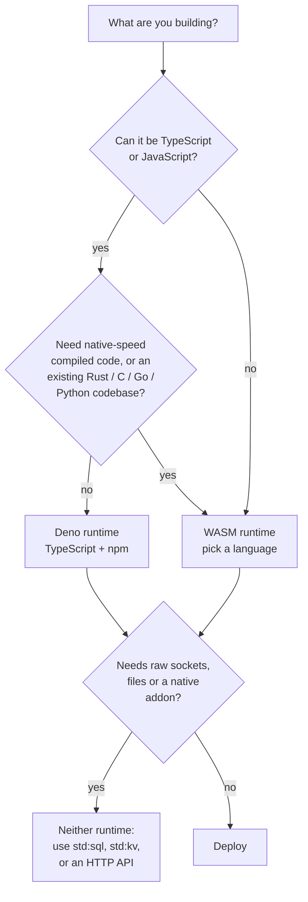

# Languages and frameworks

A node runs two kinds of services. A **Deno** service is TypeScript or JavaScript source that the node bundles and runs
in a V8 isolate. A **WASM** service is a compiled WebAssembly component that the node validates, precompiles and runs in
a fresh instance. You choose per service, with `runtime` at creation (`21ci push` infers it from the file: `.wasm` is
WASM, anything else is Deno). Both runtimes sit behind the same triggers, the same limits and the same storage, so the
choice is about the code you write, not about what the platform offers.

This page helps you decide, then lists what both runtimes cannot do. The details are on two pages:

- [Deno runtime](deno.md): requirements, import rules, framework verdicts, working examples
- [WASM runtime](wasm.md): the component contract, a project per language, what is not supported

## Choose a runtime



| Workload | Runtime | Language | Why |
|---|---|---|---|
| HTTP API, webhook receiver, glue between services | Deno | TypeScript | You push source with no toolchain. Hono or itty-router give routing; `npm:` packages are fetched at build |
| Bot, integration with a vendor SDK (payments, chat, LLM APIs) | Deno | TypeScript | Fetch-based SDKs run as they are; secrets arrive through `Deno.env` |
| Scheduled jobs and queue workers with KV or SQLite | Deno | TypeScript | `scheduled` and `queue` handlers sit in the same module as `fetch` ([Form B](deno.md#the-two-handler-shapes)) |
| Validation, auth, routing or rate limiting in front of other services | WASM | Rust | Small component, strict set of imports, no garbage-collected runtime to start |
| CPU-bound parsing, hashing, transformation of request data | WASM | Rust, C, C++ | Ahead-of-time compiled code with a predictable memory image |
| Reusing an existing Python codebase of pure-Python libraries | WASM | Python (`componentize-py`) | Works, with a large artifact and no C extensions |
| Reusing Go code | WASM | TinyGo | The standard Go compiler cannot produce a component |
| One toolchain for JavaScript and other languages, or sandboxing a script | WASM | JavaScript (`jco`) | The engine is inside the component (13 MB), no `ctx`, no `std:*` modules |
| An Express, Fastify or Koa app | Neither as is | Port to Hono on Deno | They are built on `node:http` servers; the runtime has no sockets to give them |
| A database driver over TCP, `ffmpeg`, headless browsers | Neither | Use `std:sql`, `std:kv`, `std:blob` or an HTTP API | No raw sockets, no subprocesses, no filesystem |
| A chat, live dashboard or multiplayer room over WebSockets | Deno or WASM | [`std:sockets` and durable objects](../guides/websockets.md) | The node holds the sockets; each message runs a task |

You can combine runtimes. A WASM gateway can call a Deno service in-process with `std:host/call`, and a Deno service
can call a WASM one with `std:services` ([Service calls and queues](../guides/calls-and-queues.md)).

### How the two runtimes differ

| | Deno | WASM |
|---|---|---|
| You upload | Source: a file, a directory, a zip or tar | A compiled component, one `.wasm` file |
| Toolchain on your machine | None (optionally `tsc` or `deno check` for types) | The language's component toolchain |
| Languages | TypeScript, JavaScript | Rust, JavaScript, Python, TinyGo, C, C++, C# and others that emit WASI 0.2 components |
| Dependencies | `npm:`, `jsr:` and allow-listed `https:` imports, resolved at build time through a CDN | Whatever your toolchain links into the component |
| Node-side work | Transpile and bundle, then a code cache | Validate imports, precompile to native code |
| Per task | A fresh isolate from a snapshot, your module's top level runs again | A fresh instance of the precompiled component |
| Platform APIs | `import { kv } from "std:kv"`, `ctx`, `Deno.env` | The `std:host` WIT imports, request headers, `wasi:cli/environment` |
| Caught at push time | Forbidden imports, syntax errors | Wrong ABI: core module, missing export, unknown import |
| Typical artifact | A few kilobytes of source | 40 KB (Rust) to 13 to 18 MB (JavaScript, Python) |

Why two runtimes at all? One runtime would force a trade-off. V8 isolates are a natural fit for the JavaScript
ecosystem, but they offer one language. WebAssembly components give a language-neutral, capability-based boundary: a
component can use only what it imports, and the node decides what is linked. The mechanisms are described in
[Execution](../concepts/execution.md) and compared with containers and microVMs in
[Isolation compared](../concepts/isolation-compared.md).

## The verdicts at a glance

### Deno: frameworks and libraries

| Verdict | Packages |
|---|---|
| Works | Hono, itty-router, tRPC (fetch adapter), zod, valibot, jose, date-fns, drizzle-orm through `sqlite-proxy` over `std:sql` |
| Likely, verify on your node | Oak, Elysia, the `openai` and `@anthropic-ai/sdk` SDKs, `stripe` (with the fetch HTTP client) |
| Does not work | Express, Fastify, Koa; TCP database drivers (`pg`, `mysql2`, `ioredis`, `mongodb`); `ws`, `socket.io`; native addons (`sharp`, `bcrypt`); anything that reads files at run time |

The rule of thumb: a package works if it needs only `fetch`, WebCrypto, streams and timers. "Works" means it was exercised
here against the runtime's calling convention; nothing was run on a live node. The reasoning, the esm.sh behavior for
`node:` imports inside packages, and a script that checks a package before you depend on it are in
[Deno runtime](deno.md#frameworks-and-libraries).

### WASM: languages

| Language | Verdict | Notes |
|---|---|---|
| Rust | First choice | `wasm32-wasip2` produces a component directly. 40 to 300 KB. `std` works, `std::net` and `std::fs` fail at run time |
| JavaScript, TypeScript | Works | `jco componentize`. 13 MB because the engine is inside. Service-worker `fetch` event |
| Python | Works for pure Python | `componentize-py`. 18 MB. No C extensions, no `socket` |
| Go | TinyGo only | The standard Go compiler cannot emit a component. Not built here |
| C, C++ | Possible | `wasi-sdk` and `wit-bindgen c`. Small, verbose. Not built here |
| C#, .NET | Experimental | `componentize-dotnet`. Not built here |
| Zig, AssemblyScript, Kotlin/Wasm, Swift | Not supported | No `wasi:http` component output |
| Any WASI 0.1 core module, Spin or wasmCloud components, **WASI 0.3 components** | Refused | `422 invalid_artifact` |

!!! warning "WASI 0.2 only"
    The host speaks WASI **0.2.x**. Components built for WASI 0.3 are refused. Toolchains began to default to 0.3 in
    2026, so pin the 0.2 targets: Rust `wasm32-wasip2`, 0.2 WIT packages for the others. See
    [WASM runtime](wasm.md#the-contract).

## The same service in three runtimes

A JSON hello that reads `?name=`:

=== "Deno (TypeScript)"

    ```ts title="main.ts"
    export default async function (req: Request): Promise<Response> {
      const name = new URL(req.url).searchParams.get("name") ?? "world";
      return Response.json({ message: `Hello, ${name}!` });
    }
    ```

    ```bash
    21ci push main.ts --service hello --create --wait
    ```

=== "WASM (JavaScript)"

    ```js title="src/app.js"
    addEventListener("fetch", (event) => {
      const name = new URL(event.request.url).searchParams.get("name") ?? "world";
      event.respondWith(Response.json({ message: `Hello, ${name}!` }));
    });
    ```

    ```bash
    npx jco componentize src/app.js --wit wit --world-name hello --out dist/app.wasm
    21ci push dist/app.wasm --service hello --create --wait
    ```

    Needs the `wit/` directory from `21ci init my-fn --template wasm-js`. Details in [WASM runtime](wasm.md#javascript-and-typescript).

=== "WASM (Rust)"

    See [WASM runtime](wasm.md#rust) for the full project (`Cargo.toml`, a vendored WIT file, `lib.rs`); the build is
    `cargo build --release --target wasm32-wasip2`, the deploy is
    `21ci push target/wasm32-wasip2/release/<crate>.wasm --service hello --create --wait`.

Both runtimes answer the same `21ci invoke hello '/?name=Ada'`.

## Limits both runtimes share

These are properties of the sandbox, not of a language. They are the same for Deno and WASM, because both sit behind
the same scheduler and the same host.

| Limit | What it means | Use instead |
|---|---|---|
| No filesystem | Nothing to open. Deno has no `Deno.readFile`; WASM links `wasi:filesystem` with no preopened directories | `std:blob` for objects, `std:kv` for small values, `std:sql` for tables |
| No sockets | No listening, no raw outbound TCP or UDP. Only HTTP(S) leaves the sandbox, through `fetch` or `wasi:http/outgoing-handler` and the egress guard | An HTTP API; `std:sql` instead of a database driver |
| No threads | No `Worker`, no `SharedArrayBuffer`; WASM threads and shared memory are refused at deploy | `async` code; split work over queue messages |
| WebSockets are held by the node | A request is one task, and so is each WebSocket message; no code runs between messages | [`std:sockets`](../guides/websockets.md); SSE by streaming the response body |
| Frozen clock | `Date.now()`, `performance.now()` and `wasi:clocks` advance only at I/O and timer boundaries. A busy loop never sees time pass | The wall limit stops the loop; do not measure elapsed time with it |
| No state between tasks | A new isolate or instance per task. Module variables and statics are at most a cache | `std:kv`, `std:sql` |
| Per-task limits | 128 MB memory, 1,000 ms CPU and 30 s wall for HTTP by default; `50` outbound requests; 10 MB request body, 100 MB streamed response | Plans can raise them: [Limits and quotas](../reference/limits.md) |
| Egress guard | Private and loopback destinations are refused, the plan can deny outbound traffic altogether | Ask the operator to allowlist a destination |

**Upload size limits.**

| Artifact | Limit |
|---|---|
| A single Deno source file | 1 MB |
| A Deno directory, zip, tar or JSON bundle | 10 MB in total, 1,000 files, 1 MB per file |
| Remote dependencies of one Deno build | 50 MB in total, 10 MB per module |
| A WASM component | 50 MB |

An upload over the limit is `413 too_large`. The limits are fixed in this release; the operator cannot change them.
Dependencies fetched at build time do not count against the 10 MB of a Deno upload, but they do count against the 50 MB
dependency budget.

## See also

- [Deno runtime](deno.md): requirements, import rules, frameworks table, examples with `21ci push` commands
- [WASM runtime](wasm.md): the component contract and a project per language
- [Writing Deno services](../guides/deno.md) and [Writing WASM services](../guides/wasm.md): the handler contracts
- [Execution](../concepts/execution.md): how isolates and instances run a task
- [Limits and quotas](../reference/limits.md): every limit with the key that changes it
- [Isolation compared](../concepts/isolation-compared.md): the sandbox against containers and microVMs
