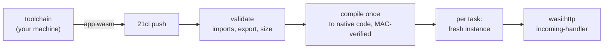

# WASM runtime

<span class="rt-badge rt-badge--wasm">WASM</span> A WASM service is not source code. It is a **WebAssembly component**
that you build with your language's toolchain and upload as one `.wasm` file. The node validates it, compiles it to
native code once, and runs a fresh instance for every task. This page tells you what the node accepts, which languages can
produce it, a minimal project for each, and what each language cannot do. The handler contract, `ctx` equivalents and
the `std:host` walkthrough are in [Writing WASM services](../guides/wasm.md); the function list is in the
[`std:host` reference](../reference/wit.md).

!!! warning "WASI 0.2 only. WASI 0.3 components are not accepted."
    The host links WASI **0.2.x** (Wasmtime with the P2 component model). A component built for WASI 0.3 imports
    `wasi:*@0.3.*` interfaces, and the node refuses it with `422 invalid_artifact` (typically ``import `wasi:...@0.3...` is not allowed``).
    Several toolchains started to default to 0.3 in 2026. Stay on the 0.2 tooling: Rust `wasm32-wasip2` with the `wasip2`
    crate (not `wasm32-wasip3`/`wasip3`), 0.2 WIT packages for jco, componentize-py and TinyGo.

## The contract

A component is accepted when all of this holds:

| Rule | Detail | If violated |
|---|---|---|
| It is a component | Not a core module. `Content-Type: application/wasm`. At most 50 MB | `422 invalid_artifact`: `not a WebAssembly component (a core module was uploaded)`; `413 too_large` over 50 MB |
| It exports the handler | `wasi:http/incoming-handler@0.2.x`, any 0.2 minor | `422 invalid_artifact`: ``component does not export `wasi:http/incoming-handler` (any 0.2.x)`` |
| It imports only what the node links | `wasi:io`, `wasi:clocks`, `wasi:random`, `wasi:cli`, `wasi:http`, `wasi:filesystem`, `wasi:sockets` (each at 0.2.x) and `std:host/*` | `422 invalid_artifact`: ``import `<name>` is not allowed``, naming the first offending import |
| It uses no threads | The threads proposal and shared memory are refused | `422 invalid_artifact`: `invalid component (threads and shared memory are not allowed)` |

Three details of the import rule decide most "why was my component rejected" questions:

- **Linked is not the same as usable.** `wasi:filesystem` is linked with **no preopened directories**, so nothing can be
  opened. `wasi:sockets` is linked with **every address denied**. A component that imports them (the JavaScript and
  Python components built below do) deploys, and fails only when it tries to open a file or a socket. That is
  deliberate: toolchains import these interfaces unconditionally, and refusing them would exclude whole languages.
- **`wasi:cli` works as expected.** stdout and stderr become service logs (`info` and `error`), stdin is empty, `exit`
  ends the task, and the terminal interfaces report "no terminal". Environment variables and secrets are visible through
  `wasi:cli/environment`.
- **Outbound HTTP is `wasi:http/outgoing-handler`.** It goes through the same egress guard as Deno's `fetch`. There is
  no other way out of the sandbox.

Why components and not core modules? A component carries typed interfaces. That is what lets the node link `std:host`
for KV, SQL and the rest, and it makes the capability model explicit: whatever the component does not import, it cannot
reach. A WASI 0.1 core module has an untyped function table, would need an adapter, and the adapter produces a `wasi:cli`
command world with no `wasi:http` export.

### How a task runs



- **Compile once.** At deploy (or the first request) the node compiles the component to native code and keeps a
  MAC-verified copy. The compile time grows with component size and is bounded by `build.wasm_timeout` (120 s).
- **A fresh instance per task.** Memory, statics and globals start from the component's initial image for every
  request. Nothing carries over between requests unless the operator enabled `wasm.reuse_instances` (default off, on in
  the `min_latency` profile), and even then you must treat it as a cache. Use `std:host/kv` or `std:host/sql` for state.
  The mechanism is in [Execution](../concepts/execution.md).
- **Pre-initialization is your toolchain's job.** The node does not run Wizer or similar. ComponentizeJS and
  componentize-py snapshot the initialized interpreter inside the component; Rust and C have nothing to initialize.
- **The clock is frozen between I/O.** `wasi:clocks` readings advance only when the guest waits on I/O or a timer.
- **Limits.** Linear memory is capped by `limits.memory_mb` (128 MB by default), CPU time by `limits.cpu_ms` (1,000 ms
  for HTTP), wall time by `limits.wall_ms`. See [Limits and quotas](../reference/limits.md).

### What the guest sees

| Aspect | Value |
|---|---|
| Path | `/{rest}?{query}`: the node strips `/s/{slug}` and reports it in `x-rt-base-path` |
| Extra request headers | `x-rt-task-id`, `x-rt-trigger`, `x-rt-deadline` (epoch ms), `x-rt-base-path`, `x-rt-client-ip` (HTTP, when known), `traceparent` |
| Schedules and queues | Synthetic `POST /__rt/scheduled` and `POST /__rt/queue` requests with a JSON body; check `x-rt-trigger` |
| Response body writes | `blocking-write-and-flush` accepts at most 4,096 bytes per call: write in chunks (all three languages built below already do) |
| Panics and traps | The task fails with `500 guest_error`; the log has the task id |

### Check a component before you push

`wasm-tools` (from the Bytecode Alliance) prints a component's imports and exports. This script applies the node's rules
to a file and exits non-zero where the node would answer `422`:

```bash title="check-component.sh"
#!/usr/bin/env bash
# usage: ./check-component.sh app.wasm
set -euo pipefail
wit="$(wasm-tools component wit "$1")"
grep -Eq '^\s*export wasi:http/incoming-handler@0\.2\.[0-9]+;' <<<"$wit" \
  || { echo "REJECTED: no wasi:http/incoming-handler@0.2.x export"; exit 1; }
bad="$(grep -E '^\s*import ' <<<"$wit" \
  | grep -Ev '^\s*import (wasi:(io|clocks|random|cli|http|filesystem|sockets)/[a-z-]+@0\.2\.[0-9]+|std:host/[a-z-]+@0\.1\.0);$' || true)"
if [ -n "$bad" ]; then echo "REJECTED imports:"; echo "$bad"; exit 1; fi
echo "ok: $(wc -c <"$1" | tr -d ' ') bytes"
```

A core module gives `wasm-tools`' own error ("input is a core wasm module ... supposed to be a component?"). To run a
component that does not import `std:host` on your machine, `wasmtime serve -S cli app.wasm` serves it (port 8080 by
default; `--addr 127.0.0.1:8391` picks another); add `-S http` for components that make outbound requests.

## Languages at a glance

"Built here" means the project below was built with the stated toolchain while this page was written, validated with the
script above, and, where marked, run on Wasmtime. Nothing was run against a live node. Sizes are what these builds
produced; yours change with toolchain versions and dependencies.

| Language | Toolchain | Built here | Size of the minimal project | Verdict |
|---|---|---|---|---|
| Rust | `wasm32-wasip2` target, `wasip2 2.0`, `wit-bindgen 0.62`, optionally `wstd 0.6` | Yes, run on Wasmtime (`wstd`) | 39 KB (`no_std` sample), 77 KB (`std` + `std:host`), 282 KB (`wstd` + `std:host`) | First choice |
| JavaScript, TypeScript | `@bytecodealliance/jco` 1.37.0 (ComponentizeJS) | Yes, run on Wasmtime (Hono) | 13.0 to 13.1 MB | Works. Large, because the JS engine is inside |
| Python | `componentize-py` 0.25.0 | Yes, run on Wasmtime | 18.4 MB | Works for pure Python. Large |
| Go | TinyGo (not the standard Go compiler) | No | Not measured | Possible with TinyGo; unverified here |
| C, C++ | `wasi-sdk` and `wit-bindgen c` | No | Not measured | Possible; unverified here |
| C# | `componentize-dotnet` | No | Not measured | Experimental; unverified here |

Cold start follows the size of the **memory image** the component carries, not the size of your code. A Rust component
starts from a few kilobytes of data. A JavaScript or Python component starts from an initialized engine or interpreter
that is copied for each task. Both are compiled ahead of time, so there is no JIT warm-up in either case. The practical
rule: if a service sees bursts after idle periods, prefer Rust or compiled-in languages, and for JS or Python keep the
bundle small. [Optimize your service](../guides/optimize.md) covers the knobs on the node side.

## Rust

<span class="rt-badge rt-badge--wasm">WASM</span> Rust has the least friction. `rustc` can emit a component directly,
so there is no post-processing step.

| Item | Value |
|---|---|
| Toolchain | Rust 1.82 or later (built here with 1.95), `rustup target add wasm32-wasip2` |
| Crates | `wasip2` 2.x (WASI 0.2 bindings and the `incoming-handler` export macro), `wit-bindgen` 0.62 (only for `std:host`) |
| Crate type | `cdylib`; `cargo build --release --target wasm32-wasip2` writes the component |
| Not needed | `cargo-component` (the Component Model documentation describes it as being deprecated in favor of native tooling) and `wasm-tools component new` |

### Minimal project with `std:host/kv`

Copy `wit/rt-host.wit` from the [`std:host` reference](../reference/wit.md) into the project. It declares the package
`std:host@0.1.0` and the world `guest` that imports all seven interfaces.

```text
hits/
├── Cargo.toml
├── wit/rt-host.wit
└── src/lib.rs
```

```toml title="Cargo.toml"
[package]
name = "hits"
version = "0.1.0"
edition = "2021"
publish = false

[lib]
crate-type = ["cdylib"]

[dependencies]
wasip2 = "2"
wit-bindgen = "0.62"

[profile.release]
opt-level = "s"
lto = true
strip = true
panic = "abort"
codegen-units = 1

# Standalone crate: stop cargo from looking for a parent workspace.
[workspace]
```

```rust title="src/lib.rs"
wit_bindgen::generate!({
    path: "wit",
    world: "guest",
});

use rt::host::{kv, log};
use wasip2::exports::http::incoming_handler::Guest;
use wasip2::http::types::{Fields, IncomingRequest, OutgoingBody, OutgoingResponse, ResponseOutparam};

struct Component;

impl Guest for Component {
    fn handle(_request: IncomingRequest, response_out: ResponseOutparam) {
        // Atomic counter in the service's KV store; keys are bytes in std:host.
        let hits = match kv::incr(b"hits", 1, kv::SetOptions { ttl_seconds: None }) {
            Ok(n) => n,
            Err(e) => {
                log::log(log::Level::Error, &format!("kv.incr: {} ({})", e.code, e.message));
                0
            }
        };

        let headers = Fields::new();
        headers
            .set("content-type", &[b"text/plain".to_vec()])
            .expect("set content-type");
        let response = OutgoingResponse::new(headers);
        response.set_status_code(200).expect("set status");
        let body = response.body().expect("response body");
        ResponseOutparam::set(response_out, Ok(response));

        let stream = body.write().expect("body stream");
        stream
            .blocking_write_and_flush(format!("hits: {hits}\n").as_bytes())
            .expect("write body");
        drop(stream);
        OutgoingBody::finish(body, None).expect("finish body");
    }
}

wasip2::http::proxy::export!(Component);
```

```bash
cargo build --release --target wasm32-wasip2
./check-component.sh target/wasm32-wasip2/release/hits.wasm
21ci push target/wasm32-wasip2/release/hits.wasm --service hits-rs --create --wait
21ci invoke hits-rs
```

The output file is named after the crate (`hits` gives `hits.wasm`; a dash in the crate name becomes an underscore). The
`wasm32-wasip2` build of this project is 77 KB and imports `wasi:io`, `wasi:cli`, `wasi:http/types`, `std:host/log` and
`std:host/kv`; `check-component.sh` accepts it. `21ci push` of a `.wasm` file creates a `wasm` service by itself.

The repository's own `sample/wasm/rust-hello` (`21ci init my-fn --template wasm-rust`) is the same idea as `#![no_std]`
with three small shims. Its header says that `std` adds `wasi:cli/{stdin,exit,terminal-*}` imports and recommends
`no_std` to avoid them. The node's import rule (above) accepts all `wasi:cli` interfaces, and the `std` build here passes
`check-component.sh`, so you can use `std` and drop the shims.

### Outbound HTTP, async and routing with `wstd`

The raw `wasip2::http::outgoing_handler` API works but is verbose (request resource, future, pollable, body stream).
[`wstd`](https://crates.io/crates/wstd) is an async standard-library layer for components with an HTTP client and a
server macro. It combines with `wit-bindgen` for `std:host`:

```toml title="Cargo.toml (dependencies)"
[dependencies]
wstd = "0.6"
wit-bindgen = "0.62"
```

```rust title="src/lib.rs"
use wstd::http::{Body, Client, Request, Response};

wit_bindgen::generate!({
    path: "wit",
    world: "guest",
});

use rt::host::{kv, log};

#[wstd::http_server]
async fn main(req: Request<Body>) -> Result<Response<Body>, wstd::http::Error> {
    match req.uri().path() {
        "/hits" => {
            let hits = kv::incr(b"hits", 1, kv::SetOptions { ttl_seconds: None }).unwrap_or(0);
            Ok(Response::new(format!("hits: {hits}\n").into()))
        }
        "/upstream" => {
            // Outbound HTTPS goes through the node's egress guard.
            let upstream = Request::get("https://example.com/").body(Body::empty())?;
            let mut response = Client::new().send(upstream).await?;
            let status = response.status();
            let bytes = response.body_mut().bytes_contents().await?;
            log::log(log::Level::Info, &format!("upstream answered {status}"));
            Ok(Response::new(format!("upstream answered {status} with {} bytes\n", bytes.len()).into()))
        }
        path => Ok(Response::new(format!("hello from wstd: {path}\n").into())),
    }
}
```

This builds to 282 KB with the same `cargo build` command and passes `check-component.sh`. Without the `std:host`
lines it also ran on Wasmtime (`wasmtime serve -S cli -S http`), including the `/upstream` request.

### Rust limits

- `std::net` and `std::fs` compile and fail at run time (no sockets, no preopened directories). `std::thread::spawn`
  fails: there are no threads. `std::time::Instant` and `SystemTime` follow the frozen clock.
- Async runtimes that need sockets or threads (the usual `tokio` features `net`, `rt-multi-thread`) do not apply. `wstd`
  brings its own single-threaded reactor on `wasi:io/poll`. Other runtimes were not tested here.
- Crates that call into C (`ring`, `openssl-sys`, `libsqlite3-sys`) need a C toolchain for `wasm32-wasip2` and often do
  not build; prefer pure-Rust crates (`sha2`, `hmac`, `serde_json`, as `sample/apps/edge-gateway` does).
- Spin SDK, wasmCloud and Fastly Compute components are different products with different worlds: see
  [Not supported](#not-supported).

## JavaScript and TypeScript

<span class="rt-badge rt-badge--wasm">WASM</span> JavaScript reaches WASM through **ComponentizeJS**: it packs the
StarlingMonkey JavaScript engine (SpiderMonkey compiled to WebAssembly) and your script into one component. `jco`
(JavaScript Component Tools) is its command-line front end.

This is a **different runtime from the Deno executor**. There is no `export default`, no `ctx`, no `std:kv` modules, no
`Deno.env`, no `npm:` imports. The handler is a service-worker-style `fetch` event. Use the [Deno runtime](deno.md) when
you want TypeScript with those conveniences; use JavaScript on WASM when you need one artifact format for several
languages, or an isolated, memory-image-based sandbox for the same code.

| Item | Value |
|---|---|
| Toolchain | Node.js 20 or later, `@bytecodealliance/jco` 1.37.0 (pulls ComponentizeJS 0.23.0) |
| Entry point | `addEventListener("fetch", (event) => event.respondWith(...))`; `respondWith` takes a `Response` or a promise of one |
| Web APIs | The StarlingMonkey set. Checked on Wasmtime: `fetch`, `Request`, `Response`, `Headers`, `URL`, streams, `TextEncoder`, `crypto.subtle` (SHA-256 digest, HMAC), `crypto.randomUUID`, `structuredClone`, `setTimeout`, `AbortSignal.timeout`, `CompressionStream`, `Blob`, `console`. Absent: `URLPattern`, every Node.js API, `process`, `require` |
| Dependencies | TypeScript sources are bundled by jco itself (Rolldown), npm packages included. For plain JavaScript pass `--bundle`, or bundle with esbuild first |
| Size | 13 MB for a minimal handler, because the engine is inside. Almost independent of your code |

### Minimal project

Scaffold the WASI WIT packages and a build script with the CLI, then add `std:host`:

```bash
21ci init hits-js --template wasm-js
cd hits-js
npm install
```

The scaffold contains `src/app.js`, `wit/world.wit`, `wit/deps/{wasi-clocks,wasi-http,wasi-io}` (WASI 0.2.10), a
`package.json` and `build.sh`. Add the `std:host` package as another dependency and list the interfaces you use in the world:

```bash
mkdir -p wit/deps/rt-host
# copy wit/rt-host.wit from the std:host reference into wit/deps/rt-host/rt-host.wit
```

```wit title="wit/world.wit"
package example:hits-js;

world hits {
  export wasi:http/incoming-handler@0.2.10;
  import std:host/kv@0.1.0;
  import std:host/log@0.1.0;
}
```

```js title="src/app.js"
import { incr } from "std:host/kv@0.1.0";
import { log } from "std:host/log@0.1.0";

const key = new TextEncoder().encode("hits");

addEventListener("fetch", (event) => {
  event.respondWith(handle(event.request));
});

async function handle(request) {
  let hits;
  try {
    // keys are Uint8Array, s64 is bigint, the options record is camelCase
    hits = incr(key, 1n, {});
  } catch (e) {
    log("error", `kv.incr failed: ${e.payload?.code ?? e}`);
    return new Response("storage error\n", { status: 500 });
  }
  return new Response(`hits: ${hits}\n`, { headers: { "content-type": "text/plain" } });
}
```

```bash
npx jco componentize src/app.js --wit wit --world-name hits --out dist/app.wasm
./check-component.sh dist/app.wasm
21ci push dist/app.wasm --service hits-js --create --wait
21ci invoke hits-js
```

The import specifier is the WIT interface id **with its version**: `std:host/kv@0.1.0`. Without the version the build
fails with `Error loading module "std:host/kv"`. Imported functions are synchronous from JavaScript.

A TypeScript project needs type declarations for those modules. `jco guest-types wit --world-name hits -o types` writes
ambient `declare module 'std:host/kv@0.1.0'` files that your `tsconfig.json` can include.

!!! warning "Verify for your version"
    Built with jco 1.37.0 and checked against the WIT (`jco guest-types`); the component imports `std:host/kv@0.1.0` and
    `std:host/log@0.1.0` and passes `check-component.sh`. It was not executed against a node, so the error shape (an
    `err` result thrown with a `payload` of `{ code, message }`) is the documented jco behavior, not something observed
    on a node. Check it with a call that fails, such as a `kv.incr` on a key holding text.

### TypeScript, npm packages and frameworks

jco 1.37.0 bundles TypeScript and its npm dependencies by itself. This project was built and, without the `std:host`
import (which needs a node), run on Wasmtime with Hono:

```ts title="src/app.ts"
import { Hono } from "hono";
import { incr } from "std:host/kv@0.1.0";

const app = new Hono();
const key = new TextEncoder().encode("hits");

app.get("/", (c) => c.text("hello from Hono in a component\n"));
app.get("/hits", (c) => c.json({ hits: Number(incr(key, 1n, {})) }));

addEventListener("fetch", (event: any) => {
  event.respondWith(app.fetch(event.request));
});
```

```bash
npm install hono
npm install --save-dev @bytecodealliance/jco
npx jco componentize src/app.ts --wit wit --world-name hits --out dist/app.wasm
./check-component.sh dist/app.wasm
21ci push dist/app.wasm --service hono-wasm --create --wait
```

jco prints an `UNRESOLVED_IMPORT` warning for `std:host/kv@0.1.0` and treats it as external. That is what you want: the
import stays in the component and the node supplies it. To bundle yourself instead, esbuild works the same way, and you
pass the result to `jco componentize` as JavaScript. Quote the pattern so your shell does not expand the `*`:

```bash
npx esbuild src/app.ts --bundle --format=esm --target=es2022 '--external:std:host/*' --outfile=build/app.js
npx jco componentize build/app.js --wit wit --world-name hits --out dist/app.wasm
```

The component is 13.1 MB: Hono adds about 0.1 MB to the engine. Fetch-based libraries work the way they do on the Deno
runtime (Hono, itty-router, zod, jose). Libraries that need Node.js modules are the problem, as the next section explains.

### JavaScript limits

- **Node.js references break the deploy.** When bundled source touches `process` or imports a `node:` module, jco's
  bundler adds a compatibility shim and **edits your `wit/world.wit`** to import `jco:node/*` interfaces (the file gains
  the comment "Added by Jco because bundled source imports node:tty"). The build succeeds, and the node then refuses the
  component: ``import `jco:node/tty@0.1.0` is not allowed``. `check-component.sh` lists such imports. Remove the
  reference or the dependency **and restore the world file**, because jco keeps the added import in the next build. Keep
  the world file in version control for this reason.
- **Top-level code runs when you componentize, not when the node starts a task.** The component is pre-initialized
  (Wizer) and snapshotted. `const startedAt = Date.now()` or `Math.random()` at module level is evaluated on your machine
  during `jco componentize` and then frozen into the artifact. Read the clock, random numbers and environment variables
  inside the handler. Modules, class definitions and lookup tables built at top level are free at run time, which is the
  point of the snapshot.
- **Each task starts from that snapshot**, so module-level `let` variables never carry state between requests.
- **`console.log` lands in the service log.** It writes to `wasi:cli/stdout` (`info`), `console.error` to stderr
  (`error`). The scaffolded `build.sh` passes `--disable stdio`, written when the import rule was believed to exclude the
  `wasi:cli` stdin and terminal interfaces that stdio brings. The node accepts them, so you can drop the flag and keep
  your logs. Checked on Wasmtime: a `console.log` in a Hono route reached the host's stdout.
- **Other flags.** `--disable clocks`, `random`, `http` remove those features from the engine (without `http` there is
  no `fetch`). `--aot` trades a larger binary for faster compiled code. `--backend quickjs` selects an alternative
  engine; it was not tried here.
- **No `std:*` modules from Deno.** Use the WIT imports (WebSockets: `std:host/sockets`, `durable`, `ws-client` and
  the `socket-handler` export, see [WebSockets](../guides/websockets.md#wasm-services)). No workers, no `URLPattern`.

## Python

<span class="rt-badge rt-badge--wasm">WASM</span> `componentize-py` packs CPython and your code into a component.

| Item | Value |
|---|---|
| Toolchain | A Python 3 environment with `pip`; `pip install componentize-py` (0.25.0 here) |
| Entry point | A class named `IncomingHandler` in your app module, implementing `handle(request, response_out)` |
| Dependencies | Pure-Python packages only, added with `-p <dir>`. No native extensions unless they have a `wasm32-wasi` build |
| Size | 18.4 MB for a minimal handler (CPython and its standard library are inside) |

### Minimal project

Use the same WIT layout as the JavaScript project (the scaffolded WASI packages plus `rt-host`), with this world:

```wit title="wit/world.wit"
package example:hits-py;

world hits {
  export wasi:http/incoming-handler@0.2.10;
  import std:host/kv@0.1.0;
  import std:host/log@0.1.0;
}
```

```python title="app.py"
from componentize_py_types import Err, Ok
from wit_world import exports
from wit_world.imports import kv, log, types


class IncomingHandler(exports.IncomingHandler):
    def handle(self, request: types.IncomingRequest, response_out: types.ResponseOutparam) -> None:
        try:
            hits = kv.incr(b"hits", 1, kv.SetOptions(ttl_seconds=None))
        except Err as e:
            log.log(log.Level.ERROR, f"kv.incr failed: {e.value.code}")
            hits = 0

        headers = types.Fields()
        headers.set("content-type", [b"text/plain"])
        response = types.OutgoingResponse(headers)
        response.set_status_code(200)
        body = response.body()
        types.ResponseOutparam.set(response_out, Ok(response))

        stream = body.write()
        stream.blocking_write_and_flush(f"hits: {hits}\n".encode())
        stream.__exit__(None, None, None)
        types.OutgoingBody.finish(body, None)
```

```bash
pip install componentize-py
componentize-py -d wit -w hits componentize app -o app.wasm
./check-component.sh app.wasm
21ci push app.wasm --service hits-py --create --wait
21ci invoke hits-py
```

The bindings module is generated as `wit_world`: `wit_world.imports.<interface>` has one module per imported interface
(`kv`, `log`, `types`), and an `err` result is raised as `componentize_py_types.Err` with the record in `.value`.
`componentize-py -d wit -w hits bindings bindings` writes the generated modules for your editor and shows every
signature. The app module name must not equal the world name. The `wasi:sockets` imports in the component (CPython links
them) are accepted and denied at run time.

A handler built without the `std:host` lines (only the response part) ran on Wasmtime and answered as expected.

### Python limits

- **Pure Python only.** CPython's `socket`, `urllib` and `requests` need sockets and fail. For outbound HTTP, import
  `wasi:http/outgoing-handler@0.2.10` in your world and call the generated `outgoing_handler` bindings (not built here).
  Packages with C extensions (`numpy`, `pydantic-core`, `cryptography`) are not available.
- **Dependencies.** `pip install --target deps <package>` and add `-p deps -p .` to the `componentize-py` command. Each
  dependency enlarges the component; the node's cap is 50 MB.
- **Size and start.** The 18 MB image is copied for each task. `componentize-py` imports your app module while it
  builds and snapshots the result, so modules imported at the top of the app module are already loaded at run time;
  an import inside a function runs in every task.
- **Async.** The generated bindings include a `componentize_py_async_support` package for `async def` handlers. It was
  not exercised here; the example above is synchronous.
- `print()` writes to stdout and appears in the service log.

## Go

<span class="rt-badge rt-badge--wasm">WASM</span> Only **TinyGo** can produce a component the node accepts.

!!! warning "Not built by the docs team; verify for your version"
    TinyGo was not available when this page was written, so the project below comes from the toolchain's documentation,
    not from a build. Check it with `./check-component.sh` before you rely on it.

The standard Go compiler cannot do it: `GOOS=wasip2` does not exist (`go: unsupported GOOS/GOARCH pair wasip2/wasm` on
Go 1.26), and `GOOS=wasip1 GOARCH=wasm go build` writes a core module, which the node rejects with
`422 invalid_artifact` (core module). This is not a gap the node can close.

| Item | Value |
|---|---|
| Toolchain | A recent TinyGo release with the `wasip2` target (0.43 when this was researched), `wasm-tools` on the `PATH` |
| HTTP | [`wasi-http-go`](https://github.com/ydnar/wasi-http-go) provides `net/http` handlers over `wasi:http` |
| `std:host` | `wit-bindgen-go` generates a Go package per interface from `rt-host.wit` |
| Standard library | A TinyGo subset: `encoding/json`, `strings`, `sort` and similar work, `net` sockets do not, `reflect` is partial |
| Concurrency | Goroutines run cooperatively on one thread |

```go title="main.go"
package main

import (
	"net/http"

	_ "github.com/ydnar/wasi-http-go/wasihttp"
)

func init() {
	http.HandleFunc("/", func(w http.ResponseWriter, r *http.Request) {
		w.Header().Set("content-type", "text/plain")
		w.Write([]byte("hello from TinyGo\n"))
	})
}

func main() {}
```

```bash
go mod init example.com/hello
go get github.com/ydnar/wasi-http-go
WITDIR="$(go list -m -f '{{.Dir}}' github.com/ydnar/wasi-http-go)/wit"
tinygo build -target=wasip2 -o app.wasm --wit-package "$WITDIR" --wit-world proxy .
./check-component.sh app.wasm
21ci push app.wasm --service hello-go --create --wait
```

For `std:host`, generate bindings with `go run go.bytecodealliance.org/cmd/wit-bindgen-go generate --world guest --out
internal ./wit` and pass your own WIT with `--wit-package ./wit --wit-world guest`. Combining `wasi-http-go`'s world
with the `std:host` imports in one world needs a world of your own that includes both; the toolchain documentation has
the pattern. This combination was not tried.

## C and C++

<span class="rt-badge rt-badge--wasm">WASM</span> The smallest and most verbose option.

!!! warning "Not built by the docs team; verify for your version"
    `wasi-sdk` and `wit-bindgen` were not installed, so this section describes the documented flow only.

| Item | Value |
|---|---|
| Toolchain | `wasi-sdk` with the `wasm32-wasip2` sysroot (`wasm32-wasip2-clang`), `wit-bindgen c` |
| Bindings | `wit-bindgen c wit --world guest --out-dir gen` writes `guest.h`, `guest.c` and an object with the component type |
| Handler | You implement the generated function for the `incoming-handler` export, using the generated resource API for headers and bodies |
| Libraries | `libc` and `libc++` without files, sockets, threads or (by default) exceptions |

```bash
wit-bindgen c wit --world guest --out-dir gen
$WASI_SDK_PATH/bin/wasm32-wasip2-clang -O2 -mexec-model=reactor \
  -o app.wasm app.c gen/guest.c gen/guest_component_type.o
./check-component.sh app.wasm
```

Use a world that exports `wasi:http/incoming-handler@0.2.x` next to the `std:host` imports. The component-model
documentation's C page is the reference for the generated function names.

## C# and .NET

<span class="rt-badge rt-badge--wasm">WASM</span> Experimental.

!!! warning "Not built by the docs team; verify for your version"
    Not built here. `componentize-dotnet` compiles .NET to a component with NativeAOT-LLVM and is a preview-quality
    toolchain.

- Toolchain: the .NET SDK (10 or later), `dotnet new install BytecodeAlliance.Componentize.DotNet.Templates`, then a
  project that references the `rt-host.wit` world with `<Wit Update="wit/rt-host.wit" World="guest" />` and the
  `wasi:http` proxy world.
- Expect a large artifact (tens of MB), no threads, no sockets, and the trimmed BCL: reflection-heavy libraries break
  under AOT trimming.
- Check the result with `./check-component.sh` before pushing.

## Not supported

| What | Why |
|---|---|
| Any WASI 0.1 core module (`wasm32-wasip1`, `GOOS=wasip1`, TinyGo `-target=wasip1`, Zig `wasm32-wasi`, Swift `wasm32-wasi`) | A core module is refused (`not a WebAssembly component`). Wrapping it with `wasm-tools component new --adapt` yields a `wasi:cli` command world, which has no `wasi:http` export, so it is refused as well |
| WASI 0.3 components (`wasm32-wasip3`, `wasip3` crate, 0.3 WIT worlds) | The host speaks 0.2 only. Stay on 0.2 toolchains |
| Zig, AssemblyScript, Kotlin/Wasm, Swift | No toolchain emits a `wasi:http` component directly today (they produce core modules). Not tried |
| Spin, wasmCloud, Fastly Compute components | Their SDKs import vendor interfaces (`fermyon:spin/*`, `wasmcloud:*`, Fastly's ABI) that the node does not provide: ``422``, ``import `...` is not allowed``. A Spin handler that uses only `wasi:http` may pass validation, but it is not a supported path |
| Threads, `SharedArrayBuffer`-style shared memory | Refused at deploy |
| Files, sockets | Linked but unusable (no preopens, all addresses denied) |
| Streaming bodies for `std:host` `blob`, `call`, `platform` | Buffered in `std:host@0.1.0` (10 MB for `call` and `blob.get` responses) |
| Components over 50 MB | `413 too_large` |

## See also

- [Writing WASM services](../guides/wasm.md): the handler contract, logs, environment, schedules and queues for components
- [`std:host` WIT reference](../reference/wit.md): every interface, record and error code
- [Execution](../concepts/execution.md): compile-once, fresh instance per task, and what that means for state
- [Deno runtime](deno.md): the other runtime, for TypeScript and JavaScript with `std:*` modules and npm packages
- [Languages and frameworks](index.md): the decision table and the limits both runtimes share
- [Limits and quotas](../reference/limits.md): per-task and upload limits
