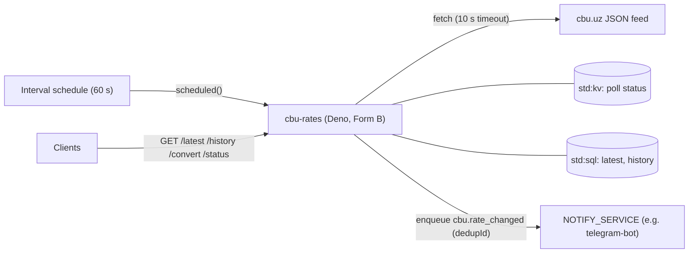

# Currency rates

This tutorial deploys `cbu-rates`, a service that polls the exchange rates of the Central Bank of Uzbekistan (CBU)
every 60 seconds, keeps a history of every change, serves a small public API and notifies another service when a
rate moves. It is for developers who want to see schedules, outbound `fetch`, change detection and queue
notifications working together.

<span class="rt-badge rt-badge--deno">Deno</span>

## What you build

- A poller that runs on an interval schedule, stores a history row only when a rate or its date changes, and backs
  off when the CBU is down.
- A public read API: latest rates, history, conversion between any two currencies (UZS included) and the poller's
  status.
- Admin routes to poll now, ingest a payload by hand and backfill history from the CBU archive.
- Optional notifications: a `cbu.rate_changed` message to another service's queue, for example the
  [Telegram bot](telegram-bot.md), which forwards it to its subscribers.

**Why it fits the runtime.** A poller is the textbook scheduled job: a short task every minute, nothing running in
between. The runtime fires the schedule, never runs two ticks of one schedule at once and skips missed ticks, so
the code does not need a lock. Each poll is one small outbound request, the history is a few SQL rows, and the
notification is one `enqueue` with a dedup id.

## Architecture



1. The schedule calls `scheduled()`. If the poller is backing off after failures, it returns at once.
2. It fetches `https://cbu.uz/uz/arkhiv-kursov-valyut/json/` with a 10 s timeout and a 1 MB cap, and validates
   every item.
3. In one SQL transaction it compares the new rates with the stored latest ones, adds history rows and updates the
   latest values.
4. If a rate moved for a watched currency, it enqueues one notification to `NOTIFY_SERVICE`.

## Prerequisites

- A running node and a tenant key in `RT_KEY` (see [First run](../getting-started/first-run.md)).
- `21ci` (see [Install](../getting-started/install.md)), or `bash`, `curl` and `jq` for `sample/scripts/*.sh`.
- The node must be able to reach `cbu.uz` (outbound `fetch` goes to the public internet only).

| Name | Kind | Meaning |
|---|---|---|
| `ADMIN_TOKEN` | secret | Bearer token for `/admin/*` (at least 16 characters; not a tenant key, since the platform removes `Authorization: Bearer rtk_…`) |
| `NOTIFY_SERVICE` | env | Slug of a same-tenant service with a queue handler; unset = no notifications |
| `NOTIFY_CCYS` | env | Currencies to announce, default `USD,EUR,RUB` |
| `CBU_BASE_URL` | env | Feed base URL, default `https://cbu.uz/uz/arkhiv-kursov-valyut/json/` |

## Deploy it

### 1. Push the code and set the admin token

=== "21ci"

    ```bash
    cd sample/apps/cbu-rates
    21ci push src --service cbu-rates --create --wait
    ADMIN=$(openssl rand -hex 24); printf %s "$ADMIN" | 21ci secret set cbu-rates ADMIN_TOKEN
    ```

=== "curl"

    ```bash
    cd sample/apps/cbu-rates
    RT_COMPILE=eager ../../scripts/deploy.sh src cbu-rates
    SVC=$(../../scripts/svc-id.sh cbu-rates)
    ADMIN=$(openssl rand -hex 24)
    jq -nc --arg v "$ADMIN" '{value: $v}' | curl -sS -X PUT -H "Authorization: Bearer $RT_KEY" \
      -H 'Content-Type: application/json' --data-binary @- "$RT_API/v1/services/$SVC/secrets/ADMIN_TOKEN"
    ```

### 2. Add the schedule

=== "21ci"

    ```bash
    21ci schedule add cbu-rates --every 60s
    ```

=== "curl"

    ```bash
    curl -sS -X POST -H "Authorization: Bearer $RT_KEY" -H 'Content-Type: application/json' \
      -d '{"kind": "interval", "every_seconds": 60}' "$RT_API/v1/services/$SVC/schedules"
    ```

60 seconds is the shortest interval the `free` plan allows; a faster schedule is refused with
`422 schedule_too_frequent`. The feed changes about once a day, so `--every 5m` is just as good. See
[Schedules](../guides/schedules.md).

### 3. Fill the history and connect a consumer (optional)

```bash
# 30 days of history from the CBU archive
curl -sS -X POST -H "Authorization: Bearer $ADMIN" 'http://127.0.0.1:8080/s/cbu-rates/admin/backfill?days=30'

# rate alerts through the Telegram bot (same tenant and environment)
21ci env set cbu-rates NOTIFY_SERVICE=telegram-bot NOTIFY_CCYS=USD,EUR,RUB
```

## Try it

```bash
B=http://127.0.0.1:8080/s/cbu-rates
curl -sS "$B/latest?ccy=USD,EUR,RUB"
curl -sS "$B/history?ccy=USD&days=7" | jq '.points[] | [.date, .rate]'
curl -sS "$B/convert?amount=100&from=USD&to=EUR"
curl -sS "$B/status"
```

| Method and path | Auth | Answer |
|---|---|---|
| `GET /latest?ccy=USD,EUR` | none | `{source, date, rates: [{ccy, code, name, nominal, rate, diff, date, perUnit}]}`; `404 no_data` before the first poll |
| `GET /history?ccy=USD&days=30` | none | `{ccy, days, points: [{date, rate, diff, nominal, perUnit, observedAt}]}`, `days` 1-366 |
| `GET /convert?amount=100&from=USD&to=EUR` | none | `{amount, from, to, result, rates}`; `to` defaults to `UZS` |
| `GET /status` | none | `{lastAttemptAt, lastSuccessAt, consecutiveFailures, lastError, backingOff, nextAttemptAt}` |
| `POST /admin/refresh` | admin | poll now, ignoring the back-off: `200 {fetched, skipped, changed, notify}` or `502` |
| `POST /admin/ingest` | admin | a CBU-format JSON array (≤ 1 MB), processed like a poll; `422` if no item is valid |
| `POST /admin/backfill?days=30` | admin | the archive for each of the last `days` (≤ 31) days, 4 requests at a time |

Rates are decimal strings exactly as the CBU publishes them (`"11778.45"` UZS per `nominal` units); `perUnit` is a
number for convenience.

## How the code works

`src/main.ts` holds the handlers and all I/O. `src/cbu.ts` is pure: feed parsing, change detection, the back-off
rule and conversion. `src/http.ts` has JSON, auth and a size-capped body reader.

### Two entry points: `fetch` and `scheduled`

```ts title="src/main.ts"
--8<-- "sample/apps/cbu-rates/src/main.ts:354:362"
      // … the public routes …

--8<-- "sample/apps/cbu-rates/src/main.ts:390:401"
```

The interval schedule calls `scheduled(event, ctx)`; HTTP requests go to `fetch`. A failed poll is recorded in KV,
not thrown: the next tick (or the back-off) is the retry. Scheduled tasks get a longer wall limit than HTTP ones
(300 s by default, capped by the plan's `limits_max`: 30 s on `free`), see [Limits](../reference/limits.md).

### Fetching an outside API defensively

```ts title="src/main.ts"
--8<-- "sample/apps/cbu-rates/src/main.ts:128:155"
```

- An `AbortController` timeout of 10 seconds keeps a hanging upstream from using the whole wall time.
- `readTextCapped` stops reading after 1 MB, so an oversized or endless body cannot exhaust memory.
- Non-`200` answers, HTML maintenance pages, cut-off bodies and empty arrays all count as failures with a stable
  error code. When the runtime refuses the request itself, `fetch` rejects with a code such as `egress_timeout` or
  `egress_dns`, which ends up in `lastError`.
- Single bad items are skipped and logged; the rest of the payload is kept.

### Change detection in one transaction

```ts title="src/main.ts"
--8<-- "sample/apps/cbu-rates/src/main.ts:93:122"
```

The comparison with `latest` and the writes run in one `sql.transaction`, so a scheduled poll and an admin refresh
running at the same moment cannot both record the same change. History is idempotent by construction: one row per
`(ccy, date, rate)` through a unique key and `INSERT OR IGNORE`, and the upsert of `latest` only moves forward in
time (`WHERE excluded.date >= latest.date`).

The comparison itself is a pure function:

```ts title="src/cbu.ts"
--8<-- "sample/apps/cbu-rates/src/cbu.ts:96:127"
```

A new currency, a newer date or a corrected rate for the same date is a forward change. An older date (backfill, a
lagging mirror) only adds history. Notifications go out only when the rate itself moved for a watched currency,
never for the first value seen.

### Notifying another service

```ts title="src/main.ts"
--8<-- "sample/apps/cbu-rates/src/main.ts:166:190"
```

- `enqueue(target, body, {dedupId})` puts a message on the queue of another service in the same tenant. The target
  must admit the caller: by default only services in the same project and environment may enqueue to it (see
  [Calls and queues](../guides/calls-and-queues.md)).
- `dedupId` is a hash of the change set. The same `dedupId` within 24 hours is delivered once, so a retried poll or a
  concurrent refresh announces a change once.
- Failures (`not_found`, `call_not_allowed`, `forbidden`, `queue_full`) are logged and returned in `notify.reason`.
  They never fail the poll.

### Status and back-off in KV

```ts title="src/main.ts"
--8<-- "sample/apps/cbu-rates/src/main.ts:194:227"
```

```ts title="src/cbu.ts"
--8<-- "sample/apps/cbu-rates/src/cbu.ts:158:164"
```

The poll status is one KV document. After three failures in a row, `nextAttemptAt` spaces the attempts out to 1, 2,
4 … minutes, capped at 30 minutes, so an outage at the CBU is not hit every minute. `GET /status` shows the state;
`POST /admin/refresh` ignores the back-off.

### Backfill within the wall limit

```ts title="src/main.ts"
--8<-- "sample/apps/cbu-rates/src/main.ts:229:249"
```

Four workers share one list of dates, so at most four requests run at once. Each worker stops when less than 8
seconds of the task's wall time (`ctx.deadline`) remain, and the answer reports how many days were done. The
runtime also caps outbound requests per task (50 for an HTTP task by default, at most 6 at once), which a 31-day
backfill stays under.

### Cacheable public reads

```ts title="src/main.ts"
--8<-- "sample/apps/cbu-rates/src/main.ts:54:58"

--8<-- "sample/apps/cbu-rates/src/main.ts:275:283"
```

The read endpoints send `cache-control: public, max-age=60` and `access-control-allow-origin: *`, so a CDN or a
browser page on any origin can use them directly.

## Test it

**Unit tests.** `test/cbu.test.ts` covers decimal normalization, CBU date parsing, payload parsing that keeps good
items and reports bad ones, change detection (new, unchanged, newer date, correction, older), which changes are
notifiable, the stable change key, the back-off schedule and the capped body reader.

```bash
cd sample/apps/cbu-rates
node --test test/*.test.ts       # Node >= 22.18, or: deno test
```

**Smoke test.** `smoke.sh` deploys `cbu-rates-smoke`. The deterministic part ingests synthetic CBU payloads dated 20
days ahead through `/admin/ingest`: a bad item is skipped, the same data twice stores nothing, a moved USD rate is a
change with its previous value, and a notification to a missing service fails softly. Then it checks `/latest`
(including a currency with `nominal` 10 and the CORS header), `/history` and `/convert`. The live part polls cbu.uz
once (a `502` with an `upstream_*` code during a CBU outage also passes).

```bash
RT_API=http://127.0.0.1:8081 RT_INVOKE=http://127.0.0.1:8080 RT_KEY=rtk_… ./smoke.sh
NOTIFY_SLUG=telegram-bot-smoke ./smoke.sh   # notify a real consumer instead of a missing one
SMOKE_SLOW=1 ./smoke.sh                     # also adds a 60 s schedule and waits for one scheduled poll
```

## Notes and limits

- Dates are calendar dates in Tashkent (UTC+5), which is how the CBU publishes them.
- `/history` accepts up to 366 days, `/admin/backfill` up to 31 days per call.
- Polling every 60 seconds suits a feed that changes once a day only because each poll is cheap (one request, about
  26 KB).

## Ideas to extend it

- Watch a second source (a commercial bank's rates) with another schedule and compare spreads.
- Add a `cron` schedule for a daily digest (cron schedules need a plan that allows them; the `free` plan does not).
- Serve a small chart page from the service, reading `/history`.
- Fan notifications out to several consumers by enqueueing to more than one slug.

## Where the code lives

`sample/apps/cbu-rates/` in the runtime repository: `src/` (the service), `test/` (unit tests), `smoke.sh` and a
README.

## See also

- [Schedules](../guides/schedules.md): interval and cron schedules, overlap and skipped ticks
- [Calls and queues](../guides/calls-and-queues.md): `enqueue`, dedupe, environments and allowed callers
- [Telegram bot](telegram-bot.md): the consumer of the notifications
- [`21ci schedule`](../cli.md#schedule)
