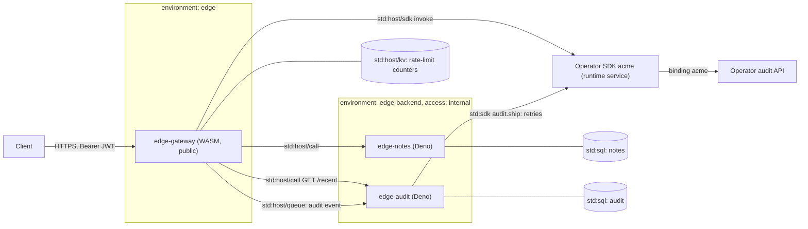

# Edge gateway (WASM)

This tutorial builds an authenticating API gateway as a WebAssembly component written in Rust, and puts two
internal Deno services behind it. It is for developers who want to see a WASM service use the runtime's host
interfaces (`std:host/kv`, `call`, `queue`, `sdk`, `log`) and how environments, `access: internal` and allowed
callers lock backends down so that only the gateway can reach them.

<span class="rt-badge rt-badge--wasm">WASM</span> <span class="rt-badge rt-badge--deno">Deno</span>

## What you build

Three services:

| Service | Runtime | Reachable from | Does |
|---|---|---|---|
| `edge-gateway` | WASM component (Rust) | the public listener | Checks every request, forwards it in-process, audits the decision |
| `edge-notes` | Deno, Form A | only the gateway | Per-subject notes in `std:sql` |
| `edge-audit` | Deno, Form B | only the gateway | Stores audit events, ships the ones the gateway could not, serves recent events |

Before any backend sees a request, the gateway checks, in this order:

1. Path, method and query shape, and the route (`400`, `404`, `405`).
2. A rate limit per client address, before any token work (`429` with `Retry-After`).
3. An HS256 bearer token: algorithm pinned, key picked by `kid`, signature checked in constant time, `exp`, `nbf`,
   `iat`, a lifetime of at most 900 s, `aud`, optional `iss` (`401`).
4. The scope for the route and method (`403`).
5. A rate limit per token subject (`429`).
6. The body: `application/json`, at most 64 KiB, well-formed (`400`, `413`, `415`).

Then it forwards the request with `std:host/call`, answers the client, and finally ships an audit event to the
operator's audit API with the operator SDK (`std:host/sdk`) and hands it to `edge-audit` (`std:host/queue`). The SDK
also answers `GET /v1/platform`, which shows an SDK update reaching the running gateway without a redeploy.

**Why WASM here.** A gateway runs on every request and holds the signing keys, so it should be the most predictable
and most locked-down piece in the path. Each request gets a fresh component instance (possibly pre-instantiated by
the warm pool), so no request can see another's memory. The component imports only the capabilities it needs: WASI
environment and clocks plus `std:host/{log,kv,queue,call,sdk}`; it has no filesystem preopens and its sockets
are denied. There is no JIT warm-up and no garbage collector. The backends are ordinary Deno services: quick to
write, never exposed. See [Execution](../concepts/execution.md) for how both runtimes run tasks.

## Architecture



The backends have `access: internal`, so the public listener answers `404` for them. They live in another
environment than the gateway and list it in `call.allowed_callers`, so the runtime admits calls and enqueues from the
gateway only. On top of that, both backends refuse anything whose `ctx.trigger` is not `call` (or `queue`). That is
why they can trust the `x-gw-sub` header the gateway sets after it verified the token.

## Prerequisites

- A running node and a tenant key in `RT_KEY` (see [First run](../getting-started/first-run.md)).
- `21ci` (see [Install](../getting-started/install.md)), or `bash`, `curl` and `jq` for `sample/scripts/*.sh`.
- Rust with the `wasm32-wasip2` target (`build.sh` adds the target with `rustup` when it is missing). Optional:
  `wasm-tools`, which `build.sh` uses to check the component's imports and export.
- `openssl` and `jq` for `mint-token.sh`, which signs test tokens.
- Optional, for audit shipping and `/v1/platform`: the operator SDK from `sample/operator-sdk/`, published and granted
  (`21ci sdk publish acme 1.0.0 sample/operator-sdk/acme-sdk`, `21ci sdk grants set node acme --allow`), its `acme`
  binding pointing at the mock API, and a tenant on a plan that binding allows. See
  [Operator SDKs and bindings](../guides/operator-sdks.md). Without it the trail stays in `edge-audit`'s own database.

## Build the component

```bash
cd sample/apps/edge-gateway
gateway/build.sh --test     # unit tests on the host, then the release build
```

The crate builds two ways: as a `cdylib` for `wasm32-wasip2`, which rustc turns into a WebAssembly component, and as
an `rlib`, so `cargo test` runs the pure modules (`token`, `request`, `ratelimit`, `audit`, `config`) on your machine:

```toml title="gateway/Cargo.toml"
--8<-- "sample/apps/edge-gateway/gateway/Cargo.toml"
```

- `wasip2` provides the `wasi:http` types and the `wasi:http/incoming-handler` export.
- `wit-bindgen` generates Rust bindings for the runtime's own imports from `gateway/wit/rt-host.wit`, a vendored copy
  of the runtime's `wit/rt-host.wit` (package `std:host@0.1.0`, see [WIT reference](../reference/wit.md)).
- The release profile optimizes for size and aborts on panic: a panic in a component is a trap, which the runtime
  reports as `500 guest_error`.

`build.sh` warns when the vendored WIT drifts from the runtime's copy, runs the tests with `--test`, builds the
release component and, with `wasm-tools` installed, checks that it exports `wasi:http/incoming-handler@0.2.x` and
imports nothing the runtime does not link:

```bash title="gateway/build.sh"
--8<-- "sample/apps/edge-gateway/gateway/build.sh:17:51"
```

A component with other imports, or without that export, is refused at deploy with `422 invalid_artifact`. The output
is `gateway/target/wasm32-wasip2/release/edge_gateway.wasm`.

## Deploy it

### 1. Create the services with their isolation, then push

Create the backends with `access: internal`, their own environment and the gateway as the only allowed caller
before any code is uploaded, so they are never public, not even for a moment.

=== "21ci"

    ```bash
    cd sample/apps/edge-gateway
    21ci service create edge-notes --runtime deno --access internal --env edge-backend --allowed-caller edge-gateway
    21ci service create edge-audit --runtime deno --access internal --env edge-backend --allowed-caller edge-gateway
    21ci service create edge-gateway --runtime wasm --env edge

    21ci push notes/main.ts --service edge-notes --wait
    21ci push audit/src --service edge-audit --wait
    21ci push gateway/target/wasm32-wasip2/release/edge_gateway.wasm --service edge-gateway --wait
    ```

=== "curl"

    ```bash
    cd sample/apps/edge-gateway
    create() {  # JSON body of POST /v1/services
      curl -sS -X POST -H "Authorization: Bearer $RT_KEY" -H 'Content-Type: application/json' \
        -d "$1" "$RT_API/v1/services"
    }
    backend() {
      jq -nc --arg s "$1" '{slug: $s, runtime: "deno", environment: "edge-backend", access: "internal",
                            call: {allowed_callers: ["edge-gateway"]}}'
    }
    create "$(backend edge-notes)"
    create "$(backend edge-audit)"
    create '{"slug": "edge-gateway", "runtime": "wasm", "environment": "edge"}'

    export RT_COMPILE=eager
    ../../scripts/deploy.sh notes/main.ts edge-notes
    ../../scripts/deploy.sh audit/src edge-audit
    ../../scripts/deploy.sh gateway/target/wasm32-wasip2/release/edge_gateway.wasm edge-gateway
    ```

!!! tip "Slug or id in `allowed_callers`"
    A slug entry admits whichever service holds that slug when the call is made. Where that matters, list the
    gateway's `svc_…` id instead. See [Calls and queues](../guides/calls-and-queues.md).

### 2. Set the signing key and limits

```bash
KEY=$(openssl rand -hex 32)       # keep it: token issuers sign with it
printf %s "k1:$KEY" | 21ci secret set edge-gateway GATEWAY_KEYS
21ci env set edge-gateway GATEWAY_RATE_LIMIT=120 GATEWAY_IP_RATE_LIMIT=600 GATEWAY_RATE_WINDOW=60
21ci schedule add edge-audit --every 5m      # optional: retries shipping, prunes shipped events after 30 days
```

The component reads its settings from the WASI environment, where the runtime puts the service's env and secrets
together:

| Name | Kind | Default | Meaning |
|---|---|---|---|
| `GATEWAY_KEYS` | secret | required | `kid:hex[,kid:hex]`, each key at least 32 bytes. Rotation: add `k2`, move issuers to it, remove `k1` |
| `GATEWAY_AUDIENCE` | env | `edge-gateway` | Required `aud` |
| `GATEWAY_ISSUER` | env | unset | Required `iss` when set |
| `GATEWAY_MAX_TOKEN_TTL` | env | `900` | Maximum `exp - iat` in seconds |
| `GATEWAY_RATE_LIMIT` | env | `120` | Requests per window per token subject; `0` turns it off |
| `GATEWAY_IP_RATE_LIMIT` | env | `600` | Requests per window per client address (IPv6 per /64), checked before the token; `0` turns it off |
| `GATEWAY_RATE_WINDOW` | env | `60` | Window in seconds, for both limits |
| `GATEWAY_NOTES_SERVICE`, `GATEWAY_AUDIT_SERVICE` | env | `edge-notes`, `edge-audit` | Backend slugs |
| `GATEWAY_AUDIT` | env | `mutations` | `all`, `mutations` (writes and every denial) or `off` |
| `GATEWAY_SDK` | env | `acme` | Operator SDK the gateway ships each event with (`audit.ship`) and answers `/v1/platform` from; `off` leaves all shipping to `edge-audit` |
| `GATEWAY_MAX_BODY` | env | `65536` | Request body limit in bytes |

`edge-audit` reads `AUDIT_SDK` (default `acme`, `off` never ships) and `AUDIT_RETENTION_DAYS` (default 30, for shipped
events). Keep the SDK equal on both services. To keep every event local, set `GATEWAY_SDK=off` and `AUDIT_SDK=off`.

## Try it

`mint-token.sh` signs a short-lived token with the same key, for local use:

```bash title="mint-token.sh"
--8<-- "sample/apps/edge-gateway/mint-token.sh:2:15"
```

```bash
B=http://127.0.0.1:8080/s/edge-gateway
T=$(GATEWAY_KEY_HEX=$KEY ./mint-token.sh alice "notes:read notes:write")
curl -sS -X POST $B/v1/notes -H "Authorization: Bearer $T" -H 'Content-Type: application/json' -d '{"text": "hi"}'
curl -sS $B/v1/notes -H "Authorization: Bearer $T"
curl -sS http://127.0.0.1:8080/s/edge-notes/      # 404: the backend is not on the public listener
```

The bearer token reaches the component unchanged: the platform removes an `Authorization` header only when it
carries one of its own tenant keys (`Bearer rtk_…`).

| Method and path | Scope | Backend |
|---|---|---|
| `GET /healthz` | none | the gateway itself (`503` when misconfigured) |
| `GET /v1/notes?limit=&before=` | `notes:read` | `edge-notes`: own notes, newest first |
| `POST /v1/notes` `{text, tags?}` | `notes:write` | `201` with `Location` |
| `GET /v1/notes/{id}` | `notes:read` | own note or `404` |
| `PUT /v1/notes/{id}` `{text, tags?}` | `notes:write` | |
| `DELETE /v1/notes/{id}` | `notes:write` | |
| `GET /v1/audit/recent?limit=&sub=&ip=` | `audit:read` | `edge-audit`: events plus the shipping state |

Gateway errors are `{"error": {"code", "message"}}` with the codes `invalid_request`, `not_found`,
`method_not_allowed`, `invalid_token` (with `WWW-Authenticate: Bearer`), `insufficient_scope`, `rate_limited` (with
`Retry-After`), `unsupported_media_type`, `too_large`, `invalid_json`, `invalid_body` (a body that cannot be read, or
a missing JSON body), `unexpected_body` (a body on `GET` or `DELETE`), `upstream_unavailable`, `upstream_error` and
`gateway_misconfigured` (`503`).
Every answer carries `x-request-id` (the task id) and `content-length`, and the `ratelimit-limit`,
`ratelimit-remaining` and `ratelimit-reset` headers once the client is known.

## How the code works

The crate is split so that everything but the WASI glue is a plain Rust module with host-side unit tests:

```rust title="gateway/src/lib.rs"
--8<-- "sample/apps/edge-gateway/gateway/src/lib.rs"
```

### Bindings and the export

```rust title="gateway/src/component.rs"
--8<-- "sample/apps/edge-gateway/gateway/src/component.rs:4:26"
```

`wit_bindgen::generate!` turns the vendored WIT world `guest` into the `rt::host::*` modules. The `wasip2` crate's
`export!` macro makes `Gateway` the component's `wasi:http/incoming-handler`. The handler gets an `IncomingRequest`
and a `ResponseOutparam`. The runtime adds `x-rt-task-id` to the request (the gateway uses it as the request id) and,
for HTTP requests, `x-rt-client-ip`.

### The pipeline

```rust title="gateway/src/component.rs"
--8<-- "sample/apps/edge-gateway/gateway/src/component.rs:154:215"
```

The per-address limit runs before the token is even parsed, so a flood of forged tokens costs one counter increment
per request. The address comes from `x-rt-client-ip`, which the platform sets to the client address it resolved
(behind `ingress.trusted_proxies`); a client-sent value is removed first. Token errors map to one public code,
`invalid_token`, while the precise reason (`expired`, `bad_signature`, …) goes to the log and the audit trail.

```rust title="gateway/src/component.rs"
--8<-- "sample/apps/edge-gateway/gateway/src/component.rs:217:246"
```

### Token verification

```rust title="gateway/src/token.rs"
--8<-- "sample/apps/edge-gateway/gateway/src/token.rs:100:134"
```

The order matters. The header is parsed only to pick the algorithm and the key: anything but `HS256` is refused,
including `none`, and so is a `crit` header. The HMAC over `<header>.<payload>` is checked with `verify_slice`, which
compares in constant time, before the payload is parsed at all. Only then are the claims trusted:

```rust title="gateway/src/token.rs"
--8<-- "sample/apps/edge-gateway/gateway/src/token.rs:136:157"
```

WASM clocks are frozen at the start of the task, which is the right reference time for `exp`. The 30 s leeway
covers clock skew between the token issuer and the node.

### Exact rate limits with `kv::incr`

```rust title="gateway/src/component.rs"
--8<-- "sample/apps/edge-gateway/gateway/src/component.rs:248:291"
```

`kv::incr` adds 1 to the counter for the current window and returns the new value in one atomic step on the
service's single SQLite writer, so concurrent requests never share a count and the limit is exact within a window.
The TTL applies when the call creates the key, so every window's counter expires on its own. Keys are per subject or
per address, and IPv6 clients count per /64:

```rust title="gateway/src/ratelimit.rs"
--8<-- "sample/apps/edge-gateway/gateway/src/ratelimit.rs:45:67"
```

The interface, from the runtime's WIT:

```text title="wit/rt-host.wit"
--8<-- "wit/rt-host.wit:54:59"
```

A KV error lets the request through and logs a warning (availability over strictness). A fixed window still admits
up to twice the limit across a window boundary, so keep the service's `ingress.rate_limit` as the global cap.

### Forwarding with `std:host/call`

```rust title="gateway/src/component.rs"
--8<-- "sample/apps/edge-gateway/gateway/src/component.rs:364:438"
```

The backend sees only an allowlist of client headers plus the gateway's own `x-gw-*` headers:

```rust title="gateway/src/request.rs"
--8<-- "sample/apps/edge-gateway/gateway/src/request.rs:209:215"
```

- `rtcall::call` runs the backend in-process, with no HTTP hop. Only the method, path and query, headers and body
  are used. The runtime checks the target's environment and `call.allowed_callers`; a refusal comes back as an error
  (`call_not_allowed`, `not_found`, …), which the gateway turns into `502 upstream_unavailable`.
- A backend `5xx` becomes `upstream_error` without the backend's body, so internal error pages never leak.
- Call bodies are buffered (no streaming yet), which is fine for JSON within `GATEWAY_MAX_BODY`.

### The audit trail: answer first, ship after

```rust title="gateway/src/component.rs"
--8<-- "sample/apps/edge-gateway/gateway/src/component.rs:141:149"
```

`send` writes the whole buffered response with a `content-length`, so the client has it at once. Only then does
`deliver` run:

```rust title="gateway/src/component.rs"
--8<-- "sample/apps/edge-gateway/gateway/src/component.rs:440:493"
```

- `sdk::invoke` calls the operator SDK's `audit.ship`. The SDK is a runtime service of the operator: no SDK code is in
  the component, and the SDK release that runs is the one the gateway's grants select now. The SDK reaches the
  operator API through its binding, which injects the credentials and forwards the gateway's tenant. A failure is an
  `error` with a stable code (`sdk_not_granted`, `sdk_unavailable`, or the SDK's own, such as `binding_not_allowed`).
- `GET /v1/platform` is answered the same way, from the SDK's `getPlatformInfo`: when the operator publishes a new SDK
  release, the next request gets its answer, with no redeploy of the gateway.
- The event then goes to `edge-audit`'s queue with the shipping result and `dedup_id: "gw:<task id>"`, so a retried
  enqueue is delivered once.
- Nothing here can fail the request: it has been answered already. Failures are logged.

The runtime ends the response stream only when the handler returns, so the instance and its concurrency slot stay
busy for the round trip to the operator API, bounded by the wall limit. To keep that outbound call off the hot path,
set `GATEWAY_SDK=off` and let `edge-audit` ship every event in batches.

The SDK interface in the runtime's WIT:

```text title="wit/rt-host.wit"
--8<-- "wit/rt-host.wit:196:209"
```

### The backends

`edge-notes` is a Form A handler that trusts `x-gw-sub` only because nothing but the gateway can call it, and checks
that once more:

```ts title="notes/main.ts"
--8<-- "sample/apps/edge-gateway/notes/main.ts:79:83"
```

Every query is scoped by that owner (`WHERE … AND owner = ?`), so one subject can never read another's notes, even
with a spoofed `x-gw-sub` header: the gateway drops client `x-gw-*` headers before it adds its own.

`edge-audit` is a Form B service with a `queue` consumer, a `scheduled` handler and a `fetch` for `/recent`. Delivery
is at least once, so the event id (the gateway's task id) is the primary key and a redelivered event is stored once:

```ts title="audit/src/main.ts"
--8<-- "sample/apps/edge-gateway/audit/src/main.ts:74:82"

--8<-- "sample/apps/edge-gateway/audit/src/main.ts:156:172"
```

Events the gateway could not ship are shipped right away in one batch with `sdk(AUDIT_SDK).audit.ship` (`std:sdk`),
and again by the optional schedule. An attempt that timed out after the operator API accepted it is shipped again, so
the operator API should deduplicate by event `id`.

## Test it

**Unit tests.** `gateway/build.sh --test` runs 21 Rust tests on the host: tokens (forgery, algorithm tricks,
malformed input, time and audience checks, issuer, and a token produced by `mint-token.sh`), routing, path rules,
the bearer header, client addresses and rate-limit keys, the audit event and shipping results, and configuration.
`audit/test/events.test.ts` has 5 tests for event validation and the shipping state.

```bash
gateway/build.sh --test
(cd audit && node --test test/*.test.ts)     # Node >= 22.18, or: deno test
```

**Smoke test.** `smoke.sh` builds the component if it is missing and deploys `edge-smoke-gateway`,
`edge-smoke-notes` and `edge-smoke-audit` with the same isolation. It checks that the backends are not public;
forged, expired, long-lived, wrong-audience and `alg=none` tokens; scopes; per-subject isolation with a spoofed
`x-gw-sub`; request validation; the per-subject limit (10 per minute); the per-address limit cutting forged tokens
before any token check; the runtime refusing the gateway once it is removed from `allowed_callers`; the audit
trail, filtered by subject and by address; and the operator SDK, which it publishes itself as `acme_<run>` with the
operator token: `GET /v1/platform` answered by 1.0.0, then by 1.1.0 (with the integrations, its new behavior) right
after `1.1.0` is published to `stable`, by 1.0.0 after a rollback, and `502 sdk_unavailable` after removal, while the
gateway keeps the same version throughout.

```bash
RT_API=http://127.0.0.1:8081 RT_INVOKE=http://127.0.0.1:8080 RT_KEY=rtk_… RT_ROOT_TOKEN=… ./smoke.sh
EXPECT_SHIPPED=1 ./smoke.sh        # with the acme binding and its mock API: events reached the operator API
```

## Notes and limits

- **Fail closed.** Missing or invalid `GATEWAY_KEYS` answers `503` for everything; nothing is forwarded unverified.
- **Fail open on the store.** A KV error in either rate limiter lets the request through and logs a warning.
- **Shared addresses.** Clients behind one NAT or proxy share a per-address budget; size `GATEWAY_IP_RATE_LIMIT`
  for that. Requests without `x-rt-client-ip` (not over the public listener) skip that limit.
- **Body size.** `GATEWAY_MAX_BODY` is checked against `Content-Length` and again while reading.

## Ideas to extend it

- Add a route to another backend: a new `Target`, a scope in `required_scope`, and the backend's slug in the config.
- Verify asymmetric tokens (RS256 or EdDSA) from your identity provider instead of shared HMAC keys.
- Cache idempotent `GET` answers in `std:host/kv` with a short TTL, keyed by subject and path.
- Write a second backend as a WASM component too, for a fully WASM request path.

## Where the code lives

`sample/apps/edge-gateway/` in the runtime repository: `gateway/` (the Rust crate: `src/`, `wit/rt-host.wit`,
`Cargo.toml`, `build.sh`), `notes/main.ts`, `audit/` (`src/`, `test/`), `mint-token.sh`, `smoke.sh` and a README.

## See also

- [WASM components](../guides/wasm.md): toolchains, the component contract, `std:host`
- [WIT reference](../reference/wit.md)
- [Calls and queues](../guides/calls-and-queues.md): environments and allowed callers
- [Operator SDKs and bindings](../guides/operator-sdks.md)
- [`21ci service`](../cli.md#service)
