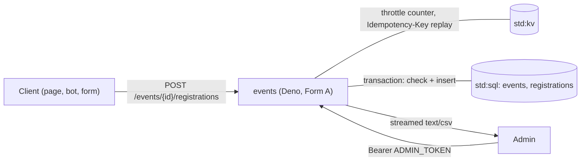

# Event sign-ups

This tutorial deploys `events`, a JSON backend for meetups and workshops: an admin publishes events with a capacity,
anyone registers with a name and a contact, and registrants cancel with a private token. It is for developers who
want to see how SQL transactions, idempotency keys and streamed responses work inside a service.

<span class="rt-badge rt-badge--deno">Deno</span>

## What you build

- **Public API**: list events, read one, register with a name plus an email or a Telegram username, look up or cancel
  your own registration with the token you got at registration.
- **Admin API** (Bearer `ADMIN_TOKEN`): create and update events, close and reopen registration, list registrations
  as JSON pages or download them as CSV.

The service is a plain JSON API, so any static page, bot or form can sit in front of it.

**Why it fits the runtime.** Registration is the classic race: two people take the last seat at the same moment.
Each service has its own SQLite database with a single writer, and `sql.transaction` runs the capacity check and
the insert as one unit, so there is no overbooking without any locking code of your own. An atomic `kv.incr`
counter on the client address the platform resolved (`ctx.client.ip`) throttles the public registration route. The
service holds no state between requests, the export streams in pages instead of building the file in memory, and
the admin token is a write-only secret.

## Architecture



A registration goes through these steps:

1. Count the request against the client address's budget for this minute (`kv.incr`); over the budget it is
   `429 rate_limited` with `Retry-After`.
2. Validate the body (`name`, `email` and/or `telegram`).
3. With an `Idempotency-Key` header: if KV has an answer for that key, replay it.
4. In one SQL transaction: the event exists, is open and has not started, the contact is not registered yet, a
   seat is left; then insert.
5. Return the registration and a token `evr_…` once. Only the token's SHA-256 is stored.

## Prerequisites

- A running node and a tenant key in `RT_KEY` (see [First run](../getting-started/first-run.md)).
- `21ci` (see [Install](../getting-started/install.md)), or `bash`, `curl` and `jq` for `sample/scripts/*.sh`.

| Name | Kind | Meaning |
|---|---|---|
| `ADMIN_TOKEN` | secret | Bearer token for the admin routes (at least 16 characters) |
| `CORS_ORIGIN` | env | Optional `Access-Control-Allow-Origin` value (an origin or `*`) for a browser frontend on another origin |
| `THROTTLE_PER_MINUTE` | env | Registrations one client address may send per minute, default 20; `0` turns the throttle off |

The admin token travels as `Authorization: Bearer …`. On a public service that header reaches the handler unchanged;
the platform removes it only when it carries one of its own tenant keys (`Bearer rtk_…`), so never use a tenant key
as `ADMIN_TOKEN`.

## Deploy it

=== "21ci"

    ```bash
    cd sample/apps/events
    21ci push src --service events --create --wait
    ADMIN=$(openssl rand -hex 24); printf %s "$ADMIN" | 21ci secret set events ADMIN_TOKEN
    21ci env set events CORS_ORIGIN=https://events.example.com      # optional
    ```

=== "curl"

    ```bash
    cd sample/apps/events
    RT_COMPILE=eager ../../scripts/deploy.sh src events
    SVC=$(../../scripts/svc-id.sh events)
    ADMIN=$(openssl rand -hex 24)
    jq -nc --arg v "$ADMIN" '{value: $v}' | curl -sS -X PUT -H "Authorization: Bearer $RT_KEY" \
      -H 'Content-Type: application/json' --data-binary @- "$RT_API/v1/services/$SVC/secrets/ADMIN_TOKEN"
    ```

The per-address throttle is on by default. On a public deployment, also set the service's ingress rate limit as a
global cap:

=== "21ci"

    ```bash
    21ci service update events --set ingress.rate_limit.rps=5 --set ingress.rate_limit.burst=20
    ```

=== "curl"

    ```bash
    SVC=$(../../scripts/svc-id.sh events)
    curl -sS -X PATCH -H "Authorization: Bearer $RT_KEY" -H 'Content-Type: application/json' \
      -d '{"ingress": {"rate_limit": {"rps": 5, "burst": 20}}}' "$RT_API/v1/services/$SVC"
    ```

## Try it

```bash
B=http://127.0.0.1:8080/s/events
curl -sS -X POST $B/events -H "Authorization: Bearer $ADMIN" -H 'Content-Type: application/json' \
  -d '{"title": "Rust meetup", "starts_at": "2026-11-20T18:00:00+05:00", "capacity": 40, "location": "IT Park"}'
curl -sS $B/events
curl -sS -X POST $B/events/1/registrations -H 'Content-Type: application/json' -H "Idempotency-Key: $(uuidgen)" \
  -d '{"name": "Ada", "telegram": "@ada_l"}'                # keep the returned token
curl -sS -X DELETE $B/registration -H "X-Registration-Token: evr_…"
curl -sS -H "Authorization: Bearer $ADMIN" -o reg.csv $B/events/1/registrations.csv
```

`starts_at` must be ISO 8601 with an offset (`…+05:00` or `…Z`) and in the future; responses use UTC.

| Method and path | Auth | Answer |
|---|---|---|
| `GET /events` | none | `{events: [event]}`, upcoming by start time (`?past=1` lists all) |
| `GET /events/{id}` | none | the event with `registered`, `spotsLeft`, `registrationOpen` |
| `POST /events/{id}/registrations` | none | `201 {registration, token}`; `409` `event_full`, `already_registered`, `event_closed`, `event_started`; `429 rate_limited` with `Retry-After` |
| `GET /registration` | `X-Registration-Token` | `{registration, event}` |
| `DELETE /registration` | `X-Registration-Token` | `{registration}` with `status: cancelled`; repeating it is fine |
| `POST /events` | admin | `201 event` |
| `PATCH /events/{id}` | admin | `event`; `409 capacity_below_registered` |
| `POST /events/{id}/close`, `/reopen` | admin | `event` |
| `GET /events/{id}/registrations` | admin | `{event, registrations, next}`; `?status=confirmed\|cancelled\|all&limit=&after=` |
| `GET /events/{id}/registrations.csv` | admin | `text/csv` download |

Errors are `{"error": {"code", "message"}}`; validation errors are `400 validation_failed`.

## How the code works

`src/main.ts` holds the handler and all SQL. `src/validate.ts` (input rules), `src/csv.ts` (CSV encoding) and
`src/http.ts` (JSON, auth and token helpers) are pure, so the unit tests load them without the runtime.

### Schema: partial unique indexes

```ts title="src/main.ts"
--8<-- "sample/apps/events/src/main.ts:61:87"
```

The two partial unique indexes allow one **confirmed** registration per email and per Telegram username for each
event. A cancelled registration no longer counts, so the same person can register again. The schema is created
read-first: the `CREATE` batch runs only when the last index is missing, so ordinary requests never write DDL.

### No overbooking: one transaction

```ts title="src/main.ts"
--8<-- "sample/apps/events/src/main.ts:146:170"
```

The status check, the duplicate check, the seat count and the insert run inside `sql.transaction`. It commits when
the callback resolves and rolls back when it throws. SQLite has a single writer per database, so two concurrent
registrations for the last seat are serialized: the second one sees the first one's row and gets `409 event_full`.
The partial unique indexes are the backstop if the duplicate check were ever wrong. A transaction is capped at 5 s
(`sql_timeout`), which this short one never approaches.

### Safe retries with `Idempotency-Key`

A client on a bad network may send the same registration twice. With an `Idempotency-Key` header the first answer is
stored in KV for 24 hours and replayed for the retry:

```ts title="src/main.ts"
--8<-- "sample/apps/events/src/main.ts:172:200"
```

- The KV key is the SHA-256 of the client's key, so arbitrary client input never becomes a KV key.
- The fingerprint ties the key to the request body: the same key with a different body is `422 idempotency_mismatch`.
- A replay carries the header `idempotent-replayed: true` and the same token as the first answer.
- `ttlSeconds: 86400` lets the store clean itself up; expired keys read as `null`.

### Tokens are stored as hashes

The registration token is `evr_` plus 32 random bytes in base64url. Only its SHA-256 goes into the database, so a
database export cannot be used to cancel anyone's registration:

```ts title="src/http.ts"
--8<-- "sample/apps/events/src/http.ts:107:117"
```

Cancellation looks the registration up by that hash, again in a transaction, and is idempotent:

```ts title="src/main.ts"
--8<-- "sample/apps/events/src/main.ts:216:236"
```

### Streaming the CSV export

The export never holds the whole file in memory. A `ReadableStream` with a `pull` callback reads 1,000 rows per pull,
and the runtime sends each chunk as soon as it is produced:

```ts title="src/main.ts"
--8<-- "sample/apps/events/src/main.ts:306:345"
```

A response body can be up to 100 MB, see [Limits](../reference/limits.md). The file
starts with a UTF-8 BOM so spreadsheet apps show Cyrillic and Uzbek names correctly, and every cell goes through a
formula-injection guard:

```ts title="src/csv.ts"
--8<-- "sample/apps/events/src/csv.ts:1:17"
```

### Routing, admin auth, throttle and CORS

A small table maps method and path patterns to handlers. Admin routes check the Bearer token in constant time.
Routes with a `throttle` scope (only `POST /events/{id}/registrations`) are counted against the client address next,
and only then is the schema checked:

```ts title="src/main.ts"
--8<-- "sample/apps/events/src/main.ts:349:368"

--8<-- "sample/apps/events/src/main.ts:383:419"
```

The handler is a Form A default function: `export default async function (req, ctx)`. `withCors` adds CORS headers
only when `CORS_ORIGIN` is set. An unknown method on a known path gets `405` with an `allow` header.

### A per-address throttle with `kv.incr`

`src/throttle.ts` counts requests per client address in fixed one-minute windows. The handler passes `kv.incr` in,
so the module has no `std:*` import and the unit tests load it as it is:

```ts title="src/throttle.ts"
--8<-- "sample/apps/events/src/throttle.ts:52:91"
```

- `kv.incr(key, 1, { ttlSeconds })` adds 1 and returns the new value in one atomic step on the service's single
  SQLite writer, so parallel requests never share a count. The TTL applies when the call creates the key, so each
  window's counter expires on its own.
- `ctx.client.ip` is the address the platform resolved for the HTTP request, behind `ingress.trusted_proxies`. A
  client-sent `x-rt-client-ip` is removed first, so the address cannot be spoofed. IPv6 addresses count per /64.
- `ctx.client` exists only for the `http` trigger. Without it, or with `THROTTLE_PER_MINUTE=0`, the throttle lets
  the request through, and so it does when the KV store fails (availability over strictness, logged).
- A fixed window admits up to twice the limit across a minute boundary, and people behind one NAT share a budget.
  Keep the service's ingress rate limit as the global cap.

## Test it

**Unit tests.** `test/validate.test.ts` covers start-time parsing (an offset is required), text cleanup, event
create and patch validation, email and Telegram normalization, registration validation, token and idempotency-key
formats, and CSV escaping with the formula guard. `test/throttle.test.ts` covers the throttle with a fake `incr`.

```bash
cd sample/apps/events
node --test test/*.test.ts     # Node >= 22.18, or: deno test
```

**Smoke test.** `smoke.sh` deploys `events-smoke` and runs the whole flow against a node: admin auth, `starts_at`
without an offset, an event with 2 seats, an idempotent retry (same token, `idempotent-replayed: true`), the same key
with another body (`422`), a case-insensitive duplicate email, `event_full`, cancel and cancel again, the freed seat
being taken, capacity below registrations, close and reopen, the JSON list with a status filter, the CSV export
(5 lines, the formula guard, the Telegram column), and finally the throttle: with `THROTTLE_PER_MINUTE=15` it sends
registrations until one is answered `429 rate_limited` with a `Retry-After`, and checks that reads are not
throttled.

```bash
RT_API=http://127.0.0.1:8081 RT_INVOKE=http://127.0.0.1:8080 RT_KEY=rtk_… ./smoke.sh
```

## Notes and limits

- Lists return at most 200 events; registrations page by id (`next`, `limit` up to 1,000). Capacity is at most
  100,000.
- Contacts are not verified and no email is sent. Plug in a mail API through `fetch` if you need confirmation.
- The idempotency store keeps the first answer, token included, for 24 hours in the service's own KV.

## Ideas to extend it

- Add a waitlist: when an event is full, insert with `status = 'waitlisted'` and promote the first one inside the
  cancel transaction.
- Send a confirmation email through an outside mail API with `fetch`, from a queue message so a slow mail provider
  does not slow down registration.
- Send reminders the day before an event with an interval schedule and a `scheduled` handler (Form B).
- Put a static registration page in front of it on the same service, as [Live queue](live-queue.md) does.

## Where the code lives

`sample/apps/events/` in the runtime repository: `src/` (the service), `test/` (unit tests), `smoke.sh` and a
README.

## See also

- [Storage](../concepts/storage.md): KV, SQL and blob per service
- [Deno services](../guides/deno.md)
- [Guest API reference](../reference/guest-api.md): `sql.transaction`, `kv.set` with a TTL
