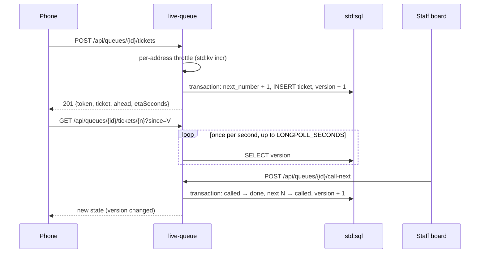

# Live queue

This tutorial deploys `live-queue`, an electronic queue like the ticket machine at a passport office, without the
machine. People take a numbered ticket on their phone and watch their place and estimated wait update live; staff
call the next people from a board; a TV page shows who is being served. It is for developers who want to see how a
service can serve its own pages and keep them live with long polling, without WebSockets
([WebSockets and durable objects](../guides/websockets.md) covers the other way).

<span class="rt-badge rt-badge--deno">Deno</span>

## What you build

| Page | Who | What |
|---|---|---|
| `/` | anyone | Landing page: enter a queue code |
| `/q/{id}` | people | Queue status and a "Take a ticket" button |
| `/q/{id}/ticket?n=12` | the ticket holder | Big number, people ahead, ETA, live updates, vibration and an optional notification when called, "Leave the queue" |
| `/q/{id}/screen` | TV | Now serving (number and counter), people waiting |
| `/admin` | staff | Sign in, open a queue, list queues |
| `/admin/q/{id}` | staff | Call next N at a counter, done, no-show, pause, waiting list, stats |

Behind the pages is a JSON API under `/api/queues`. Ticket states are `waiting → called → done`,
`waiting|called → skipped` (staff) and `waiting|called → cancelled` (the person).

**Why it fits the runtime.** Every page and API call is a short request against the service's own SQLite database.
Numbering under concurrency is one SQL transaction. Live updates use long-polling: a request waits, using almost no
CPU, until the queue changes, always inside the task's wall limit. Busy capacity queues requests instead of
rejecting them, so a crowd of open ticket pages slows down rather than failing.

## Architecture



Every change to a queue or its tickets increments the queue's `version`. A client sends the last version it saw as
`?since=V`; the server answers as soon as the version differs, or after `LONGPOLL_SECONDS` without a change.

## Prerequisites

- A running node and a tenant key in `RT_KEY` (see [First run](../getting-started/first-run.md)).
- `21ci` (see [Install](../getting-started/install.md)), or `bash`, `curl` and `jq` for `sample/scripts/*.sh`.

| Name | Kind | Meaning |
|---|---|---|
| `ADMIN_TOKEN` | secret | Staff token for the API and the admin pages (at least 16 characters) |
| `LONGPOLL_SECONDS` | env | How long a request waits for a change: 0-25, default 20. `0` turns long-polling off and clients poll every 3 s |
| `THROTTLE_PER_MINUTE` | env | Tickets one client address may take per minute, default 30; `0` turns the throttle off |

Staff send the admin token as `Authorization: Bearer …`, which reaches the service unchanged. The platform removes
that header only when it carries one of its own tenant keys (`Bearer rtk_…`), so never use a tenant key as
`ADMIN_TOKEN`.

## Deploy it

=== "21ci"

    ```bash
    cd sample/apps/live-queue
    21ci push src --service live-queue --create --wait
    ADMIN=$(openssl rand -hex 24); printf %s "$ADMIN" | 21ci secret set live-queue ADMIN_TOKEN
    21ci env set live-queue LONGPOLL_SECONDS=20 THROTTLE_PER_MINUTE=30   # optional, the defaults
    ```

=== "curl"

    ```bash
    cd sample/apps/live-queue
    RT_COMPILE=eager ../../scripts/deploy.sh src live-queue
    SVC=$(../../scripts/svc-id.sh live-queue)
    ADMIN=$(openssl rand -hex 24)
    jq -nc --arg v "$ADMIN" '{value: $v}' | curl -sS -X PUT -H "Authorization: Bearer $RT_KEY" \
      -H 'Content-Type: application/json' --data-binary @- "$RT_API/v1/services/$SVC/secrets/ADMIN_TOKEN"
    curl -sS -X PUT -H "Authorization: Bearer $RT_KEY" -H 'Content-Type: application/json' \
      -d '{"LONGPOLL_SECONDS": "20", "THROTTLE_PER_MINUTE": "30"}' "$RT_API/v1/services/$SVC/env"
    ```

Open `http://127.0.0.1:8080/s/live-queue/admin`, sign in with the token, open a queue and share its link
(`…/s/live-queue/q/<id>`, for example as a QR code at the door). Put `…/q/<id>/screen` on a TV.

Or drive it with the API:

```bash
B=http://127.0.0.1:8080/s/live-queue
curl -sS -X POST $B/api/queues -H "Authorization: Bearer $ADMIN" -H 'Content-Type: application/json' -d '{"name": "Window 3"}'
curl -sS -X POST $B/api/queues/$Q/tickets -H 'Content-Type: application/json' -d '{"name": "Ada"}'     # returns a token
curl -sS "$B/api/queues/$Q/tickets/1?since=0" -H "X-Ticket-Token: $T"
curl -sS -X POST $B/api/queues/$Q/call-next -H "Authorization: Bearer $ADMIN" -H 'Content-Type: application/json' \
  -d '{"count": 2, "counter": "window 3"}'
```

| Method and path | Auth | Answer |
|---|---|---|
| `POST /api/queues` | admin | body `{name, minutesPerPerson?: 3, maxWaiting?: 500}` → `201 {queue, links}` |
| `GET /api/queues` | admin | `{queues: [{id, name, status, waiting, createdAt}]}` |
| `GET /api/queues/{id}?since=V` | none | queue summary (long-poll) |
| `POST /api/queues/{id}/tickets` | none | `201 {token, queue, ticket, ahead, etaSeconds}`; `409 queue_paused` / `queue_full`; `429 rate_limited` with `Retry-After` |
| `GET /api/queues/{id}/tickets/{n}?since=V` | `X-Ticket-Token` | ticket view (long-poll) |
| `DELETE /api/queues/{id}/tickets/{n}` | `X-Ticket-Token` | leave the queue |
| `GET /api/queues/{id}/board?since=V` | admin | `{queue, called, waitingList, stats}` (long-poll) |
| `POST /api/queues/{id}/call-next` | admin | body `{count?: 1-20, counter?: "1"}` → board plus `calledNow` |
| `POST /api/queues/{id}/tickets/{n}/done`, `/skip` | admin | board; `409 invalid_state` |
| `POST /api/queues/{id}/pause`, `/resume` | admin | board |

## How the code works

`src/main.ts` holds the handler, SQL and long-polling; `src/queue.ts` the pure logic (ids, validation, ETA);
`src/pages.ts` the HTML pages and their client script; `src/throttle.ts` the per-address throttle; `src/http.ts`
JSON and auth helpers.

### Schema and the version counter

```ts title="src/main.ts"
--8<-- "sample/apps/live-queue/src/main.ts:64:92"
```

`queues.version` is the heart of the live updates: every write that changes what a page shows increments it.
`bump` is a ready-made statement for `sql.batch`, so a status change and the version increment commit together.

### Gap-free numbering in a transaction

```ts title="src/main.ts"
--8<-- "sample/apps/live-queue/src/main.ts:258:286"
```

Reading `next_number`, advancing it and inserting the ticket happen in one `sql.transaction`. SQLite has one writer
per database, so two people pressing the button at the same moment can never get the same number. The ticket token
(`lqt_` plus 24 random bytes) is returned once; only its SHA-256 is stored.

Before the transaction, the route counts the request against the client address's budget for this minute:

```ts title="src/main.ts"
--8<-- "sample/apps/live-queue/src/main.ts:439:444"
```

`throttle` (in `src/throttle.ts`, the same module as in [Event sign-ups](events.md#a-per-address-throttle-with-kvincr))
calls `kv.incr` on a key built from `ctx.client.ip` and the current minute. `kv.incr` is atomic, so parallel takes
cannot slip past the limit. The address is the one the platform resolved behind `ingress.trusted_proxies`, and a
client cannot spoof it. People on the venue's Wi-Fi share one address, hence the generous default of 30.

### One read batch per view

Each view (queue summary, ticket, staff board) is loaded with one `sql.batch(…, "read")`: one round trip and one
consistent snapshot, so "people ahead" and "now serving" never disagree:

```ts title="src/main.ts"
--8<-- "sample/apps/live-queue/src/main.ts:101:132"
  // … build the view from the results …
```

### Long-polling inside the wall limit

```ts title="src/main.ts"
--8<-- "sample/apps/live-queue/src/main.ts:193:211"
```

- The loop does one cheap indexed read per second and sleeps in between. The clock in a Deno task advances across
  awaited timers, so `Date.now()` measures the wait correctly.
- The wait ends at `LONGPOLL_SECONDS` (at most 25) or 3 seconds before `ctx.deadline`, whichever comes first. HTTP
  tasks have a 30 s wall limit by default, so a long-poll can never be killed by the runtime's timeout.
- Without `since`, or with a stale value, the answer is immediate.

The ticket endpoint checks the token before it waits, so a guessed token cannot hold a request open:

```ts title="src/main.ts"
--8<-- "sample/apps/live-queue/src/main.ts:299:308"
```

On the client, every page runs the same `follow` loop: send the last version, render the answer, repeat. If the
server answered at once with an unchanged version (long-polling turned off), it waits 3 seconds; on network errors
it backs off up to 30 seconds:

```js title="src/pages.ts (client script)"
--8<-- "sample/apps/live-queue/src/pages.ts:129:147"
```

### Calling the next people

```ts title="src/main.ts"
--8<-- "sample/apps/live-queue/src/main.ts:336:369"
```

In one transaction, whoever this counter called before is marked done, the next `count` waiting tickets are called
to this counter, a row is added to `calls` and the version is bumped. Every waiting long-poll wakes up within a
second.

### ETA from real throughput

```ts title="src/queue.ts"
--8<-- "sample/apps/live-queue/src/queue.ts:79:98"
```

The estimate uses the calls of the last hour: the time from the first to the last call divided by the people
admitted after the first one. That works for one counter or several, and for "call next 3" as well as one at a
time. Until there are two calls, the queue's own `minutesPerPerson` is used.

### Pages served by the service

The pages are static HTML. The only server-side input is a small JSON config (`base`, `qid`) in a non-executable
`<script type="application/json">`; names are loaded with `fetch` and written with `textContent`. Scripts and styles
carry a per-response nonce, and the Content Security Policy blocks everything else:

```ts title="src/pages.ts"
--8<-- "sample/apps/live-queue/src/pages.ts:8:33"
```

The runtime strips `/s/{slug}` from the path and passes the prefix in the `x-rt-base-path` header. `sanitizeBase`
accepts only the shape the runtime can send, and every link and `fetch` on the page is built from it. On a
[custom domain](../guides/custom-domains.md) the header is absent and `base` is `""`, so the same pages work there.

```ts title="src/main.ts"
--8<-- "sample/apps/live-queue/src/main.ts:395:419"

--8<-- "sample/apps/live-queue/src/main.ts:462:477"
```

## Test it

**Unit tests.** `test/queue.test.ts` covers queue ids and ticket tokens, the seconds-per-person estimate (fallback,
one counter, batches, the one-hour window, clamping), `etaSeconds`, input validation, base-path handling, JSON
escaping in pages, the CSP, and checks that every page's inline script parses and carries the nonce.
`test/throttle.test.ts` covers the throttle with a fake `incr`: budgets per address and minute, IPv6 /64 buckets,
and the cases where it lets requests through.

```bash
cd sample/apps/live-queue
node --test test/*.test.ts   # Node >= 22.18, or: deno test
```

**Smoke test.** `smoke.sh` deploys `live-queue-smoke` with `LONGPOLL_SECONDS=6` and checks every page (HTML with a
nonce CSP), five parallel ticket takes (they must get 1 to 5), ticket tokens, a long-poll that wakes up when staff
call the next two, call/skip/done/leave, pause and resume, the board stats, an idle long-poll that answers after
about `LONGPOLL_SECONDS`, and the throttle: with `THROTTLE_PER_MINUTE=10` it takes tickets until one is answered
`429 rate_limited` with a `Retry-After`, and checks that reads are not throttled.

```bash
RT_API=http://127.0.0.1:8081 RT_INVOKE=http://127.0.0.1:8080 RT_KEY=rtk_… ./smoke.sh
```

## Notes and limits

- **Long-polling costs a task slot.** Each open ticket page holds one in-flight task for up to `LONGPOLL_SECONDS`. It
  uses almost no CPU, but it counts against the service's concurrency. The runtime queues requests above the
  adaptive limit instead of rejecting them (up to `scaling.max_queued`, then `503 overloaded`). For a large crowd,
  raise `scaling.max_instances`, lower `LONGPOLL_SECONDS`, or set it to `0` so clients poll every 3 seconds. See
  [Scheduler](../concepts/scheduler.md).
- Long polling is the live channel here: it needs nothing but HTTP and works through any proxy. A WebSocket version
  would hold the boards' sockets in one durable object per queue and broadcast each change
  ([WebSockets and durable objects](../guides/websockets.md)).
- Taking tickets is public. `maxWaiting` caps a queue (default 500) and `THROTTLE_PER_MINUTE` caps each client
  address. The throttle is a fixed window, so up to twice the limit fits across a minute boundary, and a KV failure
  lets the request through (logged). Keep an ingress rate limit as the global cap on public deployments
  (`21ci service update live-queue --set ingress.rate_limit.rps=5 --set ingress.rate_limit.burst=20`, or
  `{"ingress": {"rate_limit": {"rps": 5, "burst": 20}}}` with `PATCH /v1/services/{id}`).
- The ticket token is kept in `localStorage` and also passed once in the URL fragment (never sent to the server), so
  the ticket page still works when storage is off. The admin token stays in `sessionStorage` for that tab only.

## Ideas to extend it

- Send an SMS or a Telegram message when a ticket is called, from a queue message so the board stays fast.
- Add appointment slots: an interval schedule that opens tomorrow's queue every evening.
- Export daily stats (served, skipped, average wait) to CSV, streamed like the [events](events.md) export.
- Serve the pages from a custom domain such as `queue.example.com` instead of `/s/live-queue`.

## Where the code lives

`sample/apps/live-queue/` in the runtime repository: `src/` (the service and its pages), `test/` (unit tests),
`smoke.sh` and a README.

## See also

- [Execution](../concepts/execution.md): isolates, wall and CPU limits, the frozen clock
- [Limits](../reference/limits.md)
- [Deno services](../guides/deno.md)
