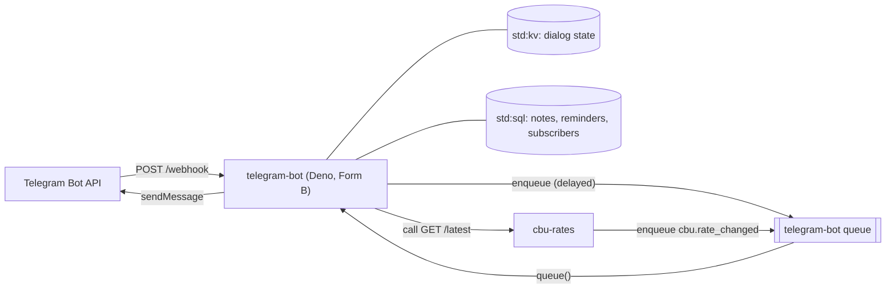

# Telegram bot

This tutorial deploys a Telegram bot that keeps notes and reminders for each chat and sends alerts when the
Central Bank of Uzbekistan changes its exchange rates. It is written for developers who want to see how a
webhook-driven, stateful service fits a runtime that keeps no state between requests.

<span class="rt-badge rt-badge--deno">Deno</span>

## What you build

A bot that answers these commands:

| Command | What it does |
|---|---|
| `/note` → text | Saves a note. `/note buy milk` saves at once |
| `/notes`, `/delnote <id>` | Lists the last 10 notes, deletes one |
| `/remind` → text → time → yes/no | Sets a reminder. `/remind 2h 30m call mom` skips the dialog |
| `/reminders`, `/unremind <id>` | Lists pending reminders, cancels one |
| `/rates` | Current rates, fetched from the [`cbu-rates`](cbu-rates.md) service |
| `/subscribe`, `/unsubscribe` | Turns rate change alerts on or off |
| `/cancel` | Ends the current dialog (any other command ends it too) |

Times such as `10m`, `in 2 hours`, `18:30`, `tomorrow 9:00` or `31.12.2026 23:00` are read in one fixed UTC offset,
`BOT_TZ_OFFSET_MINUTES` (default `300`, Tashkent).

**Why it fits the runtime.** A webhook bot is a stream of short HTTP requests, one per Telegram update, so it needs
no long-running process. By default each request runs in a fresh isolate (a reused one is only a cache), so the
dialog state lives in `std:kv` and the data in `std:sql`. Reminders are delayed queue messages to the bot itself, so there is no cron daemon to run. Retries, backoff
and the dead-letter queue come with the queue trigger, and the bot token stays in a write-only secret.

## Architecture



1. Telegram posts each update to `POST /webhook` with a secret header. The bot checks it in constant time.
2. The bot claims the `update_id` in SQL, so a re-delivered update is answered `200` without doing anything.
3. It loads the chat's dialog state from KV, runs a pure state machine, applies the resulting effect (a note, a
   reminder, a subscription) and replies through the Bot API.
4. A reminder is a queue message to the bot itself, delayed until the reminder is due.
5. `cbu-rates` enqueues a `cbu.rate_changed` message when a rate moves. The bot fans it out as one `send` message
   per subscriber.

## Prerequisites

- A running node and a tenant key in `RT_KEY` (see [First run](../getting-started/first-run.md)). A key created with
  the default scopes works; the scripts need `services:read`, `services:write`, `deploy`, `env:write`,
  `secrets:write`, and `queue:write` for the smoke test.
- `21ci` (see [Install](../getting-started/install.md)), or `bash`, `curl` and `jq` for `sample/scripts/*.sh`.
- A bot token from [@BotFather](https://t.me/BotFather).
- A public `https://` URL for the node's invoke listener. Telegram only calls `https://` URLs on ports 443, 80, 88 or
  8443, so put the public listener (`:8080`) behind a TLS proxy, or map a [custom domain](../guides/custom-domains.md)
  to the service.

The bot reads these settings:

| Name | Kind | Meaning |
|---|---|---|
| `TELEGRAM_BOT_TOKEN` | secret | Bot API token from BotFather |
| `TELEGRAM_WEBHOOK_SECRET` | secret | 16-256 characters of `A-Za-z0-9_-`; Telegram sends it back in `X-Telegram-Bot-Api-Secret-Token` |
| `ADMIN_TOKEN` | secret | Bearer token for `/setup`, `/status` and `/admin/outbox` (at least 16 characters; not a tenant key, since the platform removes `Authorization: Bearer rtk_…`) |
| `PUBLIC_URL` | env | Public base URL of the service; the webhook is `PUBLIC_URL/webhook` |
| `BOT_TZ_OFFSET_MINUTES` | env | Users' UTC offset in minutes (default `300`) |
| `RATES_SERVICE` | env | Slug of the rates service (default `cbu-rates`) |
| `TELEGRAM_DRY_RUN` | env | `1` records Bot API calls in an outbox table instead of sending them |
| `SELF_SLUG` | env | Own slug for self-enqueues, a fallback for older nodes that leave `ctx.service.slug` empty |

## Deploy it

### 1. Push the code and set the secrets

The source is the `src/` directory. Without an `rt.json`, the CLI and `deploy.sh` bundle every source file and pick
`main.ts` as the entry.

=== "21ci"

    ```bash
    cd sample/apps/telegram-bot
    21ci push src --service telegram-bot --create --wait

    printf %s "$BOT_TOKEN"   | 21ci secret set telegram-bot TELEGRAM_BOT_TOKEN
    SECRET=$(openssl rand -hex 24)
    printf %s "$SECRET"      | 21ci secret set telegram-bot TELEGRAM_WEBHOOK_SECRET
    ADMIN=$(openssl rand -hex 24)
    printf %s "$ADMIN"       | 21ci secret set telegram-bot ADMIN_TOKEN
    21ci env set telegram-bot PUBLIC_URL=https://fn.example.com/s/telegram-bot BOT_TZ_OFFSET_MINUTES=300
    ```

=== "curl"

    ```bash
    cd sample/apps/telegram-bot
    RT_COMPILE=eager ../../scripts/deploy.sh src telegram-bot     # create if missing, upload, activate
    SVC=$(../../scripts/svc-id.sh telegram-bot)

    put_secret() {  # NAME VALUE
      jq -nc --arg v "$2" '{value: $v}' | curl -sS -X PUT -H "Authorization: Bearer $RT_KEY" \
        -H 'Content-Type: application/json' --data-binary @- "$RT_API/v1/services/$SVC/secrets/$1"
    }
    SECRET=$(openssl rand -hex 24)
    ADMIN=$(openssl rand -hex 24)
    put_secret TELEGRAM_BOT_TOKEN "$BOT_TOKEN"
    put_secret TELEGRAM_WEBHOOK_SECRET "$SECRET"
    put_secret ADMIN_TOKEN "$ADMIN"

    # PUT replaces the whole env map
    curl -sS -X PUT -H "Authorization: Bearer $RT_KEY" -H 'Content-Type: application/json' \
      -d '{"PUBLIC_URL": "https://fn.example.com/s/telegram-bot", "BOT_TZ_OFFSET_MINUTES": "300"}' \
      "$RT_API/v1/services/$SVC/env"
    ```

Keep `$ADMIN` and `$SECRET`: you need them for the admin routes and for testing the webhook by hand, and secrets are
write-only, so you cannot read them back later. Secrets and env changes apply to the next task, so there is no
redeploy.

### 2. Register the webhook

`POST /setup` calls the Bot API's `getMe`, `setWebhook` (with your secret token and `allowed_updates: ["message"]`)
and `setMyCommands`. `GET /status` shows Telegram's `getWebhookInfo` plus counters.

```bash
B=https://fn.example.com/s/telegram-bot
curl -sS -X POST -H "Authorization: Bearer $ADMIN" $B/setup
curl -sS -H "Authorization: Bearer $ADMIN" $B/status
```

`/setup` takes an optional body `{"url": "https://…", "dropPendingUpdates": true}` when the webhook URL is not
`PUBLIC_URL/webhook`. Open the bot in Telegram and send `/help`.

### 3. Connect the rates service (optional)

Deploy [`cbu-rates`](cbu-rates.md) in the same tenant, project and environment, then point it at the bot:

```bash
21ci env set cbu-rates NOTIFY_SERVICE=telegram-bot NOTIFY_CCYS=USD,EUR,RUB
```

`/rates` calls the service named by `RATES_SERVICE` (default `cbu-rates`). Calls and enqueues between services are
admitted by the target's environment and caller list, see [Calls and queues](../guides/calls-and-queues.md).

### Try it without Telegram

With `TELEGRAM_DRY_RUN=1` the bot records Bot API calls in an outbox table instead of sending them, so you can post
updates yourself and read what the bot would have answered. Turn it on with
`21ci env set telegram-bot TELEGRAM_DRY_RUN=1` (with curl, add `"TELEGRAM_DRY_RUN": "1"` to the env map: `PUT`
replaces the whole map), then:

```bash
B=http://127.0.0.1:8080/s/telegram-bot
curl -sS -X POST $B/webhook -H "X-Telegram-Bot-Api-Secret-Token: $SECRET" -H 'Content-Type: application/json' \
  -d '{"update_id": 1001, "message": {"message_id": 1, "date": 0, "chat": {"id": 42, "type": "private"}, "text": "/note buy milk"}}'
curl -sS "$B/admin/outbox?chat_id=42" -H "Authorization: Bearer $ADMIN"
```

## How the code works

The service has four source files: `main.ts` (handlers and I/O), `bot.ts` (the conversation logic, pure functions),
`telegram.ts` (update parsing and a small Bot API client) and `http.ts` (JSON and auth helpers). Only `main.ts`
imports `std:*` modules, so the other files run under `node --test` as they are.

### One module, two triggers

The default export is an object (Form B). `fetch` handles HTTP; `queue` receives batches of queue messages. There is
no `scheduled`: reminders do not need a schedule.

```ts title="src/main.ts"
--8<-- "sample/apps/telegram-bot/src/main.ts:468:474"
      // … the other routes …

--8<-- "sample/apps/telegram-bot/src/main.ts:503:530"
```

A message the handler does not `retry()` is acknowledged when the handler returns. `m.retry()` without options uses
the runtime backoff and moves the message to the dead-letter queue after `queue.max_attempts`. A Telegram `429`
carries `retry_after`, which becomes `retry({delaySeconds})`.

### The webhook: authenticate, then claim the update

```ts title="src/main.ts"
--8<-- "sample/apps/telegram-bot/src/main.ts:138:174"
```

- `safeEqual` hashes both strings with SHA-256 and compares every byte, so the comparison time depends on neither
  the content nor the length of the secret.
- Telegram re-delivers an update until it gets a `2xx`. `INSERT OR IGNORE` on the `update_id` primary key is an
  atomic claim: a second delivery sees `rowsAffected === 0` and is answered `200 {duplicate: true}`.
- If anything fails, the handler deletes the claim and answers `500`, so Telegram's retry processes the update again.
  Notes and reminders are keyed by `(chat_id, source_update)`, which makes the retry safe.

### Dialog state in KV

Each chat has at most one dialog in progress, stored under `fsm/<chat id>` with a one-hour TTL, so an abandoned
dialog expires on its own:

```ts title="src/main.ts"
--8<-- "sample/apps/telegram-bot/src/main.ts:176:194"
```

`kv.getMany` reads the state and the bot's username in one call. The new state is written only after the reply was
sent: when `sendMessage` fails, the update is retried and replays the same transition.

### A pure state machine

`transition` takes the current state, the message text and the environment (time, offset, chat type) and returns
the next state plus either a reply or an effect. It does no I/O, so every dialog path is a unit test:

```ts title="src/bot.ts"
--8<-- "sample/apps/telegram-bot/src/bot.ts:18:40"

--8<-- "sample/apps/telegram-bot/src/bot.ts:112:157"
```

`isState` validates whatever comes back from KV before it is used, because a stored state may come from an older
version of the bot.

### Reminders are delayed messages to yourself

Creating a reminder stores a row and enqueues a message to the bot's own queue, delayed until the reminder is due:

```ts title="src/main.ts"
--8<-- "sample/apps/telegram-bot/src/main.ts:245:264"
```

- `delaySeconds` can be at most 7 days, which is why the bot refuses reminders further ahead.
- `dedupId: "rem:<id>"` makes a retried update enqueue the message once: the same `dedupId` within 24 hours is
  delivered once.
- `selfSlug(ctx)` is `ctx.service.slug`, with `SELF_SLUG` and `telegram-bot` as fallbacks for older nodes that left
  the slug empty.

When the message arrives, the `queue` handler sends the reminder unless it was cancelled meanwhile:

```ts title="src/main.ts"
--8<-- "sample/apps/telegram-bot/src/main.ts:341:362"
```

A message that arrives early (for example after a dead-letter redrive) is pushed back with `retry({delaySeconds})`.
Delivery is at least once: a crash between `sendMessage` and the status update can send a reminder twice.

### Rate alerts: fan-out through the queue

`cbu-rates` enqueues one `cbu.rate_changed` message per change. The bot turns it into one `send` message per
subscriber, so every chat is retried on its own and one slow chat does not hold up the rest:

```ts title="src/main.ts"
--8<-- "sample/apps/telegram-bot/src/main.ts:364:388"
```

Subscribers are read in pages of 500. When less than 20 seconds of the task's wall time are left
(`ctx.deadline`), the handler enqueues a continuation message that starts after the last chat id, and acknowledges
the current one. The `dedupId`s keep both the per-chat sends and the continuation idempotent.

### Calling another service

`/rates` asks `cbu-rates` in-process with `std:services`. Only the path and query of the `Request` are used, so the
host part of the URL does not matter:

```ts title="src/main.ts"
--8<-- "sample/apps/telegram-bot/src/main.ts:298:313"
```

`call` throws for a missing service or a refused call (`not_found`, `call_not_allowed`, …); a failing child returns a
`5xx` response instead. The bot handles both and answers politely.

### Read-first schema creation

Every task may be the first one on a fresh database, so the handler checks for the schema before using it. It
reads first and writes the `CREATE` batch only when the last index is missing, so ordinary requests never take the
write lock for DDL:

```ts title="src/main.ts"
--8<-- "sample/apps/telegram-bot/src/main.ts:99:124"
```

### The Bot API client and dry-run mode

```ts title="src/telegram.ts"
--8<-- "sample/apps/telegram-bot/src/telegram.ts:97:131"
```

The token is part of the Bot API URL, so the code never logs URLs or requests. A `10 s` `AbortController` timeout
keeps a slow Bot API from eating the task's wall time. In dry-run mode the client records the call and returns a
canned result.

## Test it

**Unit tests.** `test/bot.test.ts` covers command parsing, time parsing in the user's offset, both dialogs, quick
forms, range checks, `/cancel`, group-chat silence, KV state validation and the rate message format.
`test/telegram.test.ts` covers update parsing, secret token rules, the dry-run client, `retry_after` and the
"permanent" error flag, constant-time comparison and the body size limit.

```bash
cd sample/apps/telegram-bot
node --test test/*.test.ts        # Node >= 22.18 (type stripping); or: deno test
```

**Smoke test.** `smoke.sh` deploys the bot as `telegram-bot-smoke` in dry-run mode, so it needs no bot token, and
walks through setup, webhook authentication, `update_id` dedupe, both dialogs, subscriptions and the queue fan-out
(it enqueues a `cbu.rate_changed` message through the control API and waits for the alert in the outbox):

```bash
RT_API=http://127.0.0.1:8081 RT_INVOKE=http://127.0.0.1:8080 RT_KEY=rtk_… ./smoke.sh
SMOKE_SLOW=1 ./smoke.sh       # also waits about 70 s for a reminder to fire
SMOKE_CLEANUP=1 ./smoke.sh    # deletes the service at the end
```

See [Running the smoke tests](index.md#run-the-smoke-tests) for the shared helpers.

## Notes and limits

- Reminders are limited to 7 days ahead (the queue's maximum delay) and to 50 pending per chat; notes to 1,000 per
  chat.
- Message text is plain (no `parse_mode`), so user input never needs escaping. Replies are clipped to Telegram's
  4,096 characters.
- Chats that blocked the bot are unsubscribed on the next alert. Errors that retrying cannot fix (`403`, chat not
  found) are not retried.
- The `updates` dedupe table drops entries older than 3 days whenever an update id is a multiple of 100.

## Ideas to extend it

- Add a `scheduled` handler and a daily schedule that sends each subscriber a morning summary.
- Store per-chat time zones in SQL instead of one `BOT_TZ_OFFSET_MINUTES`.
- Accept photos and keep them in `std:blob` next to the notes.
- Add inline keyboards for the yes/no step; `transition` stays the same, only the reply format changes.

## Where the code lives

`sample/apps/telegram-bot/` in the runtime repository: `src/` (the service), `test/` (unit tests), `smoke.sh` and a
README.

## See also

- [Calls and queues](../guides/calls-and-queues.md): `enqueue`, delays, dedupe, DLQ and service calls
- [Deno services](../guides/deno.md): handler forms, `ctx`, env and secrets
- [Guest API reference](../reference/guest-api.md): `std:kv`, `std:sql`, `std:queue`, `std:services`
- [`21ci secret`](../cli.md#secret), [`21ci queue`](../cli.md#queue)
